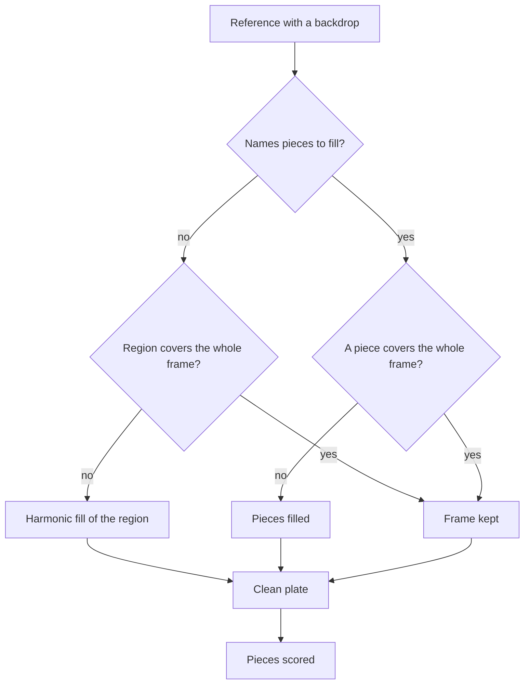

# Parity clean plate

An interface drawn over a scene is compared over the scene's own colour, not over the game's interface.

- **An interface over a scene is compared over the reference's clean plate.** A reference with `isBackdrop` has a plate drawn behind the screen: its own frame, or with a `plateSource` the screenshot beside it, with its scored region filled from the pixels around it, the harmonic fill of Laplace's equation inside the region with its one-pixel ring as the boundary (`scripts/src/services/recreation/image/fillRegionHarmonically.ts`, `scripts/src/services/genshinParity/reference/compareScreen.ts`), cached beside the reference by its hash and region (`scripts/src/services/genshinParity/reference/getCleanPlatePath.ts`). The game's interface inside the region is gone, so the world's low-frequency colour stays roughly right behind it and every drawn piece is scored against what is really there. The backdrop is not the frame itself: the frame would score a render drawing nothing near 0%, so each piece could only add error and the score would reward drawing less. A reference whose region covers the whole frame has no border to fill from, so it keeps its frame, unless it names the pieces to fill instead (`plate`): each is filled from the pixels around it in turn and the world between them stays the frame's own, so a screen laid over the whole frame is scored whole, every piece over what lies behind it (`scripts/src/services/genshinParity/shared/ParityReferenceMap.ts`). The Settings screen is scored this way ([Paimon menu](../../paimon-menu/design.md)) (`scripts/src/services/genshinParity/shared/ParityReferenceMap.ts`, `MENU_SETTINGS_REFERENCE`). Glass the interface draws translucent (the prompt band) lands on the reference's own glass and darkens twice, so its colour is solved from the scene around it, and the score holds its opaque pieces and every placement (see Open). The login's interface reaches under one percent on the title, door and loading stages this way, and 3.16% on the mainland rating, the rest being the older build's build string and repair button (see Open).

## Key files

| File                                                                | Role                                                                                                                                             |
| :------------------------------------------------------------------ | :----------------------------------------------------------------------------------------------------------------------------------------------- |
| `scripts/src/services/recreation/image/fillRegionHarmonically.ts`   | The harmonic fill of a region from its one-pixel ring, the pure function a clean plate is made of                                                |
| `scripts/src/services/genshinParity/reference/getCleanPlatePath.ts` | A reference's clean plate, each of its regions filled in turn and cached beside it by its hash and regions; none for a region covering the frame |

## Open

- [ ] **Translucent glass's colour is solved from the scene around it** — no source yet: no solver for translucent glass was found under `scripts/src/services/genshinParity` or `scripts/src/services/recreation`.
- [ ] **The login's interface reaches a few tenths of a percent on each stage** — no source yet: no committed score report for the login's stages was found in the repository or in `{data-root}/genshin-parity/comparisons/`. Raised: the committed `scripts/src/services/genshinParity/shared/ParityReferenceMap.snapshot.md` holds those rows (lines 62 to 67, mean difference column): title 0.36%, door 0.76%, door-mainland 0.67%, loading 0.28%, and mainland-rating 3.16%. The mainland rating is 3.16%, not a few tenths, and the door is under one percent but not a few tenths either, so the claim does not hold as written for those two rows.
