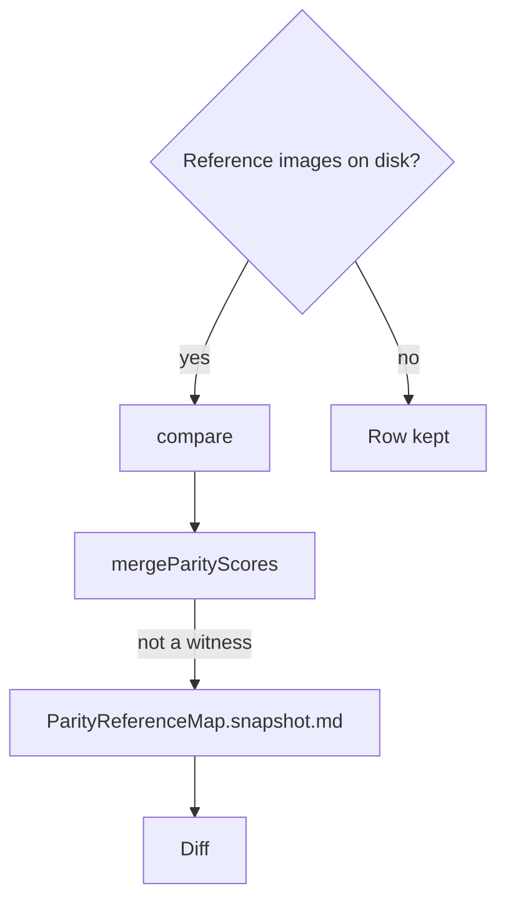

# Parity comparison

`compare` shoots a screen and scores it against its reference. The scores are the record a change is judged by.

- **The comparison is numbers first.** `compare` shoots the screen in the machine's own Edge at 1080 CSS pixels high, scaled to the reference's pixel size. It prints the mean difference and a six-by-six grid of per-cell differences, then writes reference, ours and their difference side by side (`scripts/src/services/genshinParity/reference/compareScreen.ts`, `scripts/src/services/genshinParity/shared/shootScreen.ts`, `scripts/src/services/genshinParity/commands/compareCommand.ts`). A cell that stands out says where to zoom. It prints two scores beside them for a scene, which is rebuilt from shapes rather than copied and so never matches pixel for pixel: the shape, as the share of edges each image has where the other has one too, and the tone, as the difference of their colours blurred past any texture (`scripts/src/services/genshinParity/reference/scoreStructure.ts`). A reference can hand its screen props of its own, so one screen is judged in each state a reference shows, such as a scene at each time of day (`scripts/src/services/genshinParity/shared/ParityReferenceMap.ts`).

- **A reference scores its own pixels.** Its `region` is the part scored, its `mask` the rectangles inside the region that count, and its `silhouettes` the glyphs inside it whose strokes alone count, so a map's name scores its letters and never the painted terrain between them. Each glyph is split from its ground in the reference's own pixels, every pixel going to the nearer of the glyph's colour, read off its strokes, and the ground's colour, the median of the region's pixels outside every silhouette (`computeGroundColour`, read once per reference by `readSilhouetteInks`, then `splitGlyph`) (`scripts/src/services/genshinParity/shared/computeGroundColour.ts`, `scripts/src/services/genshinParity/reference/readSilhouetteInks.ts`, `scripts/src/services/genshinParity/shared/splitGlyph.ts`). Splitting from the colour at a box's corners, as `trace` splits a mark on a plain ground, would take a map's water for ink, since water stands further from the terrain than a white name does. A box whose glyph covers more than half of it would take that glyph's ink for ground under the whole-box median, and under the median of its border ring too (measured on the committed Jueyun label: most of its box near the glyph's colour, and most of its ring; see Open), so the ground is the terrain between the glyphs. The gate is re-measured by `genshin:parity compare` against the reference's screenshots, not by this page.

- **The approval measure is the one a reference records.** The mean difference is the default (`DEFAULT_APPROVAL`, `scripts/src/services/genshinParity/reference/constants.ts`); FLIP applies where a reference records it. NVIDIA's standard dynamic range FLIP is ported as it stands (`scoreFlip`): contrast-sensitivity filtering in YCxCz at the viewing distance's pixels per degree, the HyAB distance in Hunt-adjusted CIELab, and the luminance's edges and points, each pixel's error the colour difference raised to one less the feature difference. Its test holds it to NVIDIA's own evaluator on FLIP's example pair (`scripts/src/services/genshinParity/shared/scoreFlip.ts`, `scripts/src/services/genshinParity/shared/scoreFlip.test.ts`). `compare` reports it beside the mean, read at the structure's width as on a full screen (`scripts/src/services/genshinParity/reference/compareScreen.ts`). With `--witness`, `compare` also scores each layer apart (`scoreLayers`): a family's pixels in the witness's part target, and the sky where no part is, each with its own shape, tone, detail and mean FLIP, so a change is judged where it lands (`scripts/src/services/genshinParity/reference/scoreLayers.ts`). `rank` then prices each term of the frame's error, each stand-in against the exports among them (`scripts/src/services/genshinParity/commands/rankCommand.ts`).

- **The scores are committed, as a bench's are.** Every `compare` rewrites its reference's row of `scripts/src/services/genshinParity/shared/ParityReferenceMap.snapshot.md`, beside the map, and `compare --all` rewrites every row it can measure (`scripts/src/services/genshinParity/shared/ParityReferenceMap.snapshot.md`, `scripts/src/services/genshinParity/reference/mergeParityScores.ts`). A single reference's compare is a subset run: it rewrites only its own rows and keeps every other row where and as it was. `compare --all` is the one full run (`scripts/src/services/genshinParity/commands/compareCommand.ts`), and the only one that drops a row, of a reference the map no longer names (`scripts/src/services/genshinParity/reference/writeParityScores.ts`). A reference whose images are not on disk yet keeps its row, a pending screen's row names its reason, and one whose comparison throws is reported as `failed` while the run goes on (`scripts/src/services/genshinParity/reference/mergeParityScores.ts`, `scripts/src/services/genshinParity/commands/compareCommand.ts`). A change's diff then shows what it moved on every screen, and the map's test holds every reference to a screen the page shoots (`scripts/src/services/genshinParity/shared/ParityReferenceMap.test.ts`). A scene's reference also rewrites its rows of the report's layers table, so a stand-in drawn away from the game shows on its own row even where the frame's score barely moves (`scripts/src/services/genshinParity/reference/mergeParityScores.ts`).

- **Nothing is measured uncompared.** The visual suite only holds a screen to its own image, a snapshot of our render, so it says nothing about the game. What does is `compare` against a reference in the same language and build, and a test fails for any screen with a fixture that no entry of the map names. A screen with no reference yet is a pending entry with its reason: `compare` skips it, and the report lists it as pending until a reference is recorded (`scripts/src/services/genshinParity/shared/ParityReferenceMap.ts`). A title logo sized from another language's client without a reference would come out nearly twice the size of the English client's, which is why the test exists (see Open). A reference recorded in another language says so in its props (`scripts/src/services/genshinParity/shared/ParityReferenceMap.ts`), and the parity page then gives a screen that shows the game's words that language's text, so the frame is compared in its client's own words (`packages/genshin-world/parity/main.ts`, lines 85 to 88).

## Key files

| File                                                                   | Role                                                                                                                                                                     |
| :--------------------------------------------------------------------- | :----------------------------------------------------------------------------------------------------------------------------------------------------------------------- |
| `scripts/src/services/genshinParity/reference/compareScreen.ts`        | Shoot, score and lay reference, ours and difference side by side, a scene's layers scored apart                                                                          |
| `scripts/src/services/genshinParity/reference/estimateEdgeSigma.ts`    | The Gaussian sigma of one edge read off its profile: the 10% to 90% spread of its rise                                                                                   |
| `scripts/src/services/genshinParity/reference/getReferenceSoftness.ts` | A reference screenshot's blur as a sigma, measured once per file and cached beside the references by its hash, which `compare` blurs our shot by                         |
| `scripts/src/services/genshinParity/reference/measureFrameSoftness.ts` | A screenshot's capture blur: the median sigma of its sharpest interface edges across every row and column                                                                |
| `scripts/src/services/genshinParity/reference/mergeParityScores.ts`    | The report's rows, its layers table and each pending screen's row: a subset run rewrites only its scored references, a full run lists every reference in the map's order |
| `scripts/src/services/genshinParity/reference/readScoredMask.ts`       | The pixels a comparison scores, the mask's rectangles and the silhouettes' strokes, at any raster over the region                                                        |
| `scripts/src/services/genshinParity/shared/splitGlyph.ts`              | A glyph's strokes split from its ground by the nearer of its colour and the ground's colour                                                                              |
| `scripts/src/services/genshinParity/shared/computeGroundColour.ts`     | The ground's colour: the median of a region's pixels outside every silhouette                                                                                            |
| `scripts/src/services/genshinParity/shared/shootScreen.ts`             | The parity page's screen in Edge, over a reference's clean plate when it is a backdrop                                                                                   |

## Open

- [ ] **The Jueyun label's box and ring split** — no source yet: no measurement record for the Jueyun label is in the repository, so the split stands as the page's own.
- [ ] **A title logo sized without a reference would come out nearly twice the size** — no source yet: no commit, snapshot or report records that size.
- [ ] **Splitting from the colour at a box's corners would take a map's water for ink, since water stands further from the terrain than a white name does** — no source yet: no comparison of the corner split on a water region is kept.
