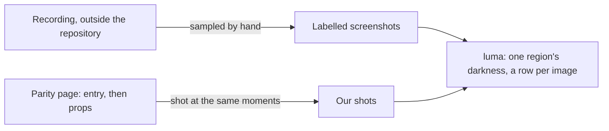

# Parity motion

Motion is matched at the moments a person samples from a recording as labelled screenshots, and the repository never reads the recording.

- **Motion is matched at sampled moments, never by recording.** A recording is downloaded outside the repository, and a person samples labelled screenshots from it there by hand; the repository compares only those screenshots and never reads a recording. Our screen's motion is held at its start on the parity page and shot at the moments its stills are set for. `entry` holds the screen's own animations as it mounts (`packages/genshin-world/parity/main.ts`). `props` lets those finish, then applies the fixture's `motionProps` and holds the transitions they start (`packages/genshin-world/parity/main.ts`); the page starts its props from the fixture's own (`packages/genshin-world/parity/main.ts`, see Open for the still). `luma` prints one region's darkness as a row per image, the sampled screenshots and our shots alike, for the reader to plot (`scripts/src/services/genshinParity/commands/lumaCommand.ts`), and a fade's duration and a wipe's steps are read from that plot. Window capture takes whatever frames the window delivers, up to sixty a second (`scripts/src/services/genshinParity/game/captureGame.ts`); where it delivers fewer, see Open.

## Key files

| File                                                         | Role                                                                       |
| :----------------------------------------------------------- | :------------------------------------------------------------------------- |
| `scripts/src/services/genshinParity/commands/lumaCommand.ts` | Prints one region's darkness as a row per image                            |
| `scripts/src/services/genshinParity/game/captureGame.ts`     | Captures the game's window at up to sixty frames a second                  |
| `packages/genshin-world/parity/main.ts`                      | The parity page's entry, its props and its hold of the screen's animations |

## Open

- [ ] **Window capture takes a frame only when the window changes** — no source yet: `scripts/src/services/genshinParity/game/captureGame.ts` was not traced for frame skipping.
- [ ] **When the window delivers a frame** — no source yet: the ffmpeg gfxcapture section (`{data-root}/cache/ffmpeg/ffmpeg-9.0.2-essentials_build/doc/ffmpeg-filters.html`) gives the rate but not when a frame is sent, and `scripts/src/services/genshinParity/game/captureGame.ts` is repo code, not a source for the timing.
- [ ] **A curve from a window that delivers fewer frames jitters by a frame or two** — no source yet: `captureGame.ts` requests `max_framerate` (`RECORD_FRAME_RATE`, sixty, in `scripts/src/services/genshinParity/game/constants.ts`) and has no fallback for a slower window, so the jitter was not measured; a luma plot of one moment taken at two delivered rates would settle it.
- [ ] **A still and the visual suite show the fixture's first state** — no source yet: `packages/genshin-world/parity/main.ts` starts `props` from `screen.props` and applies `motionProps` only in `props` mode, but how a still is captured and what the visual suite shoots were not traced.
