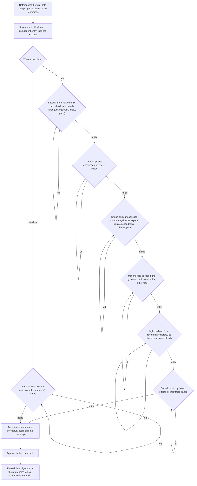

# Parity passes

A new screen, or a new piece of one, is derived in passes, each answering one kind of unknown from its most exact source and judged by its own measure, so every source is found once, recorded where it is used, and never searched for again, and no pass is judged through another's error. Placement, shape, motion and surface come from the game's own data, so they are held against its exports through the witness; a recording's camera, and motion no clip holds, are read off it by the exports' landmarks alone; and only what is set at run time, the display transform, the light, the air and the sounds, is read off a recording's colour. `passes` runs them in order; the measures some passes still lack are the [recreation passes](../../../../changes/genshin-recreation-passes/design.md) proposal.

- **The frame's score is acceptance, not the loop.** A pass is worked on its own measure until it holds, and the frame is compared once every pass before it has; ranking the frame's terms orders the work inside a pass, never across passes, since a later pass's term absorbs an earlier pass's error.

- **`passes` names the next work.** `genshin:parity passes <component>` runs each pass's measure over the references naming the component against its gate. It prints a pass the scene has nothing for as not owed (Motion with no door a clip moves, Audio with no game sound matched to it), runs on past it, stops at the first pass that fails or has no measure yet, and rewrites the component's report `scripts/src/services/genshinParity/passes/snapshots/<component>.snapshot.md`, committed like the scores. Each component has its own report, so two components' passes can run at once. The measures, in order:

- **Inventory.** Each renderer of the exports, a mesh with its materials, against what of the scene claims it in the screen's fixture: a family, a stand-in, or a part named as not drawn yet (`claimWitnessRenderers`), holding once none goes unclaimed. Each component's claims are its own, under its name in the fixture's `witnessComponents`, and the page fails on a name the fixture does not list: the login's, Windrise's and each capital's, so none of a capital's renderers falls to Windrise's families, whose terrain tiles and common ruins the capitals' exports hold too. The page is handed the layout's placements by name and loads none of the exports, so a capital's inventory costs no more than the login's.
- **Layout.** The arrangement's cross-ratios (`DerivedAssetArrangementMap`), in metres, of each fitted family's furthest part, composed as the family stands them, and each family's places projected from the scene's camera at every current reference, compared in the reference's pixels. A family with no part on a reference's frame is skipped there with a note.
- **Camera.** The landmarks of each current reference projected from the scene's camera, with the eye moved along the glide alone to where the reference stands it, and their root mean square in the reference's pixels.
- **Shape.** Each family of ours drawn into the same targets as the exports it stands for, and the outlines compared where both draw: the depth gap as a share and the normals' angle. A family the two never both draw reads no overlap, which halts the pass.
- **Surface.** The same families into the albedo target: the CIELab distance between their mean colours, and how unlike their structure is at each scale, its finest scale its detail and its coarsest its layout.
- **Motion.** The parts a clip moves, played on the faked clock a frame at a time and measured against the decoded clip's place in metres and its pace.
- **Light.** The reference's colour at each interior pixel, taken back through the tone curve and divided by the exports' albedo, solves the curve's contrast at which that light lies flattest on the plane a sun and a sky span (`computeLightPlaneResidual`). The stone light written for each hour is cast over the exports and compared bin by bin (`readStoneColourDistance`), the sun's direction is solved from the shadows on flat receivers (`solveReferenceShadows`), and the materials' glow is read against the game's frame (`measureGlow`).
- **Atmosphere.** The sky above the horizon that neither the exports nor the scene covers, compared by statistics blind to where the clouds stand (`readSkyComparison`): the cover band by band of height, the clouds' brightness over the clear sky, their edges' sharpness and spread, and the clear sky's and the clouds' mean colours.
- **Sound.** Each sound effect `DerivedAssetSoundEffectMap` names, rendered against the game's sound it was fitted from, both channels every 5 milliseconds, gated on a second take of its own noise.

`--pass <name>` runs one measure alone, rewriting only that pass's rows of the component's report, for a pass taken up ahead of one before it that still fails. Each gate is the noise of the data it reads: a pixel or two of a recording's softness, the colour difference two patches side by side are just told apart at, the surface's structure what the exports' own family reads between two chequerboard halves of its blocks, and a family too thin to meet itself reads no gate.

- **Every derived value cites its source.** A rect, a curve, a fitted shape or a constant names the key of the reference source it is taken from.

- **Exact data outranks measurement.** A RectTransform's anchor, a clip's curve or a shader's program is used before a position, a timing or a model measured off a recording; a recording measures only what the exports do not hold: what is fieldless, such as a layout group's spacing or a script's settings, its own camera and the motion no clip holds, read by the exports' landmarks, and what is set at run time.

## Key files

| File                                                                | Role                                                                                                                                                                                                              |
| :------------------------------------------------------------------ | :---------------------------------------------------------------------------------------------------------------------------------------------------------------------------------------------------------------- |
| `scripts/src/services/genshinParity/passes/ParityPassMeasureMap.ts` | Each pass's measure, which `passes` runs in order against its gate                                                                                                                                                |
| `scripts/src/services/genshinParity/passes/measureGlow.ts`          | The glow the light pass reads against the game's frame: each family's glow pixels, the reference's frame against our stand-in lit under the same camera, colour in ΔE and structure gated at the frame's softness |
