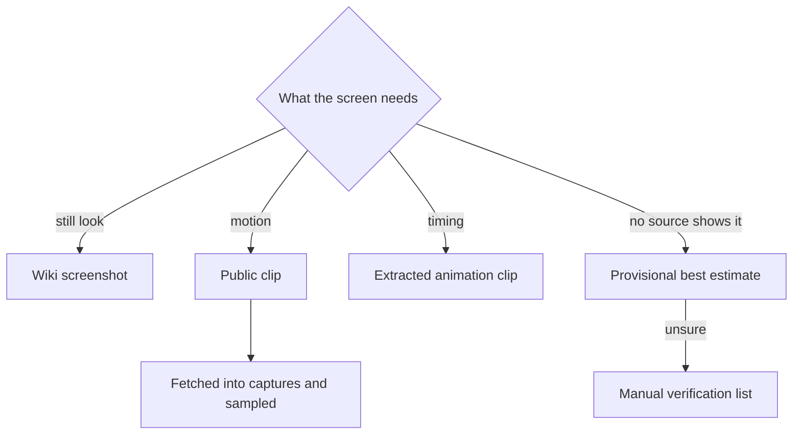

# Parity references

A reference is a screenshot the repository compares: a wiki image, or a screenshot sampled from a recording downloaded outside the repository, judged against and stored as hashed objects outside git, with only the manifest committed. This page covers how references are found, captured and stored.

- **References are stored as objects, and only their manifest is committed.** They are HoYoverse's images, so they are fetched and recorded into `{data-root}/genshin-parity` (scratch folder `REFERENCE_SCRATCH_DIRECTORY`, `scripts/src/services/genshinParity/shared/constants.ts`) and their bytes are never committed. `references pack` (`scripts/src/services/genshinParity/reference/packReferences.ts`) stores each one under its sha256 in the public game-data container, and `references restore` and every reader fetch it back into the download cache by hash (`scripts/src/services/genshinParity/reference/readCachedReference.ts`). `packages/genshin-world/parity/references/manifest.json` holds one row per reference id with its hash, size, attribution and source; `pack --kind record` stores the files given as paths the same way; no recording is stored. `recordings backfill` (`scripts/src/services/genshinParity/reference/backfillPublicRecordings.ts`) adds a recording row for each public recording in the captures folder that has none, named `yt-<videoId>-<name>` or `bili-<id>-<name>` by its file name, with its hash, its public page as its source and no range, and uploads nothing: `references restore` skips such a row and prints the clip command that fetches it again. `--skip-colliding` leaves out each reference whose bytes differ from its committed row, storing the rest and printing the ones left out, and `--replace <ids>` makes the local bytes of the named references replace their committed rows, the old objects staying in the container unreferenced. The repository still holds only what each screen is judged against (`scripts/src/services/genshinParity/shared/ParityReferenceMap.ts`): a wiki file, or a `source` string naming the recording and the second it was sampled from, or a pending entry that names the screen and the reason it has no reference yet.

- **Search before recording.** Most of what a screen needs is already published: the wiki holds the game's screens and its standalone marks, the community's data dumps hold its in-game text, and public videos show the rest, including the English client when the recording is in another language. A clip from one is fetched into the captures folder with `recreation clip --directory {data-root}/genshin-parity/captures` (`scripts/src/services/recreation/commands/clipCommand.ts`), writes its manifest row (its url, its seconds and its hash) beside the file, and is sampled like any recording. Nothing waits on a recording of the installed game: a still look is read off a wiki screenshot first, motion off a public clip on YouTube or Bilibili, sampled into screenshots (`recreation search` lists them), a timing off the extracted animation clips, and what none of them shows ships as a best estimate marked provisional, with an estimate the agent is unsure of put on the roadmap's Manual verification list for the user to check in one batch.

- **The installed game is recorded, never driven.** The user starts the game and plays while the tool records. It sends the game no input, since the game's terms count injected input as botting (`scripts/src/services/genshinParity/game/captureGame.ts`).

- **Only the game's window is recorded.** Capture goes through Windows Graphics Capture, found by the game's executable (`scripts/src/services/genshinParity/game/captureGame.ts`). Nothing else reaches the file: no window above it, no desktop or webcam behind it, no cursor, and no overlay that is its own window. A recording of the screen's rectangle would take whatever is on screen whenever the user switches away (see Open). `record` waits for the window to open, so a recording can be armed before the game starts and take it from its first frame (`scripts/src/services/genshinParity/game/captureGame.ts`, `waitForGameWindow`). It encodes on the GPU at 60 frames a second, near-lossless, into Matroska, which stays readable if the recording is cut short (`scripts/src/services/genshinParity/game/captureGame.ts`; the GPU encoder, `h264_amf` in `scripts/src/services/genshinParity/game/constants.ts`, `RECORD_ENCODING`). A minimised game gives no frames, so a recording also ends by the clock, at its length in real time, rather than waiting for frames that are not coming (`scripts/src/services/genshinParity/game/captureGame.ts`, `-t` seconds).

- **FFmpeg is pinned, not installed.** Window capture arrived in FFmpeg 8, which no npm package bundles. The tool fetches one versioned release the first time it needs FFmpeg, refuses it unless its SHA-256 matches the pinned one, and unpacks it into the shared tool cache under `{data-root}/cache`, so no install or CI run ever pays for it (`scripts/src/services/shared/installPinnedTool.ts`, `scripts/src/services/recreation/video/resolveFfmpeg.ts`; the version `FFMPEG_ARCHIVE_URL` names, in `scripts/src/services/recreation/video/constants.ts`). Off Windows the FFmpeg on the PATH stands in, since the pinned build is a Windows executable.

- **Read before searching.** A component's `Index.reference.ts`, the topic files beside it, and the [game data formats](../../game-data-formats/design.md) page's shortcuts come first; a search whose answer is recorded is not run again.

- **A reference's source is checked against its frame.** `genshin:parity verify` cuts each recorded reference's named frame and fails a reference that differs from it past tolerance, so a repointed `source` cannot name a picture its file does not show (`scripts/src/services/genshinParity/reference/verifyReferences.ts`).

## Key files

| File                                                              | Role                                                                         |
| :---------------------------------------------------------------- | :--------------------------------------------------------------------------- |
| `scripts/src/services/genshinParity/shared/ParityReferenceMap.ts` | Each reference (a wiki file or a screenshot), its screen or a pending screen |
| `scripts/src/services/genshinParity/reference/hashFile.ts`        | A file's SHA-256, streamed, its first digits as the reference cache names it |

## Open

- [ ] **A rectangle recording would take whatever is on screen when the user switches away** — no source yet: no commit, snapshot or note records that trial.
- [ ] **Window capture arrived in FFmpeg 8, which no npm package bundles** — no source yet: no FFmpeg release note is cited, and the pinned archive's version is not read here.
- [ ] **The game's terms count injected input as botting** — no source yet: the terms are not cited; the page's reason for recording without input rests on them.
- [ ] **A minimised game gives no frames** — no source yet: no capture of a minimised window is recorded to show it.
