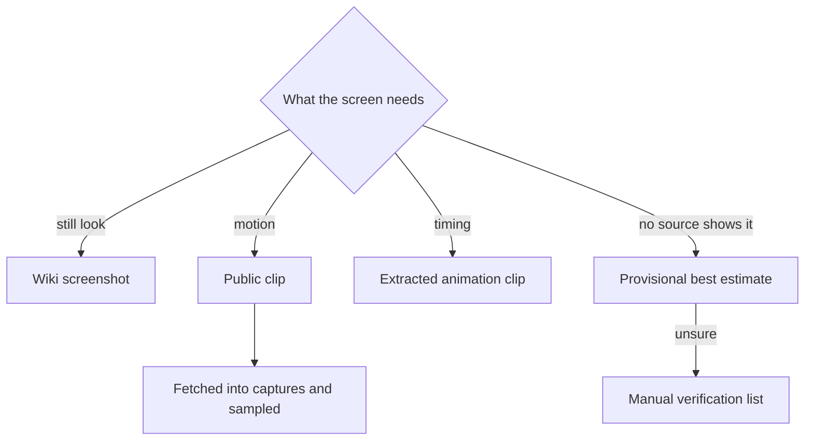

# Parity references

A reference is a screenshot the repository compares: a wiki image, or a screenshot sampled from a recording downloaded outside the repository. Each is committed as lossless WebP, beside its fixture variant's snapshot or flat in the references folder, and the manifest holds its provenance and sha256. The five records the manifest also names are packed to the public container instead. This page covers how references are found, captured and stored.

- **References are committed as lossless WebP, and the manifest is their provenance.** Each reference the map names is one file in the repository. Each fixture variant that holds a reference has one beside its snapshot, as `Index.reference.webp` or `Index-<variant>.reference.webp`: the entry that renders the fixture as it is: its first whole-screen entry in map order with no `props` override, or else its first entry with none. Where every live entry overrides `props`, it is the first whole-screen entry, or else the first live one. The snapshot is the fixture's default render, which an entry with no `props` override reproduces, while an entry with one renders the fixture with those props instead. `approve` scores a snapshot as a whole only against a whole-screen entry, and a region only says which part of the frame is scored. The fixtures listing names that same entry through `getPrimaryReferenceId` (`scripts/src/services/genshinParity/reference/getPrimaryReferenceId.ts`), so the listing and the placement cannot disagree. Every other reference sits flat in `packages/genshin-world/parity/references/` as `<id>.webp`, and a plate is `<id>.plate.webp` in the same folder. `planReferenceFiles` (`scripts/src/services/genshinParity/reference/planReferenceFiles.ts`) decides each place from the map and the fixture folders, and `readReferenceFiles` reads the plan. `references pack` (`scripts/src/services/genshinParity/reference/packReferences.ts`) writes each file and its manifest row from a screenshot in the scratch folder, `REFERENCE_SCRATCH_DIRECTORY`, and refuses a collision with a committed row unless the id is named by `--replace`. The manifest (`packages/genshin-world/parity/references/manifest.json`) holds one row per reference with its sha256, size, dimensions, source and attribution, and each file's bytes hash to its row's sha256. Every command that reads a reference reads the committed file through `getReferencePath` (`scripts/src/services/genshinParity/shared/getReferencePath.ts`), which fails with the path to add when the file is missing; nothing is fetched. No recording is stored, and the game-data container serves no reference.

- **Search before recording.** Most of what a screen needs is already published: the wiki holds the game's screens and its standalone marks, the community's data dumps hold its in-game text, and public videos show the rest, including the English client when the recording is in another language. A clip from one is fetched into the captures folder with `recreation clip --directory {data-root}/genshin-parity/captures` (`scripts/src/services/recreation/commands/clipCommand.ts`), writes its manifest row (its url, its seconds and its hash) beside the file, and is sampled like any recording. Nothing waits on a recording of the installed game: a still look is read off a wiki screenshot first, motion off a public clip on YouTube or Bilibili, sampled into screenshots (`recreation search` lists them), a timing off the extracted animation clips, and what none of them shows ships as a best estimate marked provisional, with an estimate the agent is unsure of put on the roadmap's Manual verification list for the user to check in one batch.

- **The installed game is recorded, never driven.** The user starts the game and plays while the tool records. It sends the game no input, since the game's terms count injected input as botting (`scripts/src/services/genshinParity/game/captureGame.ts`).

- **Only the game's window is recorded.** Capture goes through Windows Graphics Capture, found by the game's executable (`scripts/src/services/genshinParity/game/captureGame.ts`). Nothing else reaches the file: no window above it, no desktop or webcam behind it, no cursor, and no overlay that is its own window. A recording of the screen's rectangle would take whatever is on screen whenever the user switches away (see Open). `record` waits for the window to open, so a recording can be armed before the game starts and take it from its first frame (`scripts/src/services/genshinParity/game/captureGame.ts`, `waitForGameWindow`). It encodes on the GPU at 60 frames a second, near-lossless, into Matroska, which stays readable if the recording is cut short (`scripts/src/services/genshinParity/game/captureGame.ts`; the GPU encoder, `h264_amf` in `scripts/src/services/genshinParity/game/constants.ts`, `RECORD_ENCODING`). A minimised game gives no frames, so a recording also ends by the clock, at its length in real time, rather than waiting for frames that are not coming (`scripts/src/services/genshinParity/game/captureGame.ts`, `-t` seconds).

- **FFmpeg is pinned, not installed.** Window capture arrived in FFmpeg 8, which no npm package bundles. The tool fetches one versioned release the first time it needs FFmpeg, refuses it unless its SHA-256 matches the pinned one, and unpacks it into the shared tool cache under `{data-root}/cache`, so no install or CI run ever pays for it (`scripts/src/services/shared/installPinnedTool.ts`, `scripts/src/services/recreation/video/resolveFfmpeg.ts`; the version `FFMPEG_ARCHIVE_URL` names, in `scripts/src/services/recreation/video/constants.ts`). Off Windows the FFmpeg on the PATH stands in, since the pinned build is a Windows executable.

- **Read before searching.** A component's `Index.reference.ts`, the topic files beside it, and the [game data formats](../../game-data-formats/design.md) page's shortcuts come first; a search whose answer is recorded is not run again.

- **A reference's source is checked against its frame.** `genshin:parity verify`, run on a machine that holds the recordings, cuts each recorded reference's named frame and fails a reference that differs from it past tolerance, so a repointed `source` cannot name a picture its file does not show (`scripts/src/services/genshinParity/reference/verifyReferences.ts`).

## Key files

| File                                                                       | Role                                                                                                                                                                |
| :------------------------------------------------------------------------- | :------------------------------------------------------------------------------------------------------------------------------------------------------------------ |
| `scripts/src/services/genshinParity/shared/ParityReferenceMap.ts`          | Each reference (a wiki file or a screenshot), its screen or a pending screen                                                                                        |
| `scripts/src/services/genshinParity/reference/planReferenceFiles.ts`       | Where each reference's committed file is: beside its fixture variant's snapshot, or flat in the references folder                                                   |
| `scripts/src/services/genshinParity/reference/getPrimaryReferenceId.ts`    | The one entry a fixture variant is judged by, picked from its map entries: the planner's beside file and the fixtures listing both read it                          |
| `scripts/src/services/genshinParity/reference/readReferenceFiles.ts`       | The plan read from the fixture folders and the map                                                                                                                  |
| `scripts/src/services/genshinParity/shared/getReferencePath.ts`            | The committed file a command reads, and the error that names the path to add when it is missing                                                                     |
| `scripts/src/services/genshinParity/reference/committedReferences.test.ts` | Each file exists, each variant's reference sits beside its snapshot, every file is named by an entry or a row, matches its row's hash and is under the size ceiling |
| `scripts/src/services/genshinParity/reference/hashFile.ts`                 | A file's SHA-256, streamed, its first digits as the reference cache names it                                                                                        |

## Open

- [ ] **A rectangle recording would take whatever is on screen when the user switches away** — no source yet: no commit, snapshot or note records that trial.
- [ ] **Window capture arrived in FFmpeg 8, which no npm package bundles** — no source yet: no FFmpeg release note is cited, and the pinned archive's version is not read here.
- [ ] **The game's terms count injected input as botting** — no source yet: the terms are not cited; the page's reason for recording without input rests on them.
- [ ] **A minimised game gives no frames** — no source yet: no capture of a minimised window is recorded to show it.
