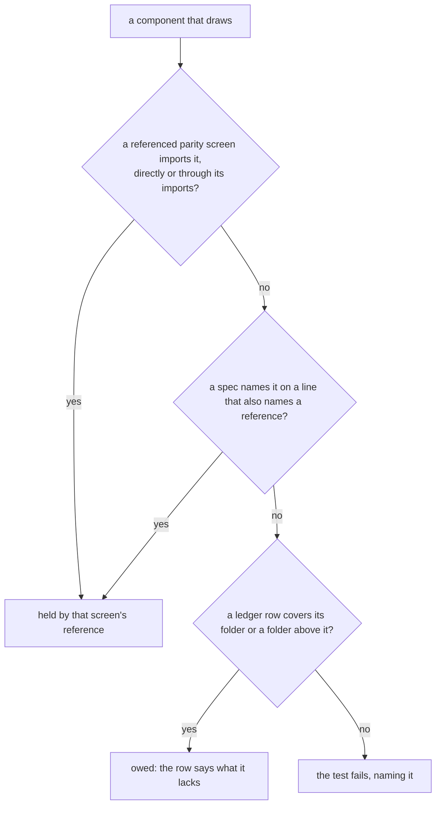

# Parity screens

A screen to be matched is a presentational component in the world package, with the fixture that puts it on the parity page.

- **A screen is a component folder with a fixture, in its section.** Every screen is a presentational component in the world package, laid out as Nuxt lays out the app's, one folder per screen under its section: `packages/genshin-world/src/components/Login/Screen/Index.vue` for `Login/Screen`, named by its path as `LoginScreen`, with its `Index.fixture.ts` and its images beside it (`packages/genshin-world/src/components/Login/Screen/Index.fixture.ts`), and a browser test beside it wherever it has one (`packages/genshin-world/src/components/Game/Opening/Index.browser.test.ts`; `Login/Screen` has none). The sections follow the game (`Game`, `Splash`, `Loading`, `Login`, `World`) (`packages/genshin-world/src/components/`), and `Game/Opening` shows the game's first screens in turn and owns every handoff between them (`packages/genshin-world/src/components/Game/Opening/Index.vue`). Having a fixture is what puts a screen on the parity page and in the visual suite, named as the package's own barrel exports it, so there is no list to keep (`packages/genshin-world/parity/screens.ts`). A fixture's `variants` are further states it is drawn in, such as the login scene's dawn, day and dusk (`packages/genshin-world/src/components/Login/Screen/Index.fixture.ts`; the field is typed in `packages/genshin-world/parity/models/ScreenFixture.ts`). A fixture marked `isMotionOnly`, such as Windrise at its first hour, drawn every frame so the visual suite's shot never settles (`packages/genshin-world/src/components/World/Screen/Index.fixture.ts`), is shot on the page but kept out of the suite (`packages/genshin-world/parity/models/ScreenFixture.ts`, `packages/genshin-world/parity/screens.visual.ts`). A screen draws inside `genshin-interface`'s `GameScreen`, whose `--unit` scales the game's 1920 by 1080 screen by the window's smaller axis, as the game scales its interface ([interface library](../../interface-library/spec.md), `packages/genshin-interface/src/components/GameScreen/Index.vue`, whose unit is `GAME_UNIT` in `packages/genshin-interface/src/services/constants.ts`); scaling by height alone would set text sized for the height in a box sized for the width in a window narrower than 16:9 (see Open). Whether the text then fits its boxes is open in [the spec](spec.md). A screen also draws no heading element, since a host page's heading styles reach into it (see Open); a heading is a paragraph with `role="heading"` (`packages/genshin-interface/src/components/Wish/Screen/Index.vue`, passing it to `ScreenTitle`, which renders a `
` in `packages/genshin-interface/src/components/ScreenTitle/Index.vue`). The pieces screens share are [`genshin-interface`](../../interface-library/design.md)'s, held by a suite of their own.

## What a screen draws

Every element a Genshin screen draws is one the game shows, and its owning spec cites the game's reference for it: a recording, a capture, or the game's own UI tree or text. An element the game does not show is not drawn, not even disabled. An element with no reference yet is not built, and the Open row of its spec names the reference sought.

`scripts/src/workspace/genshinComponentReference.test.ts` holds each component that draws something of its own in one of three ways, tried in this order:

- **What draws.** A component draws when its template opens a native element. One that only mounts other components draws nothing itself, and each component it mounts is held on its own.
- **A screen is judged by its own reference.** A component with its own fixture and parity entry is a screen, so the walk from a referenced screen stops at it. What a screen mounts is never taken for the screen mounting it.
- **The ledger is debt.** `.agents/ledgers/component-reference.md` holds the components the three routes do not reach, one row a folder, with its Notes naming what the folder lacks. A row covers its folder and everything beneath it. A row is added only by an audit that records what a component lacks, never to pass a new one. A row leaves once its folder is held, and a row naming a folder the tree no longer has fails the test.
- **The check traces; it does not compare.** A piece inside a referenced screen is held because that screen is judged against its reference, so the check proves each piece is traced to a reference and not that the reference shows it. An element a referenced screen draws with no game counterpart passes the check, and the audit of each screen against its reference is what catches it.

## Key files

| File                                                                          | Role                                                                                                                                 |
| :---------------------------------------------------------------------------- | :----------------------------------------------------------------------------------------------------------------------------------- |
| `packages/genshin-world/parity/models/ScreenFixture.ts`                       | What a screen's fixture holds: its props and states, and a scene's claims on the exports, each component's own by its name           |
| `packages/genshin-world/parity/screens.ts`                                    | Every screen with a fixture, for the page and the suite                                                                              |
| `packages/genshin-world/src/components/Loading/Startup/Index.vue`             | The game's startup screen: the seven marks, wiped in as loading goes                                                                 |
| `packages/genshin-world/src/components/Splash/Sequence/Index.vue`             | The game's splashes: its logos and health notice, timed from a recording (`packages/genshin-world/src/services/splash/constants.ts`) |
| `packages/genshin-world/src/components/Game/Opening/Index.vue`                | The game's opening: the splashes, the login screen, then the startup screen, handed on by their own timings                          |
| `scripts/src/workspace/genshinComponentReference.test.ts`                     | The check: every drawn component held, owed or named, and every ledger row a folder the tree holds                                   |
| `scripts/src/services/genshinParity/componentReference/findHeldComponents.ts` | The walk from referenced screens through their imports, and the components a spec names beside a reference                           |
| `scripts/src/services/genshinParity/componentReference/checkIsDrawn.ts`       | Whether a component draws something of its own, or only mounts components that do                                                    |
| `.agents/ledgers/component-reference.md`                                      | The debt rows the check reads, one per component folder that no route holds                                                          |

## Open

- [ ] **Scaling by height alone would set text sized for the height in a box sized for the width** — no source yet: no commit, snapshot or note records a height-only trial.
- [ ] **The opening shows the game's first screens in turn and hands each on by its own timing** — no source yet: a reading of the screens' order and timing from the opening recordings `{data-root}/genshin-parity/captures/localized-opening-japanese.mkv` and `{data-root}/genshin-parity/captures/localized-opening-korean.mkv`; 18-second samples of both across 0 to 162 s show cinematics, a black text card and Paimon's scene in turn, the name screen in the Japanese sample only, and the hand-off timing is not read.
- [ ] **The screen scales the game's 1920 by 1080 by the window's smaller axis, as the game scales its interface** — no source yet: a reference still of the game's interface at a window other than 16:9, to fix the scale by the smaller axis, is needed; no file name in `{data-root}/genshin-parity/references/` names one.
- [ ] **A host page's heading styles reach into a screen, its gold and its inherited font among them** — no source yet: `packages/genshin-interface/src/components/ScreenTitle/Index.vue`, `GameScreen/Index.vue` and `Login/Screen` name neither style, and no capture of a heading in the host page was read.
