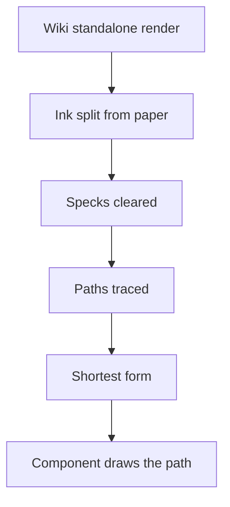

# Parity tracing

Marks and logos are traced rather than copied, so a screen ships only shapes derived from the game's marks.

- **A vector is used as it is, and only a mark with none is traced.** Wikimedia Commons holds some of the game's logos as SVG, the publisher's among them (`{data-root}/genshin-parity/references/commons-Genshin_Impact_wordmark.svg`, `{data-root}/genshin-parity/references/commons-HoYoverse_Logo.svg`), and its paths are drawn directly, so no edge can chip (see Open). The HoYoverse logo's letters and ring are its SVG's own geometry, re-encoded shorter and drawn as they are, placed by a translate (`packages/genshin-world/src/components/Splash/Publisher/Index.vue` lines 42 to 47, `packages/genshin-world/src/services/splash/constants.ts` lines 58 to 78).

- **A glyph is traced from the game's own mark.** The tracer starts from the wiki's standalone render of a mark where one exists, since a mark on a screenshot is small and, when pale, too faint to split cleanly. `scripts/src/services/genshinParity/shared/resolveSource.ts` lines 6 to 8 fetch a wiki "File:" title, and `packages/genshin-world/src/services/loading/ElementMarkPathMap.ts` lines 3 and 4 trace the wiki's "File:Element <Name>.svg" at full resolution, as `scripts/src/services/genshinAssets/skillGlyphs/getTitles.ts` line 3 does for each talent's "File:Talent <Name>.png". It traces at the source's full resolution, never reduced, and prints the region beside the trace to check (`scripts/src/services/genshinParity/shared/traceImage.ts`). Ink is told from paper by how far each pixel strays from the colour at the region's corners (`scripts/src/services/genshinParity/shared/traceImage.ts`), so a mark dark on white, lit on black or coloured on either traces alike, and a run of ink or a hole in it smaller than a sliver of the region, a sparkle printed on a logo, a speck of compression or a pale sparkle punching through a letter, is cleared from the split before it is traced (`scripts/src/services/genshinParity/shared/traceMask.ts`, `scripts/src/services/genshinParity/shared/removeMaskSpecks.ts`); every path the trace finds is then kept, so no small part of the mark is lost (`scripts/src/services/genshinParity/shared/traceMask.ts`). The path it writes is the one the component draws (`scripts/src/services/genshinAssets/fit/fitTitleLogos.ts` lines 55 to 75 write each title logo's path, `scripts/src/services/genshinAssets/fit/fitLoginScene.ts` lines 151 to 152 publish it to the game data the title splash reads, and `packages/genshin-world/src/components/Splash/Title/Index.vue` line 27 draws it). Nothing from the game ships except shapes derived this way and the publisher's published vectors (`packages/genshin-world/src/services/splash/constants.ts` lines 54 to 78), a choice made so the screens match exactly (see the [spec's Open](spec.md)).

- **A traced path is written in its shortest form.** `traceMask` returns each path through `compactSvgPath` (`scripts/src/services/genshinParity/shared/traceMask.ts`, `scripts/src/services/genshinParity/shared/compactSvgPath.ts`), which reads the path's absolute or relative commands at their own precision and writes the same geometry relative, with implicit letters, a line along an axis as one operand and no space before a minus sign. Its opening moveto alone stays absolute, so the paths of one trace joined into one `d` keep their places, where a relative one would start from wherever the path before it closed. The points are unchanged, the bytes a trace adds to the bundle are about a third to a half of the absolute form's (see Open).

## Key files

| File                                                          | Role                                                                   |
| :------------------------------------------------------------ | :--------------------------------------------------------------------- |
| `scripts/src/services/genshinParity/shared/traceImage.ts`     | A mark traced into one path at full resolution                         |
| `scripts/src/services/genshinParity/shared/traceMask.ts`      | A mask traced into its paths, each returned in its shortest form       |
| `scripts/src/services/genshinParity/shared/compactSvgPath.ts` | An SVG path written in its shortest form, the same points              |
| `scripts/src/services/genshinParity/shared/parseSvgPath.ts`   | An SVG path read into exact absolute points for the codec and its test |

## Sources

- [imagetracerjs](https://github.com/jankovicsandras/imagetracerjs): the public-domain tracer behind `trace` (`scripts/package.json`).

## Open

- [ ] **The Commons wordmark is drawn from its published paths** — no source yet: no repo file names `{data-root}/genshin-parity/references/commons-Genshin_Impact_wordmark.svg` or draws it (`rg` for "wordmark" and "commons-" outside `openspec/specs/genshin` finds nothing).
- [ ] **A trace adds a third to a half of the absolute form's bytes** — no source yet: no size comparison of a trace in both forms is recorded; `scripts/src/services/genshinParity/shared/compactSvgPath.test.ts` holds none, and a run that prints one path of `{data-root}/genshin-parity/comparisons/Logo_ENG_Pure-trace-0-0.svg` in both forms would settle it.
- [ ] **A vector's paths drawn directly cannot chip an edge** — no source yet: no render of a drawn vector beside a traced one is kept to compare the edges; one render at one scale of `packages/genshin-world/src/components/Splash/Publisher/Index.vue` beside `packages/genshin-world/src/components/Splash/Title/Index.vue` would settle it, since `{data-root}/genshin-parity/comparisons/publisher-splash.png` and `title-splash.png` hold each apart.
