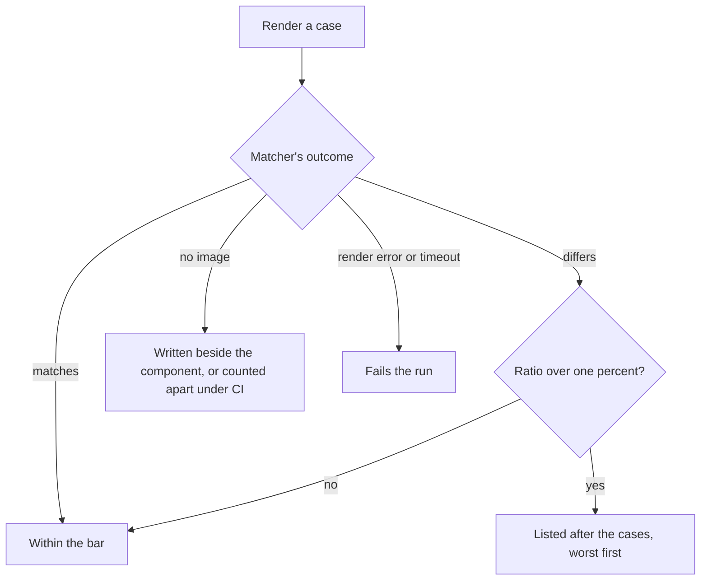

# Parity visual suite

The visual suite holds every screen to its own image, a snapshot of its render, and reports how far a run has moved from it.

- **Every screen is held by the visual suite.** `pnpm test:visual` renders every screen and every variant from its fixture in Vitest's browser mode and matches it against its own image, `Index.png` and `Index-<variant>.png` beside the component, as a test sits beside its code (`packages/genshin-world/package.json`, `packages/genshin-world/parity/screens.visual.ts`, `packages/genshin-world/src/components/Login/Screen/Index-dawn.png`). It is a separate config, so an ordinary test run never starts a browser (`packages/genshin-world/vitest.browser.config.ts`), and it reads the engine and the interface library from their source, so a change there shows without a build (see Open). The same config runs the tests of what only a browser can play: `Game/Opening`'s plays the whole opening, the login's flight included, and checks every handoff, so a screen skipped along the way fails a run rather than a reader's eye (`packages/genshin-world/src/components/Game/Opening/Index.browser.test.ts`, whose checks at lines 121-185 reach the splashes, the login's title and prompt, the marks and the finish). Its fake clock fakes `performance` with the frame clock, since the scene steps its door and its glide by the real time `performance.now` reads, so the advance the test makes is the time the flight takes. A moving screen is held still for it by its fixture's `stillProps` (`packages/genshin-world/parity/screens.visual.ts`, lines 27 and 34, the only code that reads it, so the parity page and the references never do): the login scene's glide held (`packages/genshin-world/src/components/Login/Screen/Index.fixture.ts`, lines 25-29), drawn at a tier whose anti-aliasing does not jitter (`packages/genshin-engine/src/renderer/QualityTierSettingsMap.ts`: the middle tier's SMAA against the highest tier's TRAA), with no interface over it, an image an hour (the same comment: every hour, night being the fixture's own), so a light that turns a part's colour shows as an image that moved where a frame's mean score can hide it.

- **A mismatch is reported, never failed.** A case whose render differs from its image does not fail the run. Its title and the ratio the matcher reports are collected, and the summary after the cases lists each over one percent, worst first, with the count within the bar (`packages/genshin-world/parity/screens.visual.ts`, `packages/genshin-interface/src/components/components.visual.ts`, both through `createVisualComparisonRecord` in `packages/genshin-interface/src/services/createVisualComparisonRecord.ts`; the bar is `MISMATCH_RATIO_BAR`, 0.01, in `packages/genshin-interface/src/services/constants.ts`). The matcher's own message is the only public signal of a difference and of its ratio, so each suite reads that message: a missing image is counted apart, a difference is recorded, and anything else is thrown and fails the case (`recordFailure` in `packages/genshin-interface/src/services/createVisualComparisonRecord.ts`; the message and its ratio pattern are `MISMATCH_MESSAGE` and `MISMATCH_DETAIL_REGEX` in `packages/genshin-interface/src/services/constants.ts`). A size change is one such anything else: the matcher's dimension check returns `Expected image dimensions to be ...` with no ratio (`@vitest/browser` 5.0.5's `dist/index.js`, its `pixelmatch` comparator), and the mismatch message wrapped around it carries no `pixels (ratio ...) differ` for the record to read, so the case fails. The matcher rounds each ratio up to a whole percent (the same comparator's `Math.ceil` to a hundredth), so ties in the summary are ordered by the pixel count the same message gives.

## Decisions

- **A screen's image is written by `genshin:parity approve` (`scripts/src/services/genshinParity/reference/approveReference.ts`).** `approve` prints the compare's status against the screen's bar, then writes its image as a snapshot of the current render: `Index.png` in its component's folder, a variant's as `Index-<variant>.png` beside it (the suite names it at `packages/genshin-world/parity/screens.visual.ts` line 33). It runs the suite's `-u` for that one screen alone, so the whole suite's images never move, with `APPROVE_ENVIRONMENT_VARIABLE` set (`packages/genshin-interface/src/services/constants.ts`), which `packages/genshin-world/vitest.browser.config.ts` reads as a pixel-exact comparison: the default counts a pixel only past pixelmatch's threshold, so a render that drifted below it passed its stale image and `-u` never rewrote it. The status never stops the write: a missing reference, a failed compare and a reference judging less than the whole screen are each printed and then written (`openspec/specs/genshin/parity/commands/design.md`).

- **The suite shoots each screen in the parity page's 1920 by 1080 box on a mid-tone grey backdrop (`#4a5560`, `packages/genshin-world/parity/screens.visual.ts` line 19).** The box is `getScreenBoxStyle` (`packages/genshin-world/parity/getScreenBoxStyle.ts`, 1920 wide by `SCREEN_BOX_WIDTH` on its line 4), the viewport is set to 1920 by 1080 for the screens' cases and put back after (`packages/genshin-world/parity/screens.visual.ts` lines 44-50), and the image is the box, not the browser body (lines 59-60 and 77-79).

- **The variant separator has one source.** The visual suites join a screen's name to its fixture's variant with the interface's `FIXTURE_VARIANT_SEPARATOR` (`packages/genshin-interface/src/services/constants.ts`), and `scripts` reads that same constant for `approve` through a workspace dependency on `genshin-interface`, via its pure `./constants` export (`packages/genshin-interface/package.json` lines 38-41, and `scripts/package.json` line 111 for the workspace dependency), since its root imports Vue components that the scripts runner cannot load (`packages/genshin-interface/src/index.ts` line 1 re-exports `./components/index.ts`).

- **The two visual suites share one comparison record, exported by the interface.** Both suites tally their cases through `createVisualComparisonRecord` (`packages/genshin-interface/src/services/createVisualComparisonRecord.ts`), which `genshin-interface` exports (`packages/genshin-interface/src/index.ts` line 66), so genshin-world imports it like any other interface export and no test-only module is needed. Its `report` prints the summary after the cases, and a failure that is not an `Error` is thrown rather than read for a message it does not have.

## Key files

| File                                                                      | Role                                                                                                        |
| :------------------------------------------------------------------------ | :---------------------------------------------------------------------------------------------------------- |
| `packages/genshin-world/parity/screens.visual.ts`                         | The visual suite of the screens: mismatches listed, a missing image written, the summary after the cases    |
| `packages/genshin-interface/src/components/components.visual.ts`          | The visual suite of the interface's components, the same summary without neverthrow (no `@esposter/shared`) |
| `scripts/src/services/genshinParity/reference/approveReference.ts`        | Writes one screen's image: prints the compare's status, then the suite's `-u` for that screen alone         |
| `scripts/src/services/genshinParity/reference/decideApprovalStatus.ts`    | The status of a compare against the bar: no reference, the whole screen not judged, no score, over, within  |
| `packages/genshin-interface/src/services/createVisualComparisonRecord.ts` | The tally both visual suites keep over their cases, and the summary they print after them                   |

## Sources

- [Visual regression testing](https://vitest.dev/guide/browser/visual-regression-testing), Vitest: `toMatchScreenshot` and where its reference images are kept.

## Open

- [ ] **The suite reads the engine and the interface library from their source** — no source yet: a recorded run of the suite that resolves both from source; `packages/genshin-world/vitest.browser.config.ts` (line 18) leads its `resolve.conditions` with `SOURCE_CONDITION`, but no run is kept.
- [ ] **A missing image is written beside the component, or counted apart under CI** — no source yet: `@vitest/browser` 5.0.5's `dist/index.js` (line 2042) writes a new reference when the outcome's location is `reference` and says `No existing reference screenshot found` otherwise, but what sets that location under CI was not traced.
- [ ] **The interface's `./constants` build** — owed to the build at integration.
