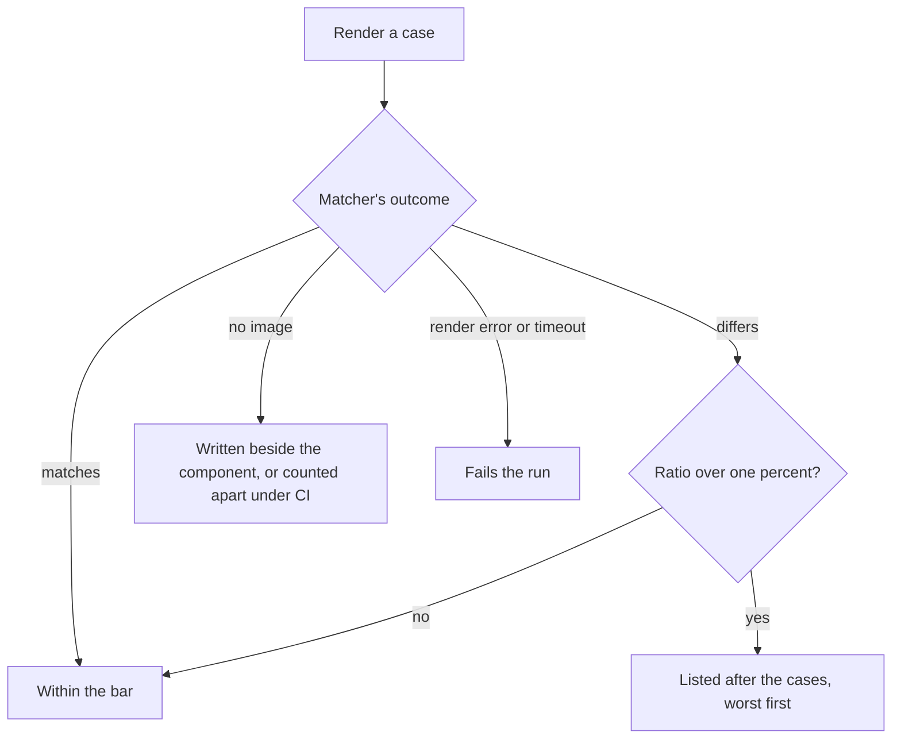

# Parity visual suite

The visual suite holds every screen to its own image, a snapshot of its render, and reports how far a run has moved from it.

- **Every screen is held by the visual suite.** `pnpm test:visual` renders every screen and every variant from its fixture in Vitest's browser mode and matches it against its own image, `Index.png` and `Index-<variant>.png` beside the component, as a test sits beside its code (`packages/genshin-world/package.json`, `packages/genshin-world/parity/screens.visual.ts`, `packages/genshin-world/src/components/Login/Screen/Index-dawn.png`). It is a separate config, so an ordinary test run never starts a browser (`packages/genshin-world/vitest.browser.config.ts`), and it reads the engine and the interface library from their source, so a change there shows without a build (see Open). The same config runs the tests of what only a browser can play: `Game/Opening`'s plays the whole opening, the login's flight included, and checks every handoff, so a screen skipped along the way fails a run rather than a reader's eye (`packages/genshin-world/src/components/Game/Opening/Index.browser.test.ts`). A moving screen is held still for it by its fixture's `stillProps` (`packages/genshin-world/parity/screens.visual.ts`), which the parity page and the references never read: the login scene's glide held, drawn at a tier whose anti-aliasing does not jitter, with no interface over it, an image an hour, so a light that turns a part's colour shows as an image that moved where a frame's mean score can hide it.

- **A mismatch is reported, never failed.** A case whose render differs from its image does not fail the run. Its title and the ratio the matcher reports are collected, and the summary after the cases lists each over one percent, worst first, with the count within the bar (`packages/genshin-world/parity/screens.visual.ts`, `packages/genshin-interface/src/components/components.visual.ts`). The matcher's own message is the only public signal of a difference and of its ratio, so each suite reads that message: a missing image is counted apart, a difference is recorded, and anything else is thrown and fails the case. The matcher rounds each ratio up to a whole percent, so ties in the summary are ordered by the pixel count the same message gives.

## Decisions

- **A screen's image is written by `genshin:parity approve` (`scripts/src/services/genshinParity/reference/approveReference.ts`).** `approve` prints the compare's status against the screen's bar, then writes its image as a snapshot of the current render: `Index.png` in its component's folder, a variant's as `Index-<variant>.png` beside it. It runs the suite's `-u` for that one screen alone, so the whole suite's images never move. The status never stops the write: a missing reference, a failed compare and a reference judging less than the whole screen are each printed and then written (`openspec/specs/genshin/parity/commands/design.md`).

- **The suite shoots each screen in the parity page's 1920 by 1080 box on a neutral backdrop.** The box is `getScreenBoxStyle` (`packages/genshin-world/parity/getScreenBoxStyle.ts`), the viewport is set to 1920 by 1080 for the screens' cases and put back after, and the image is the box, not the browser body.

- **The variant separator has one source.** The visual suites join a screen's name to its fixture's variant with the interface's `FIXTURE_VARIANT_SEPARATOR` (`packages/genshin-interface/src/services/constants.ts`), and `scripts` reads that same constant for `approve` through a workspace dependency on `genshin-interface`, via its pure `./constants` export, since its root imports Vue components that the scripts runner cannot load.

- **The two visual suites share one comparison record, exported by the interface.** Both suites tally their cases through `createVisualComparisonRecord` (`packages/genshin-interface/src/services/createVisualComparisonRecord.ts`), which `genshin-interface` exports, so genshin-world imports it like any other interface export and no test-only module is needed. Its `report` prints the summary after the cases, and a failure that is not an `Error` is thrown rather than read for a message it does not have.

## Key files

| File                                                                      | Role                                                                                                        |
| :------------------------------------------------------------------------ | :---------------------------------------------------------------------------------------------------------- |
| `packages/genshin-world/parity/screens.visual.ts`                         | The visual suite of the screens: mismatches listed, a missing image written, the summary after the cases    |
| `packages/genshin-interface/src/components/components.visual.ts`          | The visual suite of the interface's components, the same summary without neverthrow (no `@esposter/shared`) |
| `scripts/src/services/genshinParity/reference/approveReference.ts`        | Writes one screen's image: prints the compare's status, then the suite's `-u` for that screen alone         |
| `scripts/src/services/genshinParity/reference/decideApprovalStatus.ts`    | The status of a compare against the bar: no reference, the whole screen not judged, no score, over, within  |
| `packages/genshin-interface/src/services/createVisualComparisonRecord.ts` | The tally both visual suites keep over their cases, and the summary they print after them                   |

## Sources

- [Visual regression testing](https://vitest.dev/guide/browser/visual-regression-testing), Vitest: `toMatchScreenshot` and where its reference images are kept.

## Open

- [ ] **The suite reads the engine and the interface library from their source** — no source yet: a recorded run of the suite that resolves both from source; `packages/genshin-world/vitest.browser.config.ts` (line 18) leads its `resolve.conditions` with `SOURCE_CONDITION`, but no run is kept.
- [ ] **A size change fails its case rather than being listed** — no source yet: the matcher's dimension check returns no ratio (`Expected image dimensions to be ...`), so a case whose box changed size has nothing to list; a case whose size changed is failed until a ratio for it is recorded.
- [ ] **The interface's `./constants` build** — owed to the build at integration.
