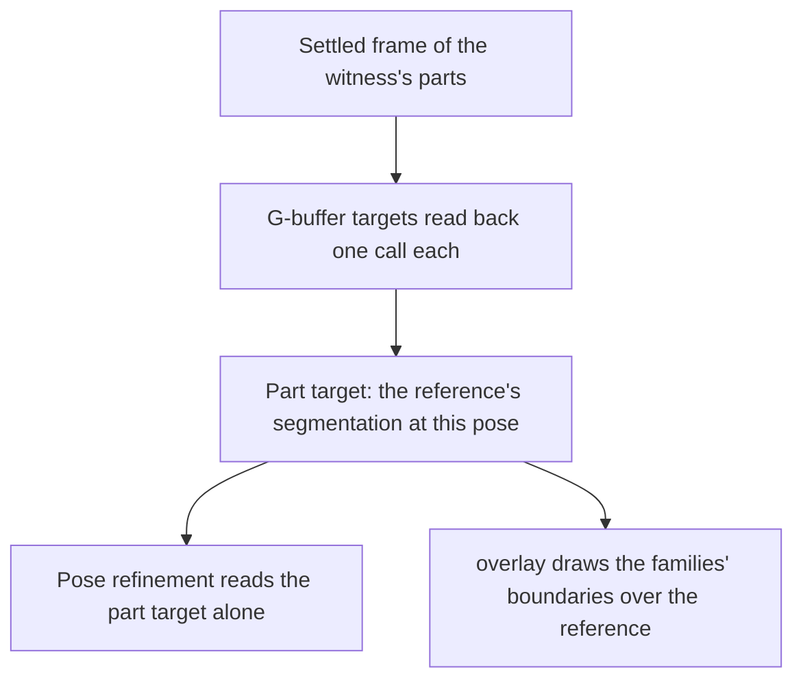

# Parity witness

The witness is the page's way of drawing the game's exports under our camera, light and frame.

- **A witness render draws the exports through our own scene.** With `--witness`, the shooting browser serves a component's exports to the page and the scene draws them in place of its own parts (`SceneWitnessKey`, `packages/genshin-world/parity/main.ts`), under its own camera, light and frame, so a stand-in is priced against the game's own data ([scene derivation](../../scene-derivation/design.md)) (`packages/genshin-world/parity/witness/claimWitnessRenderers.ts`). Textures are sampled as the game samples them, tiled and anisotropically along a grazing line of sight (`SCENE_TEXTURE_ANISOTROPY`), since one sample a pixel reads a far surface's coarse levels (`packages/genshin-world/src/services/scene/loadWitness.ts`). Nothing of the exports is bundled: the page fetches only what the shoot serves it, and of a scene whose fixture names its families, only the meshes a family draws, each texture their materials name fetched once (`packages/genshin-world/src/services/scene/loadWitness.ts`). Loading only the meshes a family draws keeps a capital's exports, most of them in meshes no family draws, within the shooting tool's memory (see Open).

`pose` solves the camera from landmarks, points of the exports whose places the witness knows, against the pixels a reference names for them. Each is snapped to its nearest corner unless it is an interior point, which is read as given (`scripts/src/services/genshinParity/witness/snapToCorner.ts`). From six or more landmarks the projection is read in closed form by a direct linear transform; from fewer, from a start with the field of view held at one read off two widths (`scripts/src/services/genshinParity/witness/solveCameraPose.ts`, `DLT_POINT_COUNT = 6`). Levenberg–Marquardt then minimises the reprojection error, printed per landmark. A few steps of the simplex refine it on the distance from the chosen families' silhouettes, taken from the part target rather than the shading, to the reference's edges, so clouds, which draw no part, cannot pull it (`scripts/src/services/genshinParity/witness/refineCameraPose.ts`). Seams between one family's parts are left out, since the reference draws them as cracks or not at all (`scripts/src/services/genshinParity/witness/findFamilyBoundaries.ts`). Parts in one frame share one camera (one `solveCameraPose` call takes every landmark `readReferenceLandmarks` reads, `scripts/src/services/genshinParity/witness/solveReferencePose.ts`), so a part whose landmarks barely fix an axis takes it from one that does (see Open). `--top-row` prices only the edges below a row, clear of what the exports draw otherwise (`scripts/src/services/genshinParity/commands/poseCommand.ts`). `track` does the same at each sampled frame of a recording, each from the frame before (`scripts/src/services/genshinParity/commands/trackCommand.ts`).

A row stands where the exports lay it; only its phase along the glide is the reference's own, read off the parts it shows (`parts`, `view --offsets`). The witness lays out every copy a spawn scrolls, so a camera gliding past a block's end still has the next copy under it (`scripts/src/services/genshinAssets/scene/writeWitnessLayout.ts`, which reads placements with `isCopied`, and `scripts/src/services/genshinAssets/shared/copySpawns.ts`). Where the camera holds still and the world glides toward it, `glide` reads the pace off the recording: a repeating landmark's edge crossing a column of the recording, paired with the same crossing a known count of repeats later, gives the pace over the time between, each crossing uncertain by its frame interval over √12 (`scripts/src/services/genshinParity/witness/findCrossings.ts`). Each frame's time is the recording's own, since its frames are not evenly spaced, and each repeat counts the frames it held unchanged. Correlating the ground frame to frame and placing a one-row template both fail as a pace source: clouds and shadows scatter the first, and the paving's joints alias the second (see Open).

- **The witness settles in one frame and writes a G-buffer.** On the parity page the witness's post chain resolves edges with SMAA, which keeps no temporal history, and setting a view holds the scene's clock, so one drawn frame is the view and the same view draws the same frame (`packages/genshin-world/parity/main.ts`, `isClockHeld`). `gbuffer` renders the witness's parts alone into floating-point targets, read back from the renderer (`renderWitnessTargets`, `packages/genshin-world/parity/witness/renderWitnessTargets.ts`): the depth along the view, the world normal and the normal its geometry carries before its normal maps bend it, the unlit albedo, the share of light the scene's screen-space occlusion leaves over the parts, and each part's identifier with its family. The normal is halved and lifted into 0 to 1, since a material's colour output clips what falls below 0, and let down again as it is read (`packages/genshin-world/parity/witness/renderWitnessTargets.ts` encodes it; `scripts/src/services/genshinParity/shared/decodeTarget.ts` decodes it). A pose's refinement reads the part target alone, and each part's target material is built once and kept, since a material built afresh each read is a pipeline WebGPU compiles and keeps until the page crashes (`packages/genshin-world/parity/witness/renderWitnessTargets.ts`). The targets are read one call each, since a call moving every target held the renderer for seconds (`packages/genshin-world/parity/witness/renderWitnessTargets.ts`, one `readRenderTargetPixelsAsync` per target; `scripts/src/services/genshinParity/shared/readWitnessTargets.ts`, one call per name). The part target is the reference's segmentation at that pose; `overlay` draws its families' boundaries over the reference beside the reference's edges, so a part that does not land shows where (`scripts/src/services/genshinParity/commands/overlayCommand.ts`).

## Key files

| File                                                                  | Role                                                                                                                 |
| :-------------------------------------------------------------------- | :------------------------------------------------------------------------------------------------------------------- |
| `scripts/src/services/genshinParity/witness/solveCameraPose.ts`       | The camera pose from correspondences: the direct linear transform, then Levenberg–Marquardt                          |
| `scripts/src/services/genshinParity/witness/solveReferenceShadows.ts` | The sun's direction priced, and solved, on a reference's shadows' edges over flat receivers                          |
| `scripts/src/services/genshinParity/witness/getSkyGridDirections.ts`  | The sun directions the shadows solve prices first, laid over the whole sky at a fixed step of azimuth and elevation  |
| `packages/genshin-world/parity/witness/claimWitnessRenderers.ts`      | Each renderer of the exports with what of the scene claims it                                                        |
| `packages/genshin-world/src/services/scene/loadWitness.ts`            | The exports laid out as the scene's parts, loading only the meshes a family draws, shared with the development world |

## Open

- [ ] **A capital's exports ran the shooting tool past several gigabytes until the browser's connection dropped** — no source yet: no run log or commit records that failure.
- [ ] **Parts in one frame share one camera, with a barely fixed axis taken from a part that fixes it** — no source yet: the hand-off of a barely fixed axis from one part to another, which no step names; `scripts/src/services/genshinParity/witness/solveReferencePose.ts` takes its held axes only from the command's `--hold` flag (`scripts/src/services/genshinParity/commands/poseCommand.ts`).
- [ ] **Correlating the ground frame to frame and placing a one-row template were tried and failed** — no source yet: no commit or note records those trials.
