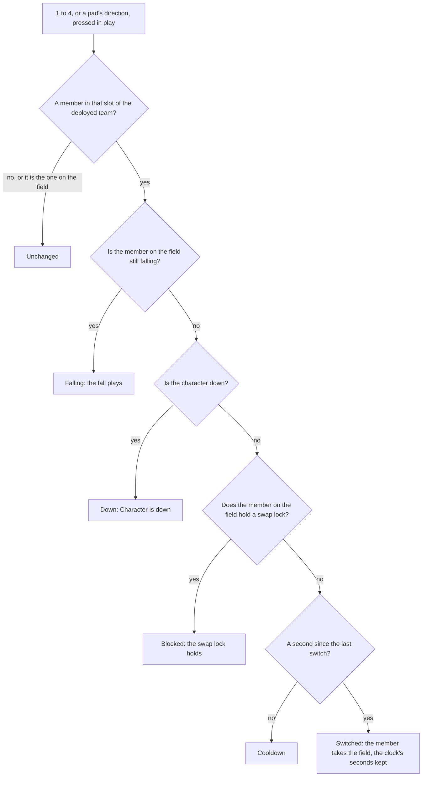
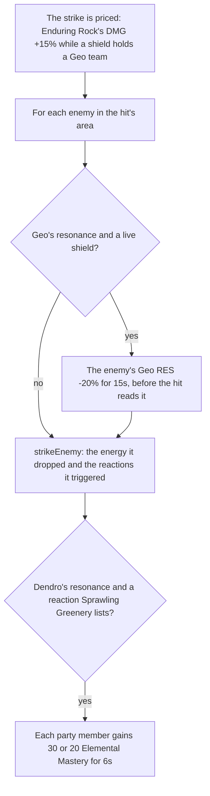

# Party

In the game, a party is a team of up to four characters, and the player keeps several: Party Setup, on `L`, holds the teams set up, one of them deployed, and one member of the deployed team is on the field (`~/Esposter.noindex/genshin-parity/captures/yt-greLeGJE-Jg-party-setup.mp4`, at 30 seconds: four characters in Party 1, and four team dots). The keys `1` to `4`, and a pad's directions, switch the member on the field. `genshin-world` keeps this as a `Party`, plain data with a few rules over it, so it runs the same in a test as in the world.

## How it works

- **A party is its teams, the one deployed and the one on the field.** `Party` holds every `PartyTeam` set up, the index of the deployed one, the index of its member on the field, each character's own `PartyMember` by its id and the seconds on the world's clock at the last switch. `createParty` starts one as the game starts a player's: the four default teams, Party 1 to 4 (the English names are in `~/Esposter.noindex/genshin-parity/text/TextMap/`), the first deployed with the characters given at full HP and its first member on the field.
- **A character keeps its own HP, energy and cooldowns, whichever team holds it.** A `PartyMember` holds its HP as a share of its Max HP, so the HP keeps its share as the Max HP changes, as the game keeps it; its energy toward its burst; and the seconds left on its skill and its burst. A character is down when its HP is gone (`checkIsCharacterDown`), and a character a team takes on joins the party at full HP.
- **Every heal and HP loss in combat is recorded for the kits.** `healPartyMember` and `damagePartyMember` push each change they make onto the party's `healthChanges`: the member, the share it gained or lost, the share of a heal past full and the character whose kit made it. The step on the field sends them to the kits as `HealthChanged` and empties the list ([character kits](../kits/README.md)) (`packages/genshin-world/src/services/party/healPartyMember.test.ts`, `packages/genshin-world/src/services/party/damagePartyMember.test.ts`). A revive and the statues' heals write the share directly, out of combat, and are not recorded.
- **A Bond of Life takes a heal before the HP does.** A `PartyMember` carries a `bondOfLifeShare`, the Bond of Life it holds as a share of its Max HP, zero when it holds none. Both it and the cleared share are runtime-only, so a reloaded team starts with none. `healPartyMember` takes it down by the heal first, and records the share it took as `bondOfLifeShare` on the change (zero when it took none), so the kits hear a heal the bond absorbed as a change of zero HP (`packages/genshin-world/src/services/party/healPartyMember.test.ts`). `grantPartyMemberBondOfLife` adds to a standing Bond of Life, and over an empty one restarts the `bondOfLifeClearedShare` a heal adds to as the bond clears, which the clearing passives read (`packages/genshin-world/src/services/party/grantPartyMemberBondOfLife.test.ts`). Its stacking is additive, which is provisional: the wiki's stacking examples, Clorinde's and Sigewinne's, read that way, and no source confirms it for a plain grant.
- **A fall brings on the next member.** `damagePartyMember` takes a share of a character's Max HP. One whose HP runs out is down and loses its energy, and if it was on the field the player chooses the next member standing once the fall ends (`checkIsNextMemberAsked`; `packages/genshin-world/src/services/party/damagePartyMember.test.ts`, `packages/genshin-world/src/services/party/checkIsNextMemberAsked.test.ts`). `checkIsPartyDown` holds once the whole deployed team is down (`packages/genshin-world/src/services/party/checkIsPartyDown.test.ts`), and the game over screen's Revive runs `reviveParty`, which brings each fallen member back at 35% of its Max HP (`packages/genshin-world/src/services/party/reviveParty.test.ts`, for the members brought back), and jumps the team to the nearest unlocked waypoint. `drownParty` is the game's drowning: every member loses its energy and 10% of its Max HP (`packages/genshin-world/src/services/party/drownParty.test.ts`).
- **A team is filled from the left.** A `PartyTeam` holds its members' character ids in slot order (`packages/genshin-world/src/services/party/quickSetupPartyTeam.test.ts`) and the name the player gave it, `""` while it keeps the game's own.
- **A switch is a key's slot, in the order of the deployed team.** `PARTY_MEMBER_INPUT_ACTIONS` holds the actions for slots 1 to 4 ([controls](../controls/design.md) binds them to `1` to `4` and a pad's up, right, left and down). `switchPartyMember` answers with a `PartySwitchResult`: `Unchanged` for an empty slot or the member already on the field, `Falling` while the fall of the member on the field plays, `Down` for a character who is down, `Blocked` while a swap lock on the member on the field holds, `Cooldown` within `PARTY_SWITCH_COOLDOWN_SECONDS` of the last switch, and `Switched` otherwise (`packages/genshin-world/src/services/party/switchPartyMember.test.ts`).
- **Party Setup's edits are refused as the game refuses them.** `deployPartyTeam` deploys a team with its first member standing on the field, and answers `Empty` for a team with nobody in it and `Down` for one whose members are all down. `setPartyTeamCharacters` sets a team's members, each once and four at most; on the deployed team the field keeps its slot, or the last one past a shortened team, so it answers `Empty` for a team emptied and `Down` for a character who is down landing on the field. Both are a `PartyTeamResult` (`packages/genshin-world/src/services/party/deployPartyTeam.test.ts`, `packages/genshin-world/src/services/party/setPartyTeamCharacters.test.ts`).
- **The world's party is reactive for the screen and raw for the step's own state.** `createWorldParty` makes the party the world holds `reactive`, so the HUD redraws as a member's HP, energy or cooldowns change and as the teams do, and holds raw what no screen reads and the step writes every step: the health changes not yet sent, the Lunar-Charged cloud, Lunar-Crystallize and Verdant Dew. `stepPartyCooldowns` writes a cooldown only while it runs, since a reactive write costs the same for a zero written over a zero (`packages/genshin-world/src/services/party/createWorldParty.test.ts`, `packages/genshin-world/src/services/party/stepPartyCooldowns.test.ts`). A profile of the kit bench put two fifths of its minute in these writes ([character kits](../kits/README.md)).
- **The character on the field** is `getActiveCharacterId`, the deployed team's member at the active index.
- **Teams are added, renamed and disbanded under the game's limits.** `addPartyTeam` adds an empty team named "Team Standing By" until renamed, and answers `Full` past fifteen teams (`packages/genshin-world/src/services/party/addPartyTeam.test.ts`; the English names "Team Standing By" and "Team standing by is full" are in `~/Esposter.noindex/genshin-parity/text/TextMap/`). `disbandPartyTeam` keeps the four default teams and the deployed one (`Kept`), and a team disbanded before the deployed one moves its index down so the same team stays deployed (`packages/genshin-world/src/services/party/disbandPartyTeam.test.ts`). `renamePartyTeam` with an empty name gives a team its own name back.
- **A burst on a switch.** [Controls](../controls/design.md) binds `Left Alt` with `1` to `4` to `SwitchToPartyMemberAndBurst1` to `4`, a chord that takes the press over from the plain key. The character's fixed step reads that press (`PARTY_MEMBER_BURST_INPUT_ACTIONS`) and uses its burst once the member is on the field, switched to by the world screen's key that frame or already there, so a refused switch (a cooldown, a fallen member, an empty slot) uses no burst.
- **Elemental Resonance is a rule over the deployed team's elements, and its effects hold on the team while it has them.** `getElementalResonances` gives each element that two or more of a full team's four members share, in the game's element order, the Protective Canopy for four unique elements, and none for a team not full (`packages/genshin-world/src/services/party/getElementalResonances.test.ts`). The resonances that change a stat are summed into every member's attributes by `computeCharacterAttributes`, from `ElementalResonanceAttributeLinesMap`: Pyro's ATK +25%, Hydro's Max HP +25%, Geo's Shield Strength +15%, Dendro's Elemental Mastery +50, and the Protective Canopy's All Elemental RES and Physical RES +15% (the game's text in `~/Esposter.noindex/genshin-parity/text/ExcelBinOutput/TeamResonanceExcelConfigData.json`, Fervent Flames, Soothing Water, Sprawling Greenery, Protective Canopy; `packages/genshin-world/src/services/character/computeCharacterAttributes.test.ts`). Cryo's CRIT Rate +15% against a Frozen or Cryo-affected enemy is read where a hit is struck, in [combat](../combat/design.md) (the game's Shattering Ice text in `~/Esposter.noindex/genshin-parity/text/ExcelBinOutput/TeamResonanceExcelConfigData.json`). Enduring Rock, Sprawling Greenery and Impetuous Winds act on a strike, a reaction and a skill, as the next section sets out. Each figure is the Elemental Resonance page's in the Genshin Impact Wiki, and the effects whose mechanism is not built yet are on the [party proposal](../../../changes/genshin-party/design.md).

## Resonances in a strike

Enduring Rock, Sprawling Greenery and Impetuous Winds read the team's shields, the reactions a strike triggers and the skill on the field as they go, so they are applied in the character's step and the strikes it lands rather than summed into the attributes.

- **Enduring Rock holds while a shield is up.** A live shield on the team, whoever cast it, makes a Geo team's hits deal 15% more: every element's DMG Bonus and the Physical DMG Bonus each rise by it, in the pricing `getBuffedCombatant` gives each strike (`packages/genshin-world/src/services/kit/effects/getBuffedCombatant.test.ts`; the game's Enduring Rock text in `~/Esposter.noindex/genshin-parity/text/ExcelBinOutput/TeamResonanceExcelConfigData.json`, DMG dealt +15%). Each enemy such a hit strikes loses 20% of its Geo RES for 15 seconds, given before the hit's damage is read (`addEnduringRockStatus`), and `strikeEnemy` reads that RES through the status's `resistanceReduction` (`packages/genshin-world/src/services/party/addEnduringRockStatus.test.ts`; the game's Geo RES -20% for 15s in the same dump table, `paramList`). The wiki's Moondrift clause, from Lunar-Crystallize, is not built.
- **Sprawling Greenery follows each reaction a strike triggers.** With Dendro's resonance, a reaction gives every party member Elemental Mastery for 6 seconds: 30 after Burning, Quicken, Bloom or Lunar-Bloom, and 20 after Aggravate, Spread, Hyperbloom or Burgeon (`ReactionElementalMasteryMap`; the game's Sprawling Greenery text in `~/Esposter.noindex/genshin-parity/text/ExcelBinOutput/TeamResonanceExcelConfigData.json`, `paramList` 30 and 20 for 6s). `strikeEnemy` returns the reactions a strike triggered beside the energy it dropped, and `addSprawlingGreeneryBuffs` adds one buff per member for each. A buff restarts only one of its own amount, and the 30 and the 20 run side by side, since the wiki counts their durations on their own (`packages/genshin-world/src/services/party/addSprawlingGreeneryBuffs.test.ts`).
- **Impetuous Winds shortens a skill, speeds the body and cuts its stamina.** A skill's cooldown is multiplied by 0.95 as it starts, after the kit's own multiplier and those of the fields it is cast inside (`startNextKitAction`), and so is the wait a skill with charges keeps for its other charges (`getImpetuousWindsSkillCooldownMultiplier`; the game's Impetuous Winds text, "Shortens Skill CD by 5%", in `~/Esposter.noindex/genshin-parity/text/ExcelBinOutput/TeamResonanceExcelConfigData.json`). The character on the field walks, runs, sprints and dashes 10% faster (`packages/genshin-world/src/services/party/getImpetuousWindsLocomotion.test.ts`; the game's "Increases Movement SPD by 10%" in `~/Esposter.noindex/genshin-parity/text/ExcelBinOutput/TeamResonanceExcelConfigData.json`): the character step hands the controller `getImpetuousWindsLocomotion`'s speeds, read from the resonances before the controller steps. Every stamina spend, the kit's and the body's, is multiplied by 0.85 while the character on the field carries Anemo's resonance (the game's "Decreases Stamina Consumption by 15%" in `~/Esposter.noindex/genshin-parity/text/ExcelBinOutput/TeamResonanceExcelConfigData.json`): `useWorldCombat` builds the party's stamina pool with `getImpetuousWindsStaminaConsumptionMultiplier` over the field's resonances, read at each spend, and a charged attack is gated at that same cost.

## The world screen

The world screen keeps the player's characters and their party. A new player's is the Traveler alone, made by `createCharacter` once the roster arrives, at level 1 with the weapon the game gives them ([character attributes](../character-attributes/design.md)). Once a frame, in play with no screen over the world, the first party key pressed is passed to `switchPartyMember` at the canvas clock's elapsed seconds, so a screen over the world holds the keys as it holds the rest of play.

The character on the field fights through its kit, which prices every character's hits from its attributes with the Traveler's kit until the kits run gives each its own ([combat](../combat/design.md)). An enemy's strike, past the team's shields, and a drowning take HP from the party, and a team that has all fallen opens the game over screen, whose Revive brings it back at 35% and jumps it to the nearest unlocked teleport waypoint, or leaves it where it fell when none is unlocked. A domain's challenge revives its team without the screen, as the domain's rule gives.

## Key files

| File                                                                                         | Role                                                                                                                                                         |
| :------------------------------------------------------------------------------------------- | :----------------------------------------------------------------------------------------------------------------------------------------------------------- |
| `packages/genshin-world/src/models/party/Party.ts`                                           | The teams, the one deployed, the field, each member, the clock                                                                                               |
| `packages/genshin-world/src/services/party/createParty.ts`                                   | A party as the game starts one                                                                                                                               |
| `packages/genshin-world/src/services/party/createWorldParty.ts`                              | The party as the world holds it: reactive, its step-only state raw                                                                                           |
| `packages/genshin-world/src/services/party/switchPartyMember.ts`                             | A key's switch, or the game's reason for refusing it                                                                                                         |
| `packages/genshin-world/src/services/party/deployPartyTeam.ts`                               | A team deployed, its first member standing on the field                                                                                                      |
| `packages/genshin-world/src/services/party/setPartyTeamCharacters.ts`                        | A team's members set, the field keeping its slot                                                                                                             |
| `packages/genshin-world/src/services/party/damagePartyMember.ts`                             | HP taken, a fall, and the next member brought on                                                                                                             |
| `packages/genshin-world/src/services/party/healPartyMember.ts`                               | HP restored to a standing member, never past full                                                                                                            |
| `packages/genshin-world/src/services/party/grantPartyMemberBondOfLife.ts`                    | Bond of Life granted to a character, added to any it already carries                                                                                         |
| `packages/genshin-world/src/models/party/PartyHealthChange.ts`                               | A change to a member's HP as it took effect, queued on the party for the kits                                                                                |
| `packages/genshin-world/src/services/party/gainPartyEnergy.ts`                               | A particle's energy to each standing member of the deployed team                                                                                             |
| `packages/genshin-world/src/services/party/stepPartyCooldowns.ts`                            | Each member's skill and burst cooldowns, lowered each step                                                                                                   |
| `packages/genshin-world/src/services/party/addPartyTeam.ts`                                  | A team added to Party Setup, named until renamed, at most fifteen                                                                                            |
| `packages/genshin-world/src/services/party/disbandPartyTeam.ts`                              | A team disbanded, the defaults and the deployed one kept                                                                                                     |
| `packages/genshin-world/src/services/party/renamePartyTeam.ts`                               | A team renamed, an empty name giving its own back                                                                                                            |
| `packages/genshin-world/src/services/party/getElementalResonances.ts`                        | The resonances a full team's elements give                                                                                                                   |
| `packages/genshin-world/src/services/party/getDeployedCombatants.ts`                         | The deployed members' built combatants in the team's order, each with its Energy and whether it is on the field, for a passive or action to read the team by |
| `packages/genshin-world/src/services/party/ElementalResonanceAttributeLinesMap.ts`           | The attribute lines each resonance adds to every member of the deployed team                                                                                 |
| `packages/genshin-world/src/services/party/checkIsEnduringRock.ts`                           | Enduring Rock holds: the deployed team's Geo resonance and a live shield                                                                                     |
| `packages/genshin-world/src/services/party/addEnduringRockStatus.ts`                         | The Geo RES an enemy struck under Enduring Rock loses, given before its damage is read                                                                       |
| `packages/genshin-world/src/services/party/ReactionElementalMasteryMap.ts`                   | The Elemental Mastery each reaction gives every party member under Sprawling Greenery                                                                        |
| `packages/genshin-world/src/services/party/addSprawlingGreeneryBuffs.ts`                     | Each reaction's timed Elemental Mastery, one buff per party member for each reaction                                                                         |
| `packages/genshin-world/src/services/party/getMovementSpeedLocomotion.ts`                    | The walking, running, sprinting and dashing speeds raised by a character's Movement SPD                                                                      |
| `packages/genshin-world/src/services/party/getImpetuousWindsLocomotion.ts`                   | The walking, running, sprinting and dashing speeds raised by Impetuous Winds                                                                                 |
| `packages/genshin-world/src/services/party/getImpetuousWindsSkillCooldownMultiplier.ts`      | Impetuous Winds' factor on a skill's cooldown, or none without it                                                                                            |
| `packages/genshin-world/src/services/party/getImpetuousWindsStaminaConsumptionMultiplier.ts` | Impetuous Winds' factor on a stamina spend, or none without it                                                                                               |
| `packages/genshin-world/src/services/kit/effects/getBuffedCombatant.ts`                      | A hit's pricing: its buffs, its passives' bonuses at its HP in the party, Enduring Rock's DMG and its stats converted from Max HP                            |
| `packages/genshin-world/src/services/kit/startNextKitAction.ts`                              | A skill's cooldown as it starts: the kit's own multiplier, the fields' it is cast inside, then Impetuous Winds'                                              |
| `packages/genshin-world/src/services/party/drownParty.ts`                                    | A drowning: every member's energy and a tenth of its Max HP                                                                                                  |
| `packages/genshin-world/src/services/party/reviveParty.ts`                                   | A fallen team brought back at 35% of its Max HP, or the share a revive gives                                                                                 |
| `packages/genshin-world/src/services/map/findNearestTeleportWaypoint.ts`                     | The unlocked teleport waypoint nearest the body, where a fallen team is jumped to                                                                            |
| `packages/genshin-world/src/services/party/constants.ts`                                     | The starting team, the team size, the cooldown, the default teams and the keys                                                                               |
| `packages/genshin-world/src/components/World/Character/Index.vue`                            | Steps the cooldowns, a drowning, a burst on a switch, the stamina cut and the field's kit                                                                    |
| `packages/genshin-world/src/services/kit/stepActiveKit.ts`                                   | The field's kit at the step, its strikes landed through `strikeKitEnemies`                                                                                   |
| `packages/genshin-world/src/services/kit/strikeKitEnemies.ts`                                | A strike's resonances: Enduring Rock's status and pricing, and Sprawling Greenery's buffs on its reactions                                                   |
| `packages/genshin-world/src/components/World/Session/Index.vue`                              | Keeps the characters and the party, switches on the keys, and respawns a fallen team                                                                         |

## Notes

- **The cooldown is the single player's.** The wiki gives one second; co-op splits the four slots between players and is out of the world's scope.
- **Only the character on the field takes an enemy's strike, bar a strike that lands on a taunt it struck.** `strikeParty` (`packages/genshin-world/src/composables/useWorldCombat.ts`) sends a taunted strike to the taunt. The others' HP falls only by a drowning, which takes every member's energy and a tenth of its Max HP together, while their cooldowns keep running off the field.

## Sources

- [Party](https://genshin-impact.fandom.com/wiki/Party), Genshin Impact Wiki: four members, the one second switch cooldown, Party Setup on `L`, the four default teams that are never disbanded, a team filled from the left and a team of none never deployed.
- [Fallen Character](https://genshin-impact.fandom.com/wiki/Fallen_Character), Genshin Impact Wiki: a fallen character is never switched in, and "Character is down" for a fallen character on the field's slot or a team of fallen characters deployed; a fallen character's energy lost, the fallen team revived at the nearest waypoint with 35% HP, and drowning's 10% of every member's Max HP and all its energy.
- [Health](https://genshin-impact.fandom.com/wiki/Health), Genshin Impact Wiki: the next character brought on when one falls, and the HP keeping its share as the Max HP changes.
- [Controls](https://genshin-impact.fandom.com/wiki/Controls), Genshin Impact Wiki: party members 1 to 4 on the number keys and a pad's up, right, left and down.
- [Team Bonus](https://genshin-impact.fandom.com/wiki/Team_Bonus), Genshin Impact Wiki: each Elemental Resonance's effect, Enduring Rock's Geo RES and DMG, Sprawling Greenery's Elemental Mastery for 6 seconds after each reaction and its two amounts counted independently, and Impetuous Winds' skill cooldown, stamina and movement.
- [Movement SPD](https://genshin-impact.fandom.com/wiki/Movement_SPD), Genshin Impact Wiki: the walking, running, sprinting, dashing and jumping that Movement SPD alters.

## Open

- [ ] **Party Setup opens on `L`, and the keys `1` to `4` and a pad's directions switch members** — the code binds them (`packages/genshin-engine/src/input/InputActionBindingMap.ts`, `OpenPartySetup` on `KeyL`, `SwitchToPartyMember1` to `4` on `Digit1` to `Digit4` and the directional pad); the game's own defaults are the controls page's open item, with the wiki's Controls page not cached.
- **`createParty` deploys Party 1 with its first member on the field** — `packages/genshin-world/src/services/party/createParty.ts` sets the active index to the first slot (`activeIndex: 0`).
- [ ] **A `PartyMember` keeps its HP as a share of Max HP, as the game does, and a character joins a team at full HP** — `packages/genshin-world/src/services/party/createPartyMember.ts` builds each member; the game's own Health page is not cached, so "as the game does" is open.
- **A revive and a statue's heal are not recorded for the kits** — `packages/genshin-world/src/services/party/reviveParty.ts` sets each fallen member's share without pushing to `healthChanges`, and `packages/genshin-world/src/services/statue/autoRecoverParty.ts` brings a team back through it.
- [ ] **A revive brings a fallen team back at 35% of Max HP** — the code holds `REVIVE_HEALTH_SHARE = 0.35` (`packages/genshin-world/src/services/party/constants.ts`), but no English game text gives the 35% and the revive clip is not measured.
- [ ] **A drowning takes a tenth of every member's Max HP** — the code holds `DROWN_HEALTH_SHARE_LOSS = 0.1` (`packages/genshin-world/src/services/party/constants.ts`, read by `packages/genshin-world/src/services/party/drownParty.ts`), but no English game text gives the 10%, and the wiki's Fallen Character page is not cached.
- **The code's game-over revive hands the team's placing to the host, which places it at the nearest waypoint** — `packages/genshin-world/src/composables/useWorldCombat.ts` (`reviveFallenParty`), `packages/genshin-world/src/components/World/Session/Index.vue`, and `packages/genshin-world/src/services/map/findNearestTeleportWaypoint.ts`.
- [ ] **The game over screen's Revive jumps the team to the nearest unlocked waypoint, or leaves it where it fell** — no source yet: no test holds the jump or the no-waypoint case.
- **The code's party switch cooldown is `PARTY_SWITCH_COOLDOWN_SECONDS`, one second** — `packages/genshin-world/src/services/party/constants.ts` (line 12).
- [ ] **`PARTY_SWITCH_COOLDOWN_SECONDS` is one second** — no source yet: the wiki's Party page is not cached.
- [ ] **Left Alt with a member's key uses that member's burst, and a refused switch uses none** — the chord is read through `PARTY_MEMBER_BURST_INPUT_ACTIONS` (cited in the prose above), but whether a refused switch in `packages/genshin-world/src/services/party/switchPartyMember.ts` uses no burst was not traced in this pass.
- [ ] **Cryo's CRIT Rate +15% is read where a hit is struck** — no source yet: the value is not checked against a game source, and no test or record in `packages/genshin-world/src/services/party/` holds it in combat.
- **The code multiplies a skill's cooldown by 0.95 under Impetuous Winds as it starts, and the wait for its other charges** — `packages/genshin-world/src/services/party/constants.ts` (`IMPETUOUS_WINDS_SKILL_COOLDOWN_MULTIPLIER`, 0.95) and `packages/genshin-world/src/services/kit/startNextKitAction.ts`.
- [ ] **Impetuous Winds multiplies a skill's cooldown by 0.95 as it starts, and the wait for its other charges** — no source yet: no test holds `startNextKitAction` or the multiplier's use.
- **The code multiplies each stamina spend by 0.85 under Impetuous Winds** — `packages/genshin-world/src/services/party/constants.ts` (`IMPETUOUS_WINDS_STAMINA_CONSUMPTION_MULTIPLIER`, 0.85) and `packages/genshin-world/src/services/party/getImpetuousWindsStaminaConsumptionMultiplier.ts`.
- [ ] **Impetuous Winds multiplies each stamina spend by 0.85** — no source yet: no test holds the stamina pool built by `useWorldCombat`.
- [ ] **The kit bench put two fifths of its minute in the party's writes** — no source yet: no bench output that records the share is cited.
- **`getActiveCharacterId` returns the deployed team's member at the active index** — `packages/genshin-world/src/services/party/getActiveCharacterId.ts`.
- **The world screen makes the Traveler from the roster at level 1 with its weapon, and switches on the first party key once a frame** — `packages/genshin-world/src/services/character/createCharacter.ts` and `packages/genshin-world/src/components/World/Session/Index.vue`.
- [ ] **A domain's challenge revives its team without the screen** — no source yet: no domain-challenge revive call was located in `packages/genshin-world/src/services/party/` or `packages/genshin-world/src/composables/useWorldDomains.ts`.
- [ ] **An enemy's strike that lands on a taunt is the taunt's to take, as the game does** — no source yet: `packages/genshin-world/src/composables/useWorldCombat.ts` (`strikeParty`) sends a taunted strike to the taunt and every other strike to the character on the field through the team's shields, but no game text or wiki page checks the taunt's targeting.
- **The code zeroes every deployed member's energy as a drowning falls** — `packages/genshin-world/src/services/party/drownParty.ts` (line 12).
- [ ] **A drowning takes every member's energy** — no source yet: a recording of a drowning, not yet captured.
- [ ] **Only the character on the field takes an enemy's strike** — no source yet: no test holds it, and the wiki's Party page is not cached.
