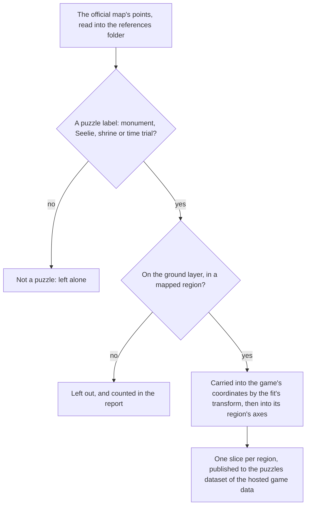

# Puzzles

The servers' puzzle mechanisms are not in the client's data, so the map's public points stand in for their places, per the [spawned places](../spawned-places/design.md) page. This page is the built half of the [puzzles](../../../changes/genshin-puzzles/design.md) proposal: each puzzle mark the map gives is carried into its region's slice by its kind, and an Elemental Monument is a small state machine that a strike or a reaction lights. Nothing is placed in the world, drawn, struck or solved yet.

## How it works

## The builder

`pnpm -C scripts genshin:assets puzzles` publishes one slice per region to the puzzles dataset of the [hosted game data](../hosted-game-data/design.md), in the shape the [chests](../chests/design.md) page describes. Its report lists each region's places and the ones it left out.

- **The four kinds are the map's labels.** An Elemental Monument is the monument label, a Seelie is the Seelie label with the two variants the map names beside it (Electro and Warming), a Shrine of Depths is each nation's and the borderland's shrine label, and a Time Trial Challenge is the challenge label. The map gives each nation's shrine a label of its own, so the kind is the one thing those labels share.
- **The ground only and the mapped areas only.** As the chests are, a point on a layer under the ground or in an area no region is mapped to is counted and left out.
- **Only places.** The map gives no element, no timing and no wiring for a mark, so none of those is published. The builder shares its placement with the chests' builder, the `placeMapPoints` primitive, so a kind of point is one label map away from a slice.

## The pages of this set

| Page                                                   | Holds                                                                     |
| :----------------------------------------------------- | :------------------------------------------------------------------------ |
| [Elemental monument](monument/design.md)               | the state machine an Elemental Monument is, lit by a strike or a reaction |
| [The Seelie](seelie/design.md)                         | a Seelie led along its route, settled at its court or sent back to rest   |
| [Time Trial Challenge](time-trial-challenge/design.md) | a timed challenge solved by striking its targets                          |

## Key files

| File                                                                  | Role                                                                    |
| :-------------------------------------------------------------------- | :---------------------------------------------------------------------- |
| `packages/genshin-world/src/models/puzzle/PuzzleKind.ts`              | The four kinds the official map marks as puzzles                        |
| `packages/genshin-world/src/models/puzzle/PuzzlePlace.ts`             | A placed puzzle mechanism: its id, kind and ground point                |
| `packages/genshin-world/src/services/puzzle/constants.ts`             | The timed monument's lit time, and a Seelie's return and route times    |
| `scripts/src/services/genshinAssets/puzzles/PuzzleKindLabelIdsMap.ts` | Each kind's labels on the official map                                  |
| `scripts/src/services/genshinAssets/puzzles/buildPuzzlePlaces.ts`     | Builds each region's puzzle places from the points                      |
| `scripts/src/services/genshinAssets/points/placeMapPoints.ts`         | Carries a kind's labelled points into their regions, shared with chests |
| `scripts/src/services/genshinAssets/commands/puzzlesCommand.ts`       | `genshin:assets puzzles`                                                |

## Sources

- [Teyvat Interactive Map](https://act.hoyolab.com/ys/app/interactive-map/index.html), HoYoLAB: the official map. Its label tree and point list are the public data the builder reads as references.
