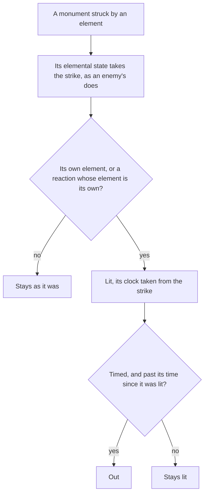

# Elemental monument

An `ElementalMonument` holds its element, its own elemental state, whether it is lit, whether it is timed, and the state's clock reading when it was last lit.

- **A strike** (`strikeElementalMonument`) lands on the monument's elemental state through `applyElement`, as a kit's hit lands on an enemy. The monument is lit by the element itself, or by any reaction whose element is its own, so a Swirl that spreads the Pyro on it lights a Pyro monument as much as a Pyro strike does. A lit monument's clock restarts from the strike.
- **A step** (`stepElementalMonument`) moves the elemental state on the fixed step, so its auras decay and its Burning ticks Pyro, lighting it from any reaction of its own. A timed monument that is not lit again goes out once `ELEMENTAL_MONUMENT_LIT_SECONDS` have passed since it was lit; an untimed one stays lit.
- **A solve** (`checkIsMonumentPuzzleSolved`) holds once every monument of a puzzle is lit together, and never by none at all.

`ELEMENTAL_MONUMENT_LIT_SECONDS` is provisional until a recording of a timed monument going out measures it.

## How it works

## Key files

| File                                                                        | Role                                                                        |
| :-------------------------------------------------------------------------- | :-------------------------------------------------------------------------- |
| `packages/genshin-world/src/models/puzzle/ElementalMonument.ts`             | A monument's element, elemental state, lit state and timing                 |
| `packages/genshin-world/src/services/puzzle/strikeElementalMonument.ts`     | A strike on a monument, lighting it by its element or a reaction of its own |
| `packages/genshin-world/src/services/puzzle/stepElementalMonument.ts`       | A monument's elemental state on the fixed step, and its time going out      |
| `packages/genshin-world/src/services/puzzle/checkIsMonumentPuzzleSolved.ts` | Whether every monument of a puzzle is lit together                          |

## Sources

- [Elemental Monument](https://genshin-impact.fandom.com/wiki/Elemental_Monument), Genshin Impact Wiki: monuments lit by their element, reactions included, some for good and some for a time.
