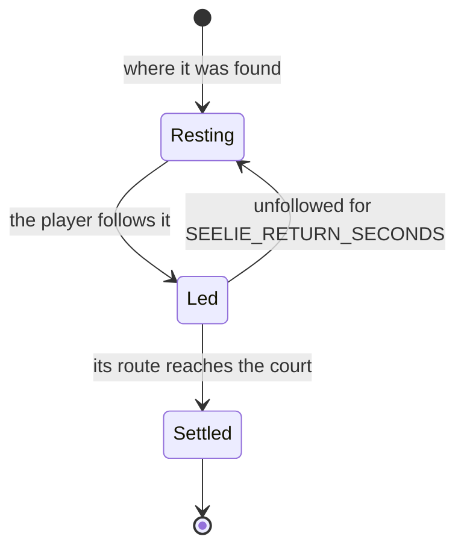

# The Seelie

A `Seelie` holds its start and its court on the ground, its progress along the route between them, its state and the time it has been left unfollowed. It is `Resting` where it was found, becomes `Led` once the player follows it, walks its route while followed and `Settled` at the court. Left unfollowed for `SEELIE_RETURN_SECONDS` (`packages/genshin-world/src/services/puzzle/constants.ts`) it goes back to its start, `Resting`, and a settled one stays settled. `stepSeelie` moves it on the fixed step, and the caller reports whether the player is following it that step (`packages/genshin-world/src/models/puzzle/Seelie.ts`, `packages/genshin-world/src/services/puzzle/stepSeelie.ts`). A route's walk takes `SEELIE_ROUTE_SECONDS` provisionally.

The map gives one point per Seelie, and the count of Mondstadt's courts is open (see Open). Each Mondstadt court is paired with one Seelie by `pairSeelieCourts`, closest first, and the world's screen leads each paired Seelie from its place toward its court (`packages/genshin-world/src/services/puzzle/pairSeelieCourts.ts`, `packages/genshin-world/src/components/World/Screen/Index.vue`). The other regions' courts are still to come. A settled Seelie spawns its chest on its court (`packages/genshin-world/src/services/puzzle/computeSeelieChestPlaces.ts`). The Seelie wiki page, cached at `{data-root}/cache/genshin-wiki/Page_Seelie.json`, says chests appear once the Seelie has settled back into its court, and names no kind.

## Key files

| File                                                       | Role                                                                   |
| :--------------------------------------------------------- | :--------------------------------------------------------------------- |
| `packages/genshin-world/src/models/puzzle/Seelie.ts`       | A Seelie's start, court, route progress and state                      |
| `packages/genshin-world/src/services/puzzle/stepSeelie.ts` | A Seelie led while followed, settled at its court or sent back to rest |

## Sources

- Seelie, Genshin Impact Wiki, cached at `{data-root}/cache/genshin-wiki/Page_Seelie.json`, line 10: a Seelie returns to its starting location "if they have not been led back to their court after a certain amount of time."

## Open

Whether the Seelie rests until followed, is led to its court and goes back to rest when left unfollowed, as the game does, is open in the [spec](spec.md).

- [ ] **The map gives one point per Seelie and thirty courts for Mondstadt** — contradicted by `{data-root}/cache/genshin-wiki/Page_Seelie.json` line 67: 51 Seelie in Mondstadt, each with its own court (line 8), not thirty courts.
- [ ] **The chest a settled Seelie spawns** — the kind is still open: the Seelie page names none (`{data-root}/cache/genshin-wiki/Page_Seelie.json`, line 10), and the Chest page lists both Common (`{data-root}/cache/genshin-wiki/Page_Chest.json`, line 24) and Exquisite (line 32) for a court; a recording of a settled Seelie's chest would name it.
