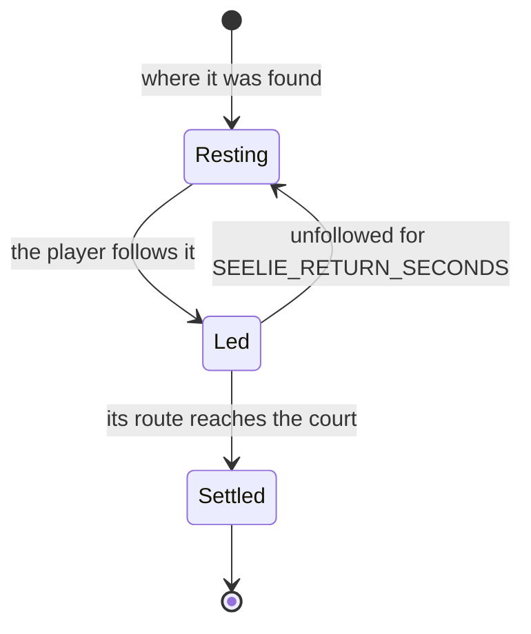

# The Seelie

A `Seelie` holds its start and its court on the ground, its progress along the route between them, its state and the time it has been left unfollowed. It is `Resting` where it was found, becomes `Led` once the player follows it, walks its route while followed and `Settled` at the court. Left unfollowed for `SEELIE_RETURN_SECONDS` it goes back to its start, `Resting`, and a settled one stays settled. `stepSeelie` moves it on the fixed step, and the caller reports whether the player is following it that step. A route's walk takes `SEELIE_ROUTE_SECONDS` provisionally.

The map gives one point per Seelie and no court, so a Seelie's court and start are not yet fitted into the world: the court is the one the wiki says a Seelie settles in, and the placed court is still to come.

## Key files

| File                                                       | Role                                                                   |
| :--------------------------------------------------------- | :--------------------------------------------------------------------- |
| `packages/genshin-world/src/models/puzzle/Seelie.ts`       | A Seelie's start, court, route progress and state                      |
| `packages/genshin-world/src/services/puzzle/stepSeelie.ts` | A Seelie led while followed, settled at its court or sent back to rest |
