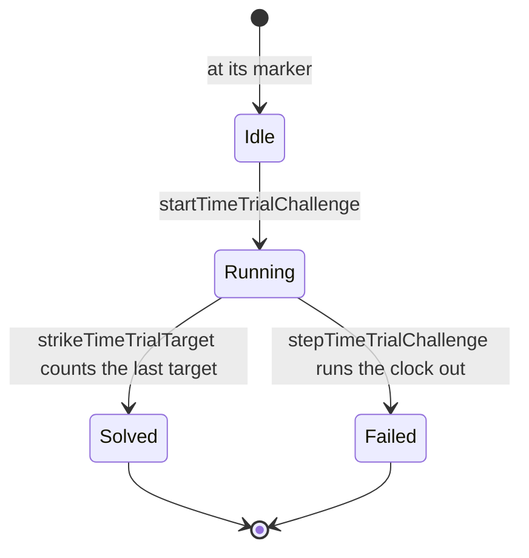

# Time Trial Challenge

A `TimeTrialChallenge` holds its clock's limit and what is left of it, its state, and how many of its targets are struck against how many it asks for. `startTimeTrialChallenge` starts an idle one from its marker, `strikeTimeTrialTarget` counts a target done and solves the challenge once the last is, and `stepTimeTrialChallenge` runs the clock on the fixed step and fails it when it runs out (`packages/genshin-world/src/models/puzzle/TimeTrialChallenge.ts`, `packages/genshin-world/src/services/puzzle/startTimeTrialChallenge.ts`, `packages/genshin-world/src/services/puzzle/strikeTimeTrialTarget.ts`, `packages/genshin-world/src/services/puzzle/stepTimeTrialChallenge.ts`). A solved challenge is the solve event: the world reads its `Solved` state and spawns its chest at its marker (`packages/genshin-world/src/services/puzzle/computeTimeTrialChestPlaces.ts`), which opening grants as the [chests](../../chests/design.md) page describes. The map gives no limit or target count per challenge, so both come from the world's data once measured.

## Key files

| File                                                                    | Role                                                                    |
| :---------------------------------------------------------------------- | :---------------------------------------------------------------------- |
| `packages/genshin-world/src/models/puzzle/TimeTrialChallenge.ts`        | A challenge's clock, targets and state                                  |
| `packages/genshin-world/src/services/puzzle/startTimeTrialChallenge.ts` | Starts an idle challenge's clock from its marker                        |
| `packages/genshin-world/src/services/puzzle/strikeTimeTrialTarget.ts`   | Counts a target done, solving the challenge on its last                 |
| `packages/genshin-world/src/services/puzzle/stepTimeTrialChallenge.ts`  | Runs a challenge's clock on the fixed step, failing it when it runs out |

## Sources

- `{data-root}/genshin-parity/captures/yt-B_l5b_KXt-o-time-trial-limit.mp4` — a Time Trial Challenge started at its marker and filmed to its end, with its clock in view, 3 minutes at most; the limit the clock is set to is read from it, since the wiki gives none for each challenge. Found: https://www.youtube.com/watch?v=B_l5b_KXt-o at 0–55 s.
- `{data-root}/genshin-parity/frames/yt-B_l5b_KXt-o-time-trial-limit@0/sheet.png`, the contact sheet of the recording's frames: the banner "Open the chest in 45s" stands over the clock at 2.00 s (`{data-root}/genshin-parity/frames/yt-B_l5b_KXt-o-time-trial-limit@0/0002.png`, which reads "Time Remaining: 42s"), and "Challenge Completed" shows at 44.00 s.
- [Time Trial Challenge](https://genshin-impact.fandom.com/wiki/Time_Trial_Challenge), Genshin Impact Wiki, cached at `{data-root}/cache/genshin-wiki/Page_Time_Trial_Challenge.json`, line 11: a challenge gives its reward for "completing the task within an allocated time limit"; its Aiming type blows up X barrels or bubbles and its Battling type defeats all opponents, each "within X second(s)" (lines 64 and 69), and its Traversing type collects particles rather than striking targets (line 75).

## Open

- [ ] **The map gives no limit or target count per challenge** — no source yet: the official map's point data is not among the caches read. The cached wiki pages name chests from time trials but no limit (`{data-root}/cache/genshin-wiki/Page_Chest.json`, lines 25, 33 and 42), and no "TimeTrial" name is in the dump's tables under `{data-root}/genshin-dump-backup-6.6/ExcelBinOutput`; the map's challenge point records would settle it.
