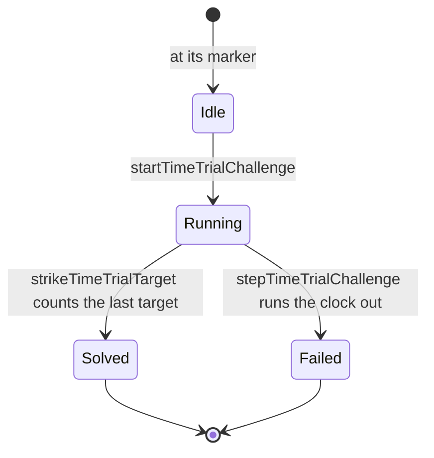

# Time Trial Challenge

A `TimeTrialChallenge` holds its clock's limit and what is left of it, its state, and how many of its targets are struck against how many it asks for. `startTimeTrialChallenge` starts an idle one from its marker, `strikeTimeTrialTarget` counts a target done and solves the challenge once the last is, and `stepTimeTrialChallenge` runs the clock on the fixed step and fails it when it runs out. A solved challenge is the solve event: once challenges are placed, the world will read its `Solved` state and spawn its chest, which the chests opening will grant. The map gives no limit or target count per challenge, so both come from the world's data once measured.

## Key files

| File                                                                    | Role                                                                    |
| :---------------------------------------------------------------------- | :---------------------------------------------------------------------- |
| `packages/genshin-world/src/models/puzzle/TimeTrialChallenge.ts`        | A challenge's clock, targets and state                                  |
| `packages/genshin-world/src/services/puzzle/startTimeTrialChallenge.ts` | Starts an idle challenge's clock from its marker                        |
| `packages/genshin-world/src/services/puzzle/strikeTimeTrialTarget.ts`   | Counts a target done, solving the challenge on its last                 |
| `packages/genshin-world/src/services/puzzle/stepTimeTrialChallenge.ts`  | Runs a challenge's clock on the fixed step, failing it when it runs out |

## Sources

- `time-trial-limit.mkv` — a Time Trial Challenge started at its marker and filmed to its end, with its clock in view, 3 minutes at most; the limit the clock is set to is read from it, since the wiki gives none for each challenge. Found 2026-10-11: https://www.youtube.com/watch?v=B_l5b_KXt-o at 0–55 s (`captures/yt-B_l5b_KXt-o-time-trial-limit.mp4`).
