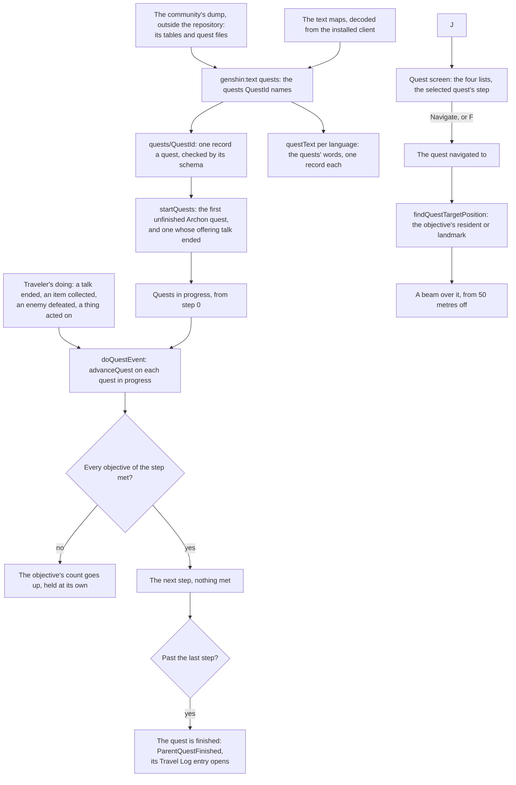

# Quests

The game's quests are its story: the Archon quests of the main story, a character's story quests, the world quests found about the map, an event's quests and the daily commissions. Each is a run of steps, and each step asks something of the Traveler. The world holds a quest as the game's data does, by the game's own ids, and a quest's words come from the game's own text, as the [dialogue](../dialogue/design.md) page's talks do.

## How it works

### A quest

A `Quest` has the game's id, its kind, its title and description by text id, its steps in the order they are done, the talks it runs, the talks that offer it, none for a quest that starts otherwise, and the items its finish pays, which the finish grants to the bag and the wallet. A step has its id, its line by text id (the "Talk to Paimon" the quest screen shows) and its objectives. An objective has a kind, a target and a count:

| Kind     | What it asks                    | Its target, as the game's own condition names it |
| :------- | :------------------------------ | :----------------------------------------------- |
| GoTo     | reach a place                   | the place's trigger                              |
| TalkTo   | finish a talk                   | the talk                                         |
| Defeat   | defeat enemies, a count of them | the enemy                                        |
| Collect  | collect items, a count of them  | the item, or any of its alternative items        |
| Interact | act on a thing                  | the thing, or the waypoint unlocked              |

The kinds are the game's five, and the quest screen files them under the game's four lists. An event's quests are listed among the world quests, as the game's own quest types have it.

### Progress

A quest's progress is the step it is on, which equals the number of steps once it is finished, and how many times each of that step's objectives has been met. `advanceQuest` takes a `QuestEvent`, the kind of the Traveler's doing and the id it names. Each objective of the current step that the event names is met once more, held at its count. Once every objective is met, the quest moves on to its next step with nothing met. An event no objective names leaves the quest where it was, and so does any event once the quest is finished.

### Starting and finishing

`startQuests` starts the first Archon quest that is not finished, once the ones before it are, so the carried Archon quests run from the prologue's first. Every other quest starts at its first shown step when a talk offering it ends, the talk-to event the world records for it, and only the once. Until then each resident a talk offering it is begun on offers that talk as a reply, as an open talk-to step's is ([dialogue](../dialogue/design.md)). The commissions are not yet dealt at the daily reset, as [commissions](../commissions/design.md) notes. A finished quest stays in the progress map at its last step, and the quest screen lists only those started and not finished.

`doQuestEvent` hands one doing to every quest in progress. Each step moved past finishes its sub-quest, which `getFinishedQuestEvents` turns into a `QuestFinished` for `advanceAchievements`, and a quest its last step finishes into a `ParentQuestFinished`. A finished main quest is added to the set the Archive opens by, and its Travel Log entry opens, the entries read off the Archive's table when first needed. The world records a talk's end as a talk-to, a dropped item or a gathering point picked as a collect, an enemy defeated as a defeat under its kind, and a waypoint or landmark unlocked as an interact.

### The quest screen

`QuestScreen` is J's screen, through the screens' `ScreenKind.Quests`, laid out as the English client's still at 1920 by 1080 lays it out, every place, size and fill measured off it in `Layout.reference.ts` beside the component. Its tabs along the top list every quest under In Progress, then each of the game's four lists under its own mark, and Q and E step between them. Down the left, each list sits under its heading and its mark: its quests in no series first, each a row of its title over how far its objective stands and its mark at the row's end, the commission's star or a place's pin, then each series holding any of its quests, a row of its title and region over a paler panel of its quests in the series' order. On the right are the selected quest's title and place, the journal its series unlocks, its step with its first counted objective's "(n/m)", its description and its series' rewards, a tile a reward shaded by its item's rarity. Under them sit the Quest Overview button, drawn and doing nothing since the overview is not built, and the button that navigates to the selected quest, or cancels the navigation of the quest already navigated to, which F presses.

The screen reads the quests in progress, their progress, their text map and the series they belong to. The world screen holds the one navigated to, and hands it each quest's distance, measured on the ground from the character to where its current step's target stands among the regions in reach, the same target the beam rises over (`getQuestTargetId`). The marks are traced off the still: the banner, the tabs', a series' chevron, the pins, the objective's and the overview's, and the close button's X, which every list screen of the Paimon menu shares with the band across its top.

### Navigation

`findQuestTargetPosition` finds where an objective's target stands among the regions in reach: the resident or landmark it names, or the resident whose talk it names. A talk-to objective names the first character its talk is begun on, so its beam rises over that resident whatever talk F begins with them. `QuestBeam` raises a column of light over that spot once the camera is 50 metres or more away, the distance at which the wiki says the game's beam appears. The beam reaches from under the lowest ground to over the highest peak, so it rises out of the ground wherever it stands with no height read for it. The world raises it over the first objective of the navigated quest's current step, in the floating origin's group, and V or a press on the [HUD](../hud/design.md)'s tracker navigates to the quest the tracker shows. The tracker's line under its title reads the same spot: its distance, and whether its ground stands higher or lower than the character's.

### The quests' content

`QuestId` is the inventory of quests the world carries: the prologue's first two, The Seventh Samurai, a world quest Xavier offers on Narukami Island, Seven Star Selection, Candidature Analysis and Foregone Conclusion, New Horizons of Adventure, whose finish pays the Mondstadt Shrine of Depths Key, the Liyue, Inazuma and Sumeru opening quests, which their regions' commissions join the deal behind (Mondstadt's is not carried, see the commissions design), and the keeper's Reputation requests. The four key quests of the other shrines (21004, 21007, 21021 and 2008) are not carried: the dump holds no binary for them, and their steps are Lua scripts (their `luaPath`) the dump does not hold, so they wait on the PC's export. `QuestIds` lists them in the order the world reads them, the Archon quests in the order they run, since the enum's members are sorted by name. An opening is one sub quest of its world quest: the dump's sub quest table names the world quest it belongs to, so the opening is titled by that world quest and its steps are read from that world quest's binary output, keeping the steps whose id is the opening's own. A quest starts once every parent quest it names is finished (`parentQuestIds`, from its sub quests' accept conditions, or for the three city openings from the wiki's named prerequisites in `OpeningParentTitleMap`, provisional), checked by `startQuests` at load and on every quest event; a parent the world does not carry never finishes, so the Liyue, Inazuma and Sumeru openings stay unstarted until their regions load. The Adventure Rank starts no quest, since no quest binary the dump holds names one. `pnpm -C scripts genshin:text quests` publishes each one to the game data: its kind, title and description from the quest table, and its shown steps and the talks offering it from its binary output. A world or story quest a talk offers opens on a step with no words that finishes on that talk, so the talks it finishes on are the quest's offers; an Archon quest has none, starting from the prologue's first. It also publishes the talks those steps end on and the offers, from the dialog table with each speaker named from the character table and titled from the manual text map, each with the characters the talk table begins it on, and every word they show in every language. A resident's standing talk offers each open talk-to step's talk begun on them as a reply ([dialogue](../dialogue/design.md)). Each quest is checked against the world's own schema before it is published.

The dump scrambles the binary output's field names each patch, so the reader finds each field by its shape, as [game data formats](../game-data-formats/design.md) describes. A step's objectives are every condition of its finish list that asks something, in the order the list gives them, and the step is done once all of them are met. So a step that finishes on an item and a talk both holds both, and one that finishes on two triggers holds both. A step with no words is the game's own bookkeeping and is left out, past reading the first one's offers. A shown step whose conditions ask nothing the Traveler does, such as a cutscene played, is left out and noted.

## Parity

The quest screen is scored whole-frame against `quest-screen`, the English client's quest screen at 1920 by 1080, set to the still's state by `components/Quest/Screen/Index.fixture.ts`: a mean difference of 44.32% and a FLIP of 0.8047, from `pnpm -C scripts genshin:parity compare quest-screen` into `comparisons/quest-screen.png`, off the wiki's `File:Quest Screen.png`. Most of what remains is the world behind the screen, blurred and washed lighter down the screen, which the page has no copy of; the screen draws the band, rows and panels translucent as the game does, so they sit over the page's white rather than the world. The rest is the list's scroll, since the still is scrolled down to its commissions and the list opens at its top, and the stand-in font, narrower than the game's.

## Key files

| File                                                                     | Role                                                                             |
| :----------------------------------------------------------------------- | :------------------------------------------------------------------------------- |
| `packages/genshin-world/src/models/quest/Quest.ts`                       | A quest: its kind, words, steps, talks, finish rewards and schema                |
| `packages/genshin-world/src/models/quest/QuestObjective.ts`              | One thing a step asks for, by its kind, target and count                         |
| `packages/genshin-world/src/services/quest/advanceQuest.ts`              | The Traveler's doing met against the current step, step by step                  |
| `packages/genshin-world/src/services/quest/startQuests.ts`               | The Archon quests run in turn, and a quest started by its offering talk          |
| `packages/genshin-world/src/services/quest/getFinishedQuestEvents.ts`    | The steps and quests a progress moves past, as the achievements' events          |
| `packages/genshin-world/src/services/quest/readQuests.ts`                | The carried quests fetched by their keys and checked against the schema          |
| `packages/genshin-world/src/services/archive/openTravelLogEntries.ts`    | The Travel Log entries of the finished main quests opened                        |
| `packages/genshin-world/src/services/quest/findQuestTargetPosition.ts`   | Where a navigated objective's target stands                                      |
| `packages/genshin-world/src/composables/useWorldQuests.ts`               | The quests in progress, and the navigated objective's target                     |
| `packages/genshin-world/src/services/quest/QuestKindCategoryMap.ts`      | Each kind's list on the quest screen                                             |
| `packages/genshin-world/src/services/quest/constants.ts`                 | The screen's tab order and keys, and the beam's distance and look                |
| `packages/genshin-world/src/components/Quest/Screen/Index.vue`           | The quest screen J opens                                                         |
| `packages/genshin-world/src/components/Quest/Screen/Layout.reference.ts` | The screen's places, sizes, fills and marks as measured off the still            |
| `packages/genshin-world/src/components/Quest/Row/Index.vue`              | One quest of the list: its title, distance and end mark                          |
| `packages/genshin-world/src/models/quest/QuestChapter.ts`                | A series: its title, region, journal, quests and rewards                         |
| `packages/genshin-world/src/services/quest/QuestGlyphMap.ts`             | The screen's own traced marks                                                    |
| `packages/genshin-world/src/services/quest/QuestCategoryGlyphMap.ts`     | Each list's traced mark, on its tab and by its heading                           |
| `packages/genshin-world/src/services/quest/getQuestTargetId.ts`          | What a quest's current step sends the player to                                  |
| `packages/genshin-world/src/components/Quest/Beam/Index.vue`             | The beam over the navigated objective                                            |
| `packages/genshin-world/src/models/quest/QuestId.ts`                     | The quests the world carries, the reader's inventory, in reading order           |
| `scripts/src/services/genshinText/buildQuests.ts`                        | The builder: every inventoried quest, its talks and words, published             |
| `scripts/src/services/genshinText/readQuestSteps.ts`                     | A quest's shown steps and offers read off its binary output by shape             |
| `scripts/src/services/genshinText/OpeningParentTitleMap.ts`              | The wiki's named prerequisites of the three city openings, provisional           |
| `scripts/src/services/genshinText/readOpeningParentQuestIds.ts`          | An opening's named prerequisites, each resolved to the one quest its title names |
| `scripts/src/services/genshinText/readParentQuestIds.ts`                 | The parent quests a quest's sub quests' accept conditions name                   |
| `scripts/src/services/genshinText/readTitleQuestIds.ts`                  | Each quest and chapter title in the English text, to the quest it names          |
| `scripts/src/services/genshinText/readTalk.ts`                           | A talk read off the dialog and talk tables                                       |

## Notes

- **A go-to does not move.** The carried prologue starts at Wanderer's Trail's first step, which asks to reach a place. No region data places that trigger yet, so the step stays where it is until the [quests proposal](../../../changes/genshin-quests/design.md) places it, and the carried Archon quests' other steps wait behind it.
- **An offered quest is offered from the start.** The game opens The Seventh Samurai only once Tatara Tales: The Last Act is finished, a quest the world does not carry, so Xavier offers it from the start. Its filming, a step whose finish the scene scripts report, is left out and noted, so the quest goes from its first talk to its next.
- **About half of an offered quest's lines show no words.** The community dump, upstream as well, holds no words in any language for about half the dialog table's lines, The Seventh Samurai's offering talk among them, so those lines and replies publish empty until the text maps are the install's own ([game text](../game-text/design.md)). Every carried quest is checked: no world quest a placed resident offers has its talks whole.
- **Progress is kept in the save.** The carried quests' progress is a slice of the [save](../save-data/design.md), so a reload resumes them as it does the bag and the wallet.
- **Quests are read from the hosted game data, not the bundle.** Each carried quest and its words are fetched by their keys (`quests/<id>` and `questText/<language>`) through `QuestLoaderMap` and `QuestTextLoaderMap`, which a new carried quest adds a line to, from the base URL the world is given.
- **The beam's look is provisional.** Its radius and colour wait on a recording of the English client navigating to an objective.
- **The world's series are not carried yet.** The screen lists a series' quests under its row once it is handed the series, which no reader writes yet, and the one world quest carried, The Seventh Samurai, sits in no series ([quests proposal](../../../changes/genshin-quests/design.md)), so the world hands none and only the fixture shows one. A quest whose target no region in reach places, an enemy or an item to collect among them, shows no distance.
- **Some of the screen's words and looks are best estimates.** The install's text map holds no line named for the screen's In Progress or its distances, so the plainest In Progress (`UI_TEXT_DOING`, over the first tab, with each list's heading line over its own) and the Miliastra editor's metre length "{0}m" (`UI_BEYOND_EDITOR_PROTOTYPE_LINE_METER`, for a quest's distance in every language, since 7.1's text map dropped the minigame's) stand in, and the rewards' caption is not drawn. The still shows no selected row, so the selected one is ringed in the game's cream, and the still's world quests are all in series, so a list's quests in no series sit above its series on a best estimate. The region's art on a series' row, the journal's emblem, each reward's item and the UID are not drawn, and the screen's open, close and tab animations are not yet timed (the roadmap's References sought).

## Sources

- [Quest](https://genshin-impact.fandom.com/wiki/Quest), Genshin Impact Wiki: the Archon, story and world quests and the commissions, and the beam that marks a navigated objective from 50 metres off.
- [Quest/Menu](https://genshin-impact.fandom.com/wiki/Quest/Menu), Genshin Impact Wiki: the quest screen's list grouped by Archon quests, story quests, commissions and world quests, its tabs, and its quest information with its Navigate button.
- [Event Quest](https://genshin-impact.fandom.com/wiki/Event_Quest), Genshin Impact Wiki: most event quests are world quests, and a flagship event's are story quests.
- [Controls](https://genshin-impact.fandom.com/wiki/Controls), Genshin Impact Wiki: J for the quest menu, V for quest navigation, and holding V to show the step's objective.
- ["The Seventh Samurai"](https://genshin-impact.fandom.com/wiki/%22The_Seventh_Samurai%22), Genshin Impact Wiki: Xavier's world quest in Inazuma City, its steps, and its unlock after Tatara Tales: The Last Act.
- [AnimeGameData](https://github.com/DimbreathBot/AnimeGameData), the community's per-patch dump: the quest table's types and words, each quest's binary output of steps and conditions, and the dialog and character tables a talk is read from.
