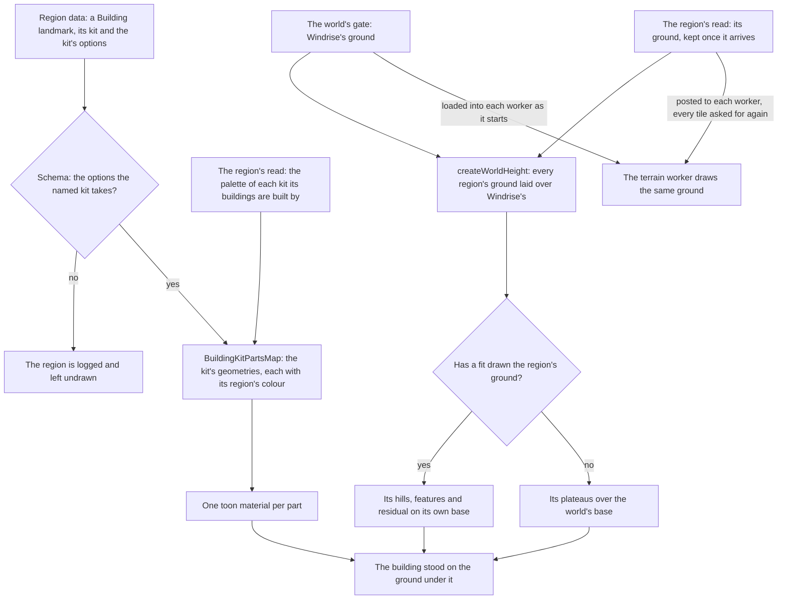

# Region buildings

Every region builds its towns from a kit of its own, whose geometry has its own page; the generic parametric kit on [buildings](../buildings/design.md) is the one Natlan's tribes use. A building landmark is the one landmark kind for all of them: its data names the kit, which is its region's, and carries the options that kit takes, so a Liyue hall and a Fontaine row house are one kind with different options. Each region's capital stands as one building of its kit, the first landmark of every region but Mondstadt's Windrise, so a camera that reaches any region finds something of it standing on its ground.

## How it works

- **The kit is the region's.** `BuildingKit` names one kit per region: Mondstadt's house, Liyue's terraced hall, Inazuma's post-and-beam building, Sumeru's rainforest city, Fontaine's row house, Natlan's tribe building on the engine's generic building, Nod-Krai's dieselpunk works and Snezhnaya's stepped hall. A building's options are checked against its kit's own schema as the region's data arrives (`regionBuildingSchema`, a union by kit), so a Fontaine building carrying Liyue's options fails its region rather than reaching a generator.
- **Parts in the region's colours.** `BuildingKitPartsMap` turns each kit's result into parts, one geometry for each material the kit draws in, coloured from its region's palette record, `regions/<region>/palette`. A region reads the palette of each kit its buildings are built by with its data, as it comes within reach (`readLoadedRegion`, `readRegionPalettes`), so a region out of reach reads none and the world's ready waits only on the palettes of the regions in reach. Each kit's reader returns its bare palette, and `readRegionPalettes` keys it by kit. `WorldLandmarks` hands each building the palettes of the regions in reach. A colour the palette does not sample keeps its constant in `services/<region>/constants.ts`: Mondstadt's and Inazuma's plaster, Mondstadt's roof, and Fontaine's gold and iron. Snezhnaya's kit has no record, so all of its colours are constants. `WorldLandmarkBuilding` gives each part a toon material, so a building costs one draw per material, and frees both when its region is released.
- **One ground for the world.** `createWorldHeight` builds the ground every reader stands on: the terrain worker, the character's body, the cameras and every landmark. It lays every other region's ground over Windrise's, each the `ground/<region>` record read from the [hosted game data](../hosted-game-data/design.md), each piece fetched as its area first comes within reach (`useRegionData`, `selectGroundKeysInReach`), through [terrain shape height](../terrain-shape-height/design.md), so each region's hills and features are filed into the same cells as Windrise's and a point reads only those near it. A region a fit has drawn stands on its own base round its hills, with its features and residual; one no fit has drawn holds only its plateaus, each over the world's base, which is the ground everywhere no fit has reached. Mondstadt's record is laid over Windrise's as every other region's is, though its capital stands inside Windrise's fitted extent, so the two grounds overlap there and that overlap is not measured yet. The session builds the ground again as each region's ground arrives and hands it down as `getGroundHeight`, and each terrain worker composes the same ground from the records it is loaded with as it starts and the regions' grounds it is sent as they arrive.
- **Capitals at provisional places.** Each capital stands where its city's waypoints do in the game's own data, read once by hand to the nearest ten metres: Mondstadt City, Liyue Harbor, Inazuma City, Sumeru City, the Court of Fontaine, Natlan's People of the Springs, Nod-Krai's Nasha Town. Snezhnaya's capital, Snezhnograd, is not in the community's dump yet, so it stands at the place the scene has always set by hand, written into `RegionCapitalMap`: about four kilometres along x from Nasha Town, level with it in z. That place is Nod-Krai's ground, not Snezhnaya's: the two waypoints nearest it, 109 and 117 metres off, are filed under Nod-Krai's Voidsea Outlook in the game's area table, whose outline holds it, and Nod-Krai's outlines cover more than four fifths of the 400 metres round it, so Snezhnaya's ground is not fitted there until Snezhnograd's place is read off the game's data. Each plateau is raised to its capital's height the same way, and each capital's area takes the game's own outline ([world map](../world-map/design.md)), but Nasha Town's, whose Lempo Isle the game's polygons do not hold yet and which keeps the outline drawn round its waypoints' tiles, and Snezhnograd's, a square round it, so its region loads when the camera comes within reach.
- **The fit places them exactly.** `genshin:assets fit windrise --only landmarks` places Windrise's oak and statue from the game's placements and then every capital from its waypoints (`fitRegionCapitals`). The game's own area table names each capital's areas; their waypoints are the scene points of the kind Windrise's statue is, and the median waypoint stands the landmark and, for a region no fit has drawn, centres and lifts its first plateau. Mondstadt's capital is written after Windrise's landmarks, since both are in its one file. Each plateau it moves is written into its region's `ground.json`, the file people edit, and published as `ground/<region>` in the same run. A region a fit has drawn stands its capital on its fitted ground, so only its landmark is written.
- **The Court of Fontaine's export is claimed by its own families.** Fontaine's row house stands in for the Court's "Area_Fd_Build_" meshes and its terrain tiles for the ground when the [parity](../parity/README.md) inventory reads its witness, while `FontaineUndrawnMeshRegexMap` sorts the remainder, from props to the plot's paving, into what is not drawn yet.

## Key files

| File                                                                             | Role                                                                        |
| :------------------------------------------------------------------------------- | :-------------------------------------------------------------------------- |
| `packages/genshin-world/src/models/world/BuildingLandmark.ts`                    | A building landmark: its region's kit and the options that kit takes        |
| `packages/genshin-world/src/models/world/RegionBuilding.ts`                      | The kit and its options, checked against the kit's own schema               |
| `packages/genshin-world/src/models/world/BuildingKit.ts`                         | The kit each region builds with                                             |
| `packages/genshin-world/src/services/world/BuildingKitPartsMap.ts`               | Each kit's geometries as parts in its region's colours                      |
| `packages/genshin-world/src/models/world/RegionPaletteMap.ts`                    | The palette colours each kit reads, by region                               |
| `packages/genshin-world/src/services/world/readRegionPalettes.ts`                | The palettes of the kits a region's buildings are built by                  |
| `packages/genshin-world/src/services/world/readLoadedRegion.ts`                  | A region as it loads in reach: its data and ground, then its kits' palettes |
| `packages/genshin-world/src/services/world/readRegionGround.ts`                  | A region's ground laid over Windrise's, read as it comes within reach       |
| `packages/genshin-world/src/components/World/Landmark/Building/Index.vue`        | A building drawn on the ground, one material per part                       |
| `packages/genshin-world/src/services/world/createWorldHeight.ts`                 | The world's one ground: every region's laid over Windrise's                 |
| `packages/genshin-world/src/models/world/RegionGround.ts`                        | A region's ground: fitted hills, or plateaus where no fit has drawn         |
| `scripts/src/services/genshinAssets/fit/fitRegionCapitals.ts`                    | Every capital stood at its waypoints, and an unfitted plateau raised        |
| `scripts/src/services/genshinAssets/fit/RegionCapitalMap.ts`                     | Each region's first landmark and the game's areas that place it             |
| `scripts/src/services/genshinAssets/palette/PaletteFamilyMap.ts`                 | Each region's kit fields and the texture families sampled for them          |
| `packages/genshin-world/src/services/fontaine/FontainePartFamilyMeshRegexMap.ts` | The Court's buildings and ground, matched by mesh name                      |
| `packages/genshin-world/src/services/fontaine/FontaineUndrawnMeshRegexMap.ts`    | The Court's other meshes, sorted by kind as not drawn yet                   |

## Notes

- **Places, plateaus, Everfrozen Earth's outline and the colours the palette leaves out are provisional.** The places and heights wait on the fit. The palettes are the game's own building textures sampled by `genshin:assets palette <region>`, each colour with its families, texel count and spread, and published as `regions/<region>/palette` for every region but Snezhnaya. Everfrozen Earth's square outline is Snezhnograd's own, and waits with it on Snezhnograd's place ([Snezhnaya](../../../changes/genshin-snezhnaya/design.md)).
- **Each region's palette is sampled from its building textures.** `genshin:assets palette <region>` pools the linear texels of each kit field's texture families (`PaletteFamilyMap`), takes the mean of their largest cluster, and publishes it as `regions/<region>/palette`: its sRGB hex, as the kits' colours are written, with its linear mean, texel count and spread. A family is a texture its part tiles with, chosen by the surface its materials cover in the region's extraction, and never an atlas whose largest cluster is another part's. Every region but Snezhnaya is published. Each kit reads its region's record for the colours it samples and keeps its constant for the rest. Those stay provisional: Mondstadt's and Inazuma's plaster and Fontaine's gold and iron are trim in atlases whose largest cluster is another part's, so each waits on a texture its part tiles with or on sampling the atlas where its part's UVs fall; Mondstadt's extraction holds none of the city's roofs; and Snezhnaya's holds none of the 44 `Area_Zd_Build_*` diffuse textures the asset index names.
- **A plateau stands within the terrain's bounds.** Every tile's box spans the heights Windrise's ground stands between (`createWindriseTerrainOptions`), since the tiles are bounded before any region's ground arrives, so a region's ground above or below them would be culled where it shows; `createWorldHeight.test.ts` fails for any plateau outside them and for any fitted ground whose own bounds reach past them.
- **The game's map turns ours.** Placed by the game's own coordinates, the capitals stand with north along x and east along z, Inazuma east of Liyue and Fontaine to its north-west, since the game's x and the mirror of its z are the scene's.
