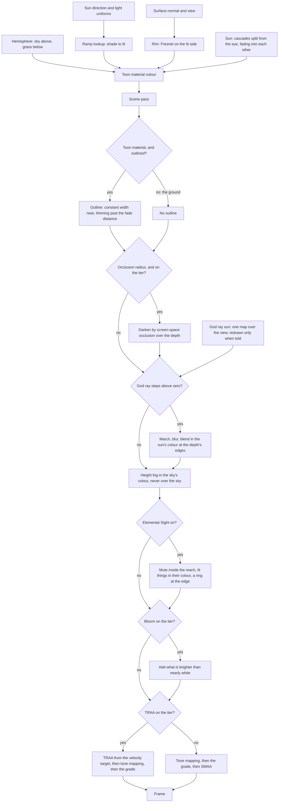

# Rendering style

Genshin's world does not read as anime because of its models. It reads that way because of how light lands on them. Surfaces step from lit to shade across a narrow painted band instead of a physical falloff. Shadow is a colour, a cool sky blue, rather than black. Edges catch a rim of sky light, and distance dissolves into a haze the colour of the sky. The engine sets that look once, in the materials and passes every later page draws with, and it is shown in Windrise, the valley where the game's world opens: a great oak on a grassy rise, with a Statue of The Seven in its shade, through the day the [sky](../sky-and-time/design.md) runs.

## How it works

### Materials

- **One toon material for the environment.** Every surface uses `createToonMaterial`, three's `MeshToonNodeMaterial` reading the world's ramp: a short row of bytes from dark to lit with a narrow smooth step (`computeRampValues`), so light steps across a band rather than a Lambert curve. The ramp's dark side is zero, so a face turned from the sun takes only ambient light.
- **Shadow is a colour, not an absence.** Cast shadow and the ramp's dark side both leave only the hemisphere light, whose sky is above and whose bounce is the grass below, so shade reads as the sky's blue and the ground's green. Nothing is multiplied toward black.
- **A rim picks out silhouettes.** A Fresnel term, masked to the side the sun lights and tinted by the sky, is the material's emissive node (`createRimNode`), so it lights on top of the ramp. Its colour and strength are the shared `LightUniforms` every material reads, so the [sky](../sky-and-time/design.md) moves them through the day by writing a few values.
- **Leaves are cut in the shader.** A leaf card is a plain quad cut to a pointed oval by a mask (`createLeafMaterial`), so a crown needs no leaf texture. The shadow pass cuts by the mask too, where it reads no opacity, so a card casts its leaf rather than its quad. Both faces of a card take the crown's own normal: three turns a double-sided face's normal round on its back, which faced half the cards into the crown, where the rim lit them pale.

### Outlines

- **One pass outlines every toon material.** `ToonOutlinePassNode` draws the scene with a back-face shell around each object whose material carries three's toon flag.
- **The ground opts out.** The game draws no outline around its terrain, so the ground's material is built with `isOutlined: false`, which clears that flag while keeping the toon lighting (`ToonNodeMaterial`). Without it, every ridge would draw an ink line against the sky.
- **One outline material for every toon material, and a pipeline compiles before its first visible frame.** three's outline pass builds an outline material per toon material it meets, though all of them are alike, so each new material paid a node build and often a pipeline mid-frame. `SharedToonOutlinePassNode` returns one material for the pass, one per distinct edge for a material with its own, and one per colour for a game model's edge read per pixel, since that colour samples its own material's textures and its outline material is dropped with it; and `PostPipeline.compileAsync` waits for the next frame's draw of the view, outlines included, and for the GPU to finish it, before the world reports ready, so the frame that first shows the world builds no pipeline; a compile that fails is logged while the world still reports ready, drawn without the warm-up, so no compile failure holds it. What the view does not show builds as it is first drawn. Every landmark shares its kind's material, so the view already holds every program a turn or a walk draws: a draw of the whole scene, every object unculled, built only programs nothing then drew, at the cost of a frame of seconds ([load budget](../load-budget/design.md)). The measure is `pnpm -C scripts genshin:parity stalls`, on the [parity](../parity/README.md) page. What no compile covers is the programs the walk adds as terrain tiles stream in.
- **Width thins with distance.** Three extrudes the shell by a constant width on screen. The engine scales the thickness by the fade distance over the view distance, capped at one, so an outline keeps its width up close and holds a constant width in the world past the fade distance. A far tree keeps a line without turning to ink.

### Shadows

- **The sun casts through cascades.** `createSunLight` attaches `AnchoredCascadeShadowNode`, three's `CSMShadowNode` with each cascade fitted to a sphere about the camera's pivot rather than to its slice of the view: the view is split from the eye outward in the practical scheme, each cascade with its own map. Near shadows stay crisp and far ones cheap, and each cascade spans more ground than the last, which softens the far shadows into the blotches the game draws. Neighbouring cascades fade into each other rather than meeting at a seam. The light's position sets only the sun's direction, and the last cascade ends at the region's `SHADOW_MAX_FAR`.
- **The ground casts too**, but only within the shadows' reach: a terrain ring casts when its range is within the region's `SHADOW_MAX_FAR` (`checkTerrainTileCasts`), so a hill shadows the slope behind it when the sun is low, and the rings past the reach draw into the view alone.
- **The cascades are drawn only when something they show has turned.** `createSunLight` turns off the cascades' automatic drawing. `useSunShadow` centres the sun's `anchor` on the camera's pivot, the character's body raised by the pivot's share of its height, and flags the cascades to be drawn again when the sun has turned past the angle the god rays' map is redrawn at (`checkSunTurned`), when an enemy has walked or turned past a quarter of a metre or a tenth of a radian since its shadow was drawn (`checkEnemiesMoved`), or when the character's body has moved, which redraws only the two nearest cascades, since a body's shadow reaches no further. The node draws a cascade again on its own when the anchor has moved a step of sixteen texels, so the origin snaps to that grid and a move within a step leaves the map as it was. **An orbit redraws no shadow cascade**: the sphere is the same whichever way the eye faces, and the follow camera keeps the eye within its arm of the pivot. Measured on the parity page's WorldScreen at the High tier, an orbit's median frame falls to about the standing still's, with far fewer draws. A walk costs more draws, since each sphere holds ground its slice of the view does not. The trees' crowns sway in the wind in the shadow pass as well, but a sway is not a turn, so a crown's shadow holds between redraws.

### After the scene

- **Screen-space occlusion where a scene draws it.** A scene that hands `createPostPipeline` an occlusion radius has its frame darkened, before anything else, by three's ground-truth occlusion over the scene pass's depth (`createOcclusionNode`), its normals rebuilt from that depth, so a crease, a recess and the foot of a wall take less light, as the game's deferred pass darkens its own. The radius is the scene's, in metres, since nothing in the game's exports holds it, and a tier that turns occlusion off draws none.
- **God rays march through a shadow of their own.** Three's `GodraysNode` reads one light's single shadow map, but the sun's shadow is split into cascades, each covering only a slice of the view. So `createGodraysLight` adds a second sun that lights nothing, whose one map spans the view. The ground and the landmarks stand still, so its map is drawn only when `shadow.needsUpdate` is set, which the sky does each time the light has turned half a degree. The rays are marched at half resolution, smoothed by a bilateral blur, and blended in the sun's colour by `depthAwareBlend`, which keeps them from bleeding over the edges of what stands in front. A scene draws them by handing the chain that sun, and none does yet: the node counts the lit air along each ray at a density set for a scene a few metres across, so over a valley nearly every ray, the sky's among them, reaches its most opacity and the whole frame is veiled half in the sun's colour. Windrise draws them again once a recording of its shafts prices their density.
- **A height fog in the sky's colour.** `createHeightFogNode` integrates a haze whose density falls off exponentially with height along the ray from the eye to what each pixel shows, starting past a start distance. Low ground and the far world thicken toward the fog's colour, the peaks rise out of it, and a level ray, or any ray through fog with no falloff such as the water's, takes the limit the general form divides by zero to reach. It runs after the outline pass, so an outline fades with what it outlines, and it skips the sky, which is already the fog's colour. Its opacity is held under a most opacity (all by default), so a far shore a scene's haze leaves seen stays seen however deep it lies. Its colour, density, falloff, most opacity, base height and start distance are `FogUniforms`, whose colour the sky writes. Looking toward the sun, the haze takes on the light it scatters: its colour lifts toward the light's by the ray's closeness to the light's direction, raised to a power that gathers it round the sun, at a strength a scene sets (none by default), so a low sun bathes its side of the frame. A scene that hands `createPostPipeline` its stone light hazes its stone apart: every stone material writes one into a mask the scene pass draws beside its colour, and where it is set the haze takes the stone light's own two colours at the same opacity and scatter.
- **Bloom lifts only the brightest light**: what is brighter than nearly white, which is the sun, glints and elemental light, in a scene that asks for it. Windrise does not: its daylit sky is brighter than the threshold over most of its area, so bloom whitens the whole sky, and like the god rays it waits on a reference that prices it.
- **The game's tone curve, and measured colours inverted through it.** The post pipeline ends every frame on the uber pass's own curve, each channel `1 - 2^(-exposure x)` lifted a ten-thousandth and raised to its contrast and a hundredth, at most 1 (`toneMapGenshinNode`, the login's `Display.reference.ts`). The lift lets a channel a hair under none still show, darker than the curve's black at none, down to black at its floor (`TONE_CURVE_FLOOR`, about a ten-thousandth and a half under none): the night's red stands there on a quarter of its pixels, and a curve held at none drew none of them. Ahead of the curve the frame passes through a white balance, as the uber pass's `_WhiteBalanceMat` does (`computeWhiteBalance`, Unity's own construction from a temperature and a tint), none until a sky state sets one: cooled, it takes a saturated blue's red under none, which is how the game's night shows its stone's red under the curve's black. Its contrast is the post profile's 0.5, which the display pass measures on the current build's recording, and its exposure the profile's 1 beside it, which only scales the scene and is carried by whatever light is solved under it. The pipeline draws the curve itself, so the renderer maps nothing: a TresJS canvas writes its own tone mapping over the renderer's, ACES filmic unless told, so every canvas passes `:tone-mapping="GENSHIN_TONE_MAPPING"`, which is none. A colour the screen shows as it is, the sky's, its clouds' and the fog's, is measured off a reference as a display colour, so `applySkyState` writes it through `toSceneColor`, the curve's closed inverse, down to its floor, and then the white balance's inverse, so it shows as measured whatever the balance; a halo or a glow a sky has none of adds nothing, rather than the curve's floor. A lit material's colour is not inverted: its light decides what it shows. The curve lifts the dark half of the range well above Khronos' PBR Neutral, so a look tuned under that, as Windrise's lights and palette were, stands paler under this one until it is tuned again.
- **A colour grade per region.** `computeGradeLut` builds a cube of display colours from a region's `GradeOptions`: contrast about the middle, saturation about each colour's grey, a shadow tint weighted toward the dark and a highlight tint toward the light. `Lut3DNode` maps the frame through it after the tone mapping, so the grade follows the tone curve rather than feeding it. The grade is authored as numbers against the region's reference screenshots, never sampled from their pixels. Windrise's is cool in shade and warm in light.
- **Anti-aliasing by tier.** TRAA resolves the scene's edges before the tone mapping from a velocity target the scene pass writes beside its colour, and it settles the thin outlines and leaf edges that SMAA leaves shimmering. A tier that pays for neither the velocity target nor a frame of history takes SMAA over the graded frame instead.

### Quality steps down, never out

Each `QualityTier` sets what the frame spends (`QualityTierSettingsMap`): the share of grass blades grown, the first cut, the shadow maps' size and the number of cascades, the god rays' march steps (none on the lowest tier), screen-space occlusion (the highest tier's alone), the pixel ratio, bloom, and TRAA or SMAA. The ramp, the rim and the outline stay at every tier, because they are the style. The tier is read when the scene mounts, since its cascades are built with the sun.

### The tuning panel

In a Vite development build, `createGenshinRenderer` puts three's inspector on every renderer it makes (`attachInspector`), so every scene, the login's walkway as much as the world, is profiled and walked without asking for it. A browser driven by automation, as the parity page's shots and the visual suite are, gets none, since the panel would cover and slow what it measures, and a production build drops the branch, so it never loads the inspector. On the world, `useGenshinTuning` adds a **Look** group to that inspector over the ramp, the rim, the outline, the fog and the grade, and the god rays and bloom when the scene draws them. A slider writes the uniform, or regenerates the texture it drives, at once, so the look is tuned against reference screenshots rather than guessed. Nothing is saved: a value that looks right is copied into the region's constants.

## What it costs to run

- **The god rays' map is drawn about every two seconds** where a scene draws them, as the sun turns, not every frame, since nothing it shadows moves. Every material still samples it with the sun's, which is the price of a light the god rays can read.
- **The god rays march at half resolution**, and a tier drops them before it drops pixels.
- **The fog and the grade are arithmetic** in the passes the frame already runs through, with no render target of their own. A scene hazing its stone apart pays one target a byte a pixel deep for the stone's mask.
- **Every generator is benched at two scales or more.** The grade's cube costs its texels, and the bench beside `computeGradeLut` holds that at two sizes.
- **The Windrise stalls are named by the trace, and what is left of them is the GPU's own time.** `pnpm -C scripts genshin:parity stalls WorldScreen --trace` records every WebGPU call and a CPU profile and, where the adapter has timestamp queries, times every render and compute pass on the GPU with how long it waited in the queue after its submit, then names each slow frame by them. No pipeline, texture or node material is built mid-frame: a material is made once per kind, so the view the world first shows already holds every one a turn or a walk draws, and the world is ready only once that view has drawn. Nor does the ground rebuild on the frame, since a far terrain ring takes each tile into a slot of its own as it arrives ([terrain](../terrain/design.md)). What holds the cold orbit's slowest frames is the GPU's throughput: the measure draws with vsync off, so the page asks a frame as soon as the last is encoded, and a frame that finds the queue full waits in a native call such as `writeBuffer` or for its next animation frame. Through the walk the main thread is the slower and the queue stays near empty.
- **Each kind of the scene's objects is priced on each pass.** Once the walk ends, the trace holds the camera still and hides each kind in turn, a kind being the component whose template holds the object. It hides one by clearing its objects' layers, since a fade or a terrain ring sets their `visible` again each frame. Each kind is drawn hidden between two ranges with every kind drawn, and is priced by the GPU time its hiding saved on each pass against those two ranges, so the GPU's drift over the run cancels. On the shared GPU the still frame's time moves by a few milliseconds between runs, so the kinds' savings move by about as much. Water is the one kind above that spread, saving a few milliseconds a frame; the grass, the landmark trees and the terrain read at about zero, either sign, and need a quiet GPU to be read apart.
- **The cascades redraw for their casters, never for the camera.** What flags them reads the sun, the character's body and the enemies, and the anchor is the camera's pivot, so an orbit flags nothing. The trace draws as many shadow passes a second with the camera still as in its second orbit, 18 each. What redraws them while the camera stands is the enemies' patrol: each quarter metre an enemy walks redraws all four cascades, wherever in the world it stands, beside the sun's turn.
- **An instanced mesh reads its matrices from a storage buffer.** Three keeps an instanced mesh's matrices, where a uniform buffer holds them all, in one it writes again on every draw, with the previous frame's beside them for the velocity TRAA reads. So Windrise's plants, enemies, animals, stand-ins and frostbearing trees rewrote their whole matrix set every frame, a share of the main thread's time in `writeBuffer`. `createInstancedMesh` gives each mesh a storage buffer three uploads only when its matrices change. The still frame now writes only the animals' and the enemies' matrices as they move. The GPU's time in its passes reads within the shared GPU's spread, before and after alike. The pass timer does not see an upload, which is the queue's copy and the main thread's call, so the proposal's keep rule (kept only where the passes' GPU time falls) cannot read this change; it is kept on the writes it ended, its passes not measurably slower.

## Key files

| File                                                                    | Role                                                                                         |
| :---------------------------------------------------------------------- | :------------------------------------------------------------------------------------------- |
| `packages/genshin-engine/src/nodes/createToonMaterial.ts`               | The environment material: ramp, rim, and whether it is outlined                              |
| `packages/genshin-engine/src/models/nodes/ToonNodeMaterial.ts`          | The toon material with the emissive rim and the outline flag                                 |
| `packages/genshin-engine/src/nodes/createRimNode.ts`                    | The rim: Fresnel on the lit side, tinted by the sky                                          |
| `packages/genshin-engine/src/materials/computeRampValues.ts`            | The ramp's bytes, from dark through a narrow step to lit                                     |
| `packages/genshin-engine/src/atmosphere/createSunLight.ts`              | The sun and its fading cascades, drawn only when flagged                                     |
| `packages/genshin-engine/src/models/nodes/AnchoredCascadeShadowNode.ts` | The cascades fitted to a sphere about the anchor, snapped to a step of texels                |
| `packages/genshin-engine/src/atmosphere/checkSunTurned.ts`              | Whether the sun has turned far enough to redraw its shadows                                  |
| `packages/genshin-engine/src/terrain/checkTerrainTileCasts.ts`          | Which terrain rings cast into the shadow maps, by their reach                                |
| `packages/genshin-world/src/composables/useSunShadow.ts`                | What turns the sun's cascades: the sun, the character's body and the enemies, and the anchor |
| `packages/genshin-engine/src/renderer/createInstancedMesh.ts`           | An instanced mesh whose matrices are a storage buffer, uploaded when they change             |
| `packages/genshin-engine/src/post/createGodraysLight.ts`                | The unlit sun whose one map the god rays march through                                       |
| `packages/genshin-engine/src/post/createPostPipeline.ts`                | The frame after the scene: outlines, occlusion, god rays, fog, bloom, grade and AA           |
| `packages/genshin-engine/src/post/createOcclusionNode.ts`               | The screen-space occlusion over the depth, the scene's and the witness's                     |
| `packages/genshin-engine/src/post/createHeightFogNode.ts`               | The height fog integrated along each pixel's ray                                             |
| `packages/genshin-engine/src/renderer/constants.ts`                     | The tone curve's contrast and exposure, and the none every canvas passes                     |
| `packages/genshin-engine/src/post/toneMapGenshinNode.ts`                | The game's tone curve, which the post pipeline ends on                                       |
| `packages/genshin-engine/src/renderer/attachInspector.ts`               | Three's inspector on a renderer, shared by whatever asks for it                              |
| `packages/genshin-engine/src/post/toSceneColor.ts`                      | A measured display colour as the scene colour the tone curve shows as it                     |
| `packages/genshin-engine/src/post/computeWhiteBalance.ts`               | The white balance the frame passes through before the tone curve                             |
| `packages/genshin-engine/src/post/computeGradeLut.ts`                   | A region's grade as a cube of display colours                                                |
| `packages/genshin-engine/src/renderer/QualityTierSettingsMap.ts`        | What each tier spends, and what none drops                                                   |
| `packages/genshin-world/src/components/World/Windrise/Index.vue`        | The Windrise scene: its lights, look, ground, water, grass and landmarks                     |
| `packages/genshin-world/src/services/windrise/constants.ts`             | Windrise's ramp, sun, fog, shadow reach and grade                                            |
| `packages/genshin-world/src/composables/usePostPipeline.ts`             | The engine's chain in place of TresJS's render, rebuilt on a new camera or tier              |
| `packages/genshin-world/src/composables/useGenshinTuning.ts`            | Development's tuning panel over the look                                                     |

## Notes

- **Characters are not styled here.** Character shading, with its face shadow map, hair highlights and material masks, is the character page's subject, not yet built. The environment material stays the one the world uses.
- **The ramp is a small texture, not a TSL function.** A row of sixty-four bytes filtered linearly is as smooth as the function would be, costs one texel fetch, and is regenerated in place when the tuning panel moves the step.
- **The god rays' sun is not free.** It lights nothing, but three evaluates every light's shadow in every material that receives shadows. Its map is rarely redrawn, so the cost is one sample per shaded fragment; a light three can render a shadow for without any material reading it would remove that.

## Sources

- [Console platform development in Genshin Impact](https://docswell.com/s/UnityJapan/KWRPQ5-210617-unity-dojo20211mihoyozhenzhongyi), Zhenzhong Yi, miHoYo, Unity Dojo 2021: the game's cascaded shadow maps with soft filtering, and volumetric fog and god rays by ray marching, the passes recreated here.
- [MeshToonNodeMaterial](https://threejs.org/docs/pages/MeshToonNodeMaterial.html) and [ToonOutlinePassNode](https://threejs.org/docs/pages/ToonOutlinePassNode.html), three.js: the toon material the environment material extends, and the outline pass that only toon materials receive.
- [CSMShadowNode](https://threejs.org/docs/pages/CSMShadowNode.html), [GodraysNode](https://threejs.org/docs/pages/GodraysNode.html), [BloomNode](https://threejs.org/docs/pages/BloomNode.html), [Lut3DNode](https://threejs.org/docs/pages/Lut3DNode.html), [SMAANode](https://threejs.org/docs/pages/SMAANode.html) and [TRAANode](https://threejs.org/docs/pages/TRAANode.html), three.js: the cascaded shadows and the post-processing chain.
- [Better fog](https://iquilezles.org/articles/fog/), Inigo Quilez: the closed form of fog whose density falls off exponentially with height, integrated along the view ray.
- [Windrise](https://genshin-impact.fandom.com/wiki/Windrise), Genshin Impact Wiki: the first scene's layout, a valley whose oak shelters a statue.
