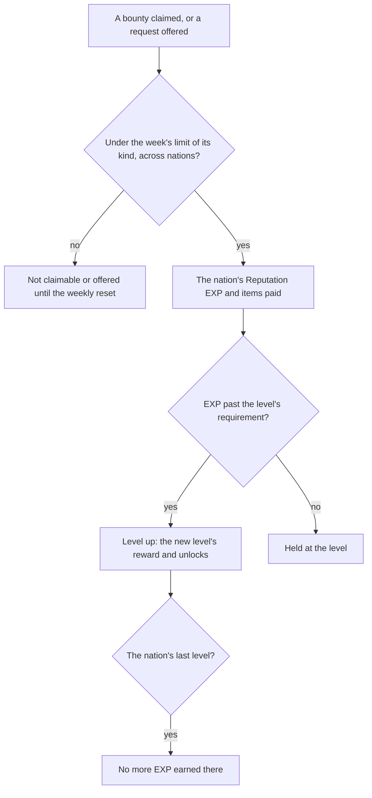

# Reputation

Each nation keeps a Reputation, raised by the work done for its people. Mondstadt's is built as data and rules: its levels from the game's table, the reward each level, request and bounty pays, the unlocks a level opens, and the weekly limit on claiming them (`scripts/src/services/genshinAssets/reputation/buildMondstadtReputation.ts`, `packages/genshin-world/src/services/reputation/readMondstadtReputation.ts`). Its keeper, its bounties and the exploration that raises its EXP call these rules from the world, and a bounty's trail is not built yet.

## How it works

## Data

- **The levels.** `ReputationLevelExcelConfigData`'s rows for the nation, each with `nextLevelExp`, the EXP to leave that level, unlike Friendship's totals (`~/Esposter/genshin-parity/text/ExcelBinOutput/ReputationLevelExcelConfigData.json`, city 1 rows 1 to 8). The last level's is zero, and it earns no more EXP (`packages/genshin-world/src/services/reputation/addReputationExp.ts`). Level 2 opens the mining outcrop search and level 4 the merchant discounts, the function ids the table names (`~/Esposter/genshin-parity/text/ExcelBinOutput/ReputationLevelExcelConfigData.json`, `functionId` 1001 on level 2 and 1002 on level 4; `~/Esposter.noindex/genshin-parity/references/reputation-screen/18s.png` shows both unlock lines at Lv. 2 and Lv. 4).
- **Each reward.** A level's `rewardId`, and a request's or bounty's, read from the reward table (`~/Esposter/genshin-parity/text/ExcelBinOutput/RewardExcelConfigData.json`, reward 2010001 for level 1). The nation's Reputation EXP is the item `ReputationCityExcelConfigData` names as its `virtualItemId`, so the reward is split into the EXP that item's count gives and the items it also pays (`~/Esposter/genshin-parity/text/ExcelBinOutput/ReputationCityExcelConfigData.json`, `virtualItemId` 315 for city 1, which `MaterialExcelConfigData.json` names Mondstadt Reputation EXP; `scripts/src/services/genshinAssets/reputation/toReputationReward.ts`). A request pays its EXP and Mora, a bounty its EXP and Mora, more of each at the harder difficulties (`~/Esposter/genshin-parity/text/ExcelBinOutput/RewardExcelConfigData.json`: reward 2010110 for a request, 80 of item 315 and 20000 of item 202, which `MaterialExcelConfigData.json` names Mora; bounty rewards 2010101 and 2010102, 120 and 160 of 315, 20000 and 25000 of 202).
- **Requests, Reputation quests and bounties.** The requests of the groups the levels name, each with its weight (`~/Esposter/genshin-parity/text/ExcelBinOutput/ReputationRequestExcelConfigData.json`, request 1001 with weight 20); the Reputation quests of `ReputationQuestExcelConfigData`, each bound to the quest its `parentQuestId` names, which pays its reward once that quest finishes (`~/Esposter/genshin-parity/text/ExcelBinOutput/ReputationQuestExcelConfigData.json`, city 1 row with `parentQuestId` 311); and the nation's `HuntingRefreshExcelConfigData` bounties with the region each is hunted in (`~/Esposter/genshin-parity/text/ExcelBinOutput/HuntingRefreshExcelConfigData.json`, city 1 rows with `regionId` 101, whose `finishRewardId` is 2010101 for easy, 2010102 for medium and 2010103 for hard). A bounty is offered ahead of a request, and a request waits while a taken bounty is still hunted, offered once the bounty is claimed (`packages/genshin-world/src/components/Reputation/Screen/Index.vue`).
- **The exploration thresholds.** The exploration table's rows for the nation, each at a percentage of its exploration and paying a reward split the same way (`~/Esposter/genshin-parity/text/ExcelBinOutput/ReputationExploreExcelConfigData.json`, city 1 at 20, 40 and 60 percent). The thresholds reached between two percentages are the ones the progress passes, so one already held pays nothing again (`packages/genshin-world/src/services/reputation/computeReputationExploresReached.ts`).
- **The tables the dump lacks.** The dump holds the exploration table but not the level, city, function, request, quest or hunting tables. Those are fetched from the AnimeGameData repository into the dump's `ExcelBinOutput` and never committed.

## Notes

- **The weekly limit is three of each kind, across nations.** (`packages/genshin-world/src/services/reputation/constants.ts`) Bounties and requests are counted apart, and each kind's claims are counted from the weekly reset, Monday at 04:00 on the server's clock (`packages/genshin-world/src/services/time/computeLastWeeklyReset.ts`), a claim at the reset counting toward the new week. The count is the weekly helper the bosses also use, in `packages/genshin-world/src/services/weekly` (`packages/genshin-world/src/services/weekly/countWeeklyClaims.ts`). The keeper offers no request past the limit until the reset (`packages/genshin-world/src/services/reputation/offerReputationRequest.ts`). A request taken before the limit pays when it finishes, past the limit too, and its claim is counted; the week's claims are kept to the newest three, which is all the limit reads.
- **A discount is 10% off, rounded down to a multiple of five Mora.** The rounding is the player's favour, the five beneath the discounted price. The wiki's Reputation page does not confirm it, so the reading follows the proposal's own wording and the [shops](../../../changes/genshin-shops/design.md) proposal's (`packages/genshin-world/src/services/reputation/constants.ts`, `packages/genshin-world/src/services/reputation/computeReputationDiscountedPrice.ts`).
- **The discount's shops are the shop types the grocery and the food shop name.** Which shops a discount covers is named in the function's text. The grocery's shop type 1004 and the Good Hunter's food shop's 1005 are the ones the discount names, and only their goods are written with the level (`toShopGoodSlice`, `scripts/src/services/genshinAssets/shops/toShopGoodSlice.ts`; the shop types in `scripts/src/services/genshinAssets/shops/constants.ts`). The [shops](../shops/design.md) page applies it.
- **The reward page.** The `ReputationScreen` lists each level of the nation as the public clip's reward page does: its level on a pentagon badge under the game's short level word (`LevelShort`, "Lv." in English, the one abbreviated in every language; `~/Esposter/genshin-parity/text/TextMap/TextMap_MediumEN.json`, key 2960839764 reads "Lv."), its items in the interface's `ItemTile`, coloured by rarity with their count beneath, the feature it unlocks in the game's words behind an info mark (`ReputationFunctionGameTextKeyMap`, by the level's function id; `packages/genshin-world/src/services/reputation/ReputationFunctionGameTextKeyMap.ts`), and the tick or the not achieved block at its end. Each slot reads its item's name and count to assistive technology, the items' rarity and names coming from the materials catalogue, which carries every item a level pays (`packages/genshin-world/src/components/Reputation/Screen/Index.vue`). The slots draw no art, since the game's item icons cannot ship. The list scrolls, since its eight rows are taller than the panel, and the page opens on the level it is given (`packages/genshin-interface/src/components/ReputationScreen/Index.vue`). The picked level's name and requirement, and the words the tick is read aloud with, stay empty in the world: which item the game names for a level of two is unknown, its requirement is worded per item, and no game text names the mark.
- **The keeper is built.** `mondstadt.json` places her as a resident with `keepsReputation`, and `getTalkScreenKind` opens the Reputation screen from her talk. Session renders `packages/genshin-world/src/components/Reputation/Screen/Index.vue` for it, with the request she offers drawn as the screen opens (`packages/genshin-world/src/data/regions/mondstadt.json`, `packages/genshin-world/src/services/dialogue/getTalkScreenKind.ts`, `packages/genshin-world/src/components/World/Session/Index.vue`).
- **Not built.** The camp requests run as world quests, a bounty's trail and its spawned target, the discount at the food shop, the reward page's sources tabs, and Natlan's tribes and supply notices. The [proposal](../../../changes/genshin-reputation/design.md) keeps them.
- **The reward page's list is measured off its frame; its head and left column are provisional.** The rows, the badge, the slots, the unlock lines and the row's end are read off `~/Esposter.noindex/genshin-parity/references/reputation-screen/18s.png`, the 18-second frame of the public reward-guide clip (`~/Esposter.noindex/genshin-parity/captures/yt-1SqmdXbIhLs-reputation-guide.mp4`), at 1080 high: rows 126 apart from 27 down and 32 in, 1145 wide and 121 tall (`~/Esposter.noindex/genshin-parity/references/reputation-screen/18s.png`, whose rows fall 126 pixels apart by eye). The frame shows only the list, so the title, the way back and the picked level's reward stand as estimates. Against it the list scores within the parity loop's bar: what is left is the item icons' art and the face, Signika for the game's HYWenHei.

## Key files

| File                                                                                    | Role                                                                                                  |
| :-------------------------------------------------------------------------------------- | :---------------------------------------------------------------------------------------------------- |
| `packages/genshin-interface/src/components/ReputationScreen/Index.vue`                  | The reward page: each level's mark, item slots and unlock line                                        |
| `packages/genshin-world/src/components/Reputation/Screen/Index.vue`                     | The nation's reward page wired to its levels and the Reputation's level                               |
| `packages/genshin-world/src/services/reputation/ReputationFunctionGameTextKeyMap.ts`    | Each unlock function's line in the game's words, by its id                                            |
| `packages/genshin-world/src/services/reputation/addReputationExp.ts`                    | The EXP carried up through each level's requirement, held at the last level                           |
| `packages/genshin-world/src/services/reputation/computeReputationDiscountedPrice.ts`    | A price's 10% off, rounded down to a multiple of five Mora                                            |
| `packages/genshin-world/src/services/reputation/checkIsReputationWeeklyLimitReached.ts` | Whether a kind's claims this week have reached the limit across nations                               |
| `packages/genshin-world/src/services/reputation/addWeeklyReputationClaim.ts`            | The one claim a bounty makes: its claims this week with one more, refused past the limit              |
| `packages/genshin-world/src/services/reputation/recordWeeklyReputationClaim.ts`         | The claims this week with one more, kept to the limit's newest; a request's claim, past the limit too |
| `packages/genshin-world/src/services/reputation/computeReputationExploresReached.ts`    | The exploration thresholds a progress passes between two percentages                                  |
| `packages/genshin-world/src/services/reputation/offerReputationRequest.ts`              | The request the keeper offers at a level by weight, none while the week's requests are at the limit   |
| `packages/genshin-world/src/services/reputation/readMondstadtReputation.ts`             | The slice, fetched by its key and checked against its shape                                           |
| `packages/genshin-world/src/services/reputation/constants.ts`                           | The discount, its rounding and the weekly claim limit                                                 |
| `packages/genshin-world/src/services/weekly/countWeeklyClaims.ts`                       | The claims the weekly limit counts, across nations                                                    |
| `packages/genshin-world/src/services/time/computeLastWeeklyReset.ts`                    | The weekly reset on the server's clock the limit counts from                                          |
| `packages/genshin-world/src/models/reputation/ReputationCity.ts`                        | A nation's slice, with the schemas of its levels, quests, requests and bounties                       |
| `scripts/src/services/genshinAssets/reputation/buildMondstadtReputation.ts`             | Builds the slice from the dump's tables, for publishing                                               |
| `scripts/src/services/genshinAssets/reputation/toReputationReward.ts`                   | Splits a reward into the Reputation EXP and the items it also pays                                    |

## Sources

- [AnimeGameData](https://github.com/DimbreathBot/AnimeGameData), the community's per-patch dump: `ReputationLevelExcelConfigData`, `ReputationCityExcelConfigData`, the function table, `ReputationRequestExcelConfigData`, `HuntingRefreshExcelConfigData` and `RewardExcelConfigData`, the tables the slice is written from.
- [Reputation](https://genshin-impact.fandom.com/wiki/Reputation), Genshin Impact Wiki: the nations' Reputation and its sources. Only the proposal's own wording stands for the discount's rounding.

## Open

- [ ] **The last level's `nextLevelExp` is zero** — no source yet: the dump's level 8 row has no `nextLevelExp` field, so zero is the reader's reading, not a value in the table.
- [ ] **The weekly limit is three claims of each kind** — no source yet: the wiki's Reputation page is not in the cache.
- [ ] **The weekly reset is Monday at 04:00 on the server's clock** — no source yet: the export's weekly row 800001, `14400;360000` (`~/Esposter.noindex/genshin-parity/text/ExcelBinOutput/RefreshPolicyExcelConfigData.json`), gives the 04:00 hour, and this page does not read `360000` as a weekday.
- [ ] **A Reputation discount is 10% off, rounded down to a multiple of five Mora** — no source yet: the Reputation wiki page is not in the wiki cache, and no cached game text states the percentage.
- [ ] **The discount names shop types 1004 and 1005** — no source yet: the discount's function text does not resolve in the cached English text.
- [ ] **The list scores within the parity loop's bar, and the game's face is HYWenHei** — no source yet: the snapshot's `reputation-screen` row reads 2.10% and 0.877 in `scripts/src/services/genshinParity/shared/ParityReferenceMap.snapshot.md`, with no bar named beside them, and no file under `~/Esposter/genshin-parity/extracted/` names HYWenHei.
- [ ] **Each level's unlock is shown in the game's words behind an info mark, by its function id** — no source yet: `ReputationCityExcelConfigData` in `~/Esposter/genshin-parity/text/ExcelBinOutput/`, not yet read for the function ids.
