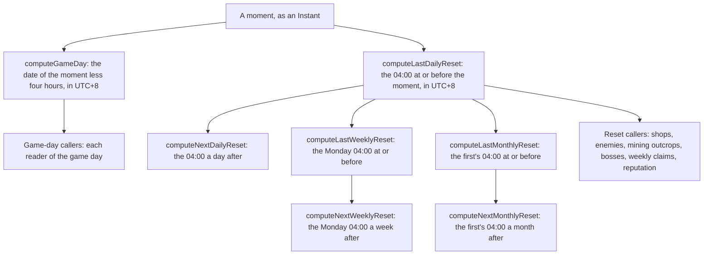

# Reset clock

Every daily, weekly and monthly reset in the world is read off one server clock, the Asia server's, UTC+8, where the daily reset is at 04:00 (`~/Esposter.noindex/genshin-parity/text/ExcelBinOutput/RefreshPolicyExcelConfigData.json`, row 1002, REFRESH_DAILY, time 14400 seconds), the weekly reset is Monday at 04:00 and the monthly reset is the first at 04:00 (`packages/genshin-world/src/services/time/constants.ts:2-8`; the dump's monthly shop goods change over at 04:00:01 on 2020-10-01, the old window ending 03:59:59, in `~/Esposter.noindex/genshin-dump-backup-6.6/ExcelBinOutput/ShopGoodsExcelConfigData.json`). One module in `packages/genshin-world/src/services/time/` owns the zone, the hour, and the weekday and day constants, and every system reads its functions rather than a copy of them.

## How it works

## Decisions

- **One clock, the Asia server's.** Every reset is read at 04:00 in `Asia/Shanghai`, the zone the game's server keeps, with the weekly reset on Monday and the monthly reset on the first at the same hour. Rejected: each reader's own time zone, which the bosses and enemies pages stated. A reader in New York then saw the daily reset on another day from a reader in Shanghai, and two players shared a week only when they shared a zone.
- **The wiki's 06:00 mining respawn is not followed.** The [mining outcrops](../mining-outcrops/design.md) page gives the wiki's respawn. The world keeps the one 04:00 reset that the shops and commissions already use, and the divergence is recorded on that page. Rejected: a respawn at 06:00 beside a draw at 04:00, which gives one region two clocks.
- **One module owns the constants.** `packages/genshin-world/src/services/time/constants.ts` holds the zone, the hour, the weekly weekday, the monthly day and the days in a week, each with its reason (`packages/genshin-world/src/services/time/constants.ts:2-10`). Rejected: the copies the shops, the Original Resin service, the enemies and the weekly count each kept, which had drifted apart and were why the resets disagreed.
- **A reset is an instant and a day is a date.** The reset functions return a `Temporal.Instant` (`packages/genshin-world/src/services/time/computeLastDailyReset.ts:5`), because a respawn, a claim and a mining are compared as moments. The game day is a `Temporal.PlainDate`, because the caps and the counts are kept per day. Rejected: a date for every reset, which cannot tell 03:59 from 04:00 on the same day.
- **The game day turns at the daily reset.** `computeGameDay` takes four hours off the moment in UTC+8 and reads the date (`packages/genshin-world/src/services/time/computeGameDay.ts:5`), so 03:59 still belongs to the day before. Rejected: the calendar midnight, which the Forging cap and the Primogem refills do not use.
- **A moment at the reset belongs to the period it opens.** The last reset at or before a moment is the one at that instant, and the next is the one after it, so a claim made at exactly 04:00 counts toward the new week (`packages/genshin-world/src/services/time/computeLastDailyReset.test.ts`:31-36 and `computeLastWeeklyReset.test.ts`:10-14 assert it, and `computeLastMonthlyReset.ts` builds on the daily reset). Rejected: a reset that closes the period it ends, which would count a claim at 04:00 on Monday toward the old week.
- **The old copies are deleted, with no alias.** The daily and weekly reset modules, the weekly constants module and the mining outcrop respawn module are removed, and the zone and hour constants leave the Original Resin, shop and enemy modules. Rejected: re-exporting the old names, since every caller is in the package and reads the new functions.
- **The save keeps its shapes.** The save still stores game-day dates and the instant of a deal as ISO strings (`packages/genshin-world/src/models/inventory/WalletSave.ts`, `packages/genshin-world/src/models/commission/CommissionDaySave.ts`). A defeated enemy's instant is saved by its spawn key as an ISO string (`EnemyRespawnSave`, `packages/genshin-world/src/models/enemy/EnemyRespawnSave.ts`:6-7), and the claim of a Trounce Blossom and a teleport are held in memory and not saved. The move to `Temporal.Instant` reads and writes those ISO strings at the save's edge, so it needs no migration.

## Key files

| File                                                                                    | Role                                                                                                       |
| :-------------------------------------------------------------------------------------- | :--------------------------------------------------------------------------------------------------------- |
| `packages/genshin-world/src/services/time/constants.ts`                                 | The server's zone, the 04:00 hour, the Monday weekday, the first of the month and the days in a week       |
| `packages/genshin-world/src/services/time/computeGameDay.ts`                            | The game day a moment belongs to, the date after four hours are taken off in UTC+8                         |
| `packages/genshin-world/src/services/time/computeLastDailyReset.ts`                     | The last 04:00 at or before a moment                                                                       |
| `packages/genshin-world/src/services/time/computeNextDailyReset.ts`                     | The 04:00 a day after the last daily reset                                                                 |
| `packages/genshin-world/src/services/time/computeLastWeeklyReset.ts`                    | The Monday 04:00 at or before a moment                                                                     |
| `packages/genshin-world/src/services/time/computeNextWeeklyReset.ts`                    | The Monday 04:00 a week after the last weekly reset                                                        |
| `packages/genshin-world/src/services/time/computeLastMonthlyReset.ts`                   | The first of the month's 04:00 at or before a moment                                                       |
| `packages/genshin-world/src/services/time/computeNextMonthlyReset.ts`                   | The first of the next month's 04:00                                                                        |
| `packages/genshin-world/src/services/time/checkIsDailyResetDayCurrent.ts`               | Whether a day keyed at a moment still stands at `now`, against the last daily reset                        |
| `packages/genshin-world/src/services/shop/computeShopRefreshTime.ts`                    | The last refresh of a shop's kind, read from the reset module                                              |
| `packages/genshin-world/src/services/shop/computeNextShopRefreshTime.ts`                | The next refresh of a shop's kind, read from the reset module                                              |
| `packages/genshin-world/src/services/shop/getPaimonsBargainsOffer.ts`                   | The bargains' month, the game day's month                                                                  |
| `packages/genshin-world/src/services/originalResin/refillOriginalResinWithPrimogems.ts` | The Primogem refill's game day                                                                             |
| `packages/genshin-world/src/services/forging/checkIsForgeDailyCapReached.ts`            | The forge cap, counted over the game day                                                                   |
| `packages/genshin-world/src/services/investigation/computeInvestigationDay.ts`          | The investigations made since the last daily reset                                                         |
| `packages/genshin-world/src/services/commission/computeCommissionDay.ts`                | The day's four, dealt again when the kept day is no longer current                                         |
| `packages/genshin-world/src/services/leyLine/checkIsMiningOutcropStanding.ts`           | A mined outcrop stands until the next 04:00 reset after its mining                                         |
| `packages/genshin-world/src/services/enemy/computeEnemyRespawnTime.ts`                  | An elite camp's member returns at the next daily reset                                                     |
| `packages/genshin-world/src/services/bosses/computeBossRespawnTime.ts`                  | A normal boss's respawn instant, five seconds after its claim                                              |
| `packages/genshin-world/src/services/bosses/checkIsWeeklyBossClaimable.ts`              | Whether a weekly boss is claimable, counting the claims since the last weekly reset                        |
| `packages/genshin-world/src/services/weekly/countWeeklyClaims.ts`                       | The claims made since the last weekly reset                                                                |
| `packages/genshin-world/src/services/reputation/checkIsReputationWeeklyLimitReached.ts` | The reputation weekly limit, counted from the last weekly reset                                            |
| `packages/genshin-world/src/services/spiralAbyss/findAbyssPeriodAt.ts`                  | The Moon Spire period that began latest, read in the server's zone                                         |
| `packages/genshin-world/src/services/spiralAbyss/pickAbyssBenedictionList.ts`           | The Moon Spire blessing list's day, counted from the game epoch on the server's clock                      |
| `packages/genshin-world/src/services/shared/findLatestBegun.ts`                         | The latest season begun before a moment, read in the server's zone                                         |
| `packages/genshin-world/src/services/gathering/computeGatheringRespawn.ts`              | The gathering midnight, read in the server's zone                                                          |
| `packages/genshin-world/src/composables/useWorldFishing.ts`                             | The fishing day's hours, read in the server's zone                                                         |
| `packages/genshin-world/src/composables/useWorldCommissions.ts`                         | The commissions' moment, from the world clock                                                              |
| `packages/genshin-world/src/components/World/Enemies/Index.vue`                         | The enemies' defeats, jumps and claims on the world clock, each respawn checked by `checkIsEnemyRespawned` |
| `packages/genshin-world/src/services/enemy/checkIsEnemyRespawned.ts`                    | The respawn moment, as [enemies](../enemies/design.md) gives it                                            |
| `packages/genshin-world/src/services/domains/checkIsDomainKindOpenOnDay.ts`             | The game day of a moment, which opens a domain kind on its set days and every Sunday                       |
| `packages/genshin-world/src/services/domains/checkIsDomainLevelOpen.ts`                 | Whether a domain level is open at a moment, by the Adventure Rank and the game day of the moment           |
| `packages/genshin-world/src/models/bosses/TrounceBlossom.ts`                            | The claim's instant as a `Temporal.Instant`                                                                |

## Notes

- The Enemies component times its defeats, jumps and claims on `getWorldNow` (`packages/genshin-world/src/components/World/Enemies/Index.vue:66`), the world clock, which Session passes through Windrise. Each respawn is checked against the same clock, so no moment is read from the device.
- A computed that reads the clock takes `worldNow`, a ref Session sets from `getWorldNow` once each `WORLD_CLOCK_INTERVAL_MS` (`packages/genshin-world/src/components/World/Session/Index.vue`), so a reset or a regeneration that passes with no write reaches it within the minute. A function that runs on a click reads `getWorldNow` at the moment it runs, and re-checks a row a computed showed before it acts on the row.
- `checkIsDomainKindOpenOnDay` and `checkIsDomainLevelOpen` take the moment checked, not a date, and read its game day from the reset clock. `checkIsDomainLevelOpen` has no caller outside its tests until the domain screen is built.
- The week's reset times are `computeLastWeeklyReset` and `computeNextWeeklyReset`, and the day's and month's are their pairs in the table above. The mining outcrop's respawn rule is in `checkIsMiningOutcropStanding`, and the game's zone, day start hour and reset days are the constants in `services/time/constants.ts`.
- Gathering's overworld ingredients respawn at the server's midnight, a separate moment kept in the gathering rules and not a reset, so it is not moved into this module.

## Open

- [ ] **The daily reset is on the Asia server's clock** — no source yet: row 1002 gives the time as 14400 seconds with no zone, and the wiki's Reset page is not in the local wiki cache.
- [ ] **The weekly reset is Monday at 04:00** — no source yet: the dump's `~/Esposter/genshin-parity/text/ExcelBinOutput/RefreshPolicyExcelConfigData.json` row 800001 (REFRESH_WEEKlY, time `14400;360000`) is not read into a weekday, and the wiki's Daily Reset page is not cached.
- [ ] **The monthly reset is the game's own 04:00 on the server's clock** — no source yet: its row in the dump and the wiki's Paimon's Bargains page are unread.
- [ ] **The world keeps 04:00 where the wiki gives the mining respawn at 06:00** — no source yet: the dump's `BlossomRefreshExcelConfigData.json` holds a 06:00:00 refresh (`BLOSSOM_REFRESH_CRYSTAL`), and whether it is the mining respawn was not checked; the wiki's Mining Outcrop page is not cached.
