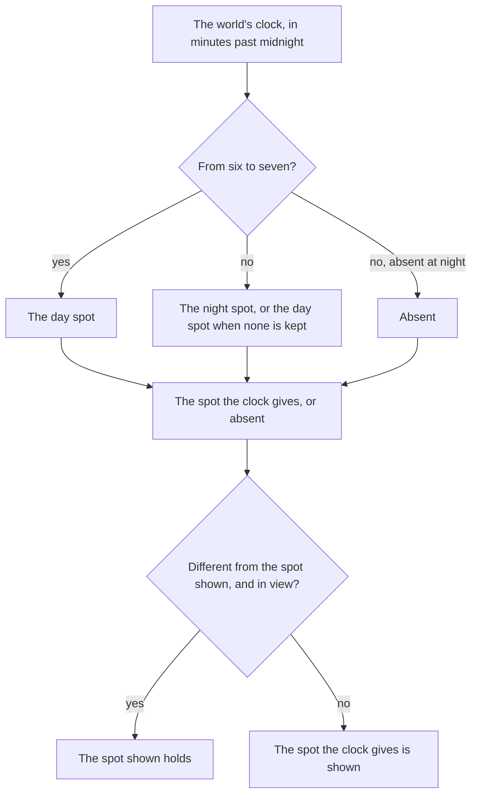
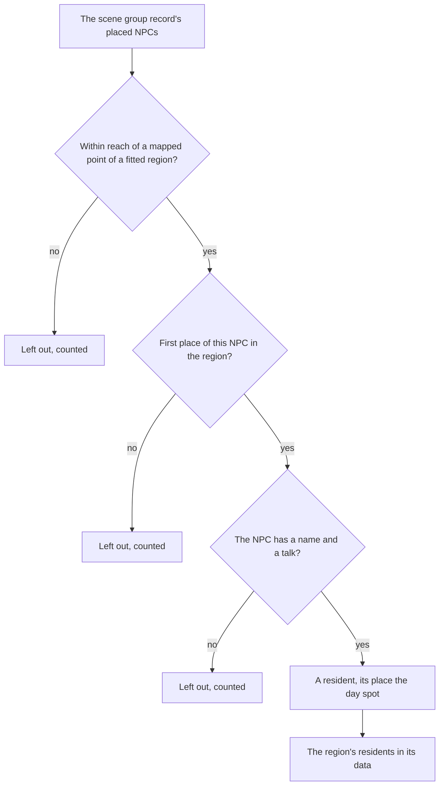

# Resident schedules

The game's people keep hours. A resident stands at one spot in the day and another at night, and some are seen only at one time. The [dialogue](../dialogue/design.md) page's residents are placed in a region's data with a day spot, a night spot, or one of the two, and this page is the rule that picks the spot the world shows at the clock's minute.

## How it works

- **Two spots by the hour.** `computeResidentSpot` returns the day spot from six in the morning until seven at night and the night spot the rest of the day. A resident with no night spot keeps their day spot through the night, and is absent at night only when the data sets `absentAtNight`. A resident with no day spot is absent in the day, so is neither drawn nor offered as a talk then.
- **Held while in view.** `computeShownResidentSpot` keeps the spot a resident stands at while the spot the clock now gives differs and the resident is in view, and moves them once they are out of view. An absence is treated as a spot, so a resident who appears or disappears at the turn does so out of view too.
- **Read each frame.** `useResidentSpots` runs each frame in the world: it reads the clock's minute, tests each resident's ground point against the camera's frustum in world coordinates, and replaces its map of shown spots only when one changed. A resident is placed the first frame they are in the data, and one whose region leaves reach is dropped, so they are placed afresh on return.
- **Vendors by their hours.** `checkIsVendorHourOpen`, with `DAY_VENDOR_SHOP_IDS`, opens a city vendor's shop only in the hours their wiki page gives: Draff's and Brook's from six in the morning until seven at night, and every other vendor's at any hour: Blanche's and Sara's pages say their shops are open all day, and the rest give no hours. The world's talk opens a dialogue in place of a shop outside them, as it does for a Souvenir Shop still closed, and no shop opens before the world's clock is read.
- **Consumers read the shown spot.** The world screen's prompts list a resident at their shown spot, and the quest's navigation marker points at it, so a resident absent at this hour is neither a prompt nor a marker.

## Where the residents come from

`pnpm -C scripts genshin:assets residents` writes the residents of each region the official map fitted to the scene into its region data, from the NPCs the [scene group record](../scene-groups/design.md) places, in their groups' order. Each is placed in the region of the nearest mapped point, carried into the region's own axes round Windrise's oak, and filed under the area of the nearest landmark. The NPC's name is the text id of its row in the game's NPC table. Its talk is its standing talk where the talk table gives it one, the talk F begins on it whatever the quests hold ([dialogue](../dialogue/design.md)), and otherwise the lowest-numbered talk the dialog table has it speak in. An NPC with neither is left out, since the schema needs a talk. The NPC a crafting bench stands for is left out too: its member is found in the bench's scene group by findCraftingBenchMember, the same member the bench's place is built from, so the bench is never a resident.

The record's NPCs are filled from the dump's NPC births, which give one place for most residents, so most have a day spot and no night spot, and stand at their day spot through the night. Most of the game's people stand in one place day and night, so absence is recorded only where the data says so, as `absentAtNight` (no resident carries it). A resident the record places more than once in a region is the same NPC at nearly the same spot rather than a day and a night, so only its first place is kept. The wiki gives a resident's daytime and nighttime location as gallery pictures captioned by the hour, not as text naming a place, so no place is matched to a night spot from it. The join takes night spots by NPC id from `RESIDENT_NIGHT_SPOT_MAP`, which is empty until a position is read for each NPC, so no resident gains one yet (no resident has a `night` spot). A shopkeeper or keeper the births do not hold is placed at the scene's building point of her shop or service: `BUILDING_NPC_ID_MAP` names each point's id and its NPC, and Hertha keeps the point named Reputation through `REPUTATION_KEEPER_NPC_ID_MAP` (where `Reputation` is NPC `1663`; the writer looks up both maps). Each such place is an estimate of the NPC's standing place, provisional until the scene's group export places them.

## Key files

| File                                                                       | Role                                                                              |
| :------------------------------------------------------------------------- | :-------------------------------------------------------------------------------- |
| `packages/genshin-world/src/models/world/Resident.ts`                      | A resident with an optional day spot, night spot and explicit absence at night    |
| `packages/genshin-world/src/models/world/ResidentSpot.ts`                  | One spot: its ground point and the way it faces                                   |
| `packages/genshin-world/src/services/resident/computeResidentSpot.ts`      | The spot the clock gives at a minute, or none                                     |
| `packages/genshin-world/src/services/resident/computeShownResidentSpot.ts` | The spot shown, held while the resident is in view across a change                |
| `packages/genshin-world/src/composables/useResidentSpots.ts`               | The shown spot of each resident, read each frame from the clock and the camera    |
| `packages/genshin-world/src/services/shop/checkIsVendorHourOpen.ts`        | The hours a city vendor's shop is open, from the wiki's pages                     |
| `packages/genshin-world/src/components/World/Windrise/Index.vue`           | Holds the residents' spots and exposes them to the world screen                   |
| `packages/genshin-world/src/components/World/Session/Index.vue`            | Lists the residents at their shown spot as talk prompts                           |
| `packages/genshin-world/src/services/quest/findQuestTargetPosition.ts`     | A quest target resident's shown spot, for the navigation marker                   |
| `scripts/src/services/genshinAssets/residents/writeResidents.ts`           | `genshin:assets residents`, joining the record's NPCs to names, talks and regions |
| `scripts/src/services/genshinAssets/residents/joinResidents.ts`            | The join: one resident per NPC per region, and what was left out                  |
| `packages/genshin-world/src/data/regions/<region>.json`                    | Each fitted region's residents, written by the generator beside its landmarks     |

## Sources

- [NPC](https://genshin-impact.fandom.com/wiki/NPC), Genshin Impact Wiki: open-world residents with their daytime and nighttime locations.

## Open

- [ ] **The game's residents stand at one spot by day and another by night** — no source yet: the wiki's NPC page is not in `~/Esposter.noindex/cache/genshin-wiki/`, and the dump gives no night spot for any resident (`RESIDENT_NIGHT_SPOT_MAP` is empty).
- [ ] **Most of the game's people stand in one place day and night** — no source yet: the wiki's NPC page is not in `~/Esposter.noindex/cache/genshin-wiki/`, so no count of residents by hour is checked.
- [ ] **The wiki gives a resident's daytime and nighttime location only as gallery pictures captioned by the hour** — no source yet: the wiki's NPC page is not in `~/Esposter.noindex/cache/genshin-wiki/`.
- [ ] **Draff's and Brook's shops open from six in the morning until seven at night** — no source yet: the wiki's vendor pages are not in `~/Esposter.noindex/cache/genshin-wiki/`.
- [ ] **Blanche's and Sara's shops are open all day, and the rest give no hours** — no source yet: the wiki's vendor pages are not in `~/Esposter.noindex/cache/genshin-wiki/`.
- [ ] **A repeated placement is the same NPC at nearly the same spot** — no source yet: no distance between an NPC's repeated births is recorded in the repo or under `~/Esposter.noindex`.
- [ ] **`computeResidentSpot` returns the day spot from six in the morning until seven at night, and the night spot the rest of the day** — no source yet: game data or a snapshot that holds this behaviour
- [ ] **A resident with no night spot keeps their day spot through the night, and is absent at night only when the data sets `absentAtNight`** — no source yet: game data or a snapshot that holds this behaviour
- [ ] **A resident with no day spot is absent in the day, so is neither drawn nor offered as a talk** — no source yet: game data or a snapshot that holds this behaviour
- [ ] **`computeShownResidentSpot` holds a resident's spot while the clock's spot differs and the resident is in view** — no source yet: game data or a snapshot that holds this behaviour
- [ ] **`useResidentSpots` runs each frame, and replaces its map of shown spots only when one changed** — no source yet: game data or a snapshot that holds this behaviour
- [ ] **A resident is placed the first frame they are in the data, and dropped when its region leaves reach** — no source yet: game data or a snapshot that holds this behaviour
- [ ] **`checkIsVendorHourOpen` opens a city vendor's shop only in the hours its wiki page gives** — no source yet: game data or a snapshot that holds this behaviour
- [ ] **The talk opens a dialogue in place of a shop that is closed** — no source yet: game data or a snapshot that holds this behaviour
- [ ] **No shop opens before the world's clock is read** — no source yet: game data or a snapshot that holds this behaviour
- [ ] **The world screen's prompts list a resident at their shown spot, and the quest's navigation marker points at it** — no source yet: game data or a snapshot that holds this behaviour
- [ ] **`genshin:assets residents` writes each fitted region's residents from the scene group record's NPCs, in their groups' order** — no source yet: game data or a snapshot that holds this behaviour
- [ ] **A resident's talk is its standing talk, else the lowest-numbered talk the dialog table has it speak in** — no source yet: game data or a snapshot that holds this behaviour
- [ ] **An NPC with no name or talk is left out, since the schema needs a talk** — no source yet: game data or a snapshot that holds this behaviour
- [ ] **The bench's NPC is left out, since its member is the one the bench's place is built from** — no source yet: game data or a snapshot that holds this behaviour
- [ ] **Most residents have one place from the dump's NPC births, a day spot and no night spot** — no source yet: game data or a snapshot that holds this behaviour
- [ ] **Absence is recorded only where the data says so, as `absentAtNight`** — no source yet: game data or a snapshot that holds this behaviour
- [ ] **Only a resident's first place in a region is kept** — no source yet: game data or a snapshot that holds this behaviour
- [ ] **The join takes night spots from `RESIDENT_NIGHT_SPOT_MAP`, which is empty, so no resident gains one yet** — no source yet: game data or a snapshot that holds this behaviour
- [ ] **A shopkeeper the births do not hold is placed at her shop's building point, named by `BUILDING_NPC_ID_MAP`** — no source yet: game data or a snapshot that holds this behaviour
- [ ] **Hertha keeps the point named Reputation through `REPUTATION_KEEPER_NPC_ID_MAP`, where Reputation is NPC `1663`** — no source yet: game data or a snapshot that holds this behaviour
