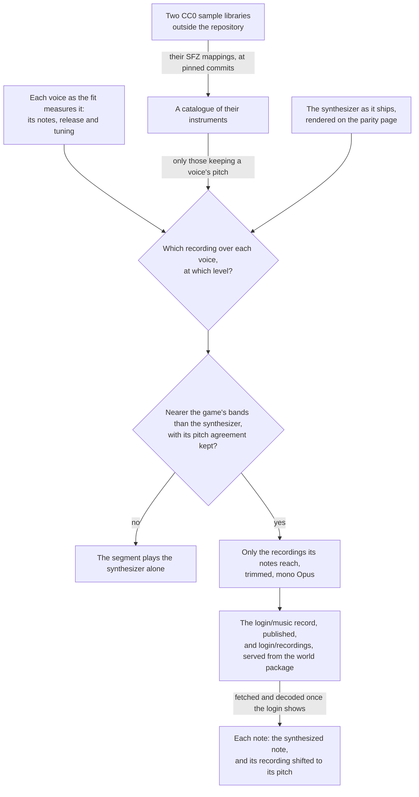

# Sampled instruments

The login's [music](../music/README.md) plays the right notes, and the synthesizer playing them is why it does not sound like the game. Each register plays one fixed spectrum of harmonics under one envelope, an organ's sound, where the game's is an orchestra recorded in a hall. The shortest route to a real instrument's sound is a recording of one. So each voice of a piece can play a recording from an openly licensed library on top of its synthesized note, at a level solved against the game's sound. The playlist, the notes, the voices and each voice's fitted instrument are unchanged, and the recordings are layered over them. Each segment's expression is then refitted, and the listening score read again.

## How it works

## Rules

- **The libraries are CC0.** The Versilian Community Sample Library and the Versilian Chamber Orchestra 2 community edition it builds on are public-domain recordings of orchestral instruments: strings as sections and solo, harp, piano, woodwinds, brass and mallets. Each instrument is sampled every tone or every few, in a few velocity layers, with its mapping in SFZ files. Beside them are a solo cello bowed and plucked, a double bass bowed and plucked, and a grand piano, each dedicated to the public domain under CC0. A library under any other licence, an attribution licence or Sampling Plus, is left out. Nothing of the game's sound is in them, so the rule that nothing of the game's audio ships is unchanged. They are the one exception to the Genshin area's rule that every asset is authored here, made because no oscillator of ours sounds like a plucked harp.
- **Layered, never replacing.** A voice's recording plays beside its synthesized note, both through the segment's expression. A level of zero leaves the synthesizer exactly as it was, so a solve that keeps the synthesizer's pitch agreement can only improve on it. Replacing the synthesizer outright loses pitch agreement on the first piece whatever the recordings and their balance: each recording's harmonics fold into the pitch classes differently from the game's, where the synthesizer's are fitted to them.
- **Chosen by a solve, never by a profile.** `genshin:parity instruments` picks each voice's instrument and level, and publishes them in the music's record where the mix beats the synthesizer. The listening score then confirms it, and the user's ear approves it. Ranking candidates by how far their harmonic profile sits from the game's voice does not predict the score: a profile distance weighs a harmonic forty decibels down the same as the second, and a cello section chosen by it overfilled the bass's band by about twelve decibels.
- **A recording plays at the voice's fitted tuning.** The game's tuning is read from its sound, and a fit can read a voice half a semitone off its mapping's centre. Each recording is shifted to the voice's tuning, not left at its own.
- **The synthesizer stays.** The layering keeps every voice's oscillator, noise and envelope playing, so they and their solves remain the music's base.
- **No reverb until a reading asks for one.** A reverb lengthens what a note already holds, so it is the remedy only where a render's notes die sooner than the game's. The best mixes' largest gaps hold their level from a note's start to half a second into it, so what is short is spectrum rather than ring.

## What is built

- **The catalogue.** Each library is read from its repository (`SampleLibraryOwnerMap`) at a pinned commit (`SampleLibraryCommitMap`). Only a mapping and the recordings a piece's notes reach are downloaded, into the shared tool cache. A mapping's `#include` files are read into its place, each from the folder of the mapping first read as SFZ resolves them, so a library whose programs are assembled from included maps is catalogued as it ships (`readSfzMapping`). `parseSfz` reads a mapping into the regions a note plays. Opcodes are inherited from `<control>`, `<global>`, `<master>` and `<group>` down to `<region>`, and a key may be a number or a note name. Release triggers, every round robin past the first, and a region whose key range is empty (a pedal noise a controller triggers) are skipped. A layer crossfaded in and out by velocity answers from the middle of its fade in to the middle of its fade out, since some instruments mark their layers only by their crossfades. A region's `volume` is carried as its gain, because each recording is normalised on its own. The amplitude envelope's opcodes are not read: the release comes from the game's voice. Velocity scales a note linearly rather than through the mapping's velocity curve.
- **One choice of recording, one rate and one gain.** `selectMusicSample` picks the recording a note plays: the region whose keys hold the note's pitch or lie nearest it, then of those the one whose velocities hold or lie nearest its velocity on MIDI's scale. `getMusicRecordingRate` shifts it from the pitch it was recorded at by the mapping's tune and the voice's fitted tuning, and `getMusicRecordingGain` scales it by the note's velocity over the recording's own gain. The solve's offline render (`renderSampledVoice`) and the engine's sampler call the same three, so what is solved is what plays.
- **The pitch check.** `computeVoicePitchReference` reads the pitch classes a voice's notes name with no instrument in them, frame by frame in the listening score's own frames (`computeNoteChroma`), and the same notes rendered as pure tones at their fundamentals beside them. A render of the voice is scored by its pitch agreement with the notes, as it stands and at the lag within a fifth of a second that agrees best (`computeLaggedAgreement`). An instrument that matches or passes the pure tones keeps the voice's pitch. `genshin:parity solos` scores every catalogued instrument this way (`scoreSampledSolos`), with the median onset of the recordings it plays and how far each note is shifted from its recording.
- **The solve.** `solveSampledVoices` renders every catalogued instrument through each voice's notes at level 1, the way the sampler plays them, with the voice's fitted release and tuning, and under the segment's shipped expression. Only an instrument that keeps the voice's pitch is a candidate, or the one nearest that where none does, since the octave bands cannot hear pitch. The base is the synthesizer as it ships, rendered alone on the parity page whatever recordings already ship, so a second run solves what the first did. For every combination of one candidate a voice, the powers come in closed form from nonnegative least squares on each band's share of the game's energy, the target being what the base leaves short of each frame's share (`solveNonNegativeSystem`). A recording only adds energy, so the solve is clipped at zero: an unclipped solve drove every combination to silence against the base's average overfill. The best combinations are refined against the score's band distance over the base (`refineVoicePowers`), each level the square root of its power. Each mix is scored whole once its expression is refitted to the game's swells (`scoreShapedMusic`), as `genshin:parity expression` refits the shipped music's. A mix that loses the base's pitch agreement is tried again at a half, a quarter and an eighth of its levels, and dropped if none keeps it.
- **What ships.** A segment whose best mix lies nearer the game's bands than the synthesizer gets each voice's instrument set in the `login/music` record as its `recordings` and `recordingLevel` (`writeLayeredRecordings`). Every other voice gets none and level 0. Only the regions the shipped notes select are written (`selectShippedRecordings`), in the instrument's own order so the sampler picks from them as it would from all of them. Each is cut where the furthest-reaching note that plays it stops reading it: the note's end and its release until it falls under a thousandth, at the rate the note shifts it by. The cut is encoded as one channel of Opus in Ogg (`encodeMusicRecording`) into `login/recordings`, which is rewritten whole so no unplayed recording stays.
- **The sampler.** `scheduleMusicRecording` plays a note's recording as a buffer source at its rate, through a gain at the voice's recording level times the note's gain, held to the note's end and then faded with the voice's release, beside the oscillator `scheduleMusicNote` plays. `createMusicPlayer` and `renderMusicSegment` call both for every note, through the segment's expression gain, and take the decoded recordings by file. A voice with none, or a recording not decoded, plays its synthesized note alone. The login's music (`Login/Music`) fetches and decodes its recordings once it mounts (`loadMusicRecordings`), from the URL its host passes down through the opening (`musicRecordingBaseUrl`), and starts the playlist once they are decoded, or without them if they cannot be fetched. The app's server serves them from the world package's folder at `GENSHIN_LOGIN_MUSIC_RECORDING_BASE_URL`, and the parity page decodes them before it renders a segment for `listen`.

## Key files

| File                                                                     | Role                                                                                    |
| :----------------------------------------------------------------------- | :-------------------------------------------------------------------------------------- |
| `packages/genshin-engine/src/models/audio/MusicRecording.ts`             | A recording as the sampler plays it: its file, key centre, tune, gain                   |
| `packages/genshin-engine/src/audio/scheduleMusicRecording.ts`            | One note's recording played over its synthesized note                                   |
| `packages/genshin-engine/src/audio/selectMusicSample.ts`                 | The recording a note plays, in the sampler and the solve alike                          |
| `packages/genshin-engine/src/audio/getMusicRecordingRate.ts`             | How fast a recording is read to sound a pitch                                           |
| `packages/genshin-world/src/services/login/music/loadMusicRecordings.ts` | A piece's recordings fetched and decoded once, by file                                  |
| `packages/genshin-world/src/components/Login/Music/Index.vue`            | The login's music, started once its recordings are decoded                              |
| `scripts/src/services/genshinAssets/music/solveSampledVoices.ts`         | Each voice's recording and level over the synthesizer, pitch heard                      |
| `scripts/src/services/genshinAssets/music/writeLayeredRecordings.ts`     | The winning layering written into the data, its recordings encoded                      |
| `scripts/src/services/genshinAssets/music/selectShippedRecordings.ts`    | Only the regions the shipped notes play, each cut where it stops                        |
| `scripts/src/services/genshinParity/music/scoreShapedMusic.ts`           | A mix scored under an expression fitted to it                                           |
| `scripts/src/services/genshinAssets/music/parseSfz.ts`                   | A mapping's regions                                                                     |
| `scripts/src/services/genshinAssets/music/computeVoicePitchReference.ts` | What a voice's render is scored against for pitch                                       |
| `scripts/src/services/genshinParity/commands/instrumentsCommand.ts`      | The solve's report, and what it ships                                                   |
| `scripts/src/services/genshinParity/commands/solosCommand.ts`            | Every instrument alone through each voice, scored for pitch                             |
| `packages/genshin-world/src/models/login/LoginMusic.ts`                  | The login's `login/music` record: its notes, each voice's instrument and its recordings |

## Sources

- [VCSL](https://github.com/sgossner/VCSL), Versilian Studios: the community sample library, CC0, its instruments sampled every tone where possible in two or three velocity layers, with SFZ mappings on its `sfz` branch.
- [VSCO 2 Community Edition](https://github.com/sgossner/VSCO-2-CE), Versilian Studios: the chamber orchestra library, CC0, with SFZ mappings on its `SFZ` branch.
- [SFZ format: headers](https://sfzformat.com/headers/): the global, master, group and region hierarchy whose opcodes define which samples play and when. A header's opcodes apply to every region under it, which is the order `parseSfz` inherits them in.
- [DDSP: Differentiable Digital Signal Processing](https://arxiv.org/html/arXiv:2001.04643): the harmonic-plus-noise model the synthesizer is a static form of, whose harmonics and noise change through each note. Recordings are the shorter route past it.
- [Opus recommended settings](https://wiki.xiph.org/Opus_Recommended_Settings), Xiph.Org: 128 kbit/s variable bit rate as about transparent for stereo music, of which a mono recording takes a channel's half (`MUSIC_RECORDING_BITRATE`).
- [Opus Audio Codec: browser support](https://www.testmuai.com/learning-hub/opus-audio-codec-browser-support/): Opus in Ogg decoded by every current engine, Safari since 18.4.
