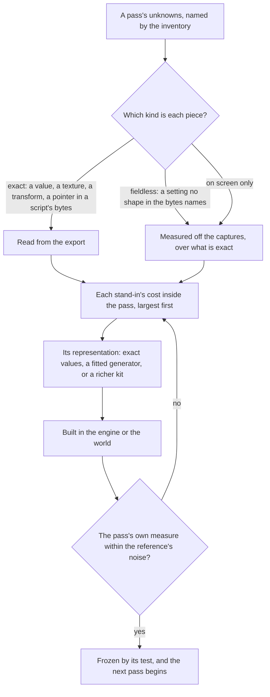
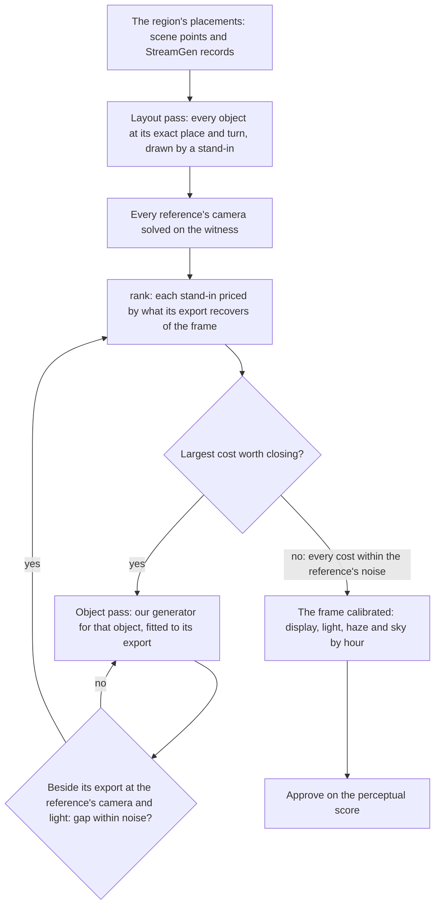

# Scene derivation

This page is the method every 3D scene of the [Genshin](../../../changes/genshin-program/design.md) program follows, built on the [derived assets](../derived-assets/design.md) pipeline and the [parity](../parity/README.md) loop; the tools each step uses are those pages' commands, and the order its unknowns are answered in, each judged by its own measure and frozen, is set by the [recreation passes](../../../changes/genshin-recreation-passes/design.md). The interface converges on the game within a few tenths of a percent because its reference holds it exactly and every difference points at the piece that caused it. A 3D scene converges only when the same is made true of it, and four things stand in the way unless the method rules them out:

- **A search over the frame.** The arrangement, the camera, the materials, the light, the fog and the grade all land in one frame's score, and a search over it settles at the minimum that masks every other mistake: a grid of camera poses absorbs a wrong arrangement into a plausible pose, and a light searched on the frame's mean stands in for a missing texture.
- **A fit that throws the game's information away.** A tower's exports are a mesh of thousands of vertices, a diffuse, a normal and a mask texture, and a material of several dozen values. A kit that keeps a lathe section per band and one colour for all the stone has a ceiling below the game however its few numbers move.
- **An assumed shading model.** The login stone's own programs only write its normal map, gloss, specular colour and rim into the G-buffer, and the game's deferred pass lights them: the sun through a ramp of its own, the sky's spherical harmonics, a cube and a GGX highlight. No tuning of a toon ramp or of a physically based material reaches that pass; reading its program does.
- **A score that cannot say where the gap is.** A whole frame's shape and tone, the tone blurred past any texture, cannot tell the geometry, a material, the light, the sky or the grade apart when a change moves them.

## Decisions

- **Lossless, re-derived.** The goal is that the browser shows what the game shows, pixel for pixel where the game's own frame allows. What ships is our own re-derivation: shaders written in TSL, geometry generated by our code, and data in our own formats written by our fits. No file, format or data of the game's is committed, built, uploaded or deployed, and that is the one line; a developer's own extraction drawn by their own development server crosses none of it ([development exports](../derived-assets/development-exports/design.md)). Short of it, a re-derivation has no fidelity ceiling: a kit rich enough to rebuild a tower within a pixel of its mesh on screen, or a procedural stone that reproduces its texture's look, is the goal, not an overreach.
- **Solved in the passes' order, never searched.** Each unknown is answered in its [recreation pass](../../../changes/genshin-recreation-passes/design.md), after the passes it depends on, by the most exact query there is: the exact value, then a closed-form solve, then a local refinement from it.
- **Nothing is built before it is inventoried.** A scene starts by listing everything the game draws it with: every renderer, its materials, each material's shader, values and texture slots, what each texture channel holds, and the lightmaps, reflection probes, grading tables and sky the scene reads. It also lists what the scene's scripts spawn and set. Each piece of information is sorted into one of three kinds, and the kind decides how it is derived (below).
- **Every loss in a pass is priced before it is closed.** The witness render draws the exports themselves, and each stand-in of ours is drawn beside its export at the same camera, moment and light. Inside a pass, the frame's error each term could recover is its cost, and the work goes to the largest cost first; across passes, the earlier pass goes first however large a later cost.
- **The witness render is a diagnostic and never ships.** It runs on the parity page, reads the exports from the references folder, and is never bundled, built or committed. Under `nuxt dev` alone the world draws the same layout through the same loader, each family it holds replacing that family's stand-ins, from the developer's own extraction ([development exports](../derived-assets/development-exports/design.md)). Neither is a second render path of the product: what ships draws our own path alone, and the witness is how it is measured.
- **Each layer is scored on its own.** A reference is split into layers, sky, clouds, stone and walkway among them, by the witness render's part identifiers from the same camera, so each subsystem has its own shape, tone and detail score and a change is judged where it lands.
- **The game's shaders and its scripts' raw bytes are read, and its code metadata only where it pays.** A shader asset the exporter dumps is read as a reference, its maths rewritten in TSL as our own. A script's JSON export carries no fields, but its raw export keeps the serialized bytes, which are scanned for what their shapes name: a pointer to a path ID the scene holds, a colour, a curve. The code metadata is decrypted offline from the user's own install where [the Genshin proposal's rule for the game's files](../../../changes/genshin-program/design.md) allows it, as for a script's type data: nothing it reads is committed and nothing touches the running game. What none of them holds is measured off the captures, as [derived assets](../derived-assets/design.md) measures what a dump cannot hold.
- **A family of scattered cards is gated on its envelope, against the exports' own halves, closed at the cards' own spacing.** Leaf against leaf, the outline, depth and normal of each card are scatter: no canopy meets a per-card reading but the export's own cards, which may not ship. The per-card figures stay as diagnostics. The gate is the canopy's envelope: each side's leaf cards closed and their depth and normal averaged over the same window, read against the exports' two halves (each card whole in one half, `WitnessView.leafHalf`), with the gate the distance those two halves stand apart on their own envelopes (`measureEnvelope`). The window is the cards' spacing as the exports draw it, never a size picked by hand: the least closing radius at which every hole either half leaves is a hole the whole leaves too (`computeEnvelopeRadius`). A sweep of the radius shows the outline reads the radius rather than the shape unless the cards are drawn from both sides, which is the next decision.
- **The witness draws a face from behind where its source does, and that face reads its geometry's own normal unless a normal map bends it.** The game's leaf mesh holds no back face for any card, and its normals are a field over the crown at right angles to the cards, so its foliage is drawn from both sides, as ours is. The witness's targets drew every part from the front alone, so each side kept only the cards that faced the camera. Every target now takes its source's sides, and a back face takes its geometry's own normal in the geometry target and in the normal target wherever no normal map bends it: `normalWorld` flips a back face's, since the exports' own halves stand apart by a wide angle otherwise. A normal-mapped face writes the map's normal from either side.
- **A family's normal is read on its geometry; its maps' bend is gated on its own.** The exports' normal target is their normals as their normal maps bend them, and the maps are textures nothing of ours ships, so a stand-in drawn without them reads at least their bend however exact its geometry. So the shape pass reads each family's normal on the geometry: the exports' `geometryNormal` target against ours, both drawn without maps, at the same 10 degrees. The bend is gated separately, as a surface detail: each family's mean bend of ours less the exports' over the pixels both draw, gated at the floor the exports' own two halves of 32-pixel blocks stand apart by, never below the normal target's resolution (`getSurfaceBendReading`, `SHAPE_NORMAL_RESOLUTION_DEGREES`). A family whose maps carry a bend it has no procedural detail for fails its surface gate until that detail is fitted to the bend and ships on its material.
- **A ground's layers are a fitted field of their shares, placed where the game places them, never by slope.** Over Windrise's radius the base maps' flat ground is mostly grass and half earth, and their steep ground mostly grass, so hand slope bands misclass a large share of the ground, and the best slope-only bands paint it all grass. Each TerrainData names the layer of every four-metre cell itself, a byte map one of the base map's tones on most of each tile ([game data formats](../game-data-formats/design.md)). So the representation is a grid of each layer's shares over the ground radius, fitted from the layer each cell is painted in ([ground paint](../ground-paint/design.md)): our own parameters at the measure's resolution, never the game's texture. The cells, not a tone of the base maps' colour, say what each layer is, since the snow reads as a pale rock and the road stone as earth by colour alone, and the base-map texels on each layer's cells give its colour, the base maps being what the witness draws. The cell is the one the surface pass reads inside its gate, and a rule laid over the field reads worse than the field alone.
- **A stand-in's colour is read off its export's texture where each of its vertices stands, never one colour a mesh.** A mesh's mean over every face counts its undersides and the faces no view shows, so the surface it shows reads warmer or cooler than the mean, and the mesh's own coverage stays right. So each vertex of the statue's stacks carries its own colour, the mean of the nearest fitted points, each point the export texture's texel under its material's tint, as the game's G-buffer holds it (`createNearestColourReader`). A coarser colour per stack or per ring reads worse against the surface pass than a colour per vertex, at a larger record, so the colour is per vertex.

## How it works

### The three kinds of information

- **Exact.** The exports hold it as numbers or pixels: a material's values and colours, a mesh, a texture's channels, a transform, a grading table, a lightmap, a pointer or a colour in a script's raw bytes. It is re-derived to within the reference's own noise, and the fit that re-derives it prints the error it leaves.
- **Fieldless.** The game holds it, but nothing in the export's bytes names it: a setting whose shape the scanner cannot tell from its neighbours, a particle system's spread and rate. It is measured off the captures and written over an exact value, as the camera's height is written over the walkway's width.
- **On screen only.** Nothing exported holds it: a transition's timing, the running game's light. It is measured off the captures alone, by a solve over what is exact (a camera's path by the matchmove, a light by regression).

### What the passes read here

The [recreation passes](../../../changes/genshin-recreation-passes/design.md) own the order. What this method adds to them is how a scene's passes read the game: the inventory reads the scene tree, which prints every root, every node and what each lost, and the closure, which exports everything the roots reach, an empty anchor under a script's object being where that script spawns a prefab its raw bytes name; the layout holds every proportion a reference shows between parts that meet, the cross-ratio of the four ends their widths mark on the line where they meet, in a unit test before any render; the camera is solved from landmark correspondences in closed form and refined on the stone's silhouette edges; and the light is solved by least squares over the witness's G-buffer, every pass before it frozen.

### The witness render

The witness page loads a scene's exports from the references folder, draws them through the engine's own renderer at a reference's camera pose, and writes a part identifier, depth, normal and albedo beside the colour. Its layers come from the inventory: which object belongs to the sky, the clouds, the stone. Because the pose is the reference's, the identifier target is also a segmentation of the reference, which is where each layer's score gets its mask. While a tool drives it, the witness holds its clock and its anti-aliasing's jitter, so one render settles a view.

Attribution is `rank`, and it swaps nothing. It shoots the witness twice at the reference's pose, once with every family drawn from the exports and once with none, ours in their place, and ranks every term of the reference's error by its ceiling, the most of the frame's FLIP that term drawn exactly could recover: each family's stand-in with the exports' own lighting and grading set aside, and the sky by its rows. A second table renders every stand-in next to its export under one shared pose and lighting and compares the pair, by FLIP and by structural similarity; the [parity page](../parity/README.md) holds both tables in full. A layer-by-layer score of every swap against the recording is not used, since a recording is too soft to tell a stand-in from its export.

### Choosing a representation

A loss is closed by the least representation that closes it, from this order:

1. **The exact value.** A material's specular colour, a rim's colour, an occlusion strength, a sky colour a script's bytes hold: a number the inventory already has, written into the scene's data.
2. **A fitted generator.** Our code generates the piece and a fit sets its parameters so its output matches the export: a stone material in TSL whose block layout, colour variation, wear and normal detail are fitted to the part's own textures, or a tower kit whose mouldings, windows and bands are fitted to its mesh. The fit prints its error on screen, in pixels at the reference's pose, not in texels or metres.
3. **A richer kit.** When no generator of ours can reach the export's look within the reference's noise, the kit grows the parameters that close it, and the fit is extended to set them.

A representation is judged by its pass's measure at the references' cameras, never by how close it looks in isolation: a stone texture that is visibly different up close can cost nothing at the distance the scene shows it, and a tower silhouette that looks right can cost the most.

### The open world: a layout pass, then a pass per object

An open-world region holds hundreds of objects, so it is built in two kinds of pass. The **layout pass** stands every object the game streams there at its exact place and turn, read from its scene points and its StreamGen records, each drawn by a stand-in: a kit we already have, or the export's bounding box where we have none. Nothing in this pass is judged by eye, since what it gets right is exact data, and it is what every later pass stands on: the cameras are solved against it. Each **object pass** then replaces one stand-in with our own re-derivation of that object, chosen by the loss table and fitted against its own export. It is drawn beside the export at a reference's camera, moment and light, so the only difference left between the two is the object, and it is done when that gap is within the reference's noise. The frame is ranked again before the next object is chosen. Only once every object's gap is within noise are the display transform, the light, the haze and the sky calibrated over the rebuilt region, in the [recreation passes](../../../changes/genshin-recreation-passes/design.md)' order, since a light calibrated over stand-ins stands in for their wrong shapes and surfaces.

An object the game places many times (a ruin slab, a rock) is one object pass however often it stands, since the fit is of its mesh and the layout already places every copy.

### Scores

- **Each layer is scored on its own**, over its mask, with the existing `shape` and `tone`.
- **A detail score reads what tone blurs away**: the difference in each band of spatial frequency between the reference and the shot over the layer, so a textureless stone scores a loss that its right mean colour hides.
- **A perceptual score over the whole frame**, FLIP's, as the one number a scene is approved by once every layer's loss is within the reference's noise.

## The login scene

The login scene is the first scene run through this method, and what it found applies to every scene after it:

- **The arrangement is spawned, not laid out.** The login's own root holds `SceneObj` at a tenth of its scale, and `SceneObj`'s children are `Atmosphere`, `ModelCamera` and three empty anchors, `SceneBeginNode`, `BridgeBeginNode` and `DoorNode`, all in the login's block. No block is missing: `MonoLoginScene` spawns the scene's prefabs into those anchors at run time. Which prefab the login spawns is in the script's raw bytes, the walkway's parent is `BridgeBeginNode`, and the three spawns are the component's, composed through their anchors.
- **A pose is read by perspective, never searched.** The flight's first pose, shared by the dawn, dusk and night skies, and its last, at the door, are read from the walkway's crossbars and the door's pixel widths and rows and checked by one render each, where a search over a grid of thousands of poses absorbs a wrong arrangement into a plausible pose. The day sky has a pose of its own. The flight between them is a script's, with no clip, so its path is tracked across the recording.
- **The stone is a physically based material.** Its values are a specular colour, a metallic, a shininess, a rim glow and an occlusion strength, and its mask texture is smoothness in red and metal in green. Its diffuse is a near-neutral grey, so the reference's warm stone is its light. Its shader, `miHoYo/Scene/Login Base`, is one AnimeStudio cannot parse, but its unparsed raw export holds its programs like any other's; its programs only write the G-buffer, so the witness and our stone alike are lit as the deferred pass lights it (`StoneLightingModel`), its ramp and its sky harmonics solved per hour by `calibrate`.
- **The tone curve is the bloom's own.** On a standard display the uber pass adds the bloom, applies the white balance and, behind `_MHYBloomTonemapping`, maps each channel by an exposure and a contrast the bloom's settings hold, then encodes it; the 3D table another pass bakes is sampled only in PQ space for an HDR display. A post profile names its table by a pointer in its raw bytes; the login's chains the game's bloom with no colour grading, so its transform to the screen is that curve and that bloom (the login's `Display.reference.ts`).
- **The clouds' shader reads cleanly.** A cloud samples its atlas through a curl-noise offset, dissolves its alpha with its age, is coloured between a dark and a light colour by the atlas's red with a rim, and fades toward the sky. It reads the Enviro sky's own terms: top and bottom colours front and back of the sun, a horizon halo and a sun halo, which `EnviroSky`'s raw bytes hold by hour.

## Windrise

Windrise is the first open-world region run through the method. Its ground is our own hills fitted to the game's terrain, its water stands at the game's level, and its statue and oak stand and turn where the game's placements set them. Each stands at a height over our ground, its `heightOffset`, its export root's height over our ground. The oak's shape is the tree kit fitted to its meshes ([trees](../trees/design.md)), while the statue's shape is stacks fitted piece by piece to its meshes, an upright stack for each ring of stone and the figure's robe and blades along their own lengths for its leaves, wings and arms, so its size is the game's, and each stack's vertices carry the colour its export's texture paints where they stand (the decisions above). Its shape pass holds its outline and its depth; its normal, read on its geometry, misses its gate most at the hood, the wings, the dish and the leaves, and its maps' bend fails as a surface detail, both as the decisions above set out. The witness lays the region's exports out round the same origin our scene stands round, the oak's foot ([derived assets](../derived-assets/design.md)), and the world screen takes a held camera and a held hour for each reference. Its fixed camera, from a recording of the statue through a whole day, is solved from points on the statue's axis, the dish's brim, the plinth's rim and the trunk's axis. Where those landmarks disagree, the statue's top and plinth against the dish's brim, the held camera stands on the set that holds, and a refinement on the statue's outline is kept only where the landmarks hold.

The paving round the statue is drawn as the export's eighteen slab placements of the two ruin meshes, each a prism over its mesh's outline as its convex hull's radii at twenty-four angles, with flat faces and the export's heights. Its shape pass holds its outline, depth and normal to their gates, where the family overlaps the exports. The rest of the outline is one stone at the dais's foot, whose top lies 5 centimetres under our terrain: the terrain's height there is the Ground pass's to fit, so the stone is not raised to the frame. The paving's record is `World/Screen`'s `Paving.reference.ts`.

Every solve is cross-checked on more than one recording. Windrise's ground and placements are the same on the older builds' recordings, so a 2021 or 2022 recording solves a camera and calibrates a light as well as the current build's, and a field of view or an hour read off one recording is trusted only once another agrees. What is worked on next is chosen by what the solves and `rank` price, never by how far a stand-in looks from the game: the fitted ground stays as it is until a ranking prices a finer one.

## Each region's ground

A region's ground is fitted in pieces by `fitGroundPieces`, the same fit Windrise's ground goes through. A piece is one of the catalogue's areas that has an outline: the square of its bounding box, with its samples those inside the outline, so no piece's samples reach another's outline. Where two pieces' hills overlap in the engine's sum, the seam is not measured yet. Its hills are fitted only on its samples, and the falloff weights them from the piece's centre: a sample 200 metres from it counts half as much in their least squares as one at it, and one 400 metres away a fifth. A piece whose gate reads on fewer samples than `GROUND_GATE_SAMPLES` (1024, provisional), or on none, is refused before its hills are fitted. A piece whose bar misses its gate is refused: it publishes no record, and its report names it. A refused piece with at least that many samples is split into its four quarters, each a piece of its own fitted the same way: a quarter's samples are those of its square inside the outline, and a sample on a shared edge belongs to the quarter east or north of it. A quarter's key is its parent's with its index, `ground/<region>/<area>/<0..3>`, and the parent's own key is published only when its bar holds. Windrise has no outline in the catalogue, so its ground is one piece over its disc of `GROUND_RADIUS` metres at the origin, which is never split. An area with no outline has no piece: Liyue's 1 area, Inazuma's 2, Fontaine's 1, Natlan's 1, Nod-Krai's 4 and Snezhnaya's 4 are unfitted, and only `everfrozen-earth` of Snezhnaya's 5 has one. Fitted over a whole region's outlines at once, Mondstadt's bar stood at 1.24 metres against its 0.87 gate and Sumeru's at 2.96 against 2.29, which is why the fit is cut into pieces that each hold their own gate.

Over the hills the fit places the sharp features they smear, plateaus first, then cliffs, then ridges, each kind greedily (`placeTerrainFeatures`): a round tries every shape at every centre, takes the one whose profile, fitted by least squares to the samples it covers, removes the most squared error, at that fitted height, and subtracts it before the next, until 200 are placed or the best takes under 0.1% of what is left. A feature costs every vertex it reaches about four hills' time (`createTerrainShapeHeight.bench.md`), while the bytes and ready time it adds do not bind, so that stop is the deepest whose step still takes as much of the extent's squared error off for each hill a vertex reads as the hills' narrowest rung does: over Windrise the step to it returns a little more than the rung, and the step past it, to 400 a kind and 0.05%, under half. A new kind of feature joins on the same terms, only where it pays at that rate. A shape counts only where every sample it covers is fitted ground. Each sample a shape covers weighs the share of its height the engine draws there, out to the feature's bounds (`computeFeatureOffsets`), so the height a round fits is the height the feature is drawn at and the error it claims to take off is the error its drawing takes. A weight that differed from the drawing, such as a band's mean, would claim gains the ground never gets, and placed deep enough the features would chase each other's errors without bound. Cliffs and ridges are segments 96, 48 or 24 metres long, tried on centres half their length apart at headings 22.5 degrees apart (`createSegmentShapes`), as fine as a 24 metre segment can tell on the fit's 6 metre grid. A cliff's headings go round the full turn, so the side its left normal raises covers both sides of every line, and its terrace reaches half its length across the line, its edges falling across a quarter of that (`fitTerrainCliffs`). A ridge is the same either way along its segment, so its headings go round the half turn, and its width is a quarter of its length (`fitTerrainRidges`). A plateau is a disc of 96, 48 or 24 metres' radius on centres half its radius apart, its edge falling across a quarter of its radius (`fitTerrainPlateaus`). On Windrise most of the features are cliffs, with a few plateaus and ridges, and together they take about a fifth off the composed ground's error over the fitted extent without its residual and move no landmark's root.

Every region is in the world's axes round the oak's foot, so its heights are read against Windrise's origin rather than its own component's. The fit publishes each piece as `ground/<region>/<area>`, and prints its gate, its bar against that gate, and the error its hills leave and the composed ground's, its hills, features and faded residual together. Snezhnaya's authored `ground.json`, the plateau its ground held before the fit, still publishes as `ground/snezhnaya` for the world to read until the pieces replace it. What a heightfield cannot hold, an overhang, an arch, a stone pillar, a sea stack, a cave or the floating rocks of Liyue and Inazuma, is an object the game places, so it stands where its StreamGen record sets it in the region's layout pass and is rebuilt by an object pass, never forced into the heights. Each region's fits are its entries in `DerivedAssetFitMap`, one per outlined area and named by the area's id, so `fit <region>` runs them all and `fit <region> --only <area>` runs one. The world lays every region's ground over Windrise's but Mondstadt's, whose capital stands inside Windrise's fitted extent ([region buildings](../region-buildings/design.md)).

A capital's city is not the region's own ground. The tiles under a city hold its built tiers: under Mondstadt City, flat terraces at about −4, 2, 7 and 17 metres with steps of 13 to 15 metres between two samples 4 metres apart, which no plateau's edge, falling across a quarter of its radius and at least 6 metres, can hold. Fitted as ground, the city held all of the features' error within 60 metres of Mondstadt's centre and 99% of it within 150, 2.24 metres RMS inside the city against 1.15 outside. So the fit takes no sample of a city's tiers: inside the city areas a capital stands in, and every one within 60 metres of those, since a capital is laid out across several (`readGroundFootprints`), it fits the land the city stands on, the tiles smoothed at the narrowest hills' width of 14 metres (`smoothTerrainGrid`), and its buildings and plazas own the tiers and walls over it. Left unsampled, the hills ran on into a city unheld: Natlan's stood 25 metres RMS off its tiles inside its areas and 41 metres over them at its capital, Inazuma's 10 metres RMS. The fit prints how far the composed ground stands off the tiles inside the city and at each capital, whose kit's building stands on that land ([region buildings](../region-buildings/design.md)): inside Mondstadt City it stands 5.5 metres RMS off the tiles' tiers, 16 metres over them at the capital's place.

Each piece is held to a gate read off its own ground, never off the fit's own result. The bar is the RMS of its hills and features, without the residual, over the samples the piece holds, printed as held when it is at or under the gate and as missed when over. The gate is the RMS, over the same samples, of the ground's detail finer than the fit's 6 metre step: each sample less the Gaussian mean, at that sigma, of the samples round it (`computeTerrainDetail`). No hill of the fit's widths follows that detail, the narrowest keeping about a hundredth of its power through it, so it is the roughness the fit cannot hold at its scale; the tiles' own rounding is under a centimetre ([game data formats](../game-data-formats/design.md)), so it never binds. A piece whose bar misses is refused, and so is every quarter of it whose bar misses in turn, until a quarter holds or falls under the samples its gate needs.

## The other regions

Each other region's open world is derived by `extract` from its capital's catalogued place, the way Windrise's is laid out, and is never rooted at its capital's index. A capital's layout is checked by `tree`: no architecture lost father within the architecture radius of its place, and architecture placed in that view by the witness. A top collapsed at the origin is an unplaced spawn (a prefab a script spawns at run time), dropped from the witness and counted apart. A lost father at the origin whose subtree is placed off it is placed by the witness, so it is not counted lost. The index is the chunk index of the capital's own StreamGen blob, a MonoBehaviour holding that blob's chunk offsets and hashes and no game object. A closure starts from the layout of game objects, so a root that holds none walks to nothing, and `extract` reports 0 objects for it. The capital's props and buildings are not in that index at all: they are the placements of its city blobs, `Area_<code>_City`, each described by its own index ([game data formats](../game-data-formats/design.md)). So the derivation reads the blob of every city area its architecture radius reaches and the tiles its view and that radius cover by path hash, keeps the placements in the capital's view and, past it, each architecture placement within 600 metres of its landmark (a building family's name, not a prop, plant, effect or decal), names each prefab by its path hash (a placement of a prefab grouped by level of detail carries none, and takes its finest level's from the game's LOD table, `readLodPathHashes`; then the community's index, and each hash past 2.6 that index leaves unnamed by the path its folder gives, hashed from the asset index's own names in the same run by `readDerivedPathNames`, so the extraction owes no later step before its prefabs are named), roots each prefab at the game object its name finds, counts the prefabs no path names, and takes the ground's terrain from the 2x2 of terrain tiles its own tile starts (its east, north and north-east neighbours), as Windrise's is, and from every tile the bounding box of each area outline its catalogue gives reaches (`getTerrainTileNames`, in game axes from the origin): an area whose tile no read covers is refused by the fit, never fitted from a neighbour's tile. A city's buildings are mostly prefabs grouped by level of detail: every prefab id of Mondstadt's city blob that carries no hash in any record is in the LOD table, and so are Inazuma City's lower town, upper town and keep. The capital's city area is found by its place, not by name: `genshin:assets city-areas` reads every `Area_<code>_City` candidate the asset index names (every one whose index is a MonoBehaviour, whichever region it serves), keeping each blob's placements' bounding box and centroid in the same game axes as a capital's place, cached as `~/Esposter/genshin-parity/city-areas.json` per game version and read by `readCityAreas`. `selectCityAreasInView` then keeps, for `extract`, every area whose extent comes within the 600-metre architecture radius of the capital, nearest first, since a capital is laid out across several: Inazuma City's lower town, upper town and keep are `Area_DQC_Down_City`, `Area_DQC_Up_City` and `Area_TSG_City`. `selectCapitalCityArea` names the one area the capital stands in, for `city-areas` to print and the ground fit to take the capital's footprint from: the area whose extent contains the capital, the nearest centroid where several do, failing that the nearest centroid within the radius, and no area beyond it. Every capital's city areas are found so, with no name kept by hand: the place lookup picks Mondstadt's `Area_Mengde_City` and Liyue's `Area_LYG_City`. The derived block is written beside the exports as `world.json`, and every reader takes it through `readWorldOptions`.

## Key files

| File                                                                    | Role                                                                                    |
| :---------------------------------------------------------------------- | :-------------------------------------------------------------------------------------- |
| `scripts/src/services/genshinAssets/shared/DerivedAssetComponentMap.ts` | Each component's roots, spawns and landmarks, grown to its shader and grade             |
| `scripts/src/services/genshinAssets/fit/fitGroundPiece.ts`              | A catalogue area's ground: its hills, fitted over its outline against its own gate      |
| `scripts/src/services/genshinAssets/fit/fitGroundPieces.ts`             | A region's piece fitted, a refused one split into quarters and each of those fitted     |
| `scripts/src/services/genshinAssets/fit/splitGroundPiece.ts`            | A piece's four quarters, each its own piece over its quarter of the square              |
| `scripts/src/services/genshinAssets/fit/readGroundPieceAreas.ts`        | The catalogue's areas with an outline, each a region's ground piece                     |
| `scripts/src/services/genshinAssets/fit/computeTerrainDetail.ts`        | A heightfield's detail finer than a scale, whose RMS is a region's gate                 |
| `scripts/src/services/genshinAssets/fit/smoothTerrainGrid.ts`           | A heightfield's Gaussian mean at a scale, the land a city stands on                     |
| `scripts/src/services/genshinAssets/fit/fitLoginScene.ts`               | The login screen's fits, each printing the error it leaves on screen                    |
| `scripts/src/services/genshinAssets/fit/fitAlbedo.ts`                   | A part's one albedo, the median of its export's diffuse textures                        |
| `scripts/src/services/genshinAssets/fit/DerivedAssetFitMap.ts`          | Each component's fit, a region's one per outlined area among them                       |
| `scripts/src/services/genshinAssets/world/readCityAreas.ts`             | Each `Area_<code>_City` blob's placements' extent and centroid, cached per game version |
| `scripts/src/services/genshinAssets/world/selectCityAreasInView.ts`     | The city areas a capital's architecture radius reaches, nearest first                   |
| `scripts/src/services/genshinParity/reference/compareScreen.ts`         | Scores each layer, and the detail and perceptual scores                                 |
| `scripts/src/services/genshinParity/witness/rankReferenceGains.ts`      | The loss table: every term's ceiling, ordering the work inside a pass                   |
| `packages/genshin-world/parity/screens.ts`                              | The page the witness render is mounted beside                                           |
| `packages/genshin-world/src/components/Login/Scene/Index.vue`           | The first scene run through the method                                                  |
| `packages/genshin-engine/src/nodes/createToonMaterial.ts`               | The environment material the witness render judges                                      |
| `scripts/src/services/genshinAssets/fit/createNearestColourReader.ts`   | A stand-in's colour at each of its vertices, read off its export's texture              |
| `packages/genshin-engine/src/nodes/createObjectSurfaceNode.ts`          | A part's surface, times the colours its vertices carry                                  |

## Notes

- **The witness render measures the renderer first.** It reaches the reference only as far as the engine renders the game's own data the way the game does; what remains is the renderer's: the shader, the light and the grade. Every stand-in is measured against that remainder.
- **An exact value is not a finished part.** A material's values are written first, but a value names a term of the game's shader, and the term is only right once the shader that reads it is.

## Sources

- [AnimeStudio](https://github.com/Escartem/AnimeStudio): the exporter the inventory reads, and the shader, texture and raw script assets it can dump.
- [FLIP](https://github.com/NVlabs/flip), NVIDIA: the perceptual difference between a rendered image and its reference, as an error map and a mean, the score a scene is approved by.
- Zhenzhong Yi's [Console platform development in Genshin Impact](https://docswell.com/s/UnityJapan/KWRPQ5-210617-unity-dojo20211mihoyozhenzhongyi) (miHoYo, Unity Dojo 2021): the game's own account of its shadows, fog and god rays, read before the frame is calibrated.
