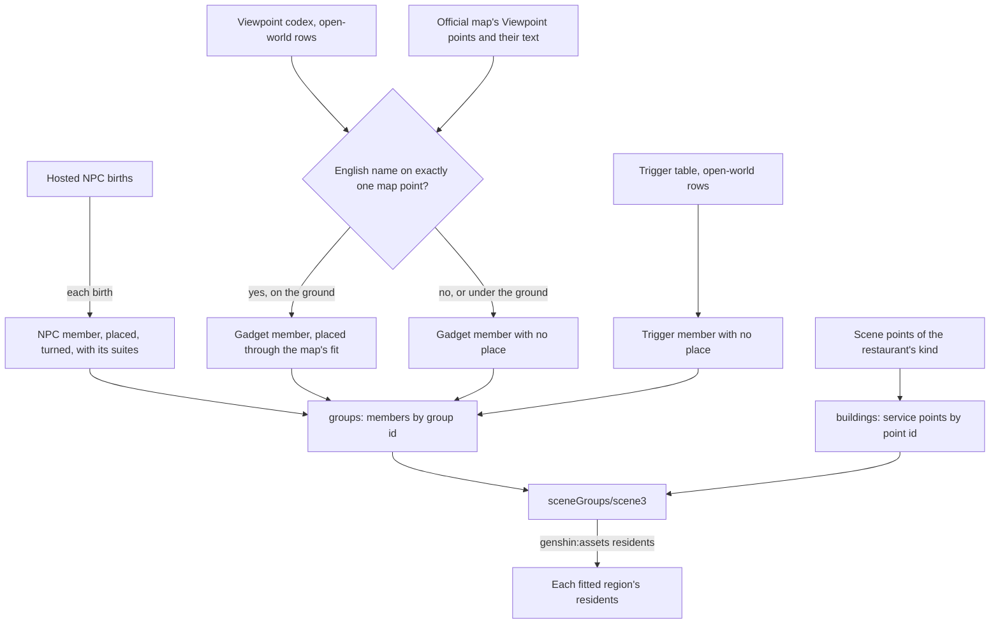

# Scene groups

The game places most of what stands in its open world through scene groups, each a script of members switched on in suites. Those scripts are the server's and never in the client, so this page is the record the repository can fill from its own sources: one record keyed by group, filled field by field from the sources the repository already reads, each member and each place naming the source behind it. The residents of [resident schedules](../resident-schedules/design.md) are written from it; the Archive's viewpoints, the crafting bench and the stove read it on their own proposals.

## How it works

## The record

`pnpm -C scripts genshin:assets scene-groups` publishes one record, `sceneGroups/scene3`, as the `sceneGroups` dataset of the [hosted game data](../hosted-game-data/design.md). It holds two maps.

- **`groups`, each group's members by group id.** A member (`SceneGroupMember`) is its kind, one of `SceneGroupMemberKind`'s NPC, gadget or trigger; its object id in that kind's own table; its config id within the group where a source names one; its place; the suites it is born in where known; and the `SceneGroupSource` that named it. One NPC may stand twice in a group, so the members are a list with no key of their own.
- **`buildings`, the scene's service points by point id.** The scene marks each city's services with points of one kind, each naming its service (`Restaurant`, `Alchemy`, `Blacksmith`, `Reputation`, `Adventurers`, each region's carrying a suffix such as `Restaurant_liyue`) and holding its place and turn. They belong to no group, so they sit beside the groups rather than in one.

A place (`SceneGroupPlace`) is a ground point in the game's own axes, the height and the turn about the vertical in degrees where its source gives them, and the source that placed it. That source may differ from the member's: a viewpoint is named by the codex and placed by the official map.

## Each field's source

| Field                                         | Source                                                                                                          | `SceneGroupSource` |
| :-------------------------------------------- | :-------------------------------------------------------------------------------------------------------------- | :----------------- |
| An NPC member, its place, turn and suites     | The hosted `sceneNpcBorn/scene3`, the dump's NPC births                                                         | `NpcBirths`        |
| A viewpoint member's group, config and gadget | `ViewCodexExcelConfigData`, its open-world rows the codex keeps                                                 | `ViewCodex`        |
| A viewpoint's place                           | The official map's Viewpoint label, matched by name and carried by the [map's fit](../spawned-places/design.md) | `OfficialMap`      |
| A trigger member's group and id               | `TriggerExcelConfigData`, its open-world rows                                                                   | `TriggerTable`     |
| A building point's service, place and turn    | The dump's `scene3_point.json`, the points of Mondstadt's restaurant point's kind                               | `ScenePoints`      |

An NPC birth's own `configId` is the NPC's id, so it becomes the member's object id, and the member's config id within the group stays unset. The two tables name the scene each row belongs to, and only the open world's are kept.

## The viewpoints' match

`pnpm -C scripts genshin:assets points` reads each Viewpoint point's info as well as the point list, and keeps their text in `viewpoints.json` beside the other map references. Each point's text names the viewpoint it marks in English, often beside a region or a note on reaching it, and no id joins it to the codex. So `matchViewpointPoints` joins them by name:

- **A candidate holds the name as whole words.** Both texts are lowercased, their apostrophes dropped (the codex writes "Islands" where the map writes "Island's"), and every other run of punctuation read as a space, so "Shut" is not found inside "Shutter".
- **Points are taken by elimination.** A viewpoint left with one candidate that no other viewpoint with one candidate shares takes it; the point is then struck from every other viewpoint's candidates, and the round repeats. A name written inside a longer one, as "The Mausoleum of King Deshret" is in a point naming "Aaru's Shut" there, is settled once the longer one takes its own point.
- **What stays ambiguous is left unplaced.** A viewpoint whose name is on several points, or which shares its only point, keeps no place, and so does one whose point lies on a layer under the ground, whose floor the place cannot hold. The publish's notes count those left out, a handful of the codex's open-world rows.

## What the record leaves out

Every field below is held only by the group scripts, which are the server's and never in the client ([game data formats](../game-data-formats/design.md)), so the record never fills them and nothing here guesses one from a nearby source. A unit needing one takes it from the next source on its own page: the official map's points for camps, puzzles, chests and outcrops, the quests' own location guides for a go-to, and the wiki for the keepers and the residents' hours, each an estimate marked provisional where no source gives it.

- **A camp's monsters and their levels.** No member is a monster, so the [enemies](../enemies/design.md) keep Mondstadt's stand-in camp.
- **A puzzle's mechanisms and a chest's gadget.** The only gadgets are the viewpoints.
- **A trigger's region.** A trigger member names its group but has no place. A quest's go-to step is placed instead by its own location guide, which names a dummy point the client's scene3_dummy_points.lua holds ([quests](../quests/design.md)).
- **The suites that move a resident by the hour.** The births give each NPC one spot, so no resident has a night spot.
- **The NPCs the births leave out.** The cities' service keepers among them: Hertha, Wagner, Katheryne, Sara and Timaeus each have no birth, so the record places their services' building points but not them.
- **Nod-Krai's NPC placements.** No Nod-Krai NPC is placed in the record, so `packages/genshin-world/src/data/regions/nod-krai.json` keeps its `residents` empty, and the [resident schedules](../../../changes/genshin-resident-schedules/proposal.md) change waits on them.

## Key files

| File                                                                        | Role                                                                   |
| :-------------------------------------------------------------------------- | :--------------------------------------------------------------------- |
| `packages/genshin-world/src/models/sceneGroup/SceneGroups.ts`               | The record: members by group id and building points by point id        |
| `packages/genshin-world/src/models/sceneGroup/SceneGroupMember.ts`          | A member: its kind, object id, config id, place, suites and source     |
| `packages/genshin-world/src/models/sceneGroup/SceneGroupPlace.ts`           | A place: ground point, height, turn and the source that placed it      |
| `packages/genshin-world/src/models/sceneGroup/SceneGroupSource.ts`          | The sources a field is filled from                                     |
| `scripts/src/services/genshinAssets/sceneGroups/buildSceneGroups.ts`        | `genshin:assets scene-groups`: the record from its five sources        |
| `scripts/src/services/genshinAssets/sceneGroups/readViewpointMembers.ts`    | The codex's viewpoints as gadget members, placed by the matched points |
| `scripts/src/services/genshinAssets/sceneGroups/matchViewpointPoints.ts`    | Each viewpoint's map point by whole-word name and elimination          |
| `scripts/src/services/genshinAssets/sceneGroups/readSceneBuildingPoints.ts` | The scene's building points with their services and places             |
| `scripts/src/services/genshinAssets/world/readScenePointsOfKind.ts`         | The scene's points of one kind, shared with the transport points       |
| `scripts/src/services/genshinAssets/points/readInteractiveMap.ts`           | Reads the official map, the Viewpoint points' text among it            |
| `scripts/src/services/genshinAssets/residents/writeResidents.ts`            | Writes each fitted region's residents from the record's placed NPCs    |

## Sources

- [AnimeGameData](https://github.com/DimbreathBot/AnimeGameData), the community's per-patch dump: the NPC births, the viewpoint codex, the trigger table and the scene's points.
- [Teyvat Interactive Map](https://act.hoyolab.com/ys/app/interactive-map/index.html), HoYoLAB: the official map, whose Viewpoint points and their text place the viewpoints.
