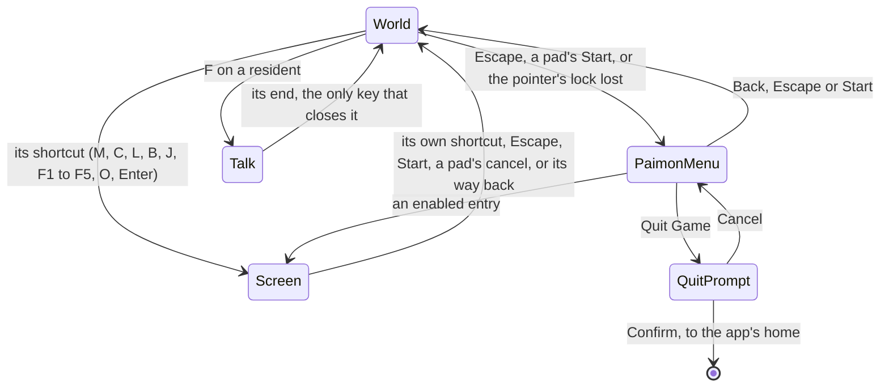

# Screens

In the game, a key or the Paimon menu opens a screen over the world: the map, the character screen, the inventory, the wish and the rest. The world screen does the same. What is open is a `ScreenKind`, either `World`, the world in play with nothing over it, or one of the screens the game opens from it. The world screen keeps it, reads the frame's pressed actions into it once a frame, and draws the open screen over the canvas.

## Moving between screens

`getNextScreenKind` is the rule, a pure function of what is open and the frame's pressed actions:

- **From the world, a shortcut opens its screen.** `InputActionScreenKindMap` names the screen each opening action opens; `Escape` and a pad's `Start` open the Paimon menu, as the game's controls bind them ([controls](../controls/design.md)).
- **Over a screen, the way back is to the world.** `Escape`, `Start` and a pad's cancel close any screen, and a screen's own shortcut closes it again, as `M` closes the map it opened.
- **One screen at a time.** Over a screen, every other screen's shortcut waits; the Paimon menu's entries are the one way from a screen to another, and they replace the menu with the screen chosen.
- **A talk stays open.** Over a talk, every key waits, Escape and a pad's Start among them; only the talk's own end sets the world back. A talk is begun from the world by F on a resident, as the [dialogue](../dialogue/design.md) page describes.

The rule is read only while the world is shown, so nothing opens under the opening that covers it.

## What a screen does to the world

`ScreenBehaviourMap` answers for each kind:

| Field               | When true                                                                             |
| :------------------ | :------------------------------------------------------------------------------------ |
| `isHeld`            | the world's fixed-step loops and its clock stand still, while the world keeps drawing |
| `isHudHidden`       | the heads-up display is hidden                                                        |
| `isPointerReleased` | the pointer's lock is let go, for the screen's own cursor                             |

Every menu answers true to all three, as the game's single-player menus pause its simulation and its time while its music and particles carry on. Photo mode and a talk hold nothing: their clock runs with the HUD hidden, photo mode's camera orbits the character and its pointer still turns it, while a talk lets the pointer go for its replies. The world in play answers false to all three.

- **Held.** Under any screen but the world, the character on the field and its body neither step, photo mode's and a talk's included. Only photo mode's follow camera still looks, orbiting the held body; a menu's and a talk's stand where they are. Only a menu holds the world's fixed-step loops, so Windrise's clock and its clouds stand still under a menu and run on under a talk and in photo mode. Drawing goes on, so the world stays behind the screen. This is a different thing from the world screen's `isPaused`, which stops drawing altogether while the opening covers the world.
- **Pointer.** A screen that lets the pointer go releases the lock when it opens. Closing it does not take the lock back, since the browser grants one only to a click; a click on the world takes it, as it did the first time.
- **A press that closes a screen is spent.** When the screen returns to the world, the world reads the input once more, so the key or click that closed it never reaches the world in play as an interact, a jump or an attack.
- **A lock lost in play opens the menu.** The browser keeps `Escape` for itself while the pointer is locked, so a lock lost with the world in play opens the Paimon menu as the key would have.

## Drawing the open screen

`MenuScreen` draws what is open over the canvas:

- the [Paimon menu](../paimon-menu/design.md);
- a built screen, which is a slot of `MenuScreen` named by its kind, filled by the world screen with what that screen needs and closed by setting the world back;
- or, for a screen nobody has built yet, a placeholder: its title in the game's words (`ScreenKindGameTextKeyMap`) over a veil, and a way back. Every shortcut therefore opens something, and closes it again, before its screen exists.

Each one is a dialog that takes focus as it opens, so the keyboard reaches it without a pointer.

A talk is none of these: `MenuScreen` draws nothing for it, and the world screen mounts the talk's host over the world while the talk is open ([dialogue](../dialogue/design.md)).

- **The world runs on behind a talk, as a best estimate.** The clock, the sky and the residents go on behind the speaker until a recording shows the game holding them still.

## Key files

| File                                                                     | Its role                                                                                              |
| :----------------------------------------------------------------------- | :---------------------------------------------------------------------------------------------------- |
| `packages/genshin-world/src/models/screen/ScreenKind.ts`                 | the world and every screen opened over it                                                             |
| `packages/genshin-world/src/services/screen/ScreenBehaviourMap.ts`       | what each screen does to the world under it                                                           |
| `packages/genshin-world/src/services/screen/InputActionScreenKindMap.ts` | the screen each shortcut opens                                                                        |
| `packages/genshin-world/src/services/screen/getNextScreenKind.ts`        | the rule moving between screens on a frame's pressed actions                                          |
| `packages/genshin-world/src/services/screen/ScreenKindGameTextKeyMap.ts` | each screen's title in the game's words                                                               |
| `packages/genshin-world/src/components/World/Session/Index.vue`          | reads the input once a frame, keeps what is open, holds the world, lets the pointer go, mounts a talk |
| `packages/genshin-world/src/components/Menu/Screen/Index.vue`            | draws the open screen: the Paimon menu, a built screen's slot or a placeholder                        |
| `packages/genshin-world/src/components/Menu/Settings/Index.vue`          | the settings: their tabs and the Graphics and Audio tabs' rows, held until the world opens them       |
| `packages/genshin-world/src/components/Menu/Placeholder/Index.vue`       | an unbuilt screen's title and way back                                                                |

## Sources

- [Controls](https://genshin-impact.fandom.com/wiki/Controls), Genshin Impact Wiki: the shortcut of each screen.
- [Time](https://genshin-impact.fandom.com/wiki/Time), Genshin Impact Wiki: the clock paused in the menu and running in photo mode.
