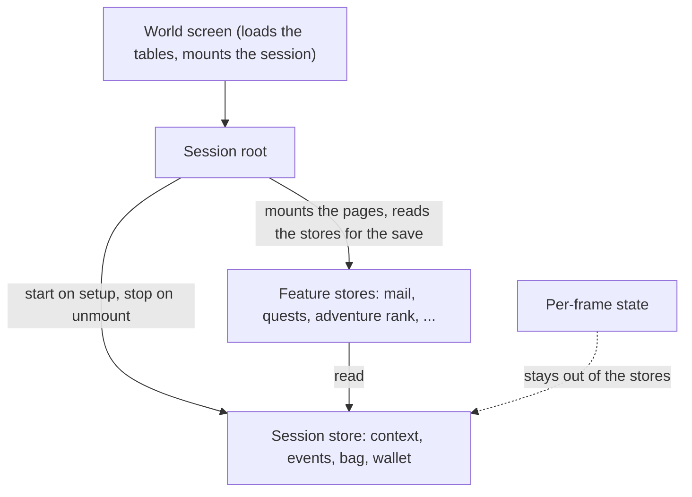

# Session store

The world session's shared state lives in Pinia stores rather than in its root: one session store holds what every feature shares (the loaded context, the events emitter, the bag and the wallet), and each feature whose state another feature reads is a store of its own. The session root starts and stops them as it mounts and unmounts, so a feature takes its inputs from a store and not from a list of options.

## How it works

- **The session store** (`world/session`) holds the data URL, the language, the text and name maps, the material and weapon data, the reliquary and artifact tables, and the clock's reader, each as a computed over the context the session started with. It also holds the one events emitter the systems react through, and the bag and wallet with their setters. `setInventory` computes the obtain events for what the bag takes in, then emits the bag change and those events, so the Archive and the Achievements hear every change to the bag.
- **The session root** (`components/World/Session/Index.vue`) calls `start` with the loaded context and the saved bag and wallet while it is set up, and `onUnmounted(stop)` clears the store. Each feature store is started and stopped the same way, so a second mount starts from nothing.
- **A feature store** reads the session store and owns its own state and actions. The mailbox (`store/mail.ts`) owns the mails, the delivered rows and the bag-full flag, with the claim, claim-all, delete, read and pin actions. The root reads the mails from the store when it writes the save.
- **The save** is written from the stores' refs when a sync runs (`composables/useWorldSaveSync.ts`, `composables/useWorldSave.ts`), so the saved state is read once to start each store and then from the store.
- **Per-frame state stays out.** The frame step (`composables/useWorldFrame.ts`) takes the refs it reads at setup and does no store patch, subscription or watcher in the frame path. The frame's values, the HUD frame, the camera and the input, are plain values the scene reads and not store state.

## Key files

| File                                                                                 | Role                                                                             |
| :----------------------------------------------------------------------------------- | :------------------------------------------------------------------------------- |
| `packages/genshin-world/src/store/session.ts`                                        | The session store: the context, the events emitter, the bag and the wallet       |
| `packages/genshin-world/src/store/session.fixture.ts`                                | `startTestWorldSession`, a fresh Pinia with a started session for a suite        |
| `packages/genshin-world/src/store/session.test.ts`                                   | The store's start, reads, bag change and stop                                    |
| `packages/genshin-world/src/store/session.bench.ts`                                  | The cost of a store read against a ref read                                      |
| `packages/genshin-world/src/store/mail.ts`                                           | The mailbox, the first feature store, reading the session store                  |
| `packages/genshin-world/src/components/World/Session/Index.vue`                      | The session root: starts the stores on setup and stops them on unmount           |
| `packages/genshin-world/src/composables/useWorldSave.ts`                             | Calls the bag's setter when the save's bag changes                               |
| `packages/genshin-world/src/composables/useWorldSaveSync.ts`                         | Writes the save from the stores' refs                                            |
| `packages/genshin-world/src/composables/useWorldFrame.ts`                            | The per-frame step, which reads its store refs at setup                          |
| `packages/genshin-world/src/composables/useWorldFrame.bench.ts`                      | The frame step over a walk, without a canvas                                     |
| `packages/genshin-world/src/composables/createFrameOptions.test.ts`                  | The frame's options with each step a no-op, shared by the frame's test and bench |
| `packages/genshin-world/src/components/World/Session/createSessionDriver.fixture.ts` | The browser driver of a scripted session, with one Pinia for its mounts          |
| `packages/genshin-world/src/components/World/Session/Index.browser.test.ts`          | The session's browser cases, including a store read empty between two mounts     |

## Notes

- **Setup stores, one binding per store.** A store is `useWorld<Feature>Store` in `src/store/<feature>.ts`, with the id `world/<feature>`. Stores reach each other one way only, so the module graph has no cycle.
- **A store is mount-lifetime.** The world screen is the only mount site, so one session is live at a time and no store is keyed. A browser case mounts, unmounts and mounts again on one Pinia, and reads the session store empty between, which fails with the session's stop removed.
- **Alternatives rejected.** The session shares its state through stores, not `provide` and `inject`. The only keys injected are the scene's own (`SceneWitnessKey` and `SceneContextKey`), which the scene components read. Module-level refs are shared by every mount, so two sessions in one page corrupt each other. One store for the whole save turns the root's fields into a global with several hundred fields. A session store alone removes only about a quarter of the options keys, since the rest are one feature's results handed to another, which only features that own their state in a store remove.
- **Cost, measured on the Mac that gates it.** A store read costs about 0.14 µs more than a ref read through a getter and about 0.36 µs more through a field of a store's ref, and the frame reads the context a few dozen times, under 0.02 ms of a sixteen-millisecond frame. The frame step's walk runs in about 17 ms on a quiet host, and the world screen's time to ready is about 4.6 s. The browser driver and its case, added to the store's tests, are in no build's import graph, so the package's dist is unchanged by them.
- **Pinia is a peer of `genshin-world`.** A store is a singleton the app and the package share, so the package declares Pinia as a peer, as `vue-phaserjs` does, and no build bundles it.
