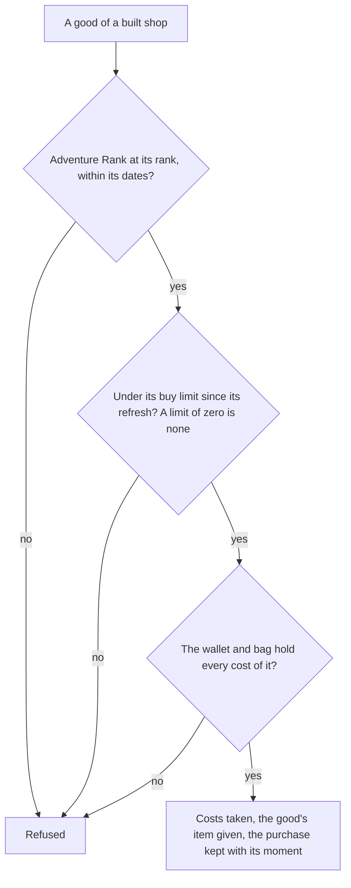

# Shops

The shops whose goods are built (`packages/genshin-world/src/generated/gameDataLock.json`, its `shops/` keys) are Paimon's Bargains, which sells the two Fates for the Masterless currencies and rotates its characters and weapons, the Mondstadt grocery, which sells general goods for Mora, the Good Hunter's food shop, the Mondstadt vendors, the Fishing Associations, the Realm Depot, the Souvenir Shops, and the Card Shop, which is priced in Lucky Coins. Their goods are the game's own rows in the shop table, published as one record per shop to the shops dataset of the [hosted game data](../hosted-game-data/design.md) (`scripts/src/services/genshinAssets/shops/buildShopGoodSlice.ts`). The rule over them is built: a good is offered from its Adventure Rank within its dates, a buy limit is counted from the purchases made since its refresh, and a purchase takes the price from the wallet and gives the item's currency back (`packages/genshin-world/src/services/shop/buyShopGood.ts`). The Shop and Paimon's Bargains screens buy through `buyShopGoodCount` (`packages/genshin-world/src/services/shop/buyShopGoodCount.ts`).

## How it works

## Decisions

- **Paimon's Bargains' goods are those filed under 1001.** Its shop row, 102, is the Paimon shop and refreshes monthly, but holds no goods (`{data-root}/genshin-parity/text/ExcelBinOutput/ShopExcelConfigData.json`, `{data-root}/genshin-parity/text/ExcelBinOutput/ShopGoodsExcelConfigData.json`); the goods filed under 1001 are the table's monthly goods, Fates among them (`scripts/src/services/genshinAssets/shops/checkIsPaimonsBargainsFateGood.ts`), bar the one filed under shop type 1031 (goodsId 316006, `{data-root}/genshin-parity/text/ExcelBinOutput/ShopGoodsExcelConfigData.json`).
- **The Mondstadt grocery is read as shop 1004.** The table numbers its shops, and no dump file names those numbers. The number is read from the table's order: shop 1002 takes item 305 and 1009 takes 307, the Sigils of Mondstadt's and Liyue's Souvenir Shops, so the numbering runs city by city and 1004 is Mondstadt's grocery (`packages/genshin-world/src/services/shop/constants.ts`, which maps 1004 to `shops/mondstadtGeneralGoods`). The table types shop 1004 as an activity shop, which the reading does not settle (see Open). Liyue's grocery, 1008, sells the same three items at the same Mora prices, which is the cross-check (`{data-root}/genshin-parity/text/ExcelBinOutput/ShopGoodsExcelConfigData.json`: shops 1004 and 1008 both file items 100075, 100076 and 100077). The wiki's Blanche (Mondstadt) page is not in the cache, so her goods, Mora prices and daily limit are not checked against shop 1004.
- **A good priced in Mora is priced at the table's Mora cost.** The grocery's goods carry their price in the table's Mora field rather than as an item, so the price is the Mora cost, taken as Mora's item id, `MORA_ITEM_ID`, which the wallet holds as Mora (`scripts/src/services/genshinAssets/shops/constants.ts`, `MORA_ITEM_ID`; `scripts/src/services/genshinAssets/shops/getShopGoodCosts.ts`).
- **A buy limit of zero is no limit.** The table gives the Starglitter-priced Fates no buyLimit field (rows 102003 and 102004 of `{data-root}/genshin-parity/text/ExcelBinOutput/ShopGoodsExcelConfigData.json`), which reads as zero, and the Stardust-priced ones a buyLimit of five a month (rows 102501 and 102502).
- **Each daily refresh follows the [reset clock](../reset-clock/design.md).** The monthly refresh is the first of the month (`MONTHLY_RESET_DAY_OF_MONTH`) at that same reset, so a purchase made before the reset on the first belongs to the month before (`packages/genshin-world/src/services/time/constants.ts`, `GAME_DAY_START_HOUR` and `GAME_TIME_ZONE`; `packages/genshin-world/src/services/shop/computeShopRefreshTime.ts`). A good that never refreshes counts its purchases from the epoch (`packages/genshin-world/src/services/shop/constants.ts`, `SHOP_NEVER_REFRESHED_AT`).
- **Starglitter is item 221 and Stardust item 222, the Fates 223 and 224 (`packages/genshin-world/src/services/shop/ShopItemCurrencyMap.ts`; `{data-root}/genshin-parity/text/ExcelBinOutput/MaterialExcelConfigData.json` names 221 to 224 as Masterless Starglitter, Masterless Stardust, Intertwined Fate and Acquaint Fate).** The table's Fates are bought at five of 221 with no limit and at seventy-five of 222 with five a month (rows 102003, 102004, 102501 and 102502 of that dump; every shop-1001 row reads a "refreshParam" of 1), which matches the proposal's Starglitter for Fates and Stardust for Fates with monthly limits; the pairing of the names to the ids awaits a recording's check ([References sought](../../../changes/genshin-roadmap/tasks.md#references-sought)).
- **The Primogem Fates are the inventory's.** A Fate bought for 160 Primogems is not in the slice (`scripts/src/services/genshinAssets/shops/checkIsPaimonsBargainsFateGood.ts`, which takes no Primogems; `{data-root}/genshin-parity/text/ExcelBinOutput/ShopGoodsExcelConfigData.json` files such Fates), since selling for Primogems is the [inventory](../../../changes/archive/2026-10-18-genshin-inventory/design.md) proposal's.
- **The grocery's goods wait on the bag (`packages/genshin-world/src/services/shop/buyShopGood.ts`).** They give ingredients the wallet does not hold, so the rule refuses them until the bag holds those items; the rule itself needs no change then.
- **The rotation, weapons and materials are not built.** Their goods pay in the same currencies, but the rotation's item ids name no row in the dump, and the items they give need the bag's definitions, so they wait for both.
- **Each good is written with its game-time dates at the game's offset (`scripts/src/services/genshinAssets/shops/toShopGoodRow.ts`).** The table's dates carry no zone, and the game's server is in `GAME_TIME_ZONE`, so each is written with that offset and read as an instant.

## Key files

| File                                                                         | Role                                                                                  |
| :--------------------------------------------------------------------------- | :------------------------------------------------------------------------------------ |
| `scripts/src/services/genshinAssets/shops/checkIsPaimonsBargainsFateGood.ts` | The table's goods that are Paimon's Bargains' Fates bought with a Masterless currency |
| `scripts/src/services/genshinAssets/shops/buildShopGoodSlice.ts`             | Builds one shop's goods as a record, one row a good                                   |
| `scripts/src/services/genshinAssets/shops/buildPaimonsBargainsGoods.ts`      | The Fates record, by the Fates filter                                                 |
| `scripts/src/services/genshinAssets/shops/buildMondstadtGeneralGoods.ts`     | The Mondstadt grocery's record, by shop 1004                                          |
| `scripts/src/services/genshinAssets/shops/buildGoodHunterGoods.ts`           | The Good Hunter's food shop's record, by shop 1005                                    |
| `scripts/src/services/genshinAssets/shops/toShopGoodRow.ts`                  | A good as the world reads it: its dates at the game's offset, its costs and refresh   |
| `packages/genshin-world/src/services/shop/buyShopGood.ts`                    | The purchase rule: rank, dates, buy limit, costs, and the wallet and bag after        |
| `packages/genshin-world/src/services/shop/computeShopRefreshTime.ts`         | The refresh at or before a moment, by its kind                                        |
| `packages/genshin-world/src/services/shop/checkIsShopGoodSoldOut.ts`         | Whether a good's limit is reached since its refresh                                   |
| `packages/genshin-world/src/services/shop/ShopItemCurrencyMap.ts`            | The item ids the shop trades in, as the wallet's currencies                           |

## Sources

- [AnimeGameData](https://github.com/DimbreathBot/AnimeGameData), the community's per-patch dump: `ShopGoodsExcelConfigData`, the goods, their prices, limits, refreshes, ranks and dates, and "ShopExcelConfigData", the shops and their refreshes. The table's refresh kinds are none, daily, weekly and monthly.
- `{data-root}/genshin-dump-backup-6.6/ExcelBinOutput/RefreshPolicyExcelConfigData.json` row 101000, which holds 14400 seconds: the daily refresh's row, grounding the requirement "Refreshes happen at four in the morning game time".
- `{data-root}/genshin-dump-backup-6.6/ExcelBinOutput/ShopExcelConfigData.json`, shop 102: the shop whose monthly refresh falls on the first of the month. It grounds that day but names no hour, so the monthly hour is unsourced (see the spec's Open), and the requirement "Refreshes happen at four in the morning game time" rests on the daily row alone for its hour.

## Open

- [ ] **The goods filed under 1001 are the only monthly ones** — contradicted by `{data-root}/genshin-parity/text/ExcelBinOutput/ShopGoodsExcelConfigData.json`: goodsId 316006 is monthly under shop type 1031.
- [ ] **Shop 1004 is the Mondstadt grocery, which the wiki's Blanche page confirms** — contradicted by `{data-root}/genshin-parity/text/ExcelBinOutput/ShopExcelConfigData.json`: types shop 1004 as SHOP_TYPE_ACTIVITY_DRAGON_SPINE.
- [ ] **The rotation's item ids name no row in the dump** — no source: they were not checked against `{data-root}/genshin-parity/text/ExcelBinOutput/ShopGoodsExcelConfigData.json`.
- [ ] **Each refresh is at four in the morning in UTC+8** — no source: the zone of the daily hour (14400 seconds in `{data-root}/genshin-parity/text/ExcelBinOutput/RefreshPolicyExcelConfigData.json`, row 101000), and a shop row that names that policy; the wiki's Reset page is not in the cache.
