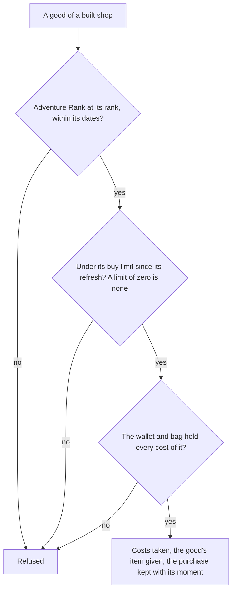

# Shops

The shops whose goods are built (`packages/genshin-world/src/generated/gameDataLock.json`, its `shops/` keys) are Paimon's Bargains, which sells the two Fates for the Masterless currencies and rotates its characters and weapons, the Mondstadt grocery, which sells general goods for Mora, the Good Hunter's food shop, the Mondstadt vendors, the Fishing Associations, the Realm Depot, the Souvenir Shops, and the Card Shop, which is priced in Lucky Coins. Their goods are the game's own rows in the shop table, published as one record per shop to the shops dataset of the [hosted game data](../hosted-game-data/design.md) (`scripts/src/services/genshinAssets/shops/buildShopGoodSlice.ts`). The rule over them is built: a good is offered from its Adventure Rank within its dates, a buy limit is counted from the purchases made since its refresh, and a purchase takes the price from the wallet and gives the item's currency back (`packages/genshin-world/src/services/shop/buyShopGood.ts`). The Shop and Paimon's Bargains screens buy through `buyShopGoodCount` (`packages/genshin-world/src/services/shop/buyShopGoodCount.ts`).

## How it works

## Decisions

- **Paimon's Bargains' goods are those filed under 1001.** Its shop row, 102, is the Paimon shop and refreshes monthly, but holds no goods (`{data-root}/genshin-parity/text/ExcelBinOutput/ShopExcelConfigData.json`, `{data-root}/genshin-parity/text/ExcelBinOutput/ShopGoodsExcelConfigData.json`); the goods filed under 1001 are the table's monthly goods, Fates among them (`scripts/src/services/genshinAssets/shops/checkIsPaimonsBargainsFateGood.ts`), bar the one filed under shop type 1031 (goodsId 316006, `{data-root}/genshin-parity/text/ExcelBinOutput/ShopGoodsExcelConfigData.json`).
- **The Mondstadt grocery is read as shop 1004.** The table numbers its shops, and no dump file names those numbers. The number is read from the table's order: shop 1002 takes item 305 and 1009 takes 307, the Sigils of Mondstadt's and Liyue's Souvenir Shops, so the numbering runs city by city and 1004 is Mondstadt's grocery (`packages/genshin-world/src/services/shop/constants.ts`, which maps 1004 to `shops/mondstadtGeneralGoods`). The table types shop 1004 as an activity shop, which the reading does not settle (see Open). Liyue's grocery, 1008, sells the same three items at the same Mora prices, which is the cross-check (`{data-root}/genshin-parity/text/ExcelBinOutput/ShopGoodsExcelConfigData.json`: shops 1004 and 1008 both file items 100075, 100076 and 100077). The wiki's Blanche (Mondstadt) page (`{data-root}/cache/genshin-wiki/Page_Blanche_(Mondstadt).json` lines 25 to 32) lists the same eight goods at the table's prices, Salt 60 to Wheat 100, with a stock of 100 each a day, which is the table's buy limit.
- **A good priced in Mora is priced at the table's Mora cost.** The grocery's goods carry their price in the table's Mora field rather than as an item, so the price is the Mora cost, taken as Mora's item id, `MORA_ITEM_ID`, which the wallet holds as Mora (`scripts/src/services/genshinAssets/shops/constants.ts`, `MORA_ITEM_ID`; `scripts/src/services/genshinAssets/shops/getShopGoodCosts.ts`).
- **A buy limit of zero is no limit.** The table gives the Starglitter-priced Fates no buyLimit field (rows 102003 and 102004 of `{data-root}/genshin-parity/text/ExcelBinOutput/ShopGoodsExcelConfigData.json`), which reads as zero, and the Stardust-priced ones a buyLimit of five a month (rows 102501 and 102502).
- **Each daily refresh follows the [reset clock](../reset-clock/design.md).** The monthly refresh is the first of the month (`MONTHLY_RESET_DAY_OF_MONTH`) at that same reset, so a purchase made before the reset on the first belongs to the month before (`packages/genshin-world/src/services/time/constants.ts`, `GAME_DAY_START_HOUR` and `GAME_TIME_ZONE`; `packages/genshin-world/src/services/shop/computeShopRefreshTime.ts`). A good that never refreshes counts its purchases from the epoch (`packages/genshin-world/src/services/shop/constants.ts`, `SHOP_NEVER_REFRESHED_AT`).
- **Starglitter is item 221 and Stardust item 222, the Fates 223 and 224 (`packages/genshin-world/src/services/shop/ShopItemCurrencyMap.ts`; `{data-root}/genshin-parity/text/ExcelBinOutput/MaterialExcelConfigData.json` names 221 to 224 as Masterless Starglitter, Masterless Stardust, Intertwined Fate and Acquaint Fate).** The table's Fates are bought at five of 221 with no limit and at seventy-five of 222 with five a month (rows 102003, 102004, 102501 and 102502 of that dump; every shop-1001 row reads a "refreshParam" of 1), which matches the proposal's Starglitter for Fates and Stardust for Fates with monthly limits; the pairing of the names to the ids awaits a recording's check ([References sought](../../../changes/genshin-roadmap/tasks.md#references-sought)).
- **The Primogem Fates are the inventory's.** A Fate bought for 160 Primogems is not in the slice (`scripts/src/services/genshinAssets/shops/checkIsPaimonsBargainsFateGood.ts`, which takes no Primogems; `{data-root}/genshin-parity/text/ExcelBinOutput/ShopGoodsExcelConfigData.json` files such Fates), since selling for Primogems is the inventory proposal's.
- **The grocery's goods wait on the bag (`packages/genshin-world/src/services/shop/buyShopGood.ts`).** They give ingredients the wallet does not hold, so the rule refuses them until the bag holds those items; the rule itself needs no change then.
- **The rotation's characters and weapons are sold by Paimon's Bargains' screen, through their own purchase rules (`packages/genshin-world/src/services/shop/buyPaimonsBargainsCharacter.ts`, `packages/genshin-world/src/services/shop/buyPaimonsBargainsWeapon.ts`).** Their goods pay in the same currencies as the Fates. The rotation's materials wait on the bag's definitions, since the items they give need them, and their item ids are open (see Open).
- **Paimon's Bargains draws the grid and the tab row of the reference, not its art.** The screen mounts the shared shop screen (`packages/genshin-interface/src/components/ShopScreen/Index.vue`) and restyles its goods with `:deep` overrides (`packages/genshin-world/src/components/PaimonsBargains/Screen/Index.vue`): four cards of 353.5 by 335 from 206 across (lefts at 206, 594, 984 and 1372) and 128 down, each filled with a gradient read off the reference's corners and framed by a lighter ridge 5 pixels in, a name over its limit line, and a price band of 57 with a 28-pixel placeholder diamond for the currency. The Fates take the gold gradient the cell carries (`packages/genshin-interface/src/models/ShopGoodCell.ts`, `tone`), the other cards the purple one, and a rule runs under the tab row from 520 to 1360. Its three tabs are the currencies its goods are bought with, in the reference's order (`PAIMON_BARGAINS_TABS`, `packages/genshin-world/src/services/shop/constants.ts`): the picked tab shows the offers bought with its currency, Starglitter first. A character the player holds at its sixth constellation shows the game's sold-out line in place of its limit, as a red band across its card (`soldOutLabel`). The measures are read off the reference's own pixels (`"paimons-bargains-screen"`, `scripts/src/services/genshinParity/shared/ParityReferenceMap.ts`). The current build's title stays in the screen for a reader and is not drawn, since the tab row stands where the reference frame has no title.
- **Each good is written with its game-time dates at the game's offset (`scripts/src/services/genshinAssets/shops/toShopGoodRow.ts`).** The table's dates carry no zone, and the game's server is in `GAME_TIME_ZONE`, so each is written with that offset and read as an instant.
- **A shop with no tabs is drawn as the General Goods list (`packages/genshin-world/src/components/Shop/Screen/List/Index.vue`).** Its goods run one under another down the left, the shown good's detail stands beside them with a plain tile for its picture and a strip for the Owned line, the balances sit across the head, and the item-refresh line and the Purchase button sit at the foot. A shop with tabs keeps the grid of the shared `ShopScreen` (`packages/genshin-interface/src/components/ShopScreen/Index.vue`), which Paimon's Bargains draws too. The detail shows the first good until one is picked, and the Purchase button stays dimmed until then, since a purchase counts the picked good alone. The words are the game's keyed ones only: the General Goods title, the Source heading over the detail's source box, the Owned line with the shown good's held count filled in (`GameTextKey.ShopOwned`), the Purchase up to line over each good with its count left over the limit filled in (`GameTextKey.ShopPurchaseUpTo`), the Refreshes in line and the Purchase button, with the Mora balance drawn as a coin. The title is the General Goods' for the three shops the goods table keys as grocery goods, Mondstadt's (1004), Liyue's (1008) and Inazuma's (1056), and the Shop's for every other shop: `ShopTitleGameTextKeyMap` (`packages/genshin-world/src/services/shop/ShopTitleGameTextKeyMap.ts`) maps the three ids to the General Goods title, and the screen reads it by the `shopId` the Session passes it. The Purchase up to and Owned lines are fitted to the reference's size, tracking and position by `compare`; what remains is the open face's glyph widths against the game's face, which cannot ship.

## Key files

| File                                                                         | Role                                                                                                    |
| :--------------------------------------------------------------------------- | :------------------------------------------------------------------------------------------------------ |
| `scripts/src/services/genshinAssets/shops/checkIsPaimonsBargainsFateGood.ts` | The table's goods that are Paimon's Bargains' Fates bought with a Masterless currency                   |
| `scripts/src/services/genshinAssets/shops/buildShopGoodSlice.ts`             | Builds one shop's goods as a record, one row a good                                                     |
| `scripts/src/services/genshinAssets/shops/buildPaimonsBargainsGoods.ts`      | The Fates record, by the Fates filter                                                                   |
| `scripts/src/services/genshinAssets/shops/buildMondstadtGeneralGoods.ts`     | The Mondstadt grocery's record, by shop 1004                                                            |
| `scripts/src/services/genshinAssets/shops/buildGoodHunterGoods.ts`           | The Good Hunter's food shop's record, by shop 1005                                                      |
| `scripts/src/services/genshinAssets/shops/toShopGoodRow.ts`                  | A good as the world reads it: its dates at the game's offset, its costs and refresh                     |
| `packages/genshin-world/src/services/shop/buyShopGood.ts`                    | The purchase rule: rank, dates, buy limit, costs, and the wallet and bag after                          |
| `packages/genshin-world/src/services/shop/computeShopRefreshTime.ts`         | The refresh at or before a moment, by its kind                                                          |
| `packages/genshin-world/src/services/shop/checkIsShopGoodSoldOut.ts`         | Whether a good's limit is reached since its refresh                                                     |
| `packages/genshin-world/src/services/shop/ShopItemCurrencyMap.ts`            | The item ids the shop trades in, as the wallet's currencies                                             |
| `packages/genshin-world/src/services/shop/ShopTitleGameTextKeyMap.ts`        | The General Goods shops' ids, each mapped to the General Goods title; every other shop keeps the Shop's |
| `packages/genshin-world/src/components/Shop/Screen/List/Index.vue`           | The General Goods list a shop with no tabs is drawn as, with the shown good's detail                    |

## Sources

- [AnimeGameData](https://github.com/DimbreathBot/AnimeGameData), the community's per-patch dump: `ShopGoodsExcelConfigData`, the goods, their prices, limits, refreshes, ranks and dates, and "ShopExcelConfigData", the shops and their refreshes. The table's refresh kinds are none, daily, weekly and monthly.
- "RefreshPolicyExcelConfigData" row 101000 of the dump ([Original Resin](../original-resin/design.md) cites its file), which holds 14400 seconds: the daily refresh's row, grounding the requirement "Refreshes happen at four in the morning game time".
- `{data-root}/genshin-dump-backup-6.6/ExcelBinOutput/ShopExcelConfigData.json`, shop 102: the shop whose monthly refresh falls on the first of the month. It grounds that day but names no hour, so the monthly hour is unsourced (see the spec's Open), and the requirement "Refreshes happen at four in the morning game time" rests on the daily row alone for its hour.
- [Blanche](<https://genshin-impact.fandom.com/wiki/Blanche_(Mondstadt)>), Genshin Impact Wiki, cached at `{data-root}/cache/genshin-wiki/Page_Blanche_(Mondstadt).json`, lines 25 to 32: eight cooking ingredients at 60, 80, 80, 100, 120, 120, 120 and 100, the prices that the shop 1004 goods hold as their `costScoin` (`{data-root}/genshin-parity/text/ExcelBinOutput/ShopGoodsExcelConfigData.json` lines 716 to 926), which `getShopGoodCosts` in `scripts/src/services/genshinAssets/shops/getShopGoodCosts.ts` takes as the Mora cost.

## Open

- [ ] **Paimon's Bargains' lower backdrop wash trades its mean against the cards' shape** — `paimons-bargains-screen` reads 6.12% mean, shape 0.633, tone 3.57% and FLIP 0.2770 once the cards' placement, fills and frame are measured (from 9.80%, 0.555, 6.63% and 0.3802). The wash's stops above 360 pixels are the average of the reference's clear margins and gutters in each band; refitting the stops from 460 down (the reference reads about (174, 175, 169) at 760 high) lowers the mean by 0.3 but the shape to 0.631 and 0.632, so those stops keep their earlier values in `packages/genshin-world/src/components/PaimonsBargains/Screen/Index.vue`. The reference's gutters between cards read warmer than its margins (about (113, 97, 88) against (88, 87, 88) at 400 to 480 high), and its left and right margins differ at 280 to 320 high ((93, 86, 87) against (67, 69, 73)), so a wash that is a function of height alone cannot follow either. The reference frame shows no detail pane, slider or Buy button, so those sit outside the scored region, and the top-right balances the frame does not show stay drawn.
- [ ] **The shared shop grid runs 5 pixels taller per row than its card** — the shared `ShopScreen`'s `.good` is an inline button, so its grid cell keeps the line's descent under the card; the bargains screen sets `display: block` on its own cards (`packages/genshin-world/src/components/PaimonsBargains/Screen/Index.vue`), and the shared fix would reach the tabbed Shop screen, which mounts the same grid and is not measured here.
- [ ] **The price digits and the sold-out line set narrower than the game's face** — the reference's price digits stand 21 pixels tall against the screen's 19 at 28 pixels, and its sold-out line sets in three lines where the screen's sets in two. Both follow the open face's glyph widths, so neither is compensated by a size or a spacing.
- [ ] **Shop 1004 is the Mondstadt grocery, which the wiki's Blanche page confirms** — contradicted by `{data-root}/genshin-parity/text/ExcelBinOutput/ShopExcelConfigData.json`: types shop 1004 as SHOP_TYPE_ACTIVITY_DRAGON_SPINE. The shop table types 203 as SHOP_TYPE_GROCERY, 302 as SHOP_TYPE_LIYUE_GROCERY and 404 as SHOP_TYPE_INAZUMA_GROCERY, while the goods table (`ShopGoodsExcelConfigData.json`) keys the Mondstadt grocery's eight goods under 1004 (goods 203001 to 203008), Liyue's twelve under 1008 (302001 to 302012) and Inazuma's under 1056 (404xxx), so the two tables number the same shops differently and only the goods table's keys are read here.
- [ ] **The rotation's other fifteen item ids name no goods row in the dump** — goods 102027 to 102033 of shop 1001 (`{data-root}/genshin-parity/text/ExcelBinOutput/ShopGoodsExcelConfigData.json` lines 39337 to 39535) name seven of the rotation's twenty-two item ids (1020, 1021, 11404, 12404, 13404, 14404 and 15404, `{data-root}/genshin-parity/text/ExcelBinOutput/ShopRotateExcelConfigData.json` line 5), and no goods row names the fifteen that remain (1006, 1014, 1015, 1023, 1024, 1025, 1027, 1031, 1032, 1034, 11408, 12408, 13408, 14408 and 15408). The rotation is published all the same, as the `shops/paimonsBargainsRotation` key in `packages/genshin-world/src/generated/gameDataLock.json`, built by `scripts/src/services/genshinAssets/shops/buildPaimonsBargainsRotation.ts`.
- [ ] **Each refresh is at four in the morning in UTC+8** — the hour is read off `{data-root}/cache/genshin-wiki/Page_Reset.json` line 2 (04:00 on the server's time zone) and the daily row 101000 of `{data-root}/genshin-parity/text/ExcelBinOutput/RefreshPolicyExcelConfigData.json` (14400 seconds); no source gives the zone's UTC offset, so a source that names it would settle it.
- [ ] **The General Goods' words with no text key: "Sold at general goods shops" and "Cooking Ingredient" are the item's own text records, not keys** — both lines are text records the item table names for the shown item itself (its source and its category), so the detail leaves them undrawn rather than keying them: `pnpm -C scripts genshin:text find` lists six ids for the exact "Sold at general goods shops" and fifteen for "Cooking Ingredient", and the record to draw is the one the shown item's own row names, which the detail does not read yet. "Item refreshes in" has no id in the dump at all, so the refresh line draws the keyed "Refreshes in: {0}" in its place (the reference is `{data-root}/genshin-parity/references/shop-screen.png`).
- [ ] **The rows and the detail draw plain tiles, not the goods' pictures** — the item icons and the Salt picture are not extracted, so the tiles wait on the goods' icon asset in the [roadmap](../../../changes/genshin-roadmap/tasks.md).
- [ ] **The row's quantity badge and the item's description are not drawn** — the goods carry their count (`ShopGood.itemCount`, one for Salt), and the detail's description needs the item's text, but `ShopGoodCell` and `ItemDefinition` carry neither yet (`packages/genshin-world/src/models/shop/ShopGood.ts`, `packages/genshin-world/src/services/inventory/getItemDefinition.ts`).
- [ ] **Paimon's Bargains: the Primogem tab is empty, and its words differ from the 2021 reference** — the Fates bought with Primogems are the inventory's, which the slice does not hold, so the "Purchase With Primogems" tab (`GameTextKey.PurchaseWithPrimogems`) shows no goods; the current text reads "Purchase With Primogems" where the reference reads "Purchase with Primogems". The tab words and the sold-out line are keyed and written; their glyphs are narrower than the game's typeface at the same size, so the words sit narrower than the reference's.
- [ ] **Paimon's Bargains: the shared backdrop wash reads darker than the reference's clear margins** — the reference reads (141, 134, 121) and (145, 148, 146) at the bottom corners where the shared wash renders about (40, 40, 40), so the screen overrides the wash locally (`packages/genshin-world/src/components/PaimonsBargains/Screen/Index.vue`); a fit of the shared wash over the menu screens' references would move the local gradient into it.
- [ ] **Paimon's Bargains: a card with no limit line and the price band are fitted in the screen** — `.good-name` stands at a fixed top in the shared shop screen, so the screen restyles it with `:deep` rules (`packages/genshin-world/src/components/PaimonsBargains/Screen/Index.vue`); the shared screen taking the name's place as a prop would remove them.
