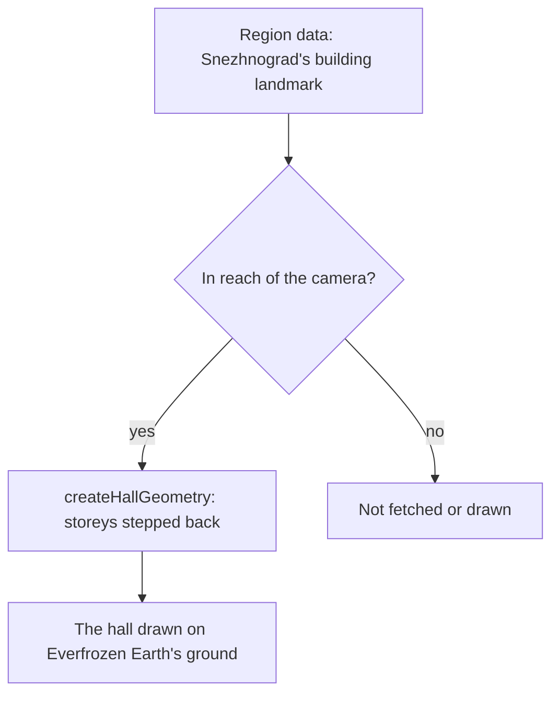

# Snezhnaya

Snezhnaya's region is specified in [its proposal](../../../changes/genshin-snezhnaya/design.md), and the parts below are the built ones. The capital kit stands as Snezhnograd's first hall (`packages/genshin-world/src/data/regions/snezhnaya.json`), a [building landmark](../region-buildings/design.md) on a provisional plateau; the industrial kit and the torch are generators nothing places yet.

## How it works

- **Factories are one hall and one chimney.** `createFactoryGeometry` merges a box for the hall, standing on the origin and centred across its width and depth, with a plain lathe stack for the chimney, which stands at a fixed share of the hall's width. Its width, depth, height and chimney are its options, so each factory is fitted by its caller (`packages/genshin-world/src/services/snezhnaya/createFactoryGeometry.ts`, `CHIMNEY_OFFSET_RATIO`).
- **Capital halls step back as they rise.** `createHallGeometry` stacks its storeys as boxes, each inset by the setback from the one below, so a palace's tiers are its options and nothing more (`packages/genshin-world/src/services/snezhnaya/createHallGeometry.ts`).
- **Kresnik's Torch is two geometries for two materials.** The stone is a faceted lathe stack of a stepped plinth, a tapering shaft and a cup brazier, and the flame is a lathe of its silhouette standing in the cup at the brazier's rim, 2.15 metres up (`packages/genshin-world/src/services/snezhnaya/createKresnikTorchGeometry.ts`, `TORCH_HEIGHT`).
- **Region data holds the capital.** `packages/genshin-world/src/data/regions/snezhnaya.json` holds Snezhnograd's hall, and Everfrozen Earth's outline is a provisional square round it, so a camera that comes within reach fetches it and draws the hall (see Open).
- **The witness claims Everfrozen Earth's export by its ground alone.** The terrain tiles are the one family it claims, since the export holds no house of Snezhnograd's for the capital kit to stand in for, and every other mesh is not drawn yet, one entry a kind: common buildings, props, rocks, stage planes and effects (`{data-root}/genshin-parity/extracted/snezhnaya/witness.json`, whose house meshes are `Area_Common_Build_Hili_House_05` and `Area_Common_Build_Hili_House_18_Vo`; `packages/genshin-world/src/services/snezhnaya/SnezhnayaPartFamilyMeshRegexMap.ts`; `packages/genshin-world/src/services/snezhnaya/SnezhnayaUndrawnMeshRegexMap.ts`).
- **The flakes in the wiki's Snezhnaya frame may be falling snow.** `File:Snezhnaya.png` shows a few faint flakes; if they are the snowfall `world-snow.mkv` measures the density of, the snow is the falling snow, and if a detail of the sky, it is not.

## Key files

| File                                                                               | Role                                                      |
| :--------------------------------------------------------------------------------- | :-------------------------------------------------------- |
| `packages/genshin-world/src/services/snezhnaya/createFactoryGeometry.ts`           | The industrial kit: a factory hall with its chimney       |
| `packages/genshin-world/src/services/snezhnaya/createHallGeometry.ts`              | The capital kit: a hall of storeys set back as it rises   |
| `packages/genshin-world/src/services/snezhnaya/createKresnikTorchGeometry.ts`      | A Kresnik's Torch as its stone and its flame              |
| `packages/genshin-world/src/models/snezhnaya/FactoryOptions.ts`                    | A factory's options                                       |
| `packages/genshin-world/src/models/snezhnaya/HallOptions.ts`                       | A hall's options                                          |
| `packages/genshin-world/src/data/regions/snezhnaya.json`                           | Snezhnaya's region data: Snezhnograd's hall               |
| `packages/genshin-world/src/services/snezhnaya/SnezhnayaPartFamilyMeshRegexMap.ts` | The game's meshes the ground family stands in for         |
| `packages/genshin-world/src/services/snezhnaya/SnezhnayaUndrawnMeshRegexMap.ts`    | The rest of the export, claimed as not drawn yet, by kind |

## Notes

- **No torch landmark yet.** Its landmark, with its warm light, is specified in [the Snezhnaya proposal](../../../changes/genshin-snezhnaya/proposal.md) (line 12), and its geometry is exported but unplaced (`packages/genshin-world/src/services/snezhnaya/createKresnikTorchGeometry.ts`; `packages/genshin-world/src/services/world/BuildingKitPartsMap.ts` line 69 maps only the Snezhnaya hall to a kit).
- **Palette and light are not set.** The stone, flame and the nation's shade colours are not chosen, and the torch's light does not reach the scene, since a point light is not one of the lighting model's shared uniforms (no `PointLight` in `packages/genshin-engine/src` or `packages/genshin-world/src`).

## Sources

- [Snezhnaya](https://genshin-impact.fandom.com/wiki/Snezhnaya), Genshin Impact Wiki: Kresnik's Torch in every settlement, and the nation's factories and capital.

## Open

- [ ] **the flame stands 2.15 metres up at the brazier's rim, as the game's torch does** — no source yet: a measure of the game's Kresnik's Torch mesh, which the witness export does not name.
- [ ] **The wiki's Snezhnaya image shows a few faint flakes** — no source yet: the `File:Snezhnaya.png` wiki image is not on disk.
- [ ] **The snowfall's density is measured in a clip** — no source yet: `world-snow.mkv` is not in `{data-root}/genshin-parity/captures/`.
- [ ] **Everfrozen Earth's outline is a provisional square round the hall, and a camera within reach fetches the region's data** — no source yet: `packages/genshin-world/src/data/regions/snezhnaya.json` holds the hall's options and no outline, no source under `packages/genshin-world/src` names Everfrozen Earth's outline, and the reach check that fetches the data was not traced.
