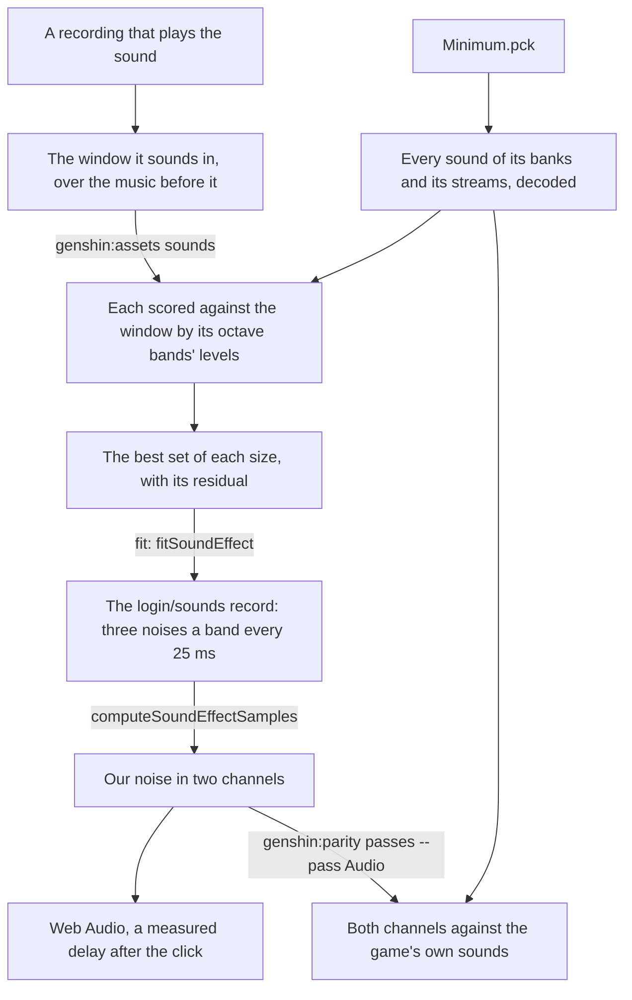

# Sound effects

The login's door sounds as it opens, and so does ours (`packages/genshin-world/src/components/Login/Music/Index.vue`). The game's own sounds stay on the machine that measures them; each sound's levels and the engine's noise that plays them are what ships (the hosted record, `{data-root}/cache/content/5523c4b4cee27020c460a2a08a930025fe6b69c05e10ffada78f373da3b8df97`, holds only the door's frame time and, each frame, the left, right and shared levels of 24 bands).

## How it works

- **A sound is found by the recording that plays it.** A sound has no name, only an id, so `genshin:assets sounds` finds it by matching: every sound of the packages it is given, `Minimum.pck` by default ([game data formats](../game-data-formats/design.md)), whose bank holds the login's own sounds, is scored against the recording's window by the cosine of its octave bands' levels from 1 kHz up (`scripts/src/services/genshinAssets/sound/findSoundStart.ts`, with the default `--lowest` of 1000 hertz in `scripts/src/services/genshinAssets/commands/soundsCommand.ts`), at every start, over the level of what plays in the quarter second before the window. The best five are then played together at their stored levels in every set of them, each start refined a frame at a time, and the best set of each size is printed with what it leaves of the window unexplained: each band's level against the set's, in decibels, over the cells within 30 decibels of the window's loudest, after one gain over every band. The gain is never one a band, since the game's sounds keep their own balance and a gain a band lets one sound stand in for another's octaves: under it the rumble alone reads better than the pair. For the door, the rumble alone leaves 4.19 decibels, the rumble and a broadband rush 75 milliseconds after it 3.31, and any further sound a few hundredths at most, so the door is the pair (`packages/genshin-world/src/components/Login/Music/DoorSound.reference.ts`, its `genshin:assets sounds` investigation). Where each sound sits is the login music's reference (`packages/genshin-world/src/components/Login/Music/Index.reference.ts`), and every search for them its door sound topic (`packages/genshin-world/src/components/Login/Music/DoorSound.reference.ts` beside it).
- **A sound with no pitch is its bands' levels, in both channels.** Neither door sound holds a harmonic series, so each is noise whose level moves band by band. The game's sounds are stereo and wide, their channels correlated about a half, so the fit lays the matched sounds at their offsets in both channels as the game plays them (`readGameSoundEffect`) and reads the mix every 25 milliseconds in a Hann window of 2048 samples over its own power, so a power is the noise's variance (`scripts/src/services/genshinAssets/sound/computeStereoSoundBandPowers.ts`, with its hop of 1200 samples at 48 kHz in `scripts/src/services/genshinAssets/shared/constants.ts`). Each band's two channels and their cross power become three noises apart: the cross power is what the channels share, and each channel's own is the rest of its power, so each channel's level and how alike the two sound both survive. One channel averaged from the two keeps neither: FFmpeg's mono downmix read the door about three decibels over each channel's own level, and the octave bands it was read in stopped at 11 kilohertz where the game's sound runs to the top of hearing (`packages/genshin-world/src/components/Login/Music/DoorSound.reference.ts`, its investigation of the two sounds in both channels: the channels correlated 0.46, the mono downmix about three decibels over each channel, the sounds run to 20 kilohertz). The bands are `SOUND_EFFECT_BAND_EDGES` (`packages/genshin-engine/src/audio/constants.ts`, where the 2048 samples of the window are too): a third of an octave each from 178 hertz up, and under that as wide as two of the window's bins, since a narrower band holds no bin of its own.
- **The engine plays its own noise, frame by frame.** `computeSoundEffectSamples` (`packages/genshin-engine/src/audio/computeSoundEffectSamples.ts`) builds each of the three noises from a spectrum flat across each band at its level at that moment, a frame a quarter of the window apart, each turned into samples by one inverse transform and laid over the frames before under a Hann window, whose overlaps sum to a constant; the shared noise is added to each channel's own. A noise of a band each built in one long transform would cost most of a second on the login's thread, where the frames cost a few hundred short transforms. `createSoundEffectBuffer` (`packages/genshin-engine/src/audio/createSoundEffectBuffer.ts`) renders it once into two channels when the login's audio starts. A window reads a band of few bins short of what the noise plays in it, so the fit renders its levels once, reads the render back as it read the game's sound, and scales each band by the game's power over the render's; the render is the same every time, so what is scaled is what plays. The levels keep five decimals, a hundred decibels under full scale, so the tail dies away as the game's does.
- **Scored against the game's own sounds, in the audio pass.** `genshin:parity passes login --pass Audio` renders each effect `DerivedAssetSoundEffectMap` names, the one map of the matched sounds that `fit` reads too, and reads both channels against the game's matched sounds in the effect's own bands every 5 milliseconds, finer than the fit's frames, over the cells within 40 decibels of the game's loudest (`scripts/src/services/genshinParity/shared/constants.ts`, `SOUND_SCORE_HOP_LENGTH` of 240 samples, and `scripts/src/services/genshinParity/sound/constants.ts`, `SOUND_SCORE_RANGE_DECIBELS` of 40). The door sits about two decibels off, every band's bias within about a decibel, its channels correlated as the game's are (`packages/genshin-world/src/components/Login/Music/DoorSound.reference.ts`, 2.18 decibels off at the mix volumes, channels correlated 0.58 against 0.53). The pass gates it at how far a second take of the same levels, its noise seeded apart (`computeSoundEffectSamples`'s seed), sits from the first (`scripts/src/services/genshinParity/passes/measureAudio.ts`, its `GRAIN_SEED`), since what is left under that is the noise's own grain, and no finer band or frame closes it: only the game's own samples would, which never ship. When the sound starts is no reading of the pass: its delay is read once off the recording's frames into its constant, with nothing solved over it (`packages/genshin-world/src/services/login/constants.ts`, `LOGIN_DOOR_SOUND_DELAY_MS`, read off the first whitened frame at 14.633 seconds in `packages/genshin-world/src/components/Login/Music/DoorSound.reference.ts`).
- **It sounds when the game's does.** The click sets off both sounds: the login's music component owns the one audio context (`packages/genshin-world/src/components/Login/Music/Index.vue`), and the door's sound starts `LOGIN_DOOR_SOUND_DELAY_MS` after the click, 0.32 seconds (`packages/genshin-world/src/services/login/constants.ts`), the time from the recording's first whitened frame to the rumble's rise, so the rush follows the click by about 0.4 seconds (`packages/genshin-world/src/components/Login/Music/DoorSound.reference.ts`, the click at 14.633 seconds and the rumble from 14.950).
- **It plays at the game's mix.** The game does not play its sounds at the level they are stored at: each is laid at the volume its banks give its source through every bus up to the master's (`readGameMixVolumes`), the door's rumble 16 decibels over its source and the rush 9 (`packages/genshin-world/src/components/Login/Music/DoorSound.reference.ts`, its `readGameMixVolumes` investigation). The door then passes a compressor at the effects bus's settings, -9 decibels at 4 to 1 with no attack and a 0.15 second release, its threshold 5 lower since the levels already carry the master's 5 down, and a limiter at the master's -2 decibels, at 20 to 1, the most a browser's compressor takes, where the game's is 50 (`packages/genshin-world/src/services/login/constants.ts`, `LOGIN_EFFECTS_COMPRESSOR_OPTIONS` and `LOGIN_MASTER_LIMITER_OPTIONS`).

## Not yet

- **The shared mixer's filters.** Both door sounds pass a low-pass of 20 and a high-pass of 15 on Wwise's scale, whose cutoffs are not published where they can be read, and the compressor's detector is the browser's own; each waits on a recording whose music is the login's own, where the door can be read out from under it.
- **The login's other sounds.** The clicks on its buttons and the wind each wait on a recording that plays them clearly enough to match, and go through the same fit.

## Key files

| File                                                                       | Role                                                               |
| :------------------------------------------------------------------------- | :----------------------------------------------------------------- |
| `packages/genshin-engine/src/audio/computeSoundEffectSamples.ts`           | A sound effect as two channels of our noise, frame by frame        |
| `packages/genshin-engine/src/audio/createSoundEffectBuffer.ts`             | A sound effect rendered once into a buffer of two channels         |
| `scripts/src/services/genshinAssets/sound/computeStereoSoundBandPowers.ts` | Two channels' powers as the shared noise and each channel's own    |
| `scripts/src/services/genshinAssets/sound/readGameSoundEffect.ts`          | The matched sounds laid at their offsets and mix volumes           |
| `scripts/src/services/genshinParity/sound/scoreSoundEffect.ts`             | Our render against the game's sounds, both channels, every 5 ms    |
| `scripts/src/services/genshinParity/passes/measureAudio.ts`                | The audio pass: each effect against the game's, gated at its grain |
| `scripts/src/services/genshinAssets/sound/DerivedAssetSoundEffectMap.ts`   | Each component's effects as the game's sounds matched for them     |
| `scripts/src/services/genshinAssets/sound/matchGameSounds.ts`              | Which of the game's sounds a recording's window plays, and when    |
| `scripts/src/services/genshinAssets/fit/fitSoundEffect.ts`                 | The matched sounds read from the game and measured as levels       |
| `scripts/src/services/genshinAssets/music/parseSoundBankSounds.ts`         | The sounds a sound bank holds in itself                            |
| `packages/genshin-world/src/components/Login/Music/Index.vue`              | The login's music and its door's sound, through one context        |
| `packages/genshin-world/src/components/Login/Music/Index.reference.ts`     | Where the door's sounds sit, and their topic of every search       |
| `packages/genshin-world/src/components/Login/Music/DoorSound.reference.ts` | The door's mix volumes, read from the game's banks                 |

## Sources

- [GENSHIN IMPACT | CELESTIA DOOR | LOADING SCREEN](https://www.youtube.com/watch?v=rBnfA4pXw6U): the English client's door, clicked, with its sound.
- The game's mix of the door's rumble and rush, read from the game's banks: each is laid at the volume its banks give its source through every bus up to the master's, the door's rumble 16 decibels over its source and the rush 9 (grounds Requirement: The door plays at the game's mix and is limited so it does not clip).
- a recording that plays them clearly enough to match (grounds Requirement: The login's other sounds stay silent until they are matched): the login's button clicks and its wind each wait on one and go through the same fit (see Not yet).

## Open

- [ ] **A noise of a band built in one long transform would cost most of a second on the login's thread** — no source yet: no timing of either build is recorded in the repo.
- [ ] **The levels keep five decimals, a hundred decibels under full scale** — no source yet: the precision and the floor were not found in `packages/genshin-engine/src/audio/computeSoundEffectSamples.ts`.
- [ ] **our login door sounds as it opens, as the game's does** — no source yet: the game's door audio in `{data-root}/genshin-parity/captures/yt-rBnfA4pXw6U-audio.webm`, named in Sources, not yet compared with our door's audio.
- [ ] **the door is the rumble and a broadband rush 75 milliseconds after it, leaving 3.31 decibels** — no source yet: the game's door audio in `{data-root}/genshin-parity/captures/yt-rBnfA4pXw6U-audio.webm`, not yet re-measured for the rush's delay and level.
- [ ] **the door sits about two decibels off the game's, its channels correlate 0.58 against the game's 0.53, its mono downmix reads about 3 decibels over each channel, and the sounds run to 20 kilohertz** — no source yet: the capture `{data-root}/genshin-parity/captures/yt-rBnfA4pXw6U-audio.webm` is on disk, but the `genshin:parity effects` command that recorded the 2.18 decibels and the 0.58 and 0.53 correlations was deleted in `600c9c6c35`, so no command here reproduces them, and the downmix level and bandwidth are not yet re-measured.
- [ ] **the door's sound delay is read once off the recording's first whitened frame at 14.633 seconds** — no source yet: `{data-root}/genshin-parity/captures/yt-rBnfA4pXw6U.mp4`, not yet re-read at its first whitened frame, 14.633 seconds.
- [ ] **the door's sound starts 0.32 seconds after the click** — no source yet: the game's door audio in `{data-root}/genshin-parity/captures/yt-rBnfA4pXw6U-audio.webm`, not yet re-measured against the click.
- [ ] **the rush follows the click by about 0.4 seconds** — no source yet: the game's door audio in `{data-root}/genshin-parity/captures/yt-rBnfA4pXw6U-audio.webm`, not yet re-measured against the click.
- [ ] **the door's rumble plays 16 decibels over its source and the rush 9** — no source yet: the game's door audio in `{data-root}/genshin-parity/captures/yt-rBnfA4pXw6U-audio.webm`, not yet re-measured against its source.
- [ ] **A deployed product holds no game sound, only the measured levels** — no source yet: the product's contents are not inspected here, and the hosted record is named in `packages/genshin-world/src/generated/gameDataLock.json` by its hash only.
