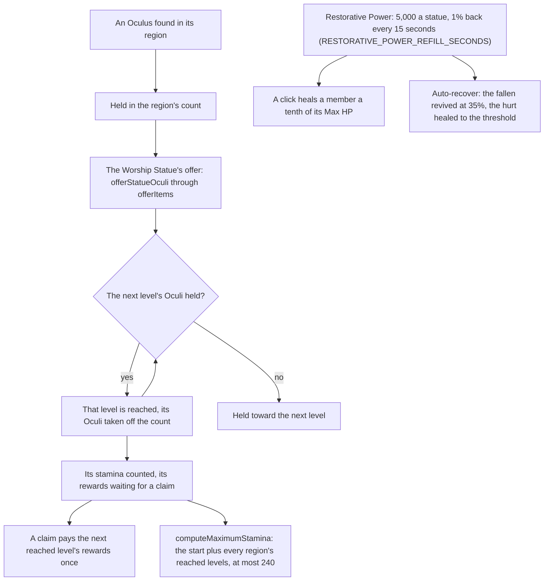

# Statues of The Seven

In the game a region's statues stand for its Archon and level together as Oculi are offered to them. This page is what is built of [Statues of The Seven](../../../changes/genshin-statues-of-the-seven/design.md): a region's levels and what each pays, the maximum stamina they raise, and the Statue's Blessing's pool with its two ways of healing. Their rules are pure functions, as the [offering systems](../offering-systems/design.md) page's are. The world now holds each region's levels, the Oculi found and the pool, and the Worship Statue offers and claims through them (`packages/genshin-world/src/composables/useWorldStatues.ts`), while the stamina maximum stays at its start.

## How it works

- **Mondstadt's and Liyue's levels are read from the dump (`{data-root}/genshin-dump-backup-6.6/ExcelBinOutput/CityLevelupConfigData.json`, city IDs 1 and 2).** `pnpm -C scripts genshin:assets statues` builds them from its level-up table and its reward table and publishes each region as `statueLevels/<region>`, one row a level holding the Oculi it takes, its items and the stamina its actions add (`scripts/src/services/genshinAssets/statues/buildStatueLevels.ts`, `scripts/src/services/genshinAssets/statues/toStatueLevelRow.ts`). `readStatueLevels` reads a region's record by its key, parsed by its schema (`packages/genshin-world/src/services/statue/readStatueLevels.ts`). The other regions' levels join with their own pages.
- **Oculi are offered, and levels are reached in turn.** `offerStatueOculi` offers a started region's held Oculi at the Worship Statue, and `offerItems`, the rule every [offering](../offering-systems/design.md) shares, adds them to the held count and reaches its levels as that page describes (`packages/genshin-world/src/services/offering/offerItems.ts`, `packages/genshin-world/src/services/statue/offerStatueOculi.ts`). Past the last level the Oculus is held with no level to reach. The levels take 65 Oculi in all (`{data-root}/genshin-dump-backup-6.6/ExcelBinOutput/CityLevelupConfigData.json`, whose Oculi costs for levels 2 to 10 sum to 65), one short of the 66 Anemoculi the wiki is said to count in Mondstadt, a count not yet checked (see Open).
- **Each reached level is claimed in one action.** `claimStatueLevel` takes the next level a region has reached and not yet claimed, and `payOfferingLevels` pays its rewards (`packages/genshin-world/src/services/statue/claimStatueLevel.ts`, `packages/genshin-world/src/services/offering/payOfferingLevels.ts`). The save keeps `claimedLevel` per region beside its level and held count, and a merge keeps the account's regions and found Oculi whole, since a claim's rewards and each Oculus found sit in the bag the merge keeps, so a level only the guest's copy claimed is claimed again on the account, and a region or an Oculus only the guest holds is not carried (`packages/genshin-world/src/services/save/mergeGenshinSave.ts`).
- **The maximum stamina rises with the levels reached.** `computeMaximumStamina` adds the stamina share of each reached level in every region to the controller's start, `STAMINA_MAX`, and stops at 240 (`packages/genshin-world/src/services/statue/computeMaximumStamina.ts`). Mondstadt alone takes the maximum to 170 at its tenth level (`{data-root}/genshin-dump-backup-6.6/ExcelBinOutput/CityLevelupConfigData.json`, whose stamina shares for levels 2 to 10 sum to 70). The engine's stamina takes its maximum as `createStamina`'s first argument, which `useWorldCombat` gives the party's pool and a controller given no pool takes as its `staminaMaximum` option, and keeps it on `stamina.maximum`, so a raised maximum reaches the body without a new stamina (`packages/genshin-engine/src/locomotion/createStamina.ts`, `packages/genshin-world/src/composables/useWorldCombat.ts`).
- **The pool regenerates from its last change.** `regenerateRestorativePower` holds the Restorative Power as an amount and the moment it last changed, with 5,000 for each unlocked Statue of The Seven as its maximum. A refill of 1% of that maximum comes every 15 seconds (`RESTORATIVE_POWER_REFILL_SECONDS`, `packages/genshin-world/src/services/statue/constants.ts`), and the moment moves on by the refills that came, so the time to the next keeps its place. At the maximum the moment is now. The maximum is a multiple of 50, so every refill is a whole number (`packages/genshin-world/src/services/statue/regenerateRestorativePower.ts`).
- **A click heals a tenth of a member's Max HP from the pool.** `healPartyMemberWithPower` pays what the pool holds when that is less than the tenth, heals nothing at full HP, and heals nothing for a fallen member, since a fallen team is revived by auto-recover rather than by a click (`packages/genshin-world/src/services/statue/healPartyMemberWithPower.ts`).
- **Auto-recover revives the fallen and heals to a threshold.** `autoRecoverParty` revives the deployed team's fallen at the revive share of 35% of their maximum HP, which costs the pool nothing, then heals every member under the threshold up to it from the pool, slot by slot. A pool that runs short leaves the last slots where they stand (`packages/genshin-world/src/services/statue/autoRecoverParty.ts`).

## Key files

| File                                                                       | Role                                                                                  |
| :------------------------------------------------------------------------- | :------------------------------------------------------------------------------------ |
| `scripts/src/services/genshinAssets/statues/buildStatueLevels.ts`          | Builds each region's levels, each reward joined from the reward table, for publishing |
| `scripts/src/services/genshinAssets/statues/toStatueLevelRow.ts`           | One level's row: the Oculi it takes, its items and its stamina share                  |
| `packages/genshin-world/src/services/statue/readStatueLevels.ts`           | Loads a region's levels by its key, failing on a row the schema rejects               |
| `packages/genshin-world/src/services/offering/offerItems.ts`               | Offers Oculi and reaches each level they cover, the rule offerings share              |
| `packages/genshin-world/src/services/statue/offerStatueOculi.ts`           | The Worship Statue's offer: a started region's held Oculi reach their levels          |
| `packages/genshin-world/src/services/statue/claimStatueLevel.ts`           | Takes the next reached level, its rewards paid once                                   |
| `packages/genshin-world/src/services/statue/computeMaximumStamina.ts`      | The maximum: the start, raised by the reached levels, at most 240                     |
| `packages/genshin-world/src/services/statue/constants.ts`                  | The pool's refill interval, `RESTORATIVE_POWER_REFILL_SECONDS`                        |
| `packages/genshin-world/src/services/statue/regenerateRestorativePower.ts` | The pool regenerated to now from its last change                                      |
| `packages/genshin-world/src/services/statue/healPartyMemberWithPower.ts`   | A click's heal, paid from the pool                                                    |
| `packages/genshin-world/src/services/statue/autoRecoverParty.ts`           | Auto-recover: the fallen revived, then the hurt healed to the threshold               |
| `packages/genshin-engine/src/locomotion/createStamina.ts`                  | The pool takes its maximum, held on `maximum`                                         |
| `packages/genshin-engine/src/locomotion/createCharacterController.ts`      | Takes `staminaMaximum` as an option where it is given no pool                         |

## Notes

- **Partly wired.** The auto-recover setting is not yet its state, and the character component still passes the start maximum.
- **Oculi wait on the spawned places.** Oculi are not in the world's data, and their places come from the spawned places' fit ([spawned places](../../../changes/genshin-spawned-places/design.md)).

## Sources

- [AnimeGameData](https://github.com/DimbreathBot/AnimeGameData), the community's per-patch dump: the city level-up table and the reward table the slice is built from.

## Open

- [ ] **A region's statues stand for its Archon and level together as Oculi are offered to them, as the game does** — no source yet: the wiki's Statue of The Seven page is not in the genshin-wiki cache.
- [ ] **The Mondstadt levels take one short of the 66 Anemoculi the wiki counts** — no source yet: the wiki's Oculus page is not in the genshin-wiki cache, so the 66 is unchecked.
- [ ] **The maximum stamina stops at 240** — no source yet: the wiki's Statue of The Seven page is not in the cache, and no dump table read holds the cap.
- [ ] **The Restorative Power holds 5,000 for each unlocked statue and refills 1% of its maximum every 15 seconds** — no source yet: the wiki's page is not in the cache, and no dump table read holds these numbers.
- [ ] **A click heals a tenth of a member's Max HP, and auto-recover revives the fallen at 35% of their HP** — no source yet: the wiki's Statue of The Seven page is not in the cache.
- [ ] **The pool also counts each unlocked Statue of the New Moon** — no source yet: the wiki's Statue of The Seven page is not in the cache.
