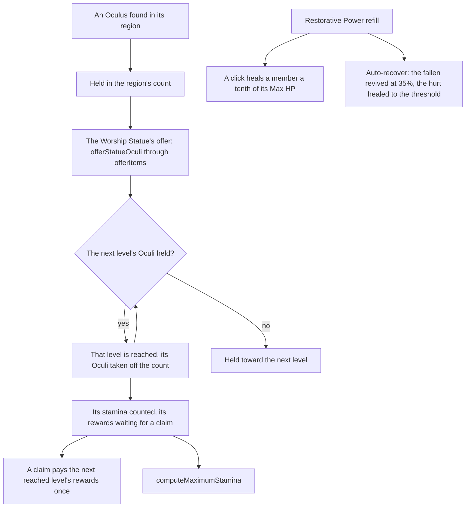

# Statues of The Seven

In the game a region's statues stand for its Archon and level together as Oculi are offered to them. This page is what is built of [Statues of The Seven](../../../changes/genshin-statues-of-the-seven/design.md): a region's levels and what each pays, the maximum stamina they raise, and the Statue's Blessing's pool with its two ways of healing. Their rules are pure functions, as the [offering systems](../offering-systems/design.md) page's are. The world holds each region's levels, the Oculi found and the pool, and the Worship Statue offers and claims through them (`packages/genshin-world/src/composables/useWorldStatues.ts`), and the party's stamina maximum follows the levels the regions reach.

## How it works

- **Mondstadt's and Liyue's levels are read from the dump (`{data-root}/genshin-dump-backup-6.6/ExcelBinOutput/CityLevelupConfigData.json`, city IDs 1 and 2).** `pnpm -C scripts genshin:assets statues` builds them from its level-up table and its reward table and publishes each region as `statueLevels/<region>`, one row a level holding the Oculi it takes, its items and the stamina its actions add (`scripts/src/services/genshinAssets/statues/buildStatueLevels.ts`, `scripts/src/services/genshinAssets/statues/toStatueLevelRow.ts`). `readStatueLevels` reads a region's record by its key, parsed by its schema (`packages/genshin-world/src/services/statue/readStatueLevels.ts`). The other regions' levels join with their own pages.
- **Oculi are offered, and levels are reached in turn.** `offerStatueOculi` offers a started region's held Oculi at the Worship Statue, and `offerItems`, the rule every [offering](../offering-systems/design.md) shares, adds them to the held count and reaches its levels as that page describes (`packages/genshin-world/src/services/offering/offerItems.ts`, `packages/genshin-world/src/services/statue/offerStatueOculi.ts`). Past the last level the Oculus is held with no level to reach. The levels take 65 Oculi in all (`{data-root}/genshin-dump-backup-6.6/ExcelBinOutput/CityLevelupConfigData.json`, whose Oculi costs for levels 2 to 10 sum to 65), one short of the 66 Anemoculi the wiki counts in Mondstadt, the one left over once every Oculus is collected and the levels are maxed (`{data-root}/cache/genshin-wiki/Page_Oculus.json`, wikitext lines 16 and 26). A region's statues share its level and depict its Archon, and grow more ornate as Oculi are offered (`{data-root}/cache/genshin-wiki/Page_Statue_of_The_Seven.json`, wikitext lines 125, 302 and 304).
- **Each reached level is claimed in one action.** `claimStatueLevel` takes the next level a region has reached and not yet claimed, and `payOfferingLevels` pays its rewards (`packages/genshin-world/src/services/statue/claimStatueLevel.ts`, `packages/genshin-world/src/services/offering/payOfferingLevels.ts`). The save keeps `claimedLevel` per region beside its level and held count, and a merge keeps the account's regions and found Oculi whole, since a claim's rewards and each Oculus found sit in the bag the merge keeps, so a level only the guest's copy claimed is claimed again on the account, and a region or an Oculus only the guest holds is not carried (`packages/genshin-world/src/services/save/mergeGenshinSave.ts`).
- **The maximum stamina rises with the levels reached.** `computeMaximumStamina` adds the stamina share of each reached level in every region to the controller's start, `STAMINA_MAX`, and stops at 240 (`packages/genshin-world/src/services/statue/computeMaximumStamina.ts`). Mondstadt alone takes the maximum to 170 at its tenth level (`{data-root}/genshin-dump-backup-6.6/ExcelBinOutput/CityLevelupConfigData.json`, whose stamina shares for levels 2 to 10 sum to 70). The world's `staminaMaximum` is that function over each region's level and the levels it last read, a started region's levels read on load (`packages/genshin-world/src/composables/useWorldStatues.ts`). `useWorldCombat` creates the party's pool at that maximum and sets the pool's `maximum` as it changes, refilling a pool that was full, since the engine's stamina takes its maximum as `createStamina`'s first argument and keeps it on `stamina.maximum` (`packages/genshin-engine/src/locomotion/createStamina.ts`, `packages/genshin-world/src/composables/useWorldCombat.ts`). The HUD's meter and the Character screen read the same maximum (`packages/genshin-world/src/components/World/Session/Index.vue`).
- **The pool regenerates from its last change.** `regenerateRestorativePower` holds the Restorative Power as an amount and the moment it last changed, with 5,000 for each unlocked Statue of The Seven and each unlocked Statue of the New Moon as its maximum, the wiki's count (`{data-root}/cache/genshin-wiki/Page_Statue_of_The_Seven.json`, wikitext line 37). A refill of 1% of that maximum comes every 15 seconds (`RESTORATIVE_POWER_REFILL_SECONDS`, `packages/genshin-world/src/services/statue/constants.ts`), and the moment moves on by the refills that came, so the time to the next keeps its place. At the maximum the moment is now. The maximum is a multiple of 50, so every refill is a whole number (`packages/genshin-world/src/services/statue/regenerateRestorativePower.ts`).
- **A click heals a tenth of a member's Max HP from the pool.** `healPartyMemberWithPower` pays what the pool holds when that is less than the tenth, heals nothing at full HP, and heals nothing for a fallen member, since a fallen team is revived by auto-recover rather than by a click (`packages/genshin-world/src/services/statue/healPartyMemberWithPower.ts`).
- **Auto-recover revives the fallen and heals to a threshold.** `autoRecoverParty` revives the deployed team's fallen at the revive share of 35% of their maximum HP, which costs the pool nothing, then heals every member under the threshold up to it from the pool, slot by slot. A pool that runs short leaves the last slots where they stand (`packages/genshin-world/src/services/statue/autoRecoverParty.ts`).

## Key files

| File                                                                       | Role                                                                                  |
| :------------------------------------------------------------------------- | :------------------------------------------------------------------------------------ |
| `scripts/src/services/genshinAssets/statues/buildStatueLevels.ts`          | Builds each region's levels, each reward joined from the reward table, for publishing |
| `scripts/src/services/genshinAssets/statues/toStatueLevelRow.ts`           | One level's row: the Oculi it takes, its items and its stamina share                  |
| `packages/genshin-world/src/composables/useWorldStatues.ts`                | Reads each region's levels, and holds the party's maximum stamina they raise          |
| `packages/genshin-world/src/services/statue/readStatueLevels.ts`           | Loads a region's levels by its key, failing on a row the schema rejects               |
| `packages/genshin-world/src/services/offering/offerItems.ts`               | Offers Oculi and reaches each level they cover, the rule offerings share              |
| `packages/genshin-world/src/services/statue/offerStatueOculi.ts`           | The Worship Statue's offer: a started region's held Oculi reach their levels          |
| `packages/genshin-world/src/services/statue/claimStatueLevel.ts`           | Takes the next reached level, its rewards paid once                                   |
| `packages/genshin-world/src/services/statue/computeMaximumStamina.ts`      | The maximum: the start, raised by the reached levels, at most 240                     |
| `packages/genshin-world/src/services/statue/constants.ts`                  | The pool's refill interval, `RESTORATIVE_POWER_REFILL_SECONDS`                        |
| `packages/genshin-world/src/services/statue/regenerateRestorativePower.ts` | The pool regenerated to now from its last change                                      |
| `packages/genshin-world/src/services/statue/healPartyMemberWithPower.ts`   | A click's heal, paid from the pool                                                    |
| `packages/genshin-world/src/services/statue/autoRecoverParty.ts`           | Auto-recover: the fallen revived, then the hurt healed to the threshold               |
| `packages/genshin-engine/src/locomotion/createStamina.ts`                  | The pool takes its maximum, held on `maximum`                                         |
| `packages/genshin-engine/src/locomotion/createCharacterController.ts`      | Takes `staminaMaximum` as an option where it is given no pool                         |

## Notes

- **Partly wired.** The auto-recover setting is the session's, set on the Blessing and read by the stand by a statue, and the Restorative Power pool is kept for the session, since the save holds no pool.
- **The pool counts the statues the region data holds.** Each unlocked statue landmark adds one entry to the resonated list, and the pool takes five thousand for each entry, so the count is of statues. `RegionIdStatueLandmarkIdMap` admits one statue per region, Windrise's being the `StatueOfTheSeven` landmark of `packages/genshin-world/src/data/regions/mondstadt.json`, so the pool counts one per region until each statue is published. The wiki counts 55 Statues of The Seven and 7 Statues of the New Moon as of Version 7.0 (`{data-root}/cache/genshin-wiki/Page_Statue_of_The_Seven.json`, wikitext line 37).
- **Oculi wait on the spawned places.** Oculi are not in the world's data, and their places come from the spawned places' fit ([spawned places](../../../changes/genshin-spawned-places/design.md)).
- **The Blessing draws the completionist clip's layout.** `packages/genshin-interface/src/components/BlessingScreen/Index.vue` draws the reference `statue-blessing` (`scripts/src/services/genshinParity/shared/ParityReferenceMap.ts`), a public clip's frame at 173 seconds: the deployed team in a section headed "In combat", the teams not deployed under it headed "Preparing for combat", each card a health bar over its portrait and its level under it, and in a panel down the right the pool, the auto-recover switch and its threshold. The waiting members are the other teams' characters, none deployed (`packages/genshin-world/src/components/Statue/Screen/Index.vue`). Each word the screen draws is a `GameTextKey` of its own: "In combat" is `GameTextKey.InCombat`, the deployed team's heading, and "Preparing for combat" is `GameTextKey.PreparingForCombat`, the waiting teams' heading, each beside its section's diamond; "Click on the character portrait to restore HP" is `GameTextKey.ClickPortraitToRestoreHp`, the PC form of its platform markup, set beside the first heading; "Restorative Power:" is `GameTextKey.RestorativePower`, before the pool's amount; and "Auto-recover when nearby" is `GameTextKey.AutoRecoverWhenNearby`, under the switch. The Statue screen passes each from the reader's `gameText`, and the piece draws it as a prop (`packages/genshin-interface/src/components/BlessingScreen/Index.vue`). The Worship button sits at the screen's bottom left, since the clip shows no switch to it.
- **The Worship popup draws the level the region is reaching.** `packages/genshin-interface/src/components/WorshipScreen/Index.vue` draws the reference `statue-worship` (`scripts/src/services/genshinParity/shared/ParityReferenceMap.ts`), the completionist clip at 164 seconds: a panel 614 units across on the window's right, its emblem over the lowest level not yet claimed, that level's stamina and items as strips with padlocks until it is reached (`packages/genshin-interface/src/components/WorshipScreen/Level/Index.vue`), the Oculus it takes against the Oculi held, and the "Offer" and "Offer All" pills, disabled while none are held. The world picks the level it shows (`packages/genshin-world/src/components/Statue/Worship/Index.vue`).
- **The Blessing's art and glass wait.** The portraits, the emblem's icon and the switch's drop icon are art the game ships and the repo does not, so the portraits are plain tiles and the icons are left out. The levels show only when the host passes `getLevel`, which the Session does not yet. The clip shows no recharge line under a card, so none is drawn. The panel's glass is the clip's colour at each height, provisional until the world shows through it.

## Open

- [ ] **Four words of the popup have no key** — "Statue's Rewards", "Owned", "Offer" and "Offer All" are in no `GameTextKey` (`packages/genshin-text/src/models/GameTextKey.ts`), so the rewards heading draws as its two rules, the requirement draws its count without "Owned", and the offer pills draw their arrows alone. "Required Anemoculus" is the "Required" key with the Oculus's item name. Needs the four keys added by the machine that holds the game install.
- [ ] **The Blessing's glass is solved over nothing the game draws under it** — the reference's panel lies over the blurred world, and the parity page stands the screen on white, so a glass that reads the reference's tones over white costs the shape score 0.010 for about ten points of mean (`statue-blessing`); the glass stays at 75 percent until the page backdrop or the screen's own world blur is decided.
- [ ] **The popup's parchment, emblem, icons, padlock and offer arrows are placeholders** — the client's UI atlas and the item icons are not checked, so each draws as a plain tile, disc or stroke (the roadmap's Worship asset rows).
- [ ] **The published level two pays 80 Adventure EXP** where the completionist clip shows 120, so the statues table is to be checked against a current recording before the popup's rewards are trusted.
- [ ] **The Blessing switch sits off the panel** — the reference's panel draws no switch, so the switch is a provisional control at the window's top left, outside the judged region; where the game leads from the popup to the Blessing is not recorded.
- [ ] **Offer and Offer All make the same offer** — the model offers every held Oculus at once, so both pills emit the one offer until the game's split between a single offer and all is modelled.

## Sources

- [AnimeGameData](https://github.com/DimbreathBot/AnimeGameData), the community's per-patch dump: the city level-up table and the reward table the slice is built from.
- [Statue of The Seven](https://genshin-impact.fandom.com/wiki/Statue_of_The_Seven), Genshin Impact Wiki, in the wiki cache as `{data-root}/cache/genshin-wiki/Page_Statue_of_The_Seven.json`: each region's levels and their offerings, the stamina cap and the Statue's Blessing.
- [Oculus](https://genshin-impact.fandom.com/wiki/Oculus), Genshin Impact Wiki, in the wiki cache as `{data-root}/cache/genshin-wiki/Page_Oculus.json`: the Oculi each region holds in all.
