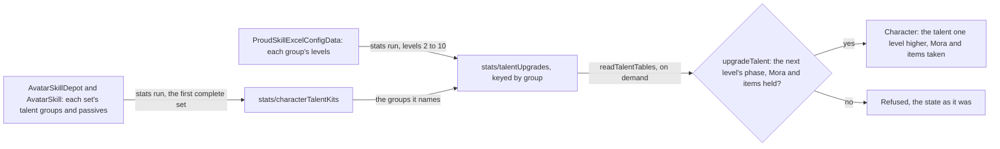
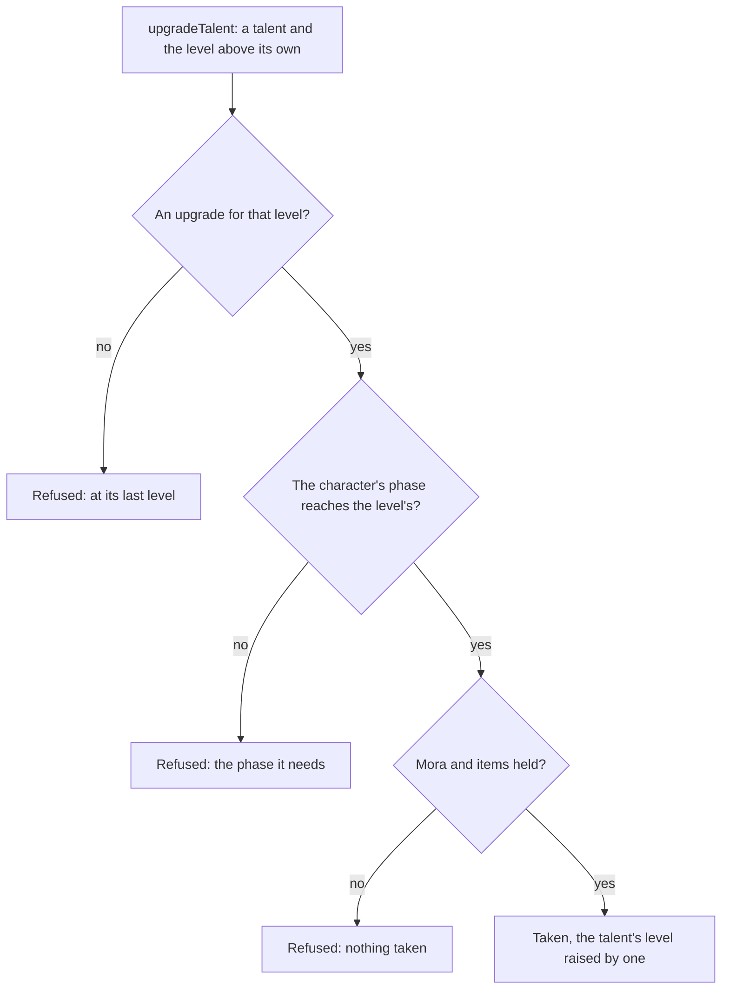

# Talents

A character's three combat talents, the normal attack, the Elemental Skill and the Elemental Burst, are levelled up from `TALENT_START_LEVEL` by the game's own rule: each level costs Mora and talent materials, and needs an ascension phase the character has reached. The table side is built, published by the stats run beside the other stat tables, and the upgrade as a pure rule over the character, its wallet and its bag. The passives are read as the phases open them. The Talents tab lists each talent's level, next phase and cost, and presses an upgrade through `upgradeCharacterTalent`, which calls `upgradeTalent`; the world screen reads `readTalentTables` beside the stat tables. A constellation's extra levels are added by the [constellations](../constellations/design.md) page, and a kit reads each talent at its own level plus those levels as its character joins the party.

## The tables

- **The proud skill table is the source.** `ProudSkillExcelConfigData` holds each combat talent's rows under its proud skill group, one a level from 1 to 15. The rows from 2 to 10 carry the phase the level needs (`breakLevel`), its Mora (`coinCost`) and its materials (`costItems`). The rows past 10 are a constellation's and cost nothing, so they are not written (`{data-root}/genshin-dump-backup-6.6/ExcelBinOutput/ProudSkillExcelConfigData.json`: every talent group holds levels 1 to 15, and no row past 10 holds a coin cost).
- **A skill set names its talents by group.** A skill row names the proud skill group of the talent it is. A set's first slot is the normal attack, its second the Elemental Skill, and its energy skill the burst. The third slot is the alternate sprint, which has one row and no level, so it is never levelled.
- **The first set that names all three is the character's.** That is its own form's set, and then the element forms' in the order the game lists them. The Traveler's own form names only its normal attack, so the Traveler reads its Anemo set, the form it takes by default, which the world's Traveler kit also reads ([forging](../forging/design.md) cites the depot table: depots 501 and 701 name only their normal attack (`{data-root}/genshin-dump-backup-6.6/ExcelBinOutput/AvatarSkillDepotExcelConfigData.json`, skill slots at lines 267 and 846), and depot 504's energy skill costs Wind (its energy skill at line 511, and `{data-root}/genshin-dump-backup-6.6/ExcelBinOutput/AvatarSkillExcelConfigData.json`, line 2316); `scripts/src/services/genshinAssets/stats/getCharacterSkillDepotRows.ts` puts the set of the default element first). No statue's element picks another set: the [statues page](../statues-of-the-seven/design.md) holds the element a resonance gives her, and her talents read the Anemo set whichever statue she resonated with (see [Not built](#not-built)).
- **Passives come from that same set.** The skill depot's inherent proud skill opens name each passive and the phase it opens at. Across the roster the phases are 0, 1 and 4: the utility passive comes with the character, and the first and fourth ascension passives open at phases 1 and 4 ("{data-root}/cache/genshin-wiki/Category_Xilonen_Talents.json" names Xilonen's utility, first and fourth ascension passives, and "Category_Traveler_Talents.json" the Traveler's first and fourth). The dump's passive lists hold no other phase: Ayaka's list at `{data-root}/genshin-dump-backup-6.6/ExcelBinOutput/AvatarSkillDepotExcelConfigData.json` line 84 gives 1, 4 and 0, and every passive of the avatar rows is 0, 1 or 4, the first and fourth ascension passives at 1 and 4 and the utility at 0 by the type names the wiki's category pages give. A passive has no level.
- **Names are published with the groups.** Each combat talent is named by its skill's `nameTextMapHash` in the set the kit reads (`AvatarSkillExcelConfigData`), and each passive by its proud skill group's first-level row (`ProudSkillExcelConfigData`). The kit holds both as text ids (`talentNames`, `Passive.nameTextId`), which `genshin:text names` publishes into the names dataset, and every group has a first-level row with a name.
- **The table is fetched beside the dump.** The dump the game text is read from lacks this table at its revision. The community repository's `main` holds it at the install's 7.1.0 build; `master` holds an older copy at 6.6 that matches the dump, so it is the stale one. The table is fetched from `main`. The keys below were read at `master`'s revision and are checked against `main`'s before the stat run is trusted. It is not committed.

## Levelling

- **Every combat talent starts at `TALENT_START_LEVEL`.** `createCharacter` sets all three to it.
- **An upgrade raises one talent one level.** The level above the talent's own is looked up among its upgrades. The upgrade is refused where there is none, which is past level 10 for the materials, where the character's ascension phase is below the level's phase, where the wallet lacks the Mora, and where the bag lacks an item. Those items leave the bag as [inventory](../inventory/design.md) describes.
- **A refusal leaves nothing behind.** The rule throws before it returns anything, so the caller keeps the character, the wallet and the bag it passed in, with no part of the cost taken.
- **The phase numbers are the ascension phases'.** Level 2 needs the second phase, levels 3 and 4 the third, 5 and 6 the fourth, 7 and 8 the fifth, and 9 and 10 the sixth (`{data-root}/genshin-dump-backup-6.6/ExcelBinOutput/ProudSkillExcelConfigData.json`, where the rule holds in every talent group). A character at the first phase can therefore be raised to level 1 only, and a character must reach the sixth phase to bring any talent to level 10.

## Passives

A passive has no level. It is open where the character's ascension phase has reached the phase its kit holds for it, and the kit keeps the phase beside the group. Nothing reads that yet: no code tests a passive's phase, and the kit modules gate on the character's ascension directly. The [character kits change](../../../changes/genshin-character-kits/design.md), still open, adds each passive at the phase its talent table names.

## Not built

- **A statue's element picks the Traveler's talent set.** Her talents read the default element's set whichever statue she resonated with, so picking the set by a statue's element is not built.

## Key files

| File                                                                      | Role                                                                                          |
| :------------------------------------------------------------------------ | :-------------------------------------------------------------------------------------------- |
| `packages/genshin-world/src/models/character/Character.ts`                | Each combat talent's level, kept with the character                                           |
| `packages/genshin-world/src/models/character/CombatTalent.ts`             | The three combat talents                                                                      |
| `packages/genshin-world/src/models/character/TalentUpgrade.ts`            | A level's phase, Mora and items                                                               |
| `packages/genshin-world/src/models/character/TalentUpgradeMap.ts`         | Each proud skill group's upgrades, from the second level                                      |
| `packages/genshin-world/src/models/character/CharacterTalentKit.ts`       | A character's talent groups, talent names and passives                                        |
| `packages/genshin-world/src/models/character/Passive.ts`                  | A passive's group, its name and the phase it opens at                                         |
| `packages/genshin-world/src/services/character/upgradeTalent.ts`          | The upgrade rule: phase, Mora and items checked before any is taken                           |
| `packages/genshin-world/src/services/character/upgradeCharacterTalent.ts` | The press: a character's talent raised, the roster, bag and wallet it leaves                  |
| `packages/genshin-world/src/services/character/getTalentRows.ts`          | Each combat talent's row on the Talents tab: its level, next upgrade and refusal              |
| `packages/genshin-world/src/services/character/readTalentTables.ts`       | The two tables, fetched by their keys and checked against their shapes                        |
| `packages/genshin-world/src/services/character/createCharacter.ts`        | Every combat talent at level 1                                                                |
| `scripts/src/services/genshinAssets/stats/toCharacterTalentKit.ts`        | A character's talents, their names and passives from the first skill set that names all three |
| `scripts/src/services/genshinAssets/stats/toProudSkillNameTextIdMap.ts`   | Each proud skill group's name, from its first level's row                                     |
| `scripts/src/services/genshinAssets/stats/toTalentUpgradeMap.ts`          | Each named group's levels from the second to the tenth, costs as the table has them           |
| `scripts/src/services/genshinAssets/stats/buildStatTables.ts`             | Builds both tables with the other stat tables, published under their `stats/` keys            |

## Sources

- [AnimeGameData](https://github.com/DimbreathBot/AnimeGameData), the community's per-patch dump: `ProudSkillExcelConfigData`, the skill depot's inherent proud skill opens, and the skill and character tables the sets are read from.
- [Talent](https://genshin-impact.fandom.com/wiki/Talent), Genshin Impact Wiki: the combat talents to level 10 by materials and the ascension phase, and the passives opened at the first and fourth phases.
- [Combat Talents](https://genshin-impact.fandom.com/wiki/Combat_Talents), Genshin Impact Wiki: the talents upgraded with Character Talent Materials and the weekly bosses' materials, and the alternate sprint never levelled.
- [Character Menu](https://genshin-impact.fandom.com/wiki/Character/Menu), Genshin Impact Wiki, in the wiki cache as `{data-root}/cache/genshin-wiki/Page_Character%2FMenu.json`: every character has a first and a fourth ascension passive, and all but the Traveler a utility passive, the page giving no phase for it (wikitext line 47).
- Requirement _Passives open at their ascension phase_: the wiki's passive types name the utility and the first and fourth ascension passives.
