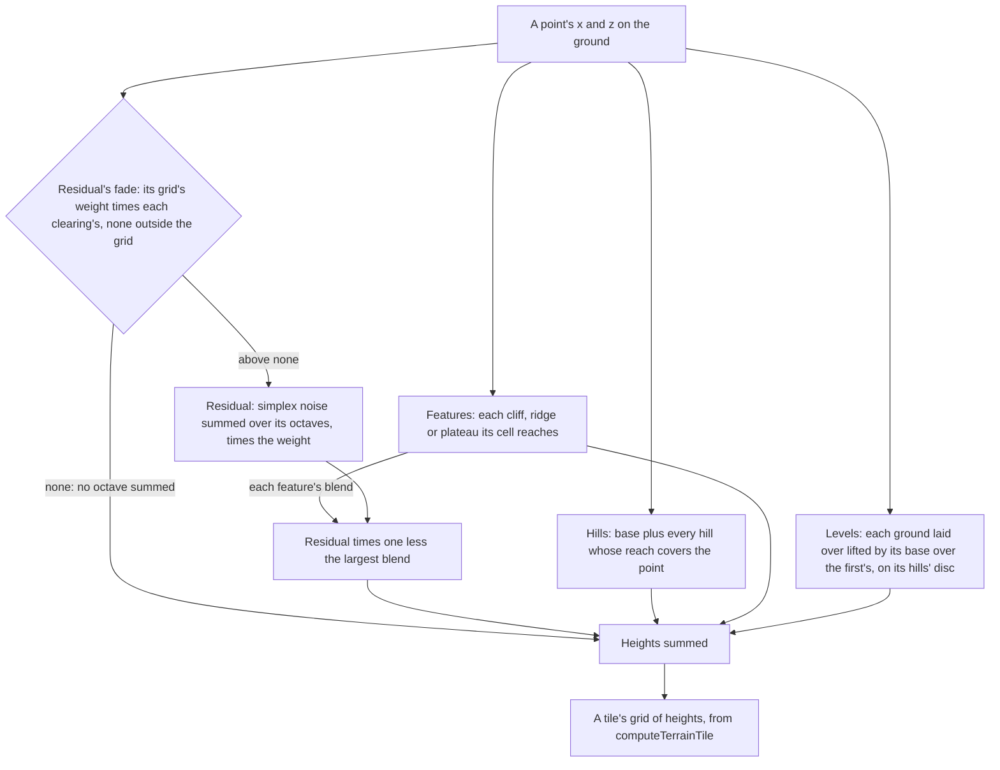
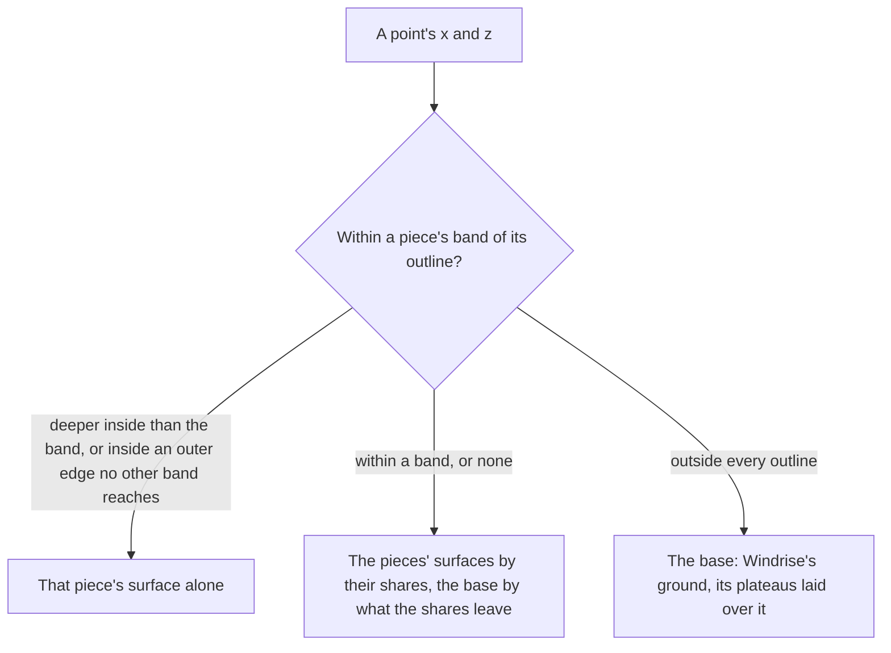

# Terrain shape height

A region's ground is a [terrain](../terrain/design.md) heightfield, and its height is composed in layers so the least representation that holds is what is stored: hills first, because a few hundred of them carry most of a valley; the sharp features they smear next; and noise last, only for what is left. Each layer adds to the one below it, so a point's height is the sum of the three, and a layer a region leaves out adds nothing (`packages/genshin-engine/src/terrain/createTerrainShapeHeight.ts`).

## How it works

Hills and features are filed under the cells of a grid of 64 metres, each item once under every cell its reach covers, so a point reads one cell's list rather than every item in the region (`packages/genshin-engine/src/terrain/fileByCell.ts`, `packages/genshin-engine/src/terrain/constants.ts` for the 64 metre cell). A hill is its Gaussian cut to none past three of its widths along either axis (`getGaussianHillBlend`), the square a fit reads it over, so a point skips a hill its cell lists whose reach does not cover it and the ground draws each hill exactly as it was fitted (`packages/genshin-engine/src/terrain/getGaussianHillBlend.ts`, `packages/genshin-engine/src/terrain/constants.ts` for the three widths). A feature's reach is its bounds: a cliff's terrace width and falloff past its segment, a ridge's three widths past its segment, a plateau's radius and falloff (`packages/genshin-engine/src/terrain/getTerrainFeatureBounds.ts`).

The three feature kinds are:

- **Cliff.** A terrace raised by its height up the side of its segment's line its left normal points to, out to its width across the line. Each edge is blended across the falloff, and the terrace fades past the segment's ends over the same falloff (`packages/genshin-engine/src/terrain/getCliffBlend.ts`, `packages/genshin-engine/src/terrain/measureSegment.ts`).
- **Ridge.** A Gaussian profile of its height over the distance from its segment, its width the distance at which it stands at about three fifths of its height (`packages/genshin-engine/src/terrain/getRidgeBlend.ts`).
- **Plateau.** A flat top at its height inside its radius, its edge blended down across the falloff past the radius. A negative height is a basin (`packages/genshin-engine/src/terrain/createTerrainFeaturesHeight.ts`).

The residual is simplex noise with the given seed, its first octave's amplitude and scale in metres, each octave after at half the amplitude and half the scale (`packages/genshin-engine/src/terrain/createResidualHeight.ts`). Noise drawn by its statistics is not the ground point for point, so wherever it is drawn it adds its own error, and it is read only where it reaches. Its optional fade is a grid of weights from none to one on nodes a cell apart, read bilinearly between the four round a point, and the residual's height there is scaled by that weight (`packages/genshin-engine/src/terrain/sampleTerrainResidualFade.ts`). A point outside the grid draws none of it, since nothing was fitted there, and each of the fade's clearings, a disc with a radius and a falloff, holds it at none inside the radius and fades it in across the falloff. Without a fade every point draws the whole residual, so a residual without one is the residual it was. Where the weight is none no octave is summed at all (`packages/genshin-engine/src/terrain/createResidualHeight.ts`).

The features keep the residual off their own ground too: the composed height multiplies the residual by one less the largest blend any feature stands at there, the same share of its height each feature adds, so a plateau's top, a terrace or a ridge's crest carries no noise and the residual comes back across their falloffs (`packages/genshin-engine/src/terrain/createTerrainShapeHeight.ts`, `packages/genshin-engine/src/terrain/createTerrainFeaturesBlend.ts`).

## Grounds laid over another

`createTerrainShapeHeight` takes one ground and any grounds laid over it, and composes them into the same three layers rather than summing whole heights: every ground's hills and features are filed into the same cells, so a point reads only the few near it, whichever ground they came from (`packages/genshin-engine/src/terrain/createTerrainShapeHeight.ts`). Only the first ground's base is the hills layer's, so each ground laid over it that has hills is lifted onto its own base by its level (`getTerrainShapeLevel`): a plateau of its base less the first's, on the disc round the box its hills stand in, falling to none across its widest hill's reach past that disc (`packages/genshin-engine/src/terrain/getTerrainShapeLevel.ts`). Inside it, the ground laid over stands exactly as it is drawn alone; past it, where its hills have fallen to none too, the base under it shows. A level is filed with the features' heights but never their blend, so the residual of the ground laid over is drawn on its own level. A ground laid over with no hills has no level, so its features stand on the first ground's base. Each ground's residual is summed in, each faded by its own grid and kept off every ground's features. This is the composition of a base's own quarters and of a whole-region record, and of a plateau (`createWorldHeight`, below).

A region's fitted piece is not summed onto the base. Each piece is the surface of its own area's outline, so its level never reaches the pieces beside it. `createWorldHeight` (`packages/genshin-world/src/services/world/createWorldHeight.ts`) takes the laid grounds with a domain each: a piece's domain is its area's outline, clipped to the squares its quarters, or its joined quarters, cover (`toLaidGround`, `getLaidGroundSquares`). Its surface is its own ground alone, as `createTerrainShapeHeight` draws it. `createTerrainPiecesHeight` (`packages/genshin-world/src/services/world/createTerrainPiecesHeight.ts`) composes the pieces over the base. A point inside a piece's domain, deeper than the blend band, reads that piece's surface alone. A piece's share of the ground is a smoothstep across a band of `GROUND_BLEND_WIDTH` metres (6, one sample step of the fit) at its outline, and the band's reach depends on its neighbours (`getTerrainBlendShare`). Where no other piece's band reaches the point, the share is all of it at the outline and none a band's width outside, so an outer edge holds the piece's own surface to its outline and blends outward into the base. Where a neighbour's band reaches it, the share is all of it only a band's width inside, so a seam's band is centred on the shared seam and mixes each piece's surface in. The ramp widens continuously with the neighbours' shares, so the ground has no step where a neighbour's band begins inside an outline. The base takes what the shares leave, so the ground is continuous wherever an outline falls. Outside every outline the base shows. The pieces are filed in the 64 metre cells their bands reach, so a point reads the few near it. A domain's signed distance is its outline's distance, positive inside (`computeOutlineSignedDistance`, `packages/genshin-engine/src/world/computeOutlineSignedDistance.ts`), clipped to each square's nearest side.

## Not yet

- **A smooth window on each hill.** A hill is cut at its reach, where its Gaussian still stands at about a hundredth of its height (the exponential of minus four and a half, 1.1%), so the ground steps by that much where a tall hill's square ends. A window falling smoothly to none at the reach would close the step, but the fit would then read a different shape, so the hills would have to be fitted again with it.

## Key files

| File                                                                         | Role                                                                                                              |
| :--------------------------------------------------------------------------- | :---------------------------------------------------------------------------------------------------------------- |
| `packages/genshin-engine/src/terrain/createTerrainShapeHeight.ts`            | The three layers summed into one ground's height                                                                  |
| `packages/genshin-engine/src/terrain/createGaussianHillsHeight.ts`           | The hills layer: a base plus every hill whose reach covers the point                                              |
| `packages/genshin-engine/src/terrain/getGaussianHillBlend.ts`                | One hill's share at a point, cut at its reach, the kernel the fit reads                                           |
| `packages/genshin-engine/src/terrain/createTerrainFeaturesHeight.ts`         | The features layer, each feature read only in the cells it reaches                                                |
| `packages/genshin-engine/src/terrain/getTerrainFeatureBounds.ts`             | The rectangle each feature's height reaches past zero within                                                      |
| `packages/genshin-engine/src/terrain/TerrainFeatureKindBlendMap.ts`          | Each kind's share of its height at a point, the one blend both read                                               |
| `packages/genshin-engine/src/terrain/getCliffBlend.ts`                       | A cliff's terrace, blended across its falloff and past its ends                                                   |
| `packages/genshin-engine/src/terrain/getRidgeBlend.ts`                       | A ridge's Gaussian profile over its distance from the segment                                                     |
| `packages/genshin-engine/src/terrain/getPlateauBlend.ts`                     | A plateau's flat top and blended edge                                                                             |
| `packages/genshin-engine/src/terrain/createTerrainFeaturesBlend.ts`          | The largest blend any feature stands at, which the residual is kept off                                           |
| `packages/genshin-engine/src/terrain/createResidualHeight.ts`                | The residual's octaves of simplex noise, scaled by its fade's weight                                              |
| `packages/genshin-engine/src/terrain/sampleTerrainResidualFade.ts`           | The fade's weight at a point, bilinear in its grid, none outside it                                               |
| `packages/genshin-engine/src/terrain/blendGridNodes.ts`                      | The bilinear blend of a grid's four nodes, read by the layer field and the fade                                   |
| `packages/genshin-engine/src/terrain/fileByCell.ts`                          | Items filed under the cells their bounds cover, read by a point                                                   |
| `packages/genshin-engine/src/terrain/getTerrainShapeLevel.ts`                | A ground laid over another lifted onto its own base, round its hills (the base's quarters, whole-region records)  |
| `packages/genshin-engine/src/world/computeOutlineSignedDistance.ts`          | An outline's distance from a point, positive inside, the piece domain's and the band's measure                    |
| `packages/genshin-world/src/services/world/createWorldHeight.ts`             | The world's ground: Windrise's base with the plateaus laid over it, and the pieces laid over it by their outlines |
| `packages/genshin-world/src/services/world/createTerrainPiecesHeight.ts`     | The pieces over the base: each its own surface inside, blended across seams and out past outer edges              |
| `packages/genshin-world/src/services/world/getTerrainPieceSignedDistance.ts` | A piece's signed distance from its domain, the outline clipped to the domain's squares                            |
| `packages/genshin-world/src/services/world/toLaidGround.ts`                  | A laid ground's domain from its lock key: its area's outline, clipped to its quarters' squares                    |
| `packages/genshin-world/src/services/world/getLaidGroundSquares.ts`          | The squares a split or joined piece is clipped to, from its indices                                               |
| `packages/genshin-world/src/models/world/TerrainPieceDomain.ts`              | A piece's domain: its outline and the squares it is clipped to                                                    |

## Notes

- **Windrise's ground is hills, features and a faded residual.** Its data is the fitted hills, the plateaus, cliffs and ridges its fit places ([scene derivation](../scene-derivation/design.md), "Each region's ground") and the residual's noise, faded out where the hills hold and cleared from the bar's 60 metres round the oak (`scripts/src/services/genshinAssets/fit/fitGroundPiece.ts`) and from every place a region file stands a landmark on inside the fitted extent. Inside Mondstadt City it holds the land the city stands on, its tiers and walls smoothed away, as every fitted region's does inside its capital's city. The world lays every other region's ground over it: one no fit has drawn adds its provisional plateau, raised under its capital ([region buildings](../region-buildings/design.md)), and one a fit has drawn is laid as its pieces, each the surface of its own outline (above, `packages/genshin-world/src/services/world/createWorldHeight.ts`). A coastline is no feature of its own ([terrain coastlines](../../../deferred/genshin/terrain-coastlines/design.md)).
- **A feature's falloff is positive.** The blends divide by their falloff, so a sharp edge is a falloff of a small positive length rather than zero (`packages/genshin-engine/src/terrain/getCliffBlend.ts`).

## Sources

- [Making maps with noise functions](https://www.redblobgames.com/maps/terrain-from-noise/), Red Blob Games: noise octaves summed into height, used here only for the residual below the fitted features, its octaves' amplitudes fitted to that residual.

## Open

- [ ] **A few hundred hills carry most of a valley** — no source yet: the hill count per valley is not measured in the cache.
- [ ] **Inside Mondstadt City the land the city stands on is smoothed, its tiers and walls away** — no source yet: Mondstadt's own ground run is not compared with the city's areas, since its hills (`{cache-root}/content/d46c78463b2e6f23e1a3a9ed838470984a492cc632fb7ad600d01a188294cb1a`) sit in the region's axes and comparing them needs the Windrise origin placement; a run sampling that ground inside the city's outline in `{data-root}/genshin-parity/city-areas.json`, at the placement, settles it.
- [ ] **A coastline's water is drawn as a negative plateau basin** — no source yet: no file under `scripts/src/services/genshinAssets/fit/` names a coastline (searched), and none draws a negative plateau (searched).
- [ ] **Our ground disagrees with the game's own placed fishing props in four regions, so the fitted ground under them is missing or wrong** — evidence: each prop's layout height in `fishing/props` (the game's placement) less `createWorldHeight` over Windrise's base and each laid region ground at the prop's place, read off the published records. Mondstadt's four props stand 0.3 to 0.4 m above the ground at (428, -279). Inazuma's fishing props stand 0.0 to 0.9 m below it at (-4934, 2945), its fish and fishstand props 0.2 to 4.4 m above it at (-4624, 2861), one of them 15.8 m above it at (-4359, 2846). Liyue's six fishing props stand 13.5 to 14.3 m above it at (-2611, -1280), and its two poles stand 6.1 m above it and 44.9 m below it at (-1989, -1509) and (-2722, -2019). Natlan's four globefish balls stand 6.9 to 7.9 m above it at (-4651, -10377). Missing: the fitted ground under those places, in the `ground/inazuma`, `ground/liyue` and `ground/natlan` records, which disagree with these placed objects and need refitting against them.
- [ ] **The fishing points read the world's default ground height, 24.35, at 59 of 97 places, where no fitted ground covers them** — evidence: each fishing point of `fishing/points`, placed in the same frame as the props, against `createWorldHeight` with each region's laid ground. Of each region's points, 12 of 14 in Liyue, 15 of 17 in Natlan, 7 of 10 in Inazuma, 2 of 11 in Mondstadt, 5 of 15 in Fontaine, 6 of 12 in Nod-Krai, 7 of 7 in Snezhnaya and 5 of 11 in Sumeru read the default. Missing: the fitted ground of those points' areas, which the published `ground/<region>` records do not cover; the point rings of [task 2.5](../../../changes/genshin-assets-fishing-wildlife/tasks.md) wait on it.
