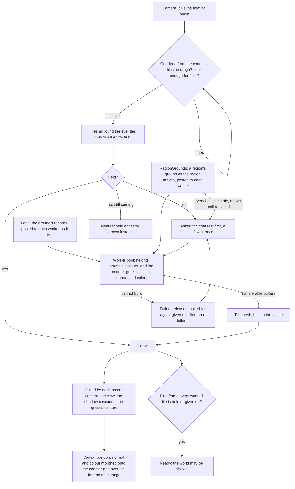

# Terrain

The world is a single connected land, so its ground is one heightfield rather than a set of scenes. It is drawn at the detail the camera needs and generated only within reach of the camera, so its cost follows the camera and never the size of the continent.

## How it works

- **A quadtree of equal tiles.** Every tile is the same grid of cells, and each level's tiles are twice the side of the level below and are drawn out to twice the distance (`TerrainOptions`). `selectTerrainTiles` walks the coarsest tiles tiled around the eye and descends by true three-dimensional distance to each tile's bounds, so detail follows the camera's height as well as its position. A tile in its level's range but too far for the level below is drawn at its level. A nearer one tries its four children, and a child out of even its own range is still drawn at its level, fully morphed onto its parent's grid. The walk with the view's frustum decides what is asked for first and when the ground is ready. A second walk with no frustum decides what is held and drawn, all round the eye: drawn from the view's walk alone, a turn of the camera would find ground not yet generated with the sky showing through, the hills just off screen would cast no shadow into the view, and the grass's capture would hold only the ground in front. Nothing bounds the world: the coarsest level simply reaches its range in every direction.
- **Vertices morph, so nothing pops.** Each vertex carries the position it collapses onto on the next level's grid, the even vertex beside it, with its tile's level in the fourth component, and the normal and colour the next level has there, its normal taken across that level's wider cells (`computeTerrainTile`). The ground material (`createTerrainMaterial`) morphs every vertex's position, normal and colour toward them over the far end of its level's range, by its distance from the eye, so a tile reaching the end of its range already is the coarser tile that replaces it, and no seam needs stitching. The normal and colour morph with the position: a normal left at its own level's, taken across cells half as wide as its parent's, would switch a patch of hill's shading the moment its tile changed level, and the ramp's hard step would show the patch vanishing and coming back. The morph starts a tile's diagonal past half its level's range (`getTerrainMorphStart`): a tile splits into its children once its bounds come within half its range, its farthest vertex then stands no more than its diagonal beyond them, so a splitting tile is wholly at its own level and its children, fully morphed onto its grid, draw it unchanged. A vertex's distance is measured as the selection measures a tile's, the eye's height counting only past the band every tile's bounds span. The morph starts from the tile's diagonal rather than a fixed share of the range, since a fixed start would have a splitting tile's far side most of the way onto the next level's grid while its children drew their own, changing a piece of hill at every split. The morph is the material's position node, which the shadow passes use too, so it is measured from the view's eye, a uniform the terrain writes each frame, and never from the camera rendering: each shadow cascade has a camera of its own that moves whenever the view turns, and morphing by it reshaped the ground the cascade drew, so patches of the hills flickered between lit and shadowed on every turn. Measured from one eye, every pass draws the same ground and shadows fall on it as it is drawn.
- **Tiles are generated off the main thread.** A small pool of workers each runs the region's height and colour functions over a tile's grid, two vertices wider on every side so each normal, its own level's and the next's, comes from its neighbours and a tile's edge normal matches its neighbour's. The arrays come back as transferable buffers, and every tile shares one index buffer. A worker imports the engine through its `genshin-engine/terrainWorker` subpath, the generators it runs and three's math, never the package's own entry, so it loads none of the renderer, its nodes or its passes before its first tile; its suite scans the worker's import graph and fails the moment it reaches any package but three.
- **Each worker is loaded with its ground as it starts.** The terrain posts each worker a `Load` message before anything else, carrying the records the world read before it opened (`TerrainWorkerGround`): Windrise's base ground, the field placing the ground's layers, the surfaces painting them and the water's level. The worker builds its height, paint and flower functions from them and keeps them for its life. A worker takes its messages in the order they were posted, so the load is handled before the first tile with nothing awaited. A tile asked for before its load is queued and answered in order once the load arrives.
- **A region's ground is laid over as the region arrives.** A region's ground is read with its data as it first comes within reach and kept from then on, since the ground is drawn past the reach a region is released at (`useRegionData`). The terrain posts each worker the grounds so far in a `RegionGrounds` message, which every tile asked for after is raised by, and refreshes its cache (`TileStreamer.refresh`) over the tiles the arriving ground changes: each tile held or generating whose sampled rectangle (`getTerrainTileBounds`, the tile and the vertices its normals read past it) meets the ground's reach (`getTerrainOverlayBounds`) is asked for again, each held one drawn until its replacement arrives, a far ring's tile written back into its own slot, so a tile built before the ground arrived never stays over it. A ground's reach is the rectangle round its features, its level, whose reach holds its hills', and its residual's fade, grown out to the 64 m cells its items are filed in, since a point reads every item filed under its cell; past it the ground laid over Windrise's draws Windrise's very heights, so a tile past it is kept rather than built again over the heights it holds (`getTerrainOverlayBounds.test.ts` fails for a reach that misses a changed height). A residual with no fade reaches everywhere. A finest tile's flowers read the ground half a metre past their tile, within its heights' metre of padding. No tile is settled until its replacement arrives, so a world readying under a region whose ground has just arrived waits on the tiles that ground changes, and the terrain is not ready before every region in reach has arrived or failed (`isGroundSettled`), so a ground arriving after its first view's tiles were built still holds ready on the tiles it rebuilds. Every region's ground stands within Windrise's heights, so the tiles' boxes are bounded by Windrise's alone (`createWorldHeight.test.ts` fails for one that does not).
- **A cache, asked coarsest first.** `createTileStreamer` holds as many tiles as a selection does, every tile round the eye among them, asks for the coarsest missing ones the view wants first, then those round it, only a few at once, and frees the tile wanted longest ago once the cache is full, never one wanted, drawn or round the eye this frame; a tile arriving after the view moved on counts as wanted when it was last wanted, so it is freed before one in view. Until a tile arrives, `resolveTerrainDraws` draws its nearest held ancestor in its place and drops whatever that ancestor covers, so the ground is always covered once, coarser for a moment where it is still streaming.
- **Every held tile is a mesh, shown only while drawn, and each pass culls by its own camera.** A tile coming back into range costs a flag, not a rebuild. Drawn all round the eye, the ground is the same whichever way the camera looks: the view culls the tiles behind it, a shadow cascade keeps the hills off screen that shade what is on it, and the grass's capture keeps the ground under it. The terrain writes the tiles it draws each frame into a selection its parent passes, which whatever reads the ground, the grass's footing among it, compares against what it last read.
- **A lost tile is retried, then given up, and the ground still settles.** A tile a worker cannot build comes back as a failure with its key. Each tile asked of the pool is held by the worker it went to (`createTileHolders`), and when a worker errors or cannot read a message, the tiles it holds are failed while the other workers keep generating, so one worker's errors never give up a tile a healthy worker is building. An answer from a worker that no longer holds the tile is refused, so the first worker's late copy never stands in for the second's. `fail` frees the tile's slot, so a later frame that still wants it asks again, of the next worker in turn. After `MAX_TILE_ATTEMPTS` (three) failures the tile is given up for the session, logged once, and counts as settled, drawn by its nearest held ancestor. A tile whose compile fails is released the same way.
- **The ground is ready once the finest tiles the view wants have settled.** Every finest-level tile the view wants (level 0, drawn at the eye's own resolution) is held or given up before the terrain reports ready, and the world's screen is ready only then, with the regions in reach of the view fetched as well, so a host showing the world never shows its first frame over finest ground still streaming in. The coarser rings the view wants keep streaming after ready and never hold it: a coarser tile still streaming is drawn as its nearest held ancestor, as the view draws any tile not yet held. A lost tile never holds `ready` on its own. The selection runs before every frame even while a paused canvas draws none, so a world loading under the opening streams its ground meanwhile, and it brings the camera's matrices up to date first, since no render has yet.
- **The origin floats.** Single-precision positions tremble far from the origin, so once the camera has gone a kilometre out across the ground, `useFloatingOrigin` moves the world back under it (`computeOriginShift`). The camera and its controls' target are pulled back by the shift, rounded to a coarsest tile so tile edges stay on whole numbers, and the group every placed thing sits in is offset by the new origin. Tile keys stay in world coordinates, and the selection adds the origin to the camera, so it never sees the shift.

## What it costs to run

- **A frame's selection allocates nothing.** The quadtree, the draw resolution and the streamer's bookkeeping write into buffers kept for the page. The benches beside `selectTerrainTiles` and `resolveTerrainDraws` hold their cost flat from the origin to fifty kilometres out, at an eye on the ground and one high above.
- **A tile costs its vertices.** The bench beside `computeTerrainTile` holds its cost to the grid's size, with the region's noise on top.
- **Draws are the tiles in each pass's camera**, a few dozen in the view, each sharing the one ground material and the one index buffer; the tiles round the eye cost each pass a bounding-sphere test.
- **The far rings are one mesh a level, written a tile at a time.** A level past the shadows' reach is one mesh over slots of a tile each (`createTerrainRing`), made as the level's first tile arrives. A far tile is written into a free slot as it arrives, its positions moved to its place (`writeTerrainRingTile`), and only that slot's range of each attribute is uploaded; as it leaves, its slot is freed for the next. When every slot is held the ring doubles, copying what it holds, so a walk grows it rarely. Its bounds are its held tiles' boxes joined, and its index names the tiles the view draws (`writeTerrainRingIndices`), rewritten and uploaded as far as it draws only when that set changes. So no frame rebuilds a ring, which would lay the level's arrays end to end again, compute its bounds over every vertex and make its buffers anew on the frame that draws it. Its cost is the arrays it holds, not an object walk per tile; at Windrise's view a handful of far tiles are in sight, so the rings trim the scene's meshes by about a third and the frame's main thread by a few tenths of a millisecond, without cutting the view's draw calls.

## Key files

| File                                                                           | Role                                                                                              |
| :----------------------------------------------------------------------------- | :------------------------------------------------------------------------------------------------ |
| `packages/genshin-engine/src/terrain/selectTerrainTiles.ts`                    | The quadtree walk by distance and frustum                                                         |
| `packages/genshin-engine/src/terrain/createTerrainRing.ts`                     | A far level's mesh, a tile written into a slot of its own as it arrives                           |
| `packages/genshin-engine/src/terrain/writeTerrainRingTile.ts`                  | One tile's arrays written into its slot, moved to its place                                       |
| `packages/genshin-engine/src/terrain/writeTerrainRingIndices.ts`               | The index of the far tiles a level's mesh draws                                                   |
| `packages/genshin-engine/src/terrain/resolveTerrainDraws.ts`                   | Held tiles drawn, a held ancestor in place of one still coming                                    |
| `packages/genshin-engine/src/terrain/computeTerrainTile.ts`                    | One tile's heights, normals, colours and the coarser grid's                                       |
| `packages/genshin-engine/src/terrainWorker.ts`                                 | The engine's entry for a terrain worker: the generators it runs, nothing that draws               |
| `packages/genshin-engine/src/terrain/createTerrainMaterial.ts`                 | The unoutlined toon ground, morphing by distance                                                  |
| `packages/genshin-engine/src/terrain/getTerrainMorphStart.ts`                  | Where a level's morph starts, past any tile that splits                                           |
| `packages/genshin-engine/src/streaming/createTileStreamer.ts`                  | The tile cache: asked coarsest first, freed least recently wanted                                 |
| `packages/genshin-engine/src/terrain/getTerrainOverlayBounds.ts`               | The rectangle past which a ground laid over another changes no height                             |
| `packages/genshin-engine/src/terrain/getTerrainTileBounds.ts`                  | The rectangle a tile's heights are read over, its padding included                                |
| `packages/genshin-engine/src/world/computeOriginShift.ts`                      | When the world is moved back under the camera, and by how much                                    |
| `packages/genshin-world/src/components/World/Terrain/Index.vue`                | The worker pool, the tile meshes, and the frame's selection                                       |
| `packages/genshin-world/src/services/world/createTileHolders.ts`               | Which worker holds each tile asked of the pool, so a worker's error fails only the tiles it holds |
| `packages/genshin-world/src/workers/terrainTile.worker.ts`                     | A tile generated from the heights and colours, with its flowers                                   |
| `packages/genshin-world/src/models/world/TerrainWorkerMessage.ts`              | What the terrain posts a worker: its ground once, then each tile                                  |
| `packages/genshin-world/src/models/world/TerrainWorkerFailure.ts`              | What a worker answers a tile it could not build with: the tile's key                              |
| `packages/genshin-world/src/models/world/TerrainWorkerGround.ts`               | The records a worker is loaded with before its first tile                                         |
| `packages/genshin-world/src/composables/useFloatingOrigin.ts`                  | The shift applied to the camera, its controls and the world's group                               |
| `packages/genshin-world/src/services/windrise/createWindriseTerrainOptions.ts` | The quadtree: tile size, levels, ranges, every fitted ground's bounds                             |
| `packages/genshin-engine/src/terrain/createTerrainShapeHeight.ts`              | A ground composed in layers: hills, sharp features and residual                                   |
| `packages/genshin-world/src/services/world/createWorldHeight.ts`               | The world's ground: every region's laid over Windrise's, each fitted one on its base              |
| `scripts/src/services/genshinAssets/fit/fitGaussianHills.ts`                   | The hills fitted to a heightfield, widest first, with their error                                 |

## Notes

- **Heights are a region's function.** Windrise's is our own Gaussian hills over a base height, composed by [terrain shape height](../terrain-shape-height/design.md) (`createTerrainShapeHeight`), several thousand of them fitted by `genshin:assets fit windrise` to the game's terrain tiles round the oak's foot, which stands at the origin, with the plateaus, cliffs and ridges the fit places where the hills smear them. The fit prints the error it leaves, under a metre round the oak and a few metres at the valley's edge, and publishes the heights the ground stands between, which with every other fitted ground's bound every tile's box. Every other region's ground is laid over Windrise's into one ground (`createWorldHeight`, [region buildings](../region-buildings/design.md)): a fitted region's ground is lifted onto its own base where its hills stand, and past every fitted extent the ground falls back to Windrise's base, raised by each unfitted region's plateaus where its places stand. Its colours are painted in layers, each lying where its fitted field puts it ([ground paint](../ground-paint/design.md)). Every region's ground is fitted the same way, its hills, sharp features and residual held to a gate its own ground sets ([scene derivation](../scene-derivation/design.md), "Each region's ground").
- **A tile is its own mesh, not an instance.** The proposal's single instanced draw over a height texture array would take the ground to one draw call, at the price of a texture array and an indirection table to stream into. With a few dozen tiles in view the draws are within the engine's budget, so it waits ([one instanced draw](../../../deferred/genshin/terrain-instanced-draw/design.md)).
- **The finest range must clear twice a finest tile's diagonal.** The morph runs from a tile's diagonal past half a level's range to the range, so half of what the finest range clears beyond twice the diagonal is the distance a vertex blends over. Windrise's blends over about nine metres; at a share of a range as wide as the CDLOD paper's, the ground would draw several times the tiles.

## Sources

- [CDLOD: Continuous distance-dependent level of detail for rendering heightmaps](https://github.com/fstrugar/CDLOD), Filip Strugar, 2010: the quadtree of regular grids, a level of detail chosen by true three-dimensional distance, and morphing between levels in place of stitching.
- [Transferable objects](https://developer.mozilla.org/en-US/docs/Web/API/Web_Workers_API/Transferable_objects), MDN: handing tile buffers from the worker without copying.
