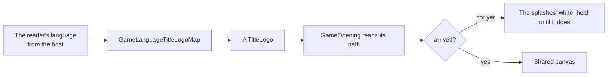

# Title splash

The opening's title splash shows the game's title logo in flat grey on white (`{data-root}/genshin-parity/references/title-splash.png`). The global client shows it after the publisher's logo and before the health notice (`{data-root}/genshin-parity/captures/yt-sQNqMfmfkZU.mp4`); mainland China's, which a Simplified Chinese reader is shown (`packages/genshin-world/src/services/splash/GameLanguageGameClientMap.ts`), opens on it with no publisher's logo, its publishing licence under it (`{data-root}/genshin-parity/captures/bili-av532052219.mp4`). The game draws a different logo for some client languages, and the splash draws the reader's.

- **Five logos, by language.** Simplified Chinese shows 原神 alone, Traditional Chinese 原神 over "Genshin Impact", Japanese 原神 over "Genshin", and Korean 원신 over "Genshin Impact"; every other language shows the English "GENSHIN IMPACT" (`{data-root}/genshin-parity/extracted/login/titleLogos/Logo_CHS_Pure.png`, `Logo_CHT_Pure.png`, `Logo_JPN_Pure.png`, `Logo_KOR_Pure.png` and `Logo_ENG_Pure.png`, each showing the words its bullet names). Those are the five sprites the game's login interface picks between by language.
- **Each is traced from the game's own sprite.** The white sprites, flattened on black, are traced at four times their size (`{data-root}/genshin-parity/Logo_ENG_Pure-trace-0-0.svg`, a 4096 by 2752 viewBox over the sprite's 1024 by 688), and the Latin line under the Chinese, Japanese and Korean marks is traced again as a region of its own (`{data-root}/genshin-parity/Logo_CHT_Pure-trace-187-525.svg`, `Logo_JPN_Pure-trace-195-516.svg`, `Logo_KOR_Pure-trace-301-536.svg`), where its i's dots are not taken for specks of the whole canvas. The sprites are references and never ship; the traced paths do, published as the world's `splash/titleLogo/<logo>` records (`packages/genshin-world/src/generated/gameDataLock.json`) by `pnpm -C scripts genshin:assets fit login` (`fitTitleLogos`, `scripts/src/services/genshinAssets/fit/fitTitleLogos.ts`), which exports the sprites from the installed game itself, so a patch that changes a logo is one run. The opening reads the reader's logo from the hosted game data as it mounts (`readTitleLogoPath`, `packages/genshin-world/src/components/Game/Opening/Index.vue`) and holds the white the splashes play on until it arrives, so the first splash never shows a title with no logo; the sequence hands the path to the splash (`packages/genshin-world/src/components/Splash/Sequence/Index.vue`), which draws it as given ([hosted game data](../hosted-game-data/design.md)).
- **One canvas places them all.** The game's five sprites share one 1024 by 688 canvas (`{data-root}/genshin-parity/extracted/login/titleLogos/`), so the splash places that canvas once, fitted so the English logo's ink lands where the English client's does against its recording and every other logo then stands where its own client's does; the two splashes are scored by the `title-splash` and `title-splash-mainland` rows of `scripts/src/services/genshinParity/shared/ParityReferenceMap.snapshot.md`. The English texture's trace and the wiki's render of the English logo agree in shape to a tenth of a percent, which is what fits the canvas to the recording.
- **Mainland China's client carries its licence.** Under its logo it prints four lines of its publishing licence (`{data-root}/genshin-parity/references/title-splash-mainland.png`), the game's own text, measured off a public recording of its launch (`bili-av532052219`, `{data-root}/genshin-parity/captures/bili-av532052219.mp4`): forty units apart over the screen's foot, fading in 400 ms behind the logo (its timing declared in `packages/genshin-world/src/components/Splash/Title/Index.vue`). Its splash holds and fades on its own timings, and its health notice, in mainland China's own words, follows at once (`GameLanguageGameClientMap`, `{data-root}/genshin-parity/captures/bili-av532052219.mp4`). The licence's second line runs narrower than the recording's, since its digits and Latin letters fall back to a system face.
- **The title screens' text is the interface library's substitute.** Their face is Signika standing in for the game's HYWenHei, as every screen's is ([interface library](../interface-library/design.md)).
- **The white is the PC client's.** Every white of the opening, its splashes, its notice and the login screen's fades, is `GAME_WHITE`, #fdfdfd (`packages/genshin-interface/src/services/constants.ts`), a step under full white, as the PC client's frames read 253 on the user's own recording and on a 2023 one alike (`{data-root}/genshin-parity/references/title-splash.png`, background 253). The English splash is compared with the 2023 recording (`scripts/src/services/genshinParity/shared/ParityReferenceMap.ts`); mainland China's recording is an older build drawn on full white (`{data-root}/genshin-parity/references/title-splash-mainland.png`, background 255), so its comparison carries the step.
- **Its name is the game's.** The splash is an image to a screen reader, named by the game's own window title in the reader's language (`packages/genshin-world/src/components/Splash/Title/Index.vue`, `GameTextKey.GameTitle` in `packages/genshin-text/src/models/GameTextKey.ts`).

## Key files

| File                                                                      | Role                                                                                |
| :------------------------------------------------------------------------ | :---------------------------------------------------------------------------------- |
| `packages/genshin-world/src/components/Splash/Title/Index.vue`            | The splash: the reader's logo on the shared canvas                                  |
| `packages/genshin-world/src/models/splash/TitleLogo.ts`                   | The game's five title logos                                                         |
| `packages/genshin-world/src/services/splash/GameLanguageTitleLogoMap.ts`  | The logo each language's client shows                                               |
| `packages/genshin-world/src/services/splash/GameLanguageGameClientMap.ts` | The build each language's reader plays, global or mainland China's                  |
| `packages/genshin-world/src/services/splash/readTitleLogoPath.ts`         | One logo's traced path on the shared canvas, read from the hosted game data         |
| `packages/genshin-world/src/components/Game/Opening/Index.vue`            | Reads the reader's logo before the first splash, holding the white until it arrives |
| `scripts/src/services/genshinAssets/fit/fitTitleLogos.ts`                 | The logos exported from the game, traced and spliced, as the world's data           |

## Open

- [ ] **Five logos: the login interface picks between them by language** — no source yet: no export or wiki page holds the login interface's language-to-logo choice, and the extracted login data names none of the five sprites.
- [ ] **A patch that changes a logo is one run** — no source yet: the fit has not been rerun against a patched install.
- [ ] **Every other logo stands where its own client's does** — no source yet: the parity snapshot measures only the English and the Simplified Chinese mainland splashes, not the Traditional Chinese, Japanese or Korean marks.
- [ ] **The English trace agrees with the wiki's render to a tenth of a percent** — no source yet: no render of the English logo is in `{data-root}/cache/genshin-wiki/`.
- [ ] **The licence's forty-unit spacing, its 400 ms fade and the splash's own hold** — no source yet: the bili recording has not been read frame by frame for these timings.
- [ ] **The licence's second line runs narrower than the recording's** — no source yet: the licence line's width has not been measured against the recording.
- [ ] **253 on the user's own recording** — no source yet: no still of the PC splash from the user's own recording is in `{data-root}/genshin-parity/references/`.
- [ ] **A Simplified Chinese reader is shown mainland China's client** — no source yet: `{data-root}/genshin-parity/references/cn-login.png`, not yet read for which client a Simplified Chinese reader sees.

## Sources

- The user's own recording of the PC client's splash, which the near-white is read from; no still of it is kept yet, as the Open list records.
