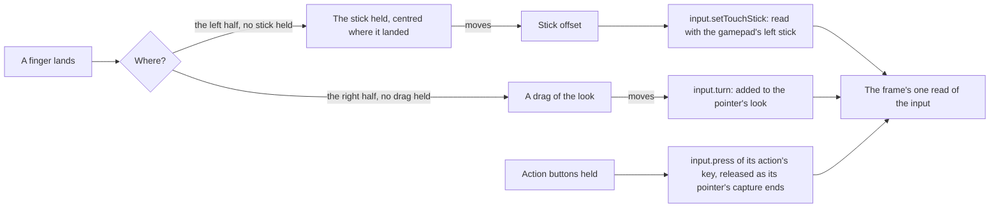

# Touch controls

A phone or a tablet has no keys or mouse to move and look with, so the game's mobile client draws its controls over the world (`{data-root}/genshin-parity/captures/mobile-touch.png`, a still with its action buttons over the world). The world's touch controls are drawn the same way, as the bottom layer of the [HUD](../hud/design.md), whenever the device's main pointer is a finger (`packages/genshin-world/src/components/World/Session/Index.vue`).

## How it works

- **One input for every device.** The touch controls write into the engine's `input` rather than moving the camera themselves: the stick's axes are added to the gamepad's left stick, a drag's turn to the pointer's look, and each of the HUD's action buttons holds its action's key code as a key would (`packages/genshin-engine/src/input/createInput.ts`, `packages/genshin-world/src/components/Hud/Stick/Index.vue`, `packages/genshin-world/src/components/Hud/Touch/Index.vue`, `packages/genshin-world/src/components/Hud/Actions/Index.vue`). So the character and its camera, and photo mode's camera, read one move and one look whatever drives them.
- **The stick appears where a thumb lands.** The owner's account of the mobile client is the source: the stick is drawn nowhere at rest, and a finger landing on the screen's left half brings it up, its group centred on the landing point and pulled in from the screen's edges so the whole ring stays on the screen, with the margin the fixed placement kept on the 16:9 recording (199.5 units in and 172.5 up from the screen's edges to the group's centre, less the back's 102 unit radius; `TOUCH_STICK_CLEARANCE_X` and `TOUCH_STICK_CLEARANCE_Y` in `packages/genshin-world/src/services/hud/constants.ts`). The area is the left half, full height, under every other HUD piece. The group's back and head are the game's `GrpJoyStick` and `ImgJoyStickHead` (`{data-root}/genshin-parity/extracted/character/interface/json/GameObject/GrpJoyStick.json`, `{data-root}/genshin-parity/extracted/character/interface/json/GameObject/ImgJoyStickHead.json`), drawn at their rects' sizes and scaled by the screen (`packages/genshin-world/src/components/Hud/Stick/Index.vue`, with its rects named in `packages/genshin-world/src/models/hud/HudInterfaceRectName.ts`). The 102 unit radius is the group's rect's half: its centre stands 102 in and up within the tree (`{data-root}/genshin-parity/extracted/character/interface/json/RectTransform/RectTransform#324625.json`, lines 9 and 10).
- **A thumb on the left half holds the stick; a thumb on the right half drags the look.** A finger landing on the left half holds the stick and keeps its moves wherever they go until it lifts; its offset from where it landed over the stick's reach is the move, the reach being the head's travel in pixels, the back's size less the head's, halved, and a finger pushed past it is a full push in its direction (`packages/genshin-world/src/components/Hud/Stick/Index.vue`). A finger landing on the right half where no HUD piece takes it drags the look by how far it moves (`packages/genshin-world/src/components/Hud/Touch/Index.vue`). The two halves are disjoint, and a press on a HUD piece is the piece's on either.
- **The head moves within the ring and shows its push on its rim.** Held, the stick is a faint ring with four chevrons inside it, and its head travels within the ring toward the push as the thumb drags, the chevrons with it. A push shows as a mark on a quarter of the rim turned to its direction. Below the push the engine walks at (`WALK_MOVE_MAGNITUDE` of 0.5 in `packages/genshin-engine/src/locomotion/constants.ts`, read by `packages/genshin-engine/src/locomotion/createCharacterController.ts`) it is a thin teal arc nearer the head; past it, as the character runs, a cyan arc at the rim with an arrow at its middle, inside the back's faint dark ring, which shows only then. Lifting the finger fades the stick out with nothing pushed, and the left half takes the next landing (`packages/genshin-world/src/components/Hud/Stick/Index.vue`).
- **The action buttons are the HUD's.** The attack, the jump, the sprint and, for a bow's wielder, the aim stand in the HUD's own rect for its action buttons beside the skill and burst (`packages/genshin-world/src/components/Hud/Actions/Index.vue`, which releases the aim only for a bow), measured off the mobile client's recording ([HUD](../hud/design.md)). The jump is the character's jump, as Space is, and the tuning panel's free camera's rise (`packages/genshin-world/src/components/Hud/Actions/Index.vue`).
- **Only on a touch screen.** The controls are drawn when the device's main pointer is coarse (`(pointer: coarse)`), which the world's session reads and hands to the HUD, so a computer's clicks still reach the world to lock the pointer (`packages/genshin-world/src/components/World/Session/Index.vue`). Hiding the HUD hides them, and they let go of whatever they held (`packages/genshin-world/src/components/Hud/Actions/Index.vue`, `packages/genshin-world/src/components/Hud/Stick/Index.vue`).

## Key files

| File                                                          | Role                                                               |
| :------------------------------------------------------------ | :----------------------------------------------------------------- |
| `packages/genshin-world/src/components/Hud/Stick/Index.vue`   | The stick, appearing where a thumb lands on the left half          |
| `packages/genshin-world/src/components/Hud/Touch/Index.vue`   | The look's drag on the right half, under the pieces                |
| `packages/genshin-world/src/components/Hud/Actions/Index.vue` | The attack, aim, jump and sprint buttons                           |
| `packages/genshin-world/src/services/hud/constants.ts`        | The drag's look turn, the stick's clearance and its fade           |
| `packages/genshin-engine/src/input/createInput.ts`            | `press`, `release`, `setTouchStick` and `turn`, read with the rest |

## Notes

- **The stick's sizes are the game's canvas units.** Its back and head scale with the screen as the game's do, so its reach and its clearance are a share of the screen rather than a fixed distance on the glass. Its rings and arcs are measured on the newest recording, which another phone's draws 0.9 times as large, so the game sizes it by device. The chevrons' shape, the back's stroke and the arrow's size are provisional, too small on the recordings to measure, and so is the look's turn for a pixel of a drag, until a drag is measured ([roadmap](../../../changes/genshin-roadmap/tasks.md)). The stick's fade is provisional too, as the game's fade on it is not measured.
- **The clearance is the 16:9 recording's on every screen.** The owner's account gives where the stick appears, not the margin a wider phone's stick keeps from its edges, so the clamp keeps the 16:9 clearance on every shape (`packages/genshin-world/src/services/hud/constants.ts`), provisional until that margin is measured (under Open). The fixed stick's per-shape placement, which stood further in on the wider recordings, is gone with it.
- **The tuning panel's free camera rises by touch but does not fall.** The game's touch layout has no button to descend, so the free camera flown by touch climbs on the jump button and has no way back down (`packages/genshin-world/src/components/Hud/Actions/Index.vue`, whose four buttons include no descend).

## Sources

- [Controls](https://genshin-impact.fandom.com/wiki/Controls), Genshin Impact Wiki: the mobile client's every action done by touching the screen, the camera turned by touching and dragging it, and the jump that moves upward where the free camera flies.
- [Game accessibility guidelines](https://gameaccessibilityguidelines.com/full-list/): support for several input devices.
- The owner's account of the mobile client: the stick is drawn nowhere at rest, a finger landing on the left half brings it up where it lands, its head moves within the ring as the thumb drags, and it disappears when the finger lifts.

## Reference

- `hud-world-pickup.png` (`{data-root}/genshin-parity/references/hud-world-pickup.png`) — the mobile client's play screen from a public recording, the [HUD](../hud/design.md)'s reference, which shows the stick at rest, a look the owner's account contradicts (under Open).
- The held stick, measured on three public recordings of the mobile client: [d9ZWM3cAlf0](https://www.youtube.com/watch?v=d9ZWM3cAlf0) (16:9, 6.1, 33 held frames), [HqQob991B8Q](https://www.youtube.com/watch?v=HqQob991B8Q) (19.5:9, 9 held and 5 at rest) and [quYgZtHhIa4](https://www.youtube.com/watch?v=quYgZtHhIa4) (20:9, 17 held), none showing the thumb itself; their fixed placement is contradicted by the owner's account (under Open).
- `mobile-touch.png` — a recording of a drag of the mobile client's look (`{data-root}/genshin-parity/captures/mobile-touch.png`). On the wiki and YouTube, none found.

## Open

The stick's appearance on the recordings, and the owner's account that contradicts their fixed placement, are the [spec's](spec.md) open items, and the recordings are named in the reference above.

- [ ] **The action buttons stand in the HUD's rect beside the skill and burst, measured off the recording** — no source yet: `touch-controls-mobile.mkv` is in the captures, but no measure of its buttons is recorded. Frames of `{data-root}/genshin-parity/captures/touch-controls-mobile.mkv` at about 30 to 57 s show the attack button with smaller buttons beside it, but no HUD rect is readable.
- [ ] **The stick's rings and arcs are measured on the newest recording, which another phone draws 0.9 times as large** — no source yet: the recordings are not in `{data-root}/genshin-parity/captures/`, so the 0.9 is not read back.
- [ ] **The game's touch layout has no button to descend** — no source yet: no frame of `touch-controls-mobile.mkv` is recorded as showing the layout's buttons. Frames of `{data-root}/genshin-parity/captures/touch-controls-mobile.mkv` at 0 to 80 s and in the water at 58 s show the attack button and smaller ones beside it, none reading as a descend control, but no dive or fall frame was viewed.
- [ ] **The recordings' fixed placement, 199.5 and 172.5 units on 16:9 and 87 and 95 units further in on 19.5:9 and 20:9** — contradicted by the owner's account of the mobile client: the stick is not fixed, it appears where a thumb lands on the left half, so a recording's placement is not the game's at every landing. The recordings "d9ZWM3cAlf0", "HqQob991B8Q" and "quYgZtHhIa4" are not in `{data-root}/genshin-parity/captures/`, so their frame counts and measures are not read back, and the placement the 16:9 measure gives is kept only as the clamp's clearance (`packages/genshin-world/src/services/hud/constants.ts`).
- [ ] **The stick's rest look, and its head that never travels, on the mobile client's three recordings** — contradicted by the owner's account of the mobile client: the stick is not drawn at rest, and its head moves within the ring as the thumb drags. The held look, a faint ring with four chevrons and the rim's marks, is not contradicted and is kept.
- [ ] **The margin a wider phone's stick keeps from the screen's edges** — no source yet: the owner's account gives where the stick appears, not its margin on a 19.5:9 or a 20:9 screen; a recording of a landing near such an edge would measure it.
