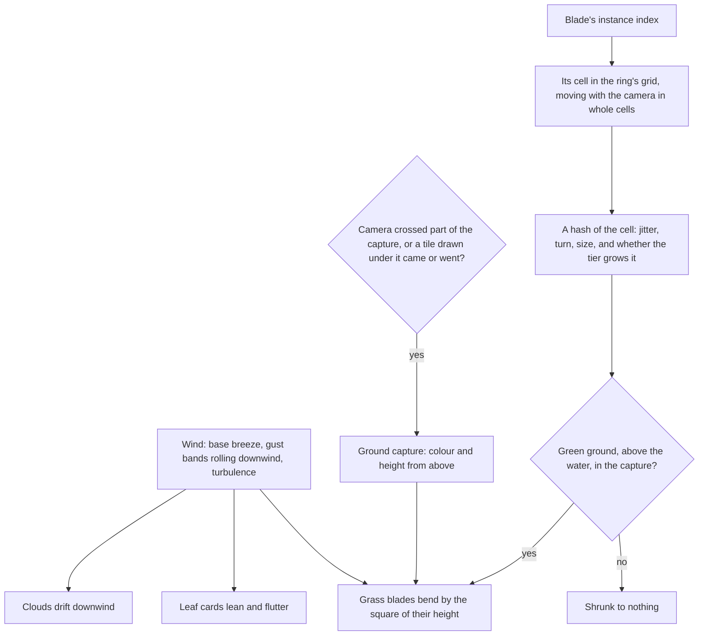

# Vegetation

Wind is what makes Genshin's meadows feel alive. Gusts roll across Mondstadt's grass in visible waves, crowns sway, and the clouds drift overhead. Here one wind field moves all of them together, and grass grows at the density the game shows without a blade being stored.

## How it works

- **One wind field.** The wind at a point on the ground (`createWindNode`) is the region's base breeze along its direction, gust bands travelling downwind that swell and fall, and a little noise so neighbouring plants never move in step. It is a TSL function of world position `packages/genshin-engine/src/nodes/createWindNode.ts`, so every sampler reads the same field: the grass, the trees' leaves, and the clouds, which drift downwind by its strength. Its direction, strength and gusts are `WindUniforms` `packages/genshin-engine/src/models/wind/WindUniforms.ts`, which a region sets. Mondstadt's is a steady breeze from the west with gusts every half minute. The gust band has a CPU reference, `computeWindGust` `packages/genshin-engine/src/nodes/computeWindGust.ts`, which the node is the GPU form of: a change to the gust lands in both, as the outline offset pair does.
- **Grass is blades generated in the vertex stage.** A ring is one draw of the same blade shape (`computeGrassBlade` `packages/genshin-engine/src/vegetation/computeGrassBlade.ts`), once per cell of a square grid around the camera (`createGrassMaterial` `packages/genshin-engine/src/vegetation/createGrassMaterial.ts`). A blade's instance index is its cell. The grid moves with the camera in whole cells, so a blade stays where it grew. A hash of the cell jitters the blade within it, turns it, sizes it and decides whether the quality tier grows it `packages/genshin-engine/src/vegetation/createGrassCell.ts`, so no blade is stored.
- **Two rings, then the ground.** The near ring is dense and fine under the eye. The middle ring is sparse, with taller, wider blades, and grows from where the near ring fades `packages/genshin-world/src/components/World/Grass/Index.vue`. Past it the terrain's own green carries the field, and since a blade takes the ground's colour, the rings fade into it with no seam (`GrassRing`).
- **Blades stand on a capture of the ground.** A camera looking straight down draws only the terrain's layer into a small half-float target: the ground's colour, and its height in alpha (`createGroundCapture` `packages/genshin-engine/src/vegetation/createGroundCapture.ts`, `renderGroundCapture` `packages/genshin-engine/src/vegetation/renderGroundCapture.ts`). A blade reads its footing and its colour there. It grows only on green ground, never on rock or sand, and only above the water `packages/genshin-engine/src/vegetation/createGrassCell.ts`. The capture camera culls by its own frustum and the terrain draws its tiles all round the eye, so the capture holds the ground under its whole square whichever way the view looks. The scene creates it and the grass redraws it; the rain's splashes stand on it too. It is redrawn only when the camera has crossed part of it or a tile drawn under it has come or gone (`checkTerrainDrawsChanged` `packages/genshin-engine/src/terrain/checkTerrainDrawsChanged.ts`), never on a tile arriving elsewhere, and never on a turn of the camera, which changes nothing the terrain draws.
- **Grass shades as a field.** Every blade takes the ground's upward normal instead of its own, and a gradient from a darker root to a lighter tip in the ground's colour, so a meadow toon-shades as one surface with light rolling across it, as Genshin's grass does, rather than a noisy carpet of lit and shaded blades. Wet, the field darkens and takes the sun's glint off that one normal as the ground does ([weather](../weather/design.md)). Blades receive the sun's shadows and cast none `packages/genshin-engine/src/vegetation/createGrassMaterial.ts`.
- **The wind bends a blade by the square of its height**, so the root stays planted and the tip travels, and the blade dips a little as it bends `packages/genshin-engine/src/vegetation/createGrassBladePoint.ts`.
- **The character bends the grass it walks through.** A trail of bends sits on a square of ground round the character, 16 metres across and 64 texels a side `packages/genshin-engine/src/vegetation/constants.ts`, and each step the character's footing is stamped with its direction of travel and every stamp fades over about a second and a half `packages/genshin-engine/src/vegetation/constants.ts` (`stepGrassTrail` `packages/genshin-engine/src/vegetation/stepGrassTrail.ts`). The square is toroidal: a texel holds one world cell `packages/genshin-engine/src/vegetation/computeGrassTrailTexel.ts`, so the square moves with the character by clearing the texels it leaves behind, and the grass reads it wrapped (`sampleGrassTrail` `packages/genshin-engine/src/nodes/sampleGrassTrail.ts`). Past the square's reach the bend fades out, where a texel holds other ground. The square's size, its resolution and the fade are provisional (`GRASS_TRAIL_*` `packages/genshin-engine/src/vegetation/constants.ts`), with their basis in the [trees and scatter](../../../changes/genshin-trees-and-scatter/design.md) change.
- **Crowns sway.** The leaf material leans a crown downwind, more the higher up the tree, and each patch of cards flutters on its own phase (`createLeafMaterial` `packages/genshin-engine/src/nodes/createLeafMaterial.ts`). The lean is the position node, so the crown's shadow sways with it.

## What it costs to run

- **A draw per ring, of the blades in view.** Each ring is one instanced draw with no per-blade data. A compute pass tests every cell of the ring's grid against the view, the fade and whether it grows at all, and writes the cells it keeps into the draw's indirect instance count (`createGrassCulling` `packages/genshin-engine/src/vegetation/createGrassCulling.ts`, `createInstanceCulling` `packages/genshin-engine/src/culling/createInstanceCulling.ts`), so a blade out of view is not drawn and the CPU never sees the count. A cell's root, its top as it stands and its tip as the wind and the trail bend it are each tested, widened by a tenth of the clip space, so a blade whose root lies just outside the view is kept while its top shows, and one whose bent tip comes into view is kept while its root and top do not. The tip is the same point the blade is drawn at (`createGrassBladePoint` `packages/genshin-engine/src/vegetation/createGrassBladePoint.ts`), so the test cannot drift from the draw.
- **Blade density is the first thing a tier lowers** (`QualityTierSettingsMap` `packages/genshin-engine/src/renderer/QualityTierSettingsMap.ts`), since the look survives thinner grass better than it survives lost shadows.
- **The ground capture is one small render of the terrain's tiles**, only when it is owed.

## Key files

| File                                                              | Role                                                                        |
| :---------------------------------------------------------------- | :-------------------------------------------------------------------------- |
| `packages/genshin-engine/src/nodes/createWindNode.ts`             | The wind at a point on the ground: breeze, gusts and turbulence             |
| `packages/genshin-engine/src/nodes/computeWindGust.ts`            | The gust band at a point on the CPU, the reference for the wind node's gust |
| `packages/genshin-engine/src/vegetation/createGrassMaterial.ts`   | A ring's blades placed, grown, bent and shaded in the vertex stage          |
| `packages/genshin-engine/src/vegetation/createGrassBladePoint.ts` | A blade's point, bent by the wind and the trail, drawn and tested alike     |
| `packages/genshin-engine/src/vegetation/createGrassCell.ts`       | A grid cell's place, jitter, turn, size and whether it grows                |
| `packages/genshin-engine/src/vegetation/createGrassCulling.ts`    | The cells a ring's compute pass keeps in view                               |
| `packages/genshin-engine/src/culling/createInstanceCulling.ts`    | The per-instance compute pass and its indirect draw                         |
| `packages/genshin-engine/src/vegetation/stepGrassTrail.ts`        | The trail of bends the character leaves, stepped each fixed step            |
| `packages/genshin-engine/src/nodes/sampleGrassTrail.ts`           | The trail's bend at a point of the ground, read in the vertex stage         |
| `packages/genshin-engine/src/vegetation/computeGrassBlade.ts`     | The one blade shape every blade is                                          |
| `packages/genshin-engine/src/vegetation/renderGroundCapture.ts`   | The ground's colour and height under the camera, from above                 |
| `packages/genshin-engine/src/nodes/createLeafMaterial.ts`         | Leaf cards that lean and flutter in the wind                                |
| `packages/genshin-world/src/components/World/Grass/Index.vue`     | The rings, their tier's density, and when the capture is redrawn            |
| `packages/genshin-world/src/services/windrise/constants.ts`       | Mondstadt's wind and Windrise's grass rings                                 |

## Notes

- **Trees and flowers are their own pages.** A tree is a species drawn as its mesh or its impostor ([trees](../trees/design.md)), and the flowers no record places are scattered on each finest tile ([scatter](../scatter/design.md)); every placed plant, its culling and grass that parts for the character are [trees and scatter](../../../changes/genshin-trees-and-scatter/design.md).
- **A blade stands on the ground as captured, not as drawn.** The capture morphs the ground for the eye where it was captured, and the eye can move up to the recapture distance before it is redrawn, so far from the eye a blade can sit a few centimetres off the drawn ground, where no one sees it.

## Sources

- [Procedural grass in Ghost of Tsushima](https://gdcvault.com/play/1027214/Advanced-Graphics-Summit-Procedural-Grass), Eric Wohllaib, Sucker Punch Productions, GDC 2021: individual blades generated on the GPU with procedural shape and animation, acres of grass within a memory and frame budget, and wind moving a field as a whole.

## Open

- [ ] **Vegetation: the cell's culling test widened by a tenth of the clip space** — no source yet: the widening constant in the culling files, which `createGrassCulling.ts` does not hold.
- [ ] **Vegetation: a blade a few centimetres off the drawn ground far from the eye** — no source yet: a measured offset of a blade from the drawn ground at the recapture distance, which no record holds.
- [ ] **Vegetation: wet ground darkens the meadow and takes the sun's glint off the one normal** — no source yet: a wet-ground branch in the grass material, which the vegetation files do not name.
- [ ] **Vegetation: Mondstadt's wind is a steady breeze from the west with gusts every half minute** — no source yet: game data or a snapshot that holds this behaviour.
- [ ] **Vegetation: the rings fade into the ground's colour with no seam** — no source yet: a visual check of the seam on a recording, which no record holds.
