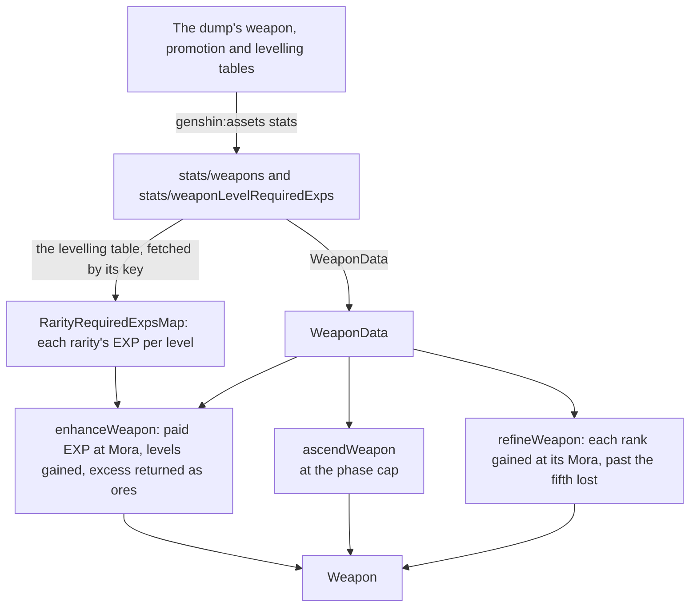

# Weapon enhancement

A weapon grows three ways a player spends on it: its level, its ascension phase and its refinement rank (`packages/genshin-world/src/models/weapon/Weapon.ts`). Levelling takes the EXP of enhancement ores and fodder weapons, ascension takes the Mora, items and Adventure Rank of the next phase, and refinement takes a copy or a refinement material and the Mora each rank costs. Each change is a pure function over the game's own tables that refuses what the weapon cannot pay for, so a weapon's state moves only through a checked rule (`packages/genshin-world/src/services/weapon/enhanceWeapon.ts`, `packages/genshin-world/src/services/weapon/ascendWeapon.ts`, `packages/genshin-world/src/services/weapon/refineWeapon.ts`). A refinement's passive is not built here: it acts through a character's kit, so it stays in the [weapon enhancement proposal](../../../changes/genshin-weapon-enhancement/design.md).

## How it works

## The tables

- **The stats run writes the weapon's own rows.** Each `WeaponData` (`packages/genshin-world/src/models/weapon/WeaponData.ts`, filled by `scripts/src/services/genshinAssets/stats/getWeaponDatas.ts`) holds its fodder EXP (`baseExp`, from `weaponBaseExp` in `{data-root}/genshin-parity/text/ExcelBinOutput/WeaponExcelConfigData.json`), its ascension phases each with the Mora, items and Adventure Rank that entering it costs, and its refinement costs and refinement material. A refinement material of zero means a copy alone refines it (`packages/genshin-world/src/components/Weapon/Screen/Index.vue`).
- **The levelling table is written once per rarity.** `weaponLevelRequiredExps.json` holds each rarity's EXP to rise past each level, one column per rarity, so the EXP is not copied into every weapon (`{data-root}/genshin-parity/text/ExcelBinOutput/WeaponLevelExcelConfigData.json`, five `requiredExps` per level; `scripts/src/services/genshinAssets/stats/toWeaponLevelRequiredExps.ts`).
- **A phase's costs are its own row.** Entering a phase pays the row of that phase (`scripts/src/services/genshinAssets/stats/getWeaponDatas.ts`), and a weapon at a phase's cap starts the next phase at the same level (`packages/genshin-world/src/services/character/ascendToNextPhase.ts`).
- **A weapon with no refinement costs cannot be refined.** The one- and two-star weapons are given none, and so are the four-star weapons the table leaves without (`{data-root}/genshin-parity/text/ExcelBinOutput/WeaponExcelConfigData.json`: one-star and two-star rows, and some four-star rows, carry no `awakenCosts`; `packages/genshin-world/src/services/weapon/refineWeapon.ts`, `packages/genshin-world/src/services/weapon/checkCanRefineWeapon.ts`).

## Levelling

- **Each source gives its EXP.** An ore gives its own EXP, 400, 2000 or 10000 by id (`{data-root}/genshin-parity/text/ExcelBinOutput/MaterialExcelConfigData.json`, ids 104011, 104012 and 104013 with "ITEM_USE_ADD_WEAPON_EXP"; `packages/genshin-world/src/services/weapon/constants.ts`). A fodder weapon gives its base, plus 80% of the EXP it was levelled with, floored (`packages/genshin-world/src/services/weapon/constants.ts`, `FODDER_EXP_SHARE`), where the invested EXP is every level it rose past from level 1 plus the EXP it holds towards the next (`packages/genshin-world/src/services/weapon/getWeaponInvestedExp.ts`).
- **Ten points of paid EXP cost one Mora.** Paid EXP is the ores' and the fodders' bases, floored to Mora; the recovered share costs nothing (`packages/genshin-world/src/services/weapon/enhanceWeapon.ts`, `EXP_PER_MORA` in `packages/genshin-world/src/services/weapon/constants.ts`).
- **Levels are gained while the EXP holds each requirement.** The EXP left after a level carries towards the next, up to the phase's cap (`packages/genshin-world/src/services/weapon/enhanceWeapon.ts`).
- **EXP past the cap comes back as ores.** The leftover is returned as the Enhancement Ores it fills, largest first (`packages/genshin-world/src/services/weapon/enhanceWeapon.ts`). Mora is charged on all paid EXP even where the excess comes back (`packages/genshin-world/src/services/weapon/enhanceWeapon.ts`). What is under the smallest ore is lost (`packages/genshin-world/src/services/weapon/enhanceWeapon.ts`); that remainder is a provisional rule, and the [roadmap](../../../changes/genshin-roadmap/tasks.md) records that its recording does not show the ore returned past the cap.
- **A wallet short of the Mora refuses the whole enhancement**, and nothing is spent (`packages/genshin-world/src/services/weapon/enhanceWeapon.ts`).

## Ascension

- **A weapon ascends at its cap.** Its level must be its phase's cap, and the next phase must exist. It stays at that level, which the next phase starts from (`packages/genshin-world/src/services/character/getAscendableNextPhase.ts`, `packages/genshin-world/src/services/character/ascendToNextPhase.ts`).
- **The Adventure Rank and the bag are checked before anything is taken.** The player's Adventure Rank must reach the next phase's requirement, the wallet must hold its Mora, and the bag must hold each of its items (`packages/genshin-world/src/services/character/ascendToNextPhase.ts`). Each leaves the bag's stacks as [inventory](../inventory/design.md) describes (`packages/genshin-world/src/services/inventory/takeInventoryItems.ts`).
- **A character and a weapon ascend through one rule.** `ascendToNextPhase` makes the checks and the takes both `ascendCharacter` and `ascendWeapon` call, so the same phase costs the same whichever it is, and it names the one reason a refusal holds (`packages/genshin-world/src/services/character/ascendToNextPhase.ts`). A character's ascension answers an `undefined`, which its Ascend button reads; a weapon's throws that reason, which its screen reports (`packages/genshin-world/src/services/weapon/ascendWeapon.ts`, `packages/genshin-world/src/components/Weapon/Screen/Index.vue`), and nothing is taken (`packages/genshin-world/src/services/character/ascendCharacter.ts`).

## Refinement

- **A copy or a material is a gain of ranks.** A copy adds its own refinement rank, and a refinement material adds one (`packages/genshin-world/src/services/weapon/refineWeapon.ts`).
- **Each rank gained costs the Mora its rank asks.** The second rank costs the first entry of the weapon's costs, the third the second, and so on, so a three-star weapon pays 500, then 1000, 2000 and 4000 Mora for ranks two to five (`{data-root}/genshin-parity/text/ExcelBinOutput/WeaponExcelConfigData.json`, the rank-3 rows' `awakenCosts` of 500, 1000, 2000 and 4000; `packages/genshin-world/src/services/weapon/refineWeapon.ts`).
- **Ranks past the fifth are lost**, and the result counts them. A weapon already at rank five is refused (`packages/genshin-world/src/services/weapon/checkCanRefineWeapon.ts`, `MAX_WEAPON_REFINEMENT` in `packages/genshin-world/src/services/weapon/constants.ts`).
- **A copy is never a wielded weapon.** A character's weapon sits on the character, outside the bag, so a copy or a material can only come from the bag (`packages/genshin-world/src/models/character/Character.ts`, `packages/genshin-world/src/components/Weapon/Screen/Index.vue`).

A bag weapon's entry holds its level, EXP, ascension and refinement, so the [weapon screen](../../../changes/genshin-weapon-screen/design.md) calls these services on a bag weapon by its entry (`packages/genshin-world/src/models/inventory/InventoryItemSave.ts`). A wielded weapon is not in the bag, and its state waits on the Weapons tab of the [character screen](../../../changes/genshin-character-screen/design.md).

## Key files

| File                                                                        | Role                                                                                    |
| :-------------------------------------------------------------------------- | :-------------------------------------------------------------------------------------- |
| `packages/genshin-world/src/models/weapon/Weapon.ts`                        | A weapon's level, EXP towards the next, ascension and refinement rank                   |
| `packages/genshin-world/src/models/weapon/WeaponData.ts`                    | A weapon's fodder EXP, ascension phases, refinement costs and material                  |
| `packages/genshin-world/src/models/weapon/WeaponAscensionPhase.ts`          | A phase with the Mora, items and Adventure Rank that entering it costs                  |
| `packages/genshin-world/src/models/weapon/RarityRequiredExpsMap.ts`         | Each rarity's EXP to rise past each level                                               |
| `packages/genshin-world/src/services/weapon/enhanceWeapon.ts`               | Paid EXP at Mora, levels gained, and the excess returned as ores                        |
| `packages/genshin-world/src/services/character/getAscendableNextPhase.ts`   | The next phase an ascension may enter, the one gate the offer and the ascension share   |
| `packages/genshin-world/src/services/character/ascendToNextPhase.ts`        | The gate, the Mora and items taken and the phase entered, both ascensions share         |
| `packages/genshin-world/src/services/weapon/checkCanRefineWeapon.ts`        | Whether a weapon can be refined at all, the one gate the offer and the refinement share |
| `packages/genshin-world/src/services/weapon/ascendWeapon.ts`                | The ascension at the cap, through the one rule a character's ascension shares           |
| `packages/genshin-world/src/services/weapon/refineWeapon.ts`                | Ranks gained at each rank's Mora, past the fifth lost                                   |
| `packages/genshin-world/src/services/weapon/readWeaponLevelRequiredExps.ts` | The levelling table, fetched by its key and checked against its shape                   |
| `packages/genshin-world/src/services/inventory/takeInventoryItems.ts`       | Items taken out of the bag's stacks, refused when the bag holds too few                 |
| `scripts/src/services/genshinAssets/stats/getWeaponDatas.ts`                | A weapon's fodder EXP, phases' costs and refinement costs from the tables               |
| `scripts/src/services/genshinAssets/stats/toWeaponLevelRequiredExps.ts`     | The levelling table turned into one column per rarity                                   |

## Sources

- [Weapon EXP](https://genshin-impact.fandom.com/wiki/Weapon_EXP), Genshin Impact Wiki: EXP from ores and fodder, the 80% share recovered, excess returned as ores, and ten points of EXP to the Mora.
- [Refinement](https://genshin-impact.fandom.com/wiki/Refinement), Genshin Impact Wiki: ranks 1 to 5, a copy's refinements carried over, the excess lost, the Mora per rank and rarity, and one- and two-star weapons never refined.
- [AnimeGameData](https://github.com/DimbreathBot/AnimeGameData), the community's per-patch dump: `WeaponExcelConfigData`, `WeaponPromoteExcelConfigData` and `WeaponLevelExcelConfigData`, the tables the stats run reads (`{data-root}/genshin-parity/text/ExcelBinOutput/WeaponExcelConfigData.json`, `WeaponPromoteExcelConfigData.json`, `WeaponLevelExcelConfigData.json`).

## Open

- [ ] **Ten points of EXP cost one Mora, and a fodder gives back 80% of its invested EXP** — no source yet: the wiki's Weapon EXP page is not in `{data-root}/cache/genshin-wiki/`, and the stats tables opened here state neither rate.
- [ ] **A copy adds its own rank, a material adds one, and the ranks past the fifth are lost** — no source yet: the wiki's Refinement page is not in `{data-root}/cache/genshin-wiki/`, and no table opened here states the refinement rule.
- [ ] **A refinement material of zero means a copy alone refines the weapon** — no source yet: the game's rule for a weapon with no `awakenMaterial`, since `{data-root}/genshin-parity/text/ExcelBinOutput/WeaponExcelConfigData.json` holds that key on some rows, omits it on the others, and states no rule.
