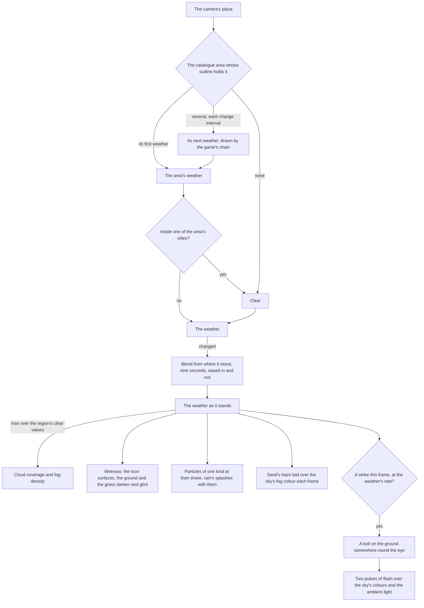

# Weather

Weather moves the same sky, haze and ground that the [sky and time](../sky-and-time/design.md) page lights, rather than a second set of them. A weather is a small table of settings, and the world blends from where the weather stands toward the active one's over the region's own clear sky (`packages/genshin-engine/src/atmosphere/blendWeatherState.ts`). Its particles and splashes are one instanced draw each, placed in the vertex stage, so their cost is the same whichever weather is on.

## How it works

- **The area names the weather.** Each catalogue area lists the weathers it can have, the first its own, the weather a visit finds it in ([world map](../world-map/design.md)): most areas clear, cloudy, rain and thunderstorm, deserts clear and cloudy, the Desert of Hadramaveth clear and sandstorms, Dragonspine snow, Tsurumi Island fog and Yashiori Island its thunderstorm, as the catalogue has them. The Weather page, which is not on disk, gives only part of that list: clear and cloudy as the default for most areas, no rain in cities or deserts, the sandstorms of the Desert of Hadramaveth, Dragonspine's snow, the fog of Tsurumi Island and Golden Apple Archipelago, and the perpetual thunderstorms of Yashiori Island and of Inazuma. It names no area that has rain, and nothing of the deserts' cloudy weather. The world draws the weather of the area its camera stands in, checked each time the camera has moved a stretch (`useAreaWeather`), and clear where no drawn outline holds it (`packages/genshin-world/src/composables/useAreaWeather.ts`). An area with several weathers turns each `AREA_WEATHER_CHANGE_SECONDS` to the next the game's standard chain draws among them (`getNextAreaWeather`, its weights in `WeatherKindTransitionWeightsMap` (`packages/genshin-world/src/services/world/WeatherKindTransitionWeightsMap.ts`); the interval is 300 seconds in `packages/genshin-world/src/services/constants.ts`), the change blending as below; a special climate with one weather holds it. The Desert of Hadramaveth stays clear: the standard chain gives clear no turn to a sandstorm, so its sandstorm waits on its own chain being read (`WeatherKindTransitionWeightsMap` has no sandstorm row). Entering an area starts its first weather again.
- **A city holds clear.** A subarea the game files as a city (`AreaTerrainType.City`, [world map](../world-map/design.md)) holds the weather clear inside its outlines while its area's turn goes on outside (`checkIsInCity`), as the wiki has rain stop at a city's edge, so leaving the city finds the area's weather as it has turned meanwhile. The edge is found as the area is, each time the camera has moved a stretch, and crossing it blends like any change (`packages/genshin-world/src/services/world/checkIsInCity.ts`). Only a city the game's polygons outline clears: the cities the game marks that have no outline yet are Dornman Port, the Collective of Plenty, the Clink-Clank Krumkake Craftshop, Nasha Town, Final Night Cemetery and the Kuuvahki Experimental Design Bureau.
- **Inazuma's storm is lifted.** Inazuma's permanent thunderstorm is lifted from the weathers its areas turn through by default (`getAreaWeathers`, the [Inazuma change](../../../changes/genshin-inazuma/design.md)), so Yashiori Island, whose only weather it is (`packages/genshin-world/src/data/catalogue.json`), holds clear. Other regions keep their thunderstorms, and the hour and weather control does not restore the storm yet. The Weather page, which is not on disk, names Yashiori Island's perpetual storm the Tatarigami, lifted after Orobashi's Legacy, and names the Inazuma-wide storm, lifted after Transient Dreams; whether Yashiori's storm is the Inazuma storm lifted here, or the Tatarigami, which holds until Orobashi's Legacy is done, is the owner's decision.
- **An eruption interrupts rain.** Rain can turn to an eruption in the chain, and an eruption turns back to rain where the area has it (`packages/genshin-world/src/services/world/WeatherKindTransitionWeightsMap.ts`, where Eruption's only row is Rain at weight 1), so the rain stops as the eruption's change blends in and resumes at the eruption's next turn. Its weights are provisional, the volcano's chain being unread, and no area lists an eruption until the game's area weathers are read ([Natlan change](../../../changes/genshin-natlan/design.md)).
- **A change blends.** When the weather changes, every field moves from where it stood toward the new weather's settings over `WEATHER_TRANSITION_SECONDS`, eased in and out by a smoothstep, so the sky darkens and the rain thickens together (`packages/genshin-engine/src/atmosphere/blendWeatherState.ts`; `WEATHER_TRANSITION_SECONDS` is 9 in `packages/genshin-engine/src/atmosphere/constants.ts`). A change begun part way through another starts from where the first had reached. One kind of particle falls at a time: where the kind changes, rain into snow say, the old fades out over the first half and the new fades in over the second. The weather the world loads with is set at once.
- **A weather raises the region's clear values; it never lowers them.** Cloud coverage and fog density take the larger of the region's own and the weather's, so a clear weather leaves the region's sky as it was (`packages/genshin-engine/src/atmosphere/applyWeatherState.ts`, which takes a `Math.max` of each). These are written only while a change runs, so the tuning panel's cloud and fog sliders hold otherwise.
- **A sandstorm's haze takes the sand's colour.** A weather may tint the haze (`fogColor`). The sky writes the fog's colour every frame, so the weather lays its tint over it every frame it holds one, by its share, as a scene colour through the tone curve's inverse, as the sky's own colours are (`packages/genshin-engine/src/atmosphere/constants.ts`, where the sandstorm's `fogColor` is `0xc9a66b`).
- **Particles fall in a box round the eye.** A particle's base is a hash of its instance's index. It falls on the wind's drift over its fall speed, and is wrapped inside a box of sixty metres across and thirty up, so the particles stay put in the world and the box never empties (`packages/genshin-engine/src/atmosphere/constants.ts`, `PRECIPITATION_VOLUME_SIZE` 60 and `PRECIPITATION_VOLUME_HEIGHT` 30; `packages/genshin-engine/src/nodes/createPrecipitationMaterial.ts`). Each streak is a quad stretched along its velocity, turned to face the camera, and lit by the light's colour, so it dims at night with the sky.
- **Rain splashes where it meets the ground.** A second draw of small rings lies flat round the eye, each widening and fading over a third of a second and then landing somewhere new, its place a hash of its instance and its life's count (`createSplashMaterial`). It stands on the ground capture's height, the one the grass grows on, or on the water where the ground lies under it, so rain rings the lake too. Its share is the rain's, so snow and sand splash nothing.
- **Lightning flashes and strikes.** A thunderstorm strikes 27.6 times a minute, the flashes counted off Yashiori Island's perpetual storm, at random at its rate, one strike at a time (`packages/genshin-engine/src/atmosphere/constants.ts`, where the thunderstorm's `lightningRate` is 27.6). A strike's flash is two pulses, the second dimmer, each dying away within a tenth of a second or so (`computeLightningFlash`; `LIGHTNING_FLASH_DECAY_SECONDS` is 0.08 in `packages/genshin-engine/src/atmosphere/constants.ts`), laid over the sky the clock has just written: the sky's and the clouds' colours turned toward the flash's and the ambient light raised (`applyLightningFlash`). Its bolt stands on the ground between one and six hundred metres from the eye, turned at random: a seeded channel climbing to the cloud base in jagged segments with a few branches falling away from it (`computeLightningBolt`), each segment a ribbon turned to face the eye, adding light, writing no depth and glowing as bright as the flash.
- **Wet ground darkens and takes a glint.** Every toon material, the ground's and the grass's read the one wetness uniform: its colour darkens by up to a third (`packages/genshin-engine/src/nodes/createWetDarkeningNode.ts`; the one-third figure is open below), and the sun's half-way highlight adds a glint in proportion. The grass glints off the ground's upward normal it shades by, so a wet meadow shines as one surface.
- **Under the water the water's haze wins.** The weather runs ahead of the water each frame, so the water's haze replaces the weather's colour under its surface, and a density the weather writes while the eye is under water is kept for surfacing rather than drawn (`updateUnderwaterFog`).

## What each weather sets

| Weather      | Cloud cover  | Fog density  | Haze tint | Wetness | Particles                         | Lightning     |
| :----------- | :----------- | :----------- | :-------- | :------ | :-------------------------------- | :------------ |
| Clear        | the region's | the region's | none      | none    | none                              | none          |
| Cloudy       | raised       | the region's | none      | none    | none                              | none          |
| Eruption     | raised       | raised       | none      | none    | none                              | none          |
| Fog          | raised       | raised       | none      | none    | none                              | none          |
| Rain         | raised       | raised       | none      | full    | rain streaks and splashes         | none          |
| Thunderstorm | full         | raised       | none      | full    | rain streaks and splashes, denser | 27.6 a minute |
| Snow         | raised       | raised       | none      | none    | snowflakes, drifting and swaying  | none          |
| Snowstorm    | raised       | raised       | none      | none    | snowflakes, drifting and swaying  | none          |
| Sandstorm    | raised       | raised       | sand      | none    | sand streaks along the wind       | none          |

The values are starting points, not the game's: each is marked provisional where it stands, and fitted as the [weather](../../../changes/genshin-weather/design.md) proposal lists.

## Cost

- **One instanced draw for the particles and one for the splashes.** Both are instanced geometries placed in the vertex stage, so no particle is stored and no frame writes per particle.
- **A frame writes the eye, and the blend while a change runs.** The flash writes a handful of colours while it lasts, and the bolt is one small mesh shown for under a second.
- **A dry world costs nothing extra.** The wetness darkening and glint multiply by zero and add nothing, and a weather that tints no haze writes no colour.
- **The desert clip is taken as a sandstorm.** `~/Esposter.noindex/genshin-parity/captures/yt-k_FKK0qcYHw-0-40.mp4` (0 to 40 seconds) and the wiki's `File:Desert of Hadramaveth.png` are the sandstorm the haze and streaks are matched to (the match is open below); a clip showing only a dust column would change the match.

## Key files

| File                                                                           | Role                                                                       |
| :----------------------------------------------------------------------------- | :------------------------------------------------------------------------- |
| `packages/genshin-engine/src/atmosphere/constants.ts`                          | Each weather's settings, the transition, the lightning and splashes' looks |
| `packages/genshin-engine/src/atmosphere/blendWeatherState.ts`                  | The weather part way from where it stood to the next one's settings        |
| `packages/genshin-engine/src/atmosphere/applyWeatherState.ts`                  | The weather as it stands written into the sky, fog, wetness and particles  |
| `packages/genshin-engine/src/atmosphere/computeLightningFlash.ts`              | A strike's two pulses of flash                                             |
| `packages/genshin-engine/src/atmosphere/applyLightningFlash.ts`                | The flash laid over the sky's colours and the ambient light                |
| `packages/genshin-engine/src/atmosphere/computeLightningBolt.ts`               | A bolt's seeded channel and branches                                       |
| `packages/genshin-engine/src/nodes/createLightningBoltMaterial.ts`             | The bolt's segments facing the eye and glowing with the flash              |
| `packages/genshin-engine/src/nodes/createPrecipitationMaterial.ts`             | The particles: the wrapped box, the sway, the streaks facing the eye       |
| `packages/genshin-engine/src/nodes/createSplashMaterial.ts`                    | The rain's splashes on the ground capture or the water                     |
| `packages/genshin-engine/src/nodes/createWetDarkeningNode.ts`                  | How far a wet surface darkens                                              |
| `packages/genshin-engine/src/water/updateUnderwaterFog.ts`                     | The water's haze under its surface, keeping what the weather writes above  |
| `packages/genshin-world/src/composables/useAreaWeather.ts`                     | The weather of the area the camera stands in, turning through its weathers |
| `packages/genshin-world/src/services/world/getNextAreaWeather.ts`              | The next weather an area turns to, drawn by the standard chain             |
| `packages/genshin-world/src/services/world/getAreaWeathers.ts`                 | The weathers an area turns through, Inazuma's storm lifted unless restored |
| `packages/genshin-world/src/services/world/checkIsInCity.ts`                   | Whether the camera stands inside one of its area's cities                  |
| `packages/genshin-world/src/services/world/WeatherKindTransitionWeightsMap.ts` | The standard chain's weights, each weather's row for the next              |
| `packages/genshin-world/src/services/constants.ts`                             | The area weather's change interval, provisional                            |
| `packages/genshin-world/src/components/World/Weather/Index.vue`                | The blend, the particles, the splashes, the haze's tint and the lightning  |

## Notes

- **Windrise stays clear.** Galesong Hill's own weather is clear, as its reference screenshots are. Moving its area's list to start at rain shows the rain over the valley, which the parity pages do not measure.
- **An area's weather turns on a provisional schedule.** The standard chain is the game's, but the change interval is a built stand-in, and the special climates' own chains are not yet read, while a city holds clear by its outline rather than by its own chain, which sends every weather to clear; the game's own weather data, which weathers an area turns between and at what weights, replaces each area's chain when it is read, and a recording of an area's weather changing replaces the interval ([weather](../../../changes/genshin-weather/design.md)).
- **The bolt shines through the haze.** It writes no depth, so the height fog, a post pass over the depth, does not reach it, as a strike reads through the game's rain.
- **The first recordings of a turning sky and of a thunderstorm were a dusk.** Each first minute (`world-weather-turn.dusk.mkv` and `world-thunderstorm.dusk.mkv`, both 1280 by 592) is a clear dusk settling into night, with a moon up by about twenty seconds, no rain at any still and no flash in the thunderstorm's. Its sky darkens from the first still and its mean luma stops falling near forty seconds, a time-of-day change rather than a weather change, so it neither confirms nor moves `WEATHER_TRANSITION_SECONDS` and gives no strike to count. Both are kept under the `.dusk` name and replaced. The turn is a thunderstorm clearing to sun, rain to clear rather than clear to rain, and `WEATHER_TRANSITION_SECONDS` is nine seconds, read off that clip: its top-left sky's frame-to-frame change spikes once, from about 8 s to 16.6 s, and settles by 18.7 s. The thunderstorm is Yashiori Island's perpetual storm, whose flashes come every two or three seconds, so the rate read off it is that storm's and may run above an ordinary thunderstorm's few strikes a minute. Its sky inside the pillarbox, read over 3000 stills at 60 a second, falls 40 or more under its median darkness in 23 runs, 27.6 a minute, the `lightningRate` the thunderstorm takes. Several of those runs come in twos and threes under four tenths of a second apart, the flicker of one strike, so taken as strikes the clip holds 15, 18 a minute.

## Sources

- [Weather](https://genshin-impact.fandom.com/wiki/Weather), Genshin Impact Wiki: weather tied to areas with only the current location's drawn, regular weather changing over time, no rain in cities or deserts, snow on Dragonspine, fog on Tsurumi Island, the perpetual thunderstorm of Yashiori Island, sandstorms in the Desert of Hadramaveth, and rain interrupted during eruptions of the Great Volcano of Tollan, which can resume afterward.
- [Lightning](https://genshin-impact.fandom.com/wiki/Lightning), Genshin Impact Wiki: lightning striking the land during thunderstorms.
- A sandstorm recording in the Desert of Hadramaveth, the camera still, 20 seconds at most; the haze's colour and the sand's streaks are matched to it (the file itself is open below). Found 2026-10-11: the wiki's `File:Desert of Hadramaveth.png` and https://www.youtube.com/watch?v=k_FKK0qcYHw at 0–40 s (`~/Esposter.noindex/genshin-parity/captures/yt-k_FKK0qcYHw-0-40.mp4`).

## Open

- [ ] **The Weather page's named weathers: Dragonspine's snow, Tsurumi Island's fog, Yashiori Island's perpetual thunderstorm and the Desert of Hadramaveth's sandstorms** — no source yet: the Weather wiki page is not on disk.
- [ ] **The areas' weathers match the wiki's list, beyond the areas the Weather page names** — no source yet: the Weather wiki page is not on disk, and no weather table in the dump gives the areas' weathers.
- [ ] **Eruption's weights are provisional, and no area lists an eruption** — no source yet: `~/Esposter/genshin-parity/text/ExcelBinOutput/WeatherTemplateExcelConfigData.json` has no eruption column (its keys are cloudy, mist, rain, snow, sunny and thunderstorm), so the provisional weights have no game source here.
- [ ] **Six cities have no outline: Dornman Port, the Collective of Plenty, the Clink-Clank Krumkake Craftshop, Nasha Town, Final Night Cemetery and the Kuuvahki Experimental Design Bureau** — no source yet: an outline for each of the six, since `packages/genshin-world/src/data/catalogue.json` holds an empty `outlines` list for each.
- [ ] **Splashes widen and fade over a third of a second, and snow and sand splash nothing** — no source yet: a game recording or dump of the splash's fade, since `packages/genshin-engine/src/atmosphere/constants.ts` (`SPLASH_LIFETIME` 0.35 s) is repo code.
- [ ] **A bolt stands between one and six hundred metres from the eye** — contradicted by `packages/genshin-engine/src/atmosphere/constants.ts`: its `LIGHTNING_MIN_DISTANCE` is 150 m, not one.
- [ ] **Wet ground darkens by up to a third** — no source yet: no one-third constant was found in `packages/genshin-engine/src/atmosphere/constants.ts` or `createWetDarkeningNode.ts`.
- [ ] **Cost: one instanced draw each for particles and splashes, a dry world costs nothing extra, the bolt writes no depth, the weather loads set at once, and the water's haze wins under the surface** — no source yet: the draw calls, the load path, `packages/genshin-engine/src/nodes/createLightningBoltMaterial.ts` and `packages/genshin-engine/src/water/updateUnderwaterFog.ts` are on disk but not matched to the claim's parts in this pass.
- [ ] **The sandstorm haze and streaks match the Desert clip** — no source yet: the match is visual, `world-sandstorm.mkv` is not in `~/Esposter/genshin-parity/captures/`, and `yt-k_FKK0qcYHw-0-40.mp4` was not viewed.
- [ ] **Galesong Hill's weather is clear, as its reference screenshots are** — no source yet: `~/Esposter.noindex/genshin-parity/comparisons/map-overlay-galesong.png` is a map overlay, not a weather screen, and no other Galesong Hill still is in `~/Esposter.noindex/genshin-parity/comparisons`.
- [ ] **The first recordings are dusks at 1280 by 592, and the turn and strike counts are read off them** — no source yet: the clip dimensions and the 3000-still, 23-run and 15 to 18 a minute counts were not re-run.
- [ ] **An area's weather turns through the game's standard chain, drawn by its weights** — no source yet: `WeatherTemplateExcelConfigData` in `~/Esposter/genshin-parity/text/ExcelBinOutput/` holds the chain, not yet read. Checked the Weather page, which is in the cache: it says only that areas affected by regular weather change over time, and gives no chain or weights.
- [ ] **The Desert of Hadramaveth stays clear, since the standard chain gives clear no turn to a sandstorm** — no source yet: `WeatherTemplateExcelConfigData` not yet read for clear's turns; the sandstorm recording named in Sources is not in `~/Esposter/genshin-parity/captures/`.
- [ ] **Rain turns to an eruption in the chain, and an eruption turns back to rain where the area has it** — no source yet: `WeatherTemplateExcelConfigData` in `~/Esposter/genshin-parity/text/ExcelBinOutput/`, not yet read for the eruption's turns. The Weather page, which is not on disk, gives the interruption and that rain can resume afterward, but no chain and no rule for where the area has rain.
- [ ] **A sandstorm's haze takes the sand's colour, its `fogColor` being `0xc9a66b`** — no source yet: `WeatherExcelConfigData` in `~/Esposter/genshin-parity/text/ExcelBinOutput/` has no fog-colour key by name, so the colour's table is not yet found; the sandstorm recording named in Sources is not in `~/Esposter/genshin-parity/captures/`. The Weather page, which is not on disk, names the Desert of Hadramaveth as the only place sandstorms occur, and gives no haze colour.
- [ ] **A thunderstorm strikes 27.6 times a minute, counted off Yashiori Island's perpetual storm** — no source yet: the wiki's Lightning page, named in Sources, is not in the wiki cache; the count off Yashiori Island's storm is not yet read from a recording. Checked: the Lightning page is not in the wiki cache, and the Weather page, which links it, says players, allies, enemies, wildlife and the environment can be struck by lightning, but gives no rate.
- [ ] **The haze's colour and the sand's streaks are matched to a sandstorm recording** — no source yet: the cited file `world-sandstorm.mkv` is not on disk.
- [ ] **Rain splashes where it meets the ground** — no source yet: the splash rule in `packages/genshin-engine/src/nodes/createSplashMaterial.ts` was not read.
- [ ] **Snow and fog keep the ground dry** — no source yet: the snow and fog wetness values were not read in `packages/genshin-engine/src/atmosphere/constants.ts`.
