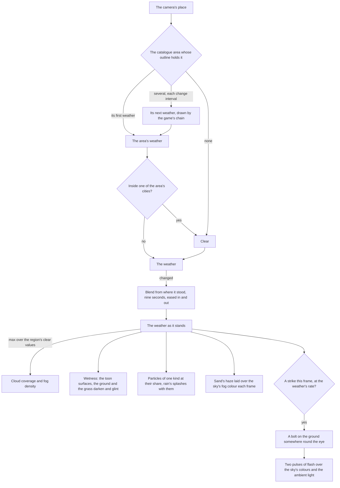

# Weather

Weather moves the same sky, haze and ground that the [sky and time](../sky-and-time/design.md) page lights, rather than a second set of them. A weather is a small table of settings, and the world blends from where the weather stands toward the active one's over the region's own clear sky (`packages/genshin-engine/src/atmosphere/blendWeatherState.ts`). Its particles and splashes are one instanced draw each, placed in the vertex stage, so their cost is the same whichever weather is on.

## How it works

- **The area names the weather.** Each catalogue area lists the weathers it can have, the first its own, the weather a visit finds it in ([world map](../world-map/design.md)): most areas clear, cloudy, rain and thunderstorm, deserts clear and cloudy, the Desert of Hadramaveth clear and sandstorms (the dump's one "Weather_SandStorm" row is area 4100 in `{data-root}/genshin-parity/text/ExcelBinOutput/WeatherExcelConfigData.json`), Dragonspine snow, Tsurumi Island fog and Yashiori Island its thunderstorm (the part beyond the areas the Weather page names is open, see Open). The Weather page (`{data-root}/cache/genshin-wiki/Page_Weather.json`, wikitext lines 19–20, 30–31, 40–44 and 58–74) gives only part of that list: clear and cloudy as the default for most areas (the dump's "WeatherExcelConfigData.json" has sunny as the default for most of its rows and cloudy for many of the rest), no rain in cities or deserts, the sandstorms of the Desert of Hadramaveth (which it says currently affects only that desert, line 74), Dragonspine's snow, the fog of Tsurumi Island and Golden Apple Archipelago, and the perpetual thunderstorms of Yashiori Island and of Inazuma. It names no area that has rain, and nothing of the deserts' cloudy weather. The world draws the weather of the area its camera stands in, checked each time the camera has moved a stretch (`useAreaWeather`), and clear where no drawn outline holds it (`packages/genshin-world/src/composables/useAreaWeather.ts`). An area with several weathers turns each `AREA_WEATHER_CHANGE_SECONDS` to the next the game's standard chain draws among them (`getNextAreaWeather`, its weights in `WeatherKindTransitionWeightsMap` (`packages/genshin-world/src/services/world/WeatherKindTransitionWeightsMap.ts`); the interval, `AREA_WEATHER_CHANGE_SECONDS`, is 300 seconds in `packages/genshin-world/src/services/constants.ts`), the change blending as below; a special climate with one weather holds it. The dump's `Weather_Standard` template (`{data-root}/genshin-parity/text/ExcelBinOutput/WeatherTemplateExcelConfigData.json`), which a few hundred of its rows in "WeatherExcelConfigData.json" name, gives the same clear, cloudy, rain and thunderstorm weights, with no eruption column. The Desert of Hadramaveth stays clear: the standard chain gives clear no turn to a sandstorm, so its sandstorm waits on its own chain being read (`WeatherKindTransitionWeightsMap` has no sandstorm row). Entering an area starts its first weather again.
- **A city holds clear.** A subarea the game files as a city (`AreaTerrainType.City`, [world map](../world-map/design.md)) holds the weather clear inside its outlines while its area's turn goes on outside (`checkIsInCity`), as the wiki has rain stop at a city's edge, so leaving the city finds the area's weather as it has turned meanwhile. The edge is found as the area is, each time the camera has moved a stretch, and crossing it blends like any change (`packages/genshin-world/src/services/world/checkIsInCity.ts`). Only a city the game's polygons outline clears: the cities the game marks that have no outline yet are Dornman Port, the Collective of Plenty, the Clink-Clank Krumkake Craftshop, Nasha Town, Final Night Cemetery and the Kuuvahki Experimental Design Bureau (each has an empty `outlines` list in `packages/genshin-world/src/data/catalogue.json`, at lines 1106, 6714, 7599, 7607, 7710 and 7716, in that order).
- **Inazuma's storm is lifted.** Inazuma's permanent thunderstorm is lifted from the weathers its areas turn through by default (`getAreaWeathers`, the [Inazuma change](../../../changes/genshin-inazuma/design.md)), so Yashiori Island, whose only weather it is (`packages/genshin-world/src/data/catalogue.json`), holds clear. Other regions keep their thunderstorms, and the hour and weather control does not restore the storm yet. The Weather page names Yashiori Island's perpetual storm the Tatarigami, lifted after Orobashi's Legacy, and the Inazuma-wide storm, which it calls "A Nation Closed by Thunder", lifted after Transient Dreams (`{data-root}/cache/genshin-wiki/Page_Weather.json`, wikitext lines 41–44); whether Yashiori's storm is the Inazuma storm lifted here, or the Tatarigami, which holds until Orobashi's Legacy is done, is the owner's decision.
- **An eruption interrupts rain.** Rain can turn to an eruption in the chain, and an eruption turns back to rain where the area has it (`packages/genshin-world/src/services/world/WeatherKindTransitionWeightsMap.ts`, where Eruption's only row is Rain at weight 1), so the rain stops as the eruption's change blends in and resumes at the eruption's next turn. Its weights are provisional, the volcano's chain being unread, and no area lists an eruption until the game's area weathers are read ([Natlan change](../../../changes/genshin-natlan/design.md)).
- **A change blends.** When the weather changes, every field moves from where it stood toward the new weather's settings over `WEATHER_TRANSITION_SECONDS`, eased in and out by a smoothstep, so the sky darkens and the rain thickens together (`packages/genshin-engine/src/atmosphere/blendWeatherState.ts`; `WEATHER_TRANSITION_SECONDS` is 9 in `packages/genshin-engine/src/atmosphere/constants.ts`). A change begun part way through another starts from where the first had reached. One kind of particle falls at a time: where the kind changes, rain into snow say, the old fades out over the first half and the new fades in over the second. The weather the world loads with is set at once (`packages/genshin-world/src/components/World/Weather/Index.vue` line 112, a blend at amount 1).
- **A weather raises the region's clear values; it never lowers them.** Cloud coverage and fog density take the larger of the region's own and the weather's, so a clear weather leaves the region's sky as it was (`packages/genshin-engine/src/atmosphere/applyWeatherState.ts`, which takes a `Math.max` of each). These are written only while a change runs, so the tuning panel's cloud and fog sliders hold otherwise.
- **A sandstorm's haze takes the sand's colour.** A weather may tint the haze (`fogColor`). The sky writes the fog's colour every frame, so the weather lays its tint over it every frame it holds one, by its share, as a scene colour through the tone curve's inverse, as the sky's own colours are (`packages/genshin-engine/src/atmosphere/constants.ts`, where the sandstorm's `fogColor` is `0xc9a66b`).
- **Particles fall in a box round the eye.** A particle's base is a hash of its instance's index. It falls on the wind's drift over its fall speed, and is wrapped inside a box of sixty metres across and thirty up, so the particles stay put in the world and the box never empties (`packages/genshin-engine/src/atmosphere/constants.ts`, `PRECIPITATION_VOLUME_SIZE` 60 and `PRECIPITATION_VOLUME_HEIGHT` 30; `packages/genshin-engine/src/nodes/createPrecipitationMaterial.ts`). Each streak is a quad stretched along its velocity, turned to face the camera, and lit by the light's colour, so it dims at night with the sky.
- **Rain splashes where it meets the ground.** A second draw of small rings lies flat round the eye, each widening and fading over a third of a second and then landing somewhere new, its place a hash of its instance and its life's count (`createSplashMaterial`). It stands on the ground capture's height, the one the grass grows on, or on the water where the ground lies under it, so rain rings the lake too. Its share is the rain's, so snow and sand splash nothing.
- **Lightning flashes and strikes.** A thunderstorm strikes 27.6 times a minute, the flashes counted off Yashiori Island's perpetual storm, at random at its rate, one strike at a time (`packages/genshin-engine/src/atmosphere/constants.ts`, where the thunderstorm's `lightningRate` is 27.6). A strike's flash is two pulses, the second dimmer, each dying away within a tenth of a second or so (`computeLightningFlash`; `LIGHTNING_FLASH_DECAY_SECONDS` is 0.08 in `packages/genshin-engine/src/atmosphere/constants.ts`), laid over the sky the clock has just written: the sky's and the clouds' colours turned toward the flash's and the ambient light raised (`applyLightningFlash`). Its bolt stands on the ground between 150 and six hundred metres from the eye, turned at random: a seeded channel climbing to the cloud base in jagged segments with a few branches falling away from it (`computeLightningBolt`), each segment a ribbon turned to face the eye, adding light, writing no depth and glowing as bright as the flash.
- **Wet ground darkens and takes a glint.** Every toon material, the ground's and the grass's read the one wetness uniform: its colour darkens by up to 0.35 (`WET_DARKENING` in `packages/genshin-engine/src/nodes/constants.ts`, read at `packages/genshin-engine/src/nodes/createWetDarkeningNode.ts`; the game's own figure is open below), and the sun's half-way highlight adds a glint in proportion. The grass glints off the ground's upward normal it shades by, so a wet meadow shines as one surface.
- **Under the water the water's haze wins.** The weather runs ahead of the water each frame, so the water's haze replaces the weather's colour under its surface, and a density the weather writes while the eye is under water is kept for surfacing rather than drawn (`packages/genshin-engine/src/water/updateUnderwaterFog.ts`: the colour at line 32, the saved density at lines 30 and 34).

## What each weather sets

| Weather      | Cloud cover  | Fog density  | Haze tint | Wetness | Particles                         | Lightning     |
| :----------- | :----------- | :----------- | :-------- | :------ | :-------------------------------- | :------------ |
| Clear        | the region's | the region's | none      | none    | none                              | none          |
| Cloudy       | raised       | the region's | none      | none    | none                              | none          |
| Eruption     | raised       | raised       | none      | none    | none                              | none          |
| Fog          | raised       | raised       | none      | none    | none                              | none          |
| Rain         | raised       | raised       | none      | full    | rain streaks and splashes         | none          |
| Thunderstorm | full         | raised       | none      | full    | rain streaks and splashes, denser | 27.6 a minute |
| Snow         | raised       | raised       | none      | none    | snowflakes, drifting and swaying  | none          |
| Snowstorm    | raised       | raised       | none      | none    | snowflakes, drifting and swaying  | none          |
| Sandstorm    | raised       | raised       | sand      | none    | sand streaks along the wind       | none          |

The values are starting points, not the game's: each is marked provisional where it stands, and fitted as the [weather](../../../changes/genshin-weather/design.md) proposal lists.

## Cost

- **One instanced draw for the particles and one for the splashes.** Both are instanced geometries placed in the vertex stage, so no particle is stored and no frame writes per particle (`packages/genshin-engine/src/atmosphere/createPrecipitationGeometry.ts` line 6, an `InstancedBufferGeometry`, given one `Mesh` each at `packages/genshin-world/src/components/World/Weather/Index.vue` lines 81 and 86).
- **A frame writes the eye, and the blend while a change runs.** The flash writes a handful of colours while it lasts, and the bolt is one small mesh shown for under a second.
- **A dry world costs nothing extra.** The wetness darkening's factor is one when dry and the glint's wetness term is zero, so both add nothing (`packages/genshin-engine/src/nodes/createWetDarkeningNode.ts` lines 8 and 9, `packages/genshin-engine/src/nodes/createWetSheenNode.ts` line 14), and a weather that tints no haze writes no colour (`packages/genshin-world/src/components/World/Weather/Index.vue` line 144).
- **The desert clip is taken as a sandstorm.** `{data-root}/genshin-parity/captures/yt-k_FKK0qcYHw-0-40.mp4` (0 to 40 seconds) and the wiki's `File:Desert of Hadramaveth.png` are the sandstorm the haze and streaks are matched to (the match is open below); a clip showing only a dust column would change the match.

## Key files

| File                                                                           | Role                                                                       |
| :----------------------------------------------------------------------------- | :------------------------------------------------------------------------- |
| `packages/genshin-engine/src/atmosphere/constants.ts`                          | Each weather's settings, the transition, the lightning and splashes' looks |
| `packages/genshin-engine/src/atmosphere/blendWeatherState.ts`                  | The weather part way from where it stood to the next one's settings        |
| `packages/genshin-engine/src/atmosphere/applyWeatherState.ts`                  | The weather as it stands written into the sky, fog, wetness and particles  |
| `packages/genshin-engine/src/atmosphere/computeLightningFlash.ts`              | A strike's two pulses of flash                                             |
| `packages/genshin-engine/src/atmosphere/applyLightningFlash.ts`                | The flash laid over the sky's colours and the ambient light                |
| `packages/genshin-engine/src/atmosphere/computeLightningBolt.ts`               | A bolt's seeded channel and branches                                       |
| `packages/genshin-engine/src/nodes/createLightningBoltMaterial.ts`             | The bolt's segments facing the eye and glowing with the flash              |
| `packages/genshin-engine/src/nodes/createPrecipitationMaterial.ts`             | The particles: the wrapped box, the sway, the streaks facing the eye       |
| `packages/genshin-engine/src/nodes/createSplashMaterial.ts`                    | The rain's splashes on the ground capture or the water                     |
| `packages/genshin-engine/src/nodes/createWetDarkeningNode.ts`                  | How far a wet surface darkens                                              |
| `packages/genshin-engine/src/water/updateUnderwaterFog.ts`                     | The water's haze under its surface, keeping what the weather writes above  |
| `packages/genshin-world/src/composables/useAreaWeather.ts`                     | The weather of the area the camera stands in, turning through its weathers |
| `packages/genshin-world/src/services/world/getNextAreaWeather.ts`              | The next weather an area turns to, drawn by the standard chain             |
| `packages/genshin-world/src/services/world/getAreaWeathers.ts`                 | The weathers an area turns through, Inazuma's storm lifted unless restored |
| `packages/genshin-world/src/services/world/checkIsInCity.ts`                   | Whether the camera stands inside one of its area's cities                  |
| `packages/genshin-world/src/services/world/WeatherKindTransitionWeightsMap.ts` | The standard chain's weights, each weather's row for the next              |
| `packages/genshin-world/src/services/constants.ts`                             | The area weather's change interval, provisional                            |
| `packages/genshin-world/src/components/World/Weather/Index.vue`                | The blend, the particles, the splashes, the haze's tint and the lightning  |

## Notes

- **Windrise stays clear.** Galesong Hill's own weather is clear, as its reference screenshots are. Moving its area's list to start at rain shows the rain over the valley, which the parity pages do not measure.
- **An area's weather turns on a provisional schedule.** The standard chain is the game's, but the change interval is a built stand-in, and the special climates' own chains are not yet read, while a city holds clear by its outline rather than by its own chain, which sends every weather to clear; the game's own weather data, which weathers an area turns between and at what weights, replaces each area's chain when it is read, and a recording of an area's weather changing replaces the interval ([weather](../../../changes/genshin-weather/design.md)).
- **The bolt shines through the haze.** It writes no depth (`packages/genshin-engine/src/nodes/createLightningBoltMaterial.ts` line 22), so the height fog, a post pass over the depth, does not reach it, as a strike reads through the game's rain.
- **The turning-sky and thunderstorm recordings are dusks.** Each (`world-weather-turn.dusk.mkv` and `world-thunderstorm.dusk.mkv`) is a clear dusk settling into night, a time-of-day change rather than a weather change, so it neither confirms nor moves `WEATHER_TRANSITION_SECONDS` and gives no strike to count. Both are kept under the `.dusk` name until a turn recording replaces them. The turn is a thunderstorm clearing to sun, rain to clear rather than clear to rain, and `WEATHER_TRANSITION_SECONDS` is nine seconds. The thunderstorm is Yashiori Island's perpetual storm, so the rate read off it is that storm's and may run above an ordinary thunderstorm's few strikes a minute; its strike counts are open below.

## Sources

- [Weather](https://genshin-impact.fandom.com/wiki/Weather), Genshin Impact Wiki.
- [Lightning](https://genshin-impact.fandom.com/wiki/Lightning), Genshin Impact Wiki: lightning striking the land during thunderstorms.
- A sandstorm recording in the Desert of Hadramaveth, the camera still, a short clip; the haze's colour and the sand's streaks are matched to it (the file itself is open below). the wiki's `File:Desert of Hadramaveth.png` and https://www.youtube.com/watch?v=k_FKK0qcYHw (`{data-root}/genshin-parity/captures/yt-k_FKK0qcYHw-0-40.mp4`).

## Open

The thunderstorm's strike rate is the [spec's](spec.md) open item.

- [ ] **The areas' weathers match the wiki's list, beyond the areas the Weather page names** — no source yet: the Weather page names no area beyond those the area bullet names, and no cached region page names area weathers (`{data-root}/cache/genshin-wiki/`), so a region page's weather list would settle it; the dump's default climates (`{data-root}/genshin-parity/text/ExcelBinOutput/WeatherExcelConfigData.json`) carry no area names to join them by.
- [ ] **Eruption's weights are provisional, and no area lists an eruption** — contradicted by `{data-root}/genshin-parity/text/ExcelBinOutput/WeatherExcelConfigData.json` line 16360: weather area 6151 names "CLIMATE_VOLCANO_OUTSIDE" as its default climate, and line 16555 does the same for 6170, against the page's no-area claim; the weights still have no game source, since `{data-root}/genshin-parity/text/ExcelBinOutput/WeatherTemplateExcelConfigData.json` has no eruption column (its keys are cloudy, mist, rain, snow, sunny and thunderstorm).
- [ ] **Splashes widen and fade over a third of a second, and snow and sand splash nothing** — no source yet: a game recording or dump of the splash's fade, since `packages/genshin-engine/src/atmosphere/constants.ts` (`SPLASH_LIFETIME` 0.35 s) is repo code; the cached Weather page gives no splash (`{data-root}/cache/genshin-wiki/Page_Weather.json`).
- [ ] **Wet ground darkens by up to a third** — no source yet: a game measure of the wet darkening, since `WET_DARKENING` is 0.35 in `packages/genshin-engine/src/nodes/constants.ts`, which is repo code. A wet and a dry frame of one ground, from a capture such as `{data-root}/genshin-parity/captures/world-thunderstorm.mkv`, would settle it.
- [ ] **The sandstorm haze and streaks match the Desert clip** — no source yet: the match is visual, `world-sandstorm.mkv` is not in `{data-root}/genshin-parity/captures/`, and `yt-k_FKK0qcYHw-0-40.mp4` was not viewed (its stills are under `{data-root}/genshin-parity/frames/yt-k_FKK0qcYHw-0-40@0/`, and a render at the sandstorm's settings beside them would settle it).
- [ ] **Galesong Hill's weather is clear, as its reference screenshots are** — no source yet: `{data-root}/genshin-parity/comparisons/map-overlay-galesong.png` is a map overlay, not a weather screen, and no other Galesong Hill still is in `{data-root}/genshin-parity/comparisons`; the Mondstadt weather rows name "Weather_Sunny" for area 1 and "Weather_Standard" beyond it (`{data-root}/genshin-parity/references/windrise-environment/README.md`, line 10), and which area covers Windrise is not read (line 12).
- [ ] **The turn's spike and settle times and the strike counts read off the two dusk recordings** — no source yet: a re-run of those readings over the two clips in `{data-root}/genshin-parity/captures/`.
- [ ] **The Desert of Hadramaveth stays clear, since the standard chain gives clear no turn to a sandstorm** — contradicted by `{data-root}/cache/genshin-wiki/Page_Weather.json` line 76: sandstorms occur intermittently in the desert, where this claim says clear. The dump's weather area 4100 (`{data-root}/genshin-parity/text/ExcelBinOutput/WeatherExcelConfigData.json` line 11226) names "CLIMATE_DESERT" as its default, though its id names "Lokapala Jungle" in `{data-root}/genshin-parity/text/ExcelBinOutput/WorldAreaConfigData.json`, not the Desert, so that row's link to the Desert is open.
- [ ] **Rain turns to an eruption in the chain, and an eruption turns back to rain where the area has it** — no source yet for the chain's turn: the cached Weather page says rain is interrupted during eruptions and can resume afterward (`{data-root}/cache/genshin-wiki/Page_Weather.json`, wikitext line 32), and `{data-root}/genshin-parity/text/ExcelBinOutput/WeatherTemplateExcelConfigData.json` holds no eruption template.
- [ ] **A sandstorm's haze takes the sand's colour, its `fogColor` being `0xc9a66b`** — no source yet: the sandstorm's environment profile, "ESP_Xm31_CWSM_General", named at `{data-root}/genshin-parity/text/ExcelBinOutput/WeatherExcelConfigData.json` line 11232 and held by no file under `{data-root}/genshin-parity/extracted/`, `captures/` or `comparisons/`, and the windrise export names only Mondstadt's profile (`{data-root}/genshin-parity/references/windrise-environment/README.md`, line 10).
- [ ] **Rain splashes where it meets the ground** — no source yet: a game recording of the rain's splashes, since `packages/genshin-engine/src/nodes/createSplashMaterial.ts` is repo code; `{data-root}/genshin-parity/captures/world-thunderstorm.mkv` is video and was not read for one.
- [ ] **Snow and fog keep the ground dry** — no source yet: the game's own snow and fog wetness, since `packages/genshin-engine/src/atmosphere/constants.ts` sets wetness 0 for both, which is repo code. The wiki's Rain section gives "Wet" to characters and opponents only in rain (`{data-root}/cache/genshin-wiki/Page_Weather.json`, wikitext line 23), and a dry-ground frame of a snow or fog area would settle it; `captures/` has no fog clip.
