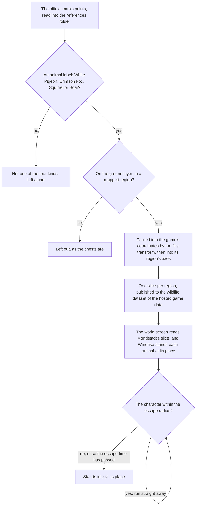

# Wildlife

The client does not place the game's animals, so the map's public points stand in for them, as [spawned places](../spawned-places/design.md) describes (`scripts/src/services/genshinAssets/wildlife/buildWildlifePlaces.ts`). This page is the built part of the [wildlife](../../../changes/genshin-wildlife/design.md) proposal: the three kinds of bird and beast the map marks as fleeing are placed in the scene by the fit's transform and published into each region's slice, and in Windrise's scene each one stands at its place and runs from the character when it comes near (`packages/genshin-world/src/components/World/Windrise/Index.vue`, which mounts `WorldWildlife` over the wildlife list; `packages/genshin-world/src/services/wildlife/stepWildlife.ts`). The boar, which charges rather than flees, is placed in the same slice too. The proposal's later steps cover its charge, the strikes, the drops and the material pickups, and this page does not describe them.

## How it works

Its ground-layer and mapped-region checks are `scripts/src/services/genshinAssets/points/placeMapPoints.ts`, which skips a point off the ground layer and one in no mapped region.

## The kinds

`WildlifeKind` names four: `Boar`, `CrimsonFox`, `Squirrel` and `WhitePigeon`, of which `Boar` charges and the other three flee. Each is one of the map's own labels under its Animals group, and `WildlifeKindLabelIdMap` gives its label id, so a point takes its kind by its label (`scripts/src/services/genshinAssets/wildlife/WildlifeKindLabelIdMap.ts`). The archive files each as an animal or aviary monster, and the capture table's rows and the monster rows hold the rest of what each one is.

## The flight

`stepWildlife` runs on the Wildlife component's own fixed step, a sixtieth of a second (`packages/genshin-world/src/components/World/Wildlife/Index.vue`; `WILDLIFE_STEP_SECONDS` in `packages/genshin-world/src/services/wildlife/constants.ts`). An idle animal with the character within its escape radius starts running straight away from it at the flight speed (`packages/genshin-world/src/services/wildlife/stepWildlife.ts`). A running one keeps running for the escape time, then stands idle, or runs again if the character is still in reach (`packages/genshin-world/src/services/wildlife/stepWildlife.ts`). A character that is gone leaves a running animal running on its last heading until its time is up, and then standing idle (`packages/genshin-world/src/services/wildlife/stepWildlife.ts`).

The numbers are provisional, each marked in `packages/genshin-world/src/services/wildlife/constants.ts`:

- **The escape radius and the escape time.** `WILDLIFE_ESCAPE_RADIUS` and `WILDLIFE_ESCAPE_SECONDS` are the environment table's gadget rows' values (`{data-root}/genshin-parity/text/ExcelBinOutput/EnvAnimalGatherExcelConfigData.json`, four of its six Gadget rows at escapeRadius 4 and escapeTime 1), the closest it holds, since it has no row for a bird or a beast, until a recording of each kind's flight measures them.
- **The flight speed.** `WILDLIFE_FLEE_SPEED` is a placeholder, since no table gives it, until a recording times it (`packages/genshin-world/src/services/wildlife/constants.ts`; the environment table's keys carry escapeRadius and escapeTime and no speed).

## The placement

`pnpm -C scripts genshin:assets wildlife` (`scripts/src/services/genshinAssets/commands/wildlifeCommand.ts`) publishes each region's animals as one slice to the wildlife dataset of the [hosted game data](../hosted-game-data/design.md), the chest slices' pattern. Mondstadt's slice holds about a hundred animals, and the other regions hold the same kinds where their labels are marked.

`WorldWildlife` stands each animal in Windrise's scene as a capsule of one instanced draw, the enemies' stand-in, stood on the ground under it and turned to its heading (`packages/genshin-world/src/components/World/Wildlife/Index.vue`, whose capsules are `WILDLIFE_CAPSULE_RADIUS`, `WILDLIFE_CAPSULE_HEIGHT` and `WILDLIFE_CAPACITY` in `packages/genshin-world/src/services/wildlife/constants.ts`). The world's screen reads the Mondstadt slice from the hosted game data before it opens (`readMondstadtWildlifePlaces`, each place's id unique) and hands it down to Windrise (`packages/genshin-world/src/components/World/Windrise/Index.vue`, its `wildlifeList` prop), and the animals are not drawn in a witness render, as the enemies are not (`packages/genshin-world/parity/witness/renderWitnessTargets.ts` draws the families of the component's `witness.parts`, and no file under `packages/genshin-world/parity/` or `scripts/src/services/genshinParity/` names a wildlife kind).

Every animal of the slice exists from the scene's load (`packages/genshin-world/src/services/wildlife/createWildlife.ts`, which stands each place's animal at its place). The rule that most animals come into being only when the player is near is not built, and neither are their shadows nor the elemental sight over them.

## Key files

| File                                                                          | Role                                                        |
| :---------------------------------------------------------------------------- | :---------------------------------------------------------- |
| `packages/genshin-world/src/models/wildlife/WildlifeKind.ts`                  | The four kinds: three that flee, and the boar that charges  |
| `packages/genshin-world/src/models/wildlife/WildlifePlace.ts`                 | A placed animal, and the schema its slice is parsed with    |
| `packages/genshin-world/src/models/wildlife/Wildlife.ts`                      | One animal as its flight moves it                           |
| `packages/genshin-world/src/services/wildlife/stepWildlife.ts`                | The flight, one fixed step at a time                        |
| `packages/genshin-world/src/services/wildlife/constants.ts`                   | The provisional escape radius, escape time and flight speed |
| `packages/genshin-world/src/components/World/Wildlife/Index.vue`              | The instanced stand-ins, stepped and drawn                  |
| `packages/genshin-world/src/components/World/Windrise/Index.vue`              | Mounts the stand-ins over Mondstadt's slice                 |
| `packages/genshin-world/src/services/wildlife/readMondstadtWildlifePlaces.ts` | Mondstadt's slice, read at the world's gate                 |
| `scripts/src/services/genshinAssets/wildlife/buildWildlifePlaces.ts`          | Carries the map's animals into each region's slice          |
| `scripts/src/services/genshinAssets/wildlife/WildlifeKindLabelIdMap.ts`       | Each kind's label on the official map                       |
| `scripts/src/services/genshinAssets/commands/wildlifeCommand.ts`              | `genshin:assets wildlife`                                   |

## Sources

- [Teyvat Interactive Map](https://act.hoyolab.com/ys/app/interactive-map/index.html), HoYoLAB: the official map. The label tree and point list there are public data the builder reads as references.
- [AnimeGameData](https://gitlab.com/Dimbreath/AnimeGameData), the community's per-patch dump: the environment animal table whose gadget rows give the closest escape radius and time held for the kinds.

## Open

- [ ] **The archive files each kind as an animal or aviary monster** — no source yet: the dump's Monster and Gadget rows were not matched to the kinds' names.
- [ ] **No table gives a flight's speed** — no source yet: only the environment table's keys were read, not every table's.
- [ ] **Mondstadt's slice holds about a hundred animals, and the other regions hold the same kinds where their labels are marked** — no source yet: the published slices are in hosted storage, not the local dump, so neither count was checked.
