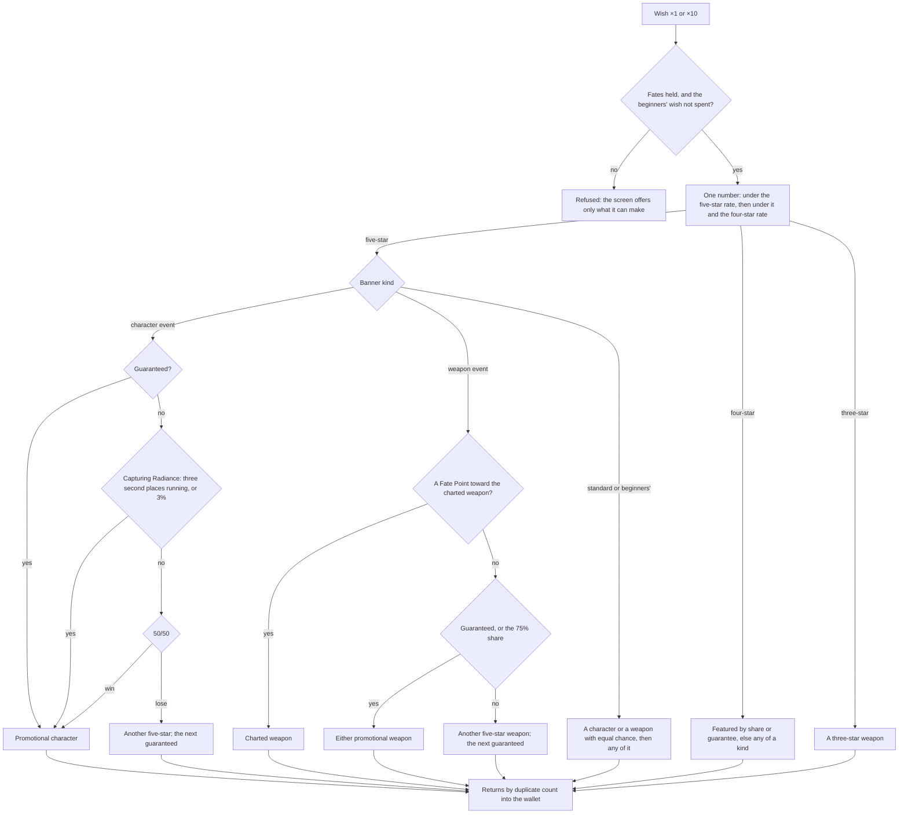

# Wish

A wish draws one character or weapon from a banner, by rates and guarantees the game publishes in each banner's details. The world package pulls it with pure functions over a banner, its kind's counters and a random source `packages/genshin-world/src/services/wish/pullWish.ts`, so a test replays any sequence from the numbers it hands in, and its screen spends the wallet's Fates `packages/genshin-world/src/services/wish/makeWishes.ts`. The screen offers the two permanent banners `packages/genshin-world/src/services/wish/createBanners.ts` and each event banner the wiki's schedule has open at the server's time `packages/genshin-world/src/services/wish/getOpenEventBanners.ts`, and it keeps the draws of the year for its History `packages/genshin-world/src/services/wish/appendWishHistory.ts`.

## How it works

- **Four banner kinds.** `BannerKind` is the character event wish, the weapon event wish, the standard wish (Wanderlust Invocation) and the beginners' wish, each named by the game's own text `packages/genshin-world/src/services/wish/BannerKindGameTextKeyMap.ts`. A `Banner` `packages/genshin-world/src/models/wish/Banner.ts` is one banner's pool and its id, the kind for a permanent banner and the wiki page's title for an event banner: its promotional five-stars, its featured four-stars, and the rest at each rarity.
- **Each kind keeps its own counters.** `WishPity` is what a kind carries from one wish and one banner to the next: the wishes made, the wishes since the last five-star and since the last four-star or better, whether the next of each is featured, how many character event five-stars running came second to the promotional character, and the Epitomized Path's course and Fate Points `packages/genshin-world/src/services/wish/InitialBannerKindWishPityMap.ts`. A second character event banner shares its kind's counters `packages/genshin-world/src/services/wish/makeWishes.ts`, as Character Event Wish-2 shares the first's.
- **The rates.** `BannerKindWishRatesMap` gives each kind its five-star and four-star `RarityRate` `packages/genshin-world/src/services/wish/BannerKindWishRatesMap.ts`. The base rates and the hard pity are the game's published details, and the soft pity is the community's model from millions of recorded wishes, which the wiki publishes. Each kind's five-star and four-star rates are declared in `services/wish/constants.ts` as a base, a hard pity, and a soft pity's start and step, the weapon wish's pair beside the others.
- **One number decides the rarity.** `pullWish` draws one number: under the five-star rate it is a five-star, under that and the four-star rate a four-star, the four-star's rate capped so the two fill every number at its guarantee, and a three-star weapon otherwise. A five-star leaves the four-star counter running, so its guarantee passes to the next wish `packages/genshin-world/src/services/wish/pullWish.ts`, as the details say.
- **The featured share and its guarantee.** A character event five-star is the promotional character half the time, and a four-star one of the featured three half the time; the weapon wish's shares are three quarters `packages/genshin-world/src/services/wish/BannerKindWishRatesMap.ts`. A miss guarantees the next of that rarity `packages/genshin-world/src/services/wish/pullWish.ts`.
- **Capturing Radiance as the game publishes it.** On a character event five-star the 50/50 decides, `pullFiveStar` first checks Capturing Radiance, which makes it the promotional character and marks the result `packages/genshin-world/src/services/wish/pullFiveStar.ts`. Its published base rate is a share of the five-star's, so it triggers on the share of those five-stars `CAPTURING_RADIANCE_RATE` names, and for certain once the promotional character has come second `CAPTURING_RADIANCE_LOSS_LIMIT` times running `packages/genshin-world/src/services/wish/constants.ts`. It never touches the guarantee, and with it the promotional character takes about 55% of the 50/50s, the consolidated share the wiki gives.
- **The Epitomized Path.** On the weapon wish, with a course charted for one of the two promotional weapons, a five-star that is not that weapon earns a Fate Point, and at one Fate Point (`FATE_POINT_LIMIT`) the next five-star is the charted weapon. Drawing it resets the points; without a course none are earned `packages/genshin-world/src/services/wish/pullFiveStar.ts`.
- **What is not featured.** A non-featured draw, on the standard wish or an event wish, is a character or a weapon with equal chance where the pool holds both, as the standard wish's details give each kind an equal share of a rarity, then any one of that kind (`pickWishItem`) `packages/genshin-world/src/services/wish/pickWishItem.ts`.
- **The beginners' wish.** It takes Acquaint Fates, eight for a ×10 `packages/genshin-world/src/services/wish/getWishCost.ts`, holds no four-star or five-star weapon `packages/genshin-world/src/services/wish/constants.ts`, draws its featured four-star, Noelle, on its eighth wish `packages/genshin-world/src/services/wish/pullWish.ts`, and ends after its twentieth `packages/genshin-world/src/services/wish/checkIsWishSetOffered.ts`.
- **A draw returns Starglitter or Stardust.** `getWishReturn` gives nothing for a new character and Masterless Starglitter for a duplicate, the amounts `FIVE_STAR_DUPLICATE_STARGLITTER` and `FOUR_STAR_DUPLICATE_STARGLITTER` while its constellations are incomplete (`CONSTELLATION_COUNT`), and the `COMPLETE` pair once they are `packages/genshin-world/src/services/wish/getWishReturn.ts`. A weapon returns `FIVE_STAR_WEAPON_STARGLITTER` and `FOUR_STAR_WEAPON_STARGLITTER` Starglitter, and a three-star `THREE_STAR_WEAPON_STARDUST` Masterless Stardust. A duplicate among its first six also brings its character's own Stella Fortuna, which `makeWishes` counts to that character `packages/genshin-world/src/services/wish/makeWishes.ts`, and what a five-star past six copies brings is the [constellations](../constellations/design.md) page's too.
- **The roster.** A character drawn for the first time joins the player's characters in the order drawn (`getNewCharacters`), and a duplicate counts a copy instead `packages/genshin-world/src/services/wish/getNewCharacters.ts`. A weapon drawn is put into the bag `packages/genshin-world/src/components/Wish/Screen/Index.vue`.
- **Event banners come from the wiki's schedule.** `buildWishSchedule` lists the wiki's `Category:Wish` pages and reads each event banner's page: its kind and window from its template, its promotional five-stars and featured four-stars from its Item Pool's featured parameters for its kind (`character_5_F` and `character_4_F` on a character banner, `weapon_5_F` and `weapon_4_F` on a weapon one), each joined to the game's ids by name `scripts/src/services/genshinAssets/wish/toWishScheduleEvent.ts`. The Summary's prose is not read, since the wiki's older banner pages name their items there without the markers the reader needs `scripts/src/services/genshinAssets/wish/parseWishPage.ts`. `genshin:assets wish-schedule` publishes the record as `wishSchedule/eventBanners`, which `readWishSchedule` reads as the world opens `scripts/src/services/genshinAssets/wish/buildWishSchedule.ts`, `packages/genshin-world/src/services/wish/readWishSchedule.ts`. A name that joins no item fails the build rather than dropping the item, and a banner featuring no five-star fails it rather than publishing the banner empty `scripts/src/services/genshinAssets/wish/toWishScheduleEvent.ts`. A page carrying `type2` is the second character banner of its window `scripts/src/services/genshinAssets/wish/parseWishPage.ts`. A page naming its `type` more than once is read as the one type its Item Pool holds the featured five-stars of, and a page that no type or more than one type matches fails the build naming the page `scripts/src/services/genshinAssets/wish/parseWishPage.ts`. `getOpenEventBanners` offers each event banner whose window holds the server's time, from its start through its end, and two character banners open together are both offered `packages/genshin-world/src/services/wish/getOpenEventBanners.ts`.
- **The history is kept for a year.** Each draw is appended to the save's `wishHistory` as it is made, with its kind, item and time (`appendWishHistory`). A draw older than the year is pruned at write `packages/genshin-world/src/services/wish/constants.ts`, and the save's merge of a guest's history into an account's keeps the account's alone (`packages/genshin-world/src/services/save/mergeGenshinSave.ts`, line 238), so a guest's draws are not carried over. The History popup lists the year's draws newest first, each with its minute, banner, name and rarity in that order and no column headings, which is provisional until a recording of the English client's History settles the columns `packages/genshin-world/src/services/wish/toWishHistoryCells.ts`.
- **A wish ×1 or ×10 spends from the wallet.** `makeWishes` spends the set's Fates (`getWishCost`: Intertwined Fate on the event wishes, Acquaint Fate on the others), pulls each wish in turn, adds each return to the wallet, and counts a character drawn twice in one set as held by the second `packages/genshin-world/src/services/wish/makeWishes.ts`. A set the wallet cannot pay for, or past the beginners' twentieth wish, is refused by `checkIsWishSetOffered`, the same check that disables the screen's button for it `packages/genshin-world/src/services/wish/checkIsWishSetOffered.ts`.
- **Nothing is bought with money.** Fates are the wallet's, which the world fills, or which the player buys with Primogems: `buyWishFate` takes `FATE_PRIMOGEM_COST` (160) Primogems for one Fate of the banner's kind, and refuses a purchase the Primogems do not cover `packages/genshin-world/src/services/wish/buyWishFate.ts`. No Genesis Crystal is sold and no Fate is bought with money.
- **The screen opens on F3.** `InputAction.OpenWish` is on F3 `packages/genshin-engine/src/input/InputActionBindingMap.ts`, and the screens' map opens `ScreenKind.Wish` from it `packages/genshin-world/src/services/screen/InputActionScreenKindMap.ts` or from the Paimon menu `packages/genshin-world/src/services/hud/constants.ts`. `Wish/Screen` offers the banners the world has in the game's order, the beginners' wish gone once spent, with Primogems and the open banner's Fate counted beside them, the Epitomized Path's Fate Points on the weapon wish in the colour the game's text gives the count, and Wish ×1 and ×10 with their costs, each disabled when the wallet cannot pay `packages/genshin-world/src/components/Wish/Screen/Index.vue`. Short of the open banner's Fate for its ×1, a Go Buy button (the game's `UI_GACHAPAGE_BUYFATE_DIRECT`) offers one Fate of its kind for 160 Primogems, disabled when the Primogems fall short `packages/genshin-text/src/models/GameTextKey.ts`. Its body is the game's at rest: the banners across the head, the open banner's card (its name in the game's colours, Probability increased!, the rate-up line, the promoted five-star with its stars and title), Shop, Details and History, and Wish ×1 and ×10. Details opens `WishDetails`, a popup over the screen that lists the open banner's pool by rarity, each rarity under its stars with its featured items first; the screen holds its open state as `isDetailsOpen` `packages/genshin-interface/src/components/WishScreen/Index.vue`. A wish draws from `Math.random`, puts each weapon drawn into the bag, adds a character drawn for the first time to the roster, and shows a card for each wish drawn with its name, its stars and what it returned, in the game's order (the highest rarity first, a character ahead of a weapon of the same rarity, the rest in the order drawn) until a click goes on `packages/genshin-world/src/components/Wish/Screen/Index.vue`, `packages/genshin-world/src/services/wish/sortWishResults.ts`.

## Key files

| File                                                                 | Role                                                                                                                  |
| :------------------------------------------------------------------- | :-------------------------------------------------------------------------------------------------------------------- |
| `packages/genshin-world/src/services/wish/pullWish.ts`               | One wish: the rarity from one number, the four-star's share and guarantee                                             |
| `packages/genshin-world/src/services/wish/pullFiveStar.ts`           | Which five-star: the 50/50, Capturing Radiance and the Epitomized Path                                                |
| `packages/genshin-world/src/services/wish/BannerKindWishRatesMap.ts` | Each kind's rates and featured shares                                                                                 |
| `packages/genshin-world/src/services/wish/constants.ts`              | The rates, the guarantees' limits, the returns and the pools' ids                                                     |
| `packages/genshin-world/src/services/wish/buyWishFate.ts`            | One Fate bought with Primogems, refused when the Primogems fall short                                                 |
| `packages/genshin-world/src/services/wish/getWishReturn.ts`          | What a draw returns by duplicate count                                                                                |
| `packages/genshin-world/src/services/wish/makeWishes.ts`             | A set's Fates spent, its wishes pulled, their returns and Stella Fortuna added                                        |
| `packages/genshin-world/src/services/wish/createBanners.ts`          | The banners the world offers: the permanent two and each open event, from the stat tables, the names and the schedule |
| `packages/genshin-world/src/services/wish/sortWishResults.ts`        | A set's results in the order the game shows them                                                                      |
| `packages/genshin-world/src/services/character/NameTextLoaderMap.ts` | One language's names the stat tables cite, fetched by its key on first use                                            |
| `packages/genshin-world/src/components/Wish/Screen/Index.vue`        | The wish's screen in the reader's language                                                                            |
| `packages/genshin-interface/src/components/WishScreen/Index.vue`     | The banners, the card, the sets, the counts and the results                                                           |
| `packages/genshin-world/src/services/wish/getOpenEventBanners.ts`    | The event banners whose window holds the server's time                                                                |
| `packages/genshin-world/src/services/wish/readWishSchedule.ts`       | The schedule's event banners, fetched by their key from the hosted game data                                          |
| `packages/genshin-world/src/services/wish/getNewCharacters.ts`       | The characters drawn for the first time, to join the roster                                                           |
| `packages/genshin-world/src/services/wish/appendWishHistory.ts`      | Each draw appended to the year's history, pruned at write                                                             |
| `packages/genshin-world/src/services/wish/toWishHistoryCells.ts`     | The history's rows, newest first, each with its banner, name, rarity and minute                                       |
| `packages/genshin-world/src/models/wish/WishScheduleEvent.ts`        | One event banner of the schedule: its kind, its window and its featured items                                         |
| `scripts/src/services/genshinAssets/wish/buildWishSchedule.ts`       | The schedule record, listed from the wiki's `Category:Wish` and published by `genshin:assets wish-schedule`           |
| `scripts/src/services/genshinAssets/wish/parseWishPage.ts`           | One banner page's wikitext read into its kind, window and featured names from its Item Pool                           |
| `scripts/src/services/genshinAssets/wish/toWishScheduleEvent.ts`     | One banner page's read joined to the game's ids, failing on a name that joins none or a banner with no five-star      |
| `packages/genshin-interface/src/components/WishHistory/Index.vue`    | The History popup: the year's draws, newest first                                                                     |
| `packages/genshin-interface/src/components/WishDetails/Index.vue`    | The Details popup: the open banner's pool by rarity and the Epitomized Path                                           |
| `packages/genshin-interface/src/components/RarityStars/Index.vue`    | A rarity's stars in the game's gold, one for each rarity, drawn by the wish's screens and popups                      |

## Notes

- **The rarity stars are one shared piece.** `RarityStars` is a shared piece of the interface package, alongside its other pieces rather than the wish's, since the game draws its stars the same way on every screen that shows a rarity. `WishDetails`, `WishScreen` and `WishHistory` draw a rarity's stars through it `packages/genshin-interface/src/components/RarityStars/Index.vue`.
- **The banners' pools are the wiki's, by the game's ids.** `services/wish/constants.ts` lists the standard wish's and the beginners' characters and weapons as the wiki's Wanderlust Invocation and Beginners' Wish item pools give them, and `createBanners` builds the two permanent banners from the stat tables, each item's rarity read from them and its name from the world's names in the reader's language `packages/genshin-world/src/services/wish/createBanners.ts`. The beginners' wish takes the standard wish's three-star weapons alone `packages/genshin-world/src/services/wish/constants.ts`. A member the wiki's pool lists that the dump's tables do not hold yet, Alyosha, is left out until a later dump carries it `packages/genshin-world/src/services/wish/constants.ts`. Each event banner the wish schedule has open at the game's time is built on the standard wish's pool, derived once, with its promoted five-stars and featured four-stars read from the schedule by id ([wish proposal](../../../changes/archive/2026-10-18-genshin-wish/design.md)) `packages/genshin-world/src/services/wish/createBanners.ts`.
- **The beginners' wish keeps counters of its own.** The game's details do not say whether it shares the standard wish's, and the guides that say anything say it does not `packages/genshin-world/src/services/wish/InitialBannerKindWishPityMap.ts`.

## Parity

Compared with the game at 78 seconds of `yt-uhCW3MZTgL8`: mean 50.96%, shape 0.425, FLIP 0.8743, from 52.22% and 0.8926 before the body was rebuilt. The FLIP bar of 0.05 is not reached: the card's art, the banner tabs' portraits, the element mark, the star and coin icons and the Intertwined Fate icon are the plate's, which cannot ship, and the card's time remaining is not drawn yet (it needs the banner's end date).

- **References held.** The published 1080p clip (`yt-uhCW3MZTgL8`) shows the Character Event banner whole, Born of Ocean Swell with Eula, at about 96 to 117 seconds and again at about 136 seconds, with its Shop, Details and History and its Wish ×1 and ×10 buttons `~/Esposter.noindex/genshin-parity/captures/yt-uhCW3MZTgL8.mp4`. Later in the clip come the single pulls' reveals, from about 104 seconds. Its ten-pull results grid is not in it; a second published clip (`yt-gFmdG_0s5L0-wish-ten`, the English PC client at 1080p and 60 frames a second) holds a ten from Wish ×10 at about 16.5 seconds to the results grid at about 44 to 50, its stills under `frames/yt-gFmdG_0s5L0-wish-ten@16/` `~/Esposter.noindex/genshin-parity/captures/yt-gFmdG_0s5L0-wish-ten.mp4`. The wiki's Details popups (`wish-details-1` to `wish-details-4`, 2560 by 1440) are popups over a blurred sky, not the screen beneath them; `wish-details-1` is the Promotional Items tab of a Viridescent Vigil event wish `~/Esposter.noindex/genshin-parity/references/wish-details-1.png`.
- **The compare is over the event banner.** The wrapper's fixture pins its clock inside the window of Born of Ocean Swell (2021-05-20) `packages/genshin-world/src/components/Wish/Screen/Index.fixture.ts`, so the schedule offers that Character Event banner, and `wish-screen` is scored over its sky with the game's pieces filled. The Standard banner has no whole-frame reference until `wish-standard.png` lands.
- **Results have no seam.** The wrapper draws its results from `Math.random` inside the screen and takes no results prop, so a single or ten-pull state cannot be set by a fixture `packages/genshin-world/src/components/Wish/Screen/Index.vue`. The interface's own fixture sets them through `variants`, which the parity page does not reach.
- **The pool is in the Details popup.** The game lists a banner's items in the Details popup's List of Items tab, beside Promotional Items and Details, and the screen itself shows only the banner card. The body is the card alone, and the popup lists the pool; its Promotional Items and Details tabs are not built yet, so the popup holds the pool alone `packages/genshin-interface/src/components/WishDetails/Index.vue`.
- **The card's words are the game's, by the banner's own text ids.** `WishCharacterEventTitle` and `WishCharacterEventFeaturedTitle` are the Born of Ocean Swell banner's (`UI_GACHA_SHOW_PANEL_A041_*`), so the card is drawn for the Character Event banner only, and the Standard and Beginners' banners draw no card until their own keys are added `packages/genshin-text/src/models/GameTextKey.ts`, `packages/genshin-world/src/components/Wish/Screen/Index.vue`.
- **The event banners' windows and featured items are the wiki's.** They are provisional until a recording of the banner confirms them. The schedule holds ids and times only, and each item's name comes from the game's stat tables `scripts/src/services/genshinAssets/wish/toWishScheduleEvent.ts`.
- **A save needs a backfill for its history.** The save's schema requires a `wishHistory` list `packages/genshin-world/src/models/save/GenshinSave.ts`, so a save stored before the slice existed has none until a backfill writes `wishHistory: []` into it. That backfill is owed, and it runs before the schema deploys, through a throwaway script per the backfills skill.
- **Banner art is the game's asset.** It cannot ship, so the banner card's art stays a placeholder.

## Sources

- [Wish](https://genshin-impact.fandom.com/wiki/Wish), Genshin Impact Wiki: the banner kinds, the Fates, the separate counters carried between banners, and the Starglitter and Stardust each draw returns.
- [Character Event Wish](https://genshin-impact.fandom.com/wiki/Character_Event_Wish), Genshin Impact Wiki: the rates, the community's soft pity model, the guarantees, Capturing Radiance's published rules and Character Event Wish-2's shared counters.
- [Weapon Event Wish](https://genshin-impact.fandom.com/wiki/Weapon_Event_Wish), Genshin Impact Wiki: the weapon wish's rates, its soft pity, its 75% shares and the Epitomized Path.
- [Wanderlust Invocation](https://genshin-impact.fandom.com/wiki/Wanderlust_Invocation), Genshin Impact Wiki: the standard wish's rates, its item pool, and its equal chance of a character or a weapon at each rarity.
- [Beginners' Wish](https://genshin-impact.fandom.com/wiki/Beginners%27_Wish), Genshin Impact Wiki: its item pool, twenty wishes, eight Acquaint Fates for ten, no four-star or five-star weapons, and Noelle on the eighth wish.
- [Controls](https://genshin-impact.fandom.com/wiki/Controls), Genshin Impact Wiki: the wish screen on F3.
- `wish-ten.mkv` — a ten-wish on the English PC client at 1080p, from Wish ×10 to the summary dismissed. A published 1080p clip (`yt-uhCW3MZTgL8.mp4`) shows the event banner and single pulls' reveals only, so the ten-pull results grid is still owed. Found 2026-10-11: https://www.youtube.com/watch?v=gFmdG_0s5L0 at 0–76 s (`~/Esposter.noindex/genshin-parity/captures/yt-gFmdG_0s5L0-wish-ten.mp4`), the English PC client at 1080p and 60 frames a second in 2022: Wish ×10 pressed at about 16.5 s, the reveals, the results grid at about 44–50 s, Obtained at about 50–51 s and the banner back at about 51.3 s; a small channel mark sits at the bottom right. Its stills from 16 s for 36 are under `frames/yt-gFmdG_0s5L0-wish-ten@16/`.

## Open
- [ ] **The base rates and the hard pity are the game's published details, and the soft pity is the community's model from recorded wishes** — no source yet: the wiki's Character Event Wish and Weapon Event Wish pages are in neither `~/Esposter/cache/genshin-wiki` nor the snapshots, and the dump holds no gacha table.
- [ ] **Character Event Wish-2 shares the first's counters, as the game does** — no source yet: the wiki's Character Event Wish page is not cached.
- [ ] **Capturing Radiance's published base rate is a share of the five-star's, and with it the promotional character takes about 55% of the 50/50s** — no source yet: the wiki page is not cached and no measured run is recorded.
- [ ] **The standard wish's details give each kind an equal share of a rarity** — no source yet: the wiki's Wanderlust Invocation page is not cached.
- [ ] **The standard and beginners' pools match the wiki's Wanderlust Invocation and Beginners' Wish item pools** — no source yet: the wiki pages are not cached.
- [ ] **The beginners' wish's pool, its twenty wishes and Noelle on the eighth wish match the wiki's Beginners' Wish page** — no source yet: the wiki page is not cached.
- [ ] **The beginners' wish keeps counters of its own, as the game does** — no source yet: the game's details and the wiki's guides are not cached.
- [ ] **The Starglitter and Stardust amounts each draw returns match the wiki's Wish page** — no source yet: the wiki page is not cached.
- [ ] **One Fate costs 160 Primogems, as in the game** — the code holds `FATE_PRIMOGEM_COST = 160` (`packages/genshin-world/src/services/wish/constants.ts`), but the game's price is not checked against a recording or the wiki.
- **The wish screen opens on F3** — `packages/genshin-engine/src/input/InputActionBindingMap.ts` binds `InputAction.OpenWish` to `F3`; the game's own default stays with the controls page's open item.
- **The save's merge of a guest's history into an account's keeps the account's alone** — contradicted and corrected in the prose above: `packages/genshin-world/src/services/save/mergeGenshinSave.ts` (line 238) sets `wishHistory` to `account.wishHistory`, so the guest's draws are not kept.
- [ ] **The parity figures at 78 seconds of `yt-uhCW3MZTgL8` (mean 50.96%, shape 0.425, FLIP 0.8743; 52.22% and 0.8926 before the rebuild)** — no source yet: the clip is in `~/Esposter.noindex/genshin-parity/captures/`, but no parity run output or snapshot holding these figures is kept in the repo.
- [ ] **The 1080p clip shows the Character Event banner at about 96 to 117 seconds and 136 seconds, and single-pull reveals from about 104 seconds** — no source yet: the clip's frames were not checked.
- [ ] **`wish-details-2` to `wish-details-4` are 2560 by 1440 popups over a blurred sky** — no source yet: only `wish-details-1`'s size was measured, and no image was viewed in this pass.
- [ ] **The stills under `frames/yt-gFmdG_0s5L0-wish-ten@16/` and the clip's timestamps (16.5 to 51.3 seconds)** — no source yet: no such folder is in `~/Esposter.noindex/genshin-parity/frames`, and the timestamps were not checked.
- [ ] **`wish-ten.mkv` is a ten-wish capture on the English PC client** — no source yet: no `wish-ten.mkv` and no `yt-gFmdG_0s5L0-wish-ten.mp4` is in `~/Esposter.noindex/genshin-parity/captures/`.
- [ ] **The Standard banner has no whole-frame reference until `wish-standard.png` lands** — no source yet: `wish-standard.png` is not in `~/Esposter.noindex/genshin-parity/captures/`, so whether a whole-frame reference exists was not checked.
- [ ] **The card's keys `UI_GACHA_SHOW_PANEL_A041_*` belong to the Born of Ocean Swell banner** — no source yet: the key-to-banner mapping is not checked, and no English text under "Ocean Swell" is in `~/Esposter.noindex/genshin-parity/text/TextMap/TextMapEN.json`.
