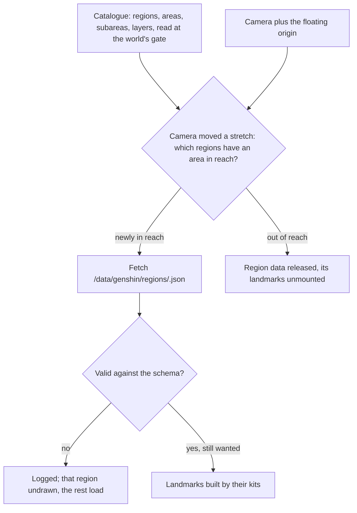

# World map

The world map is the one place a region is described. Every other page reads the world through it: the terrain will take its shapes from it, the weather each area's weather, the vegetation its biomes, and exploring its waypoints. It is organised as the game organises its own map, and world units are metres, y up, with x the game's own x and z the mirror of its z, which the game's map runs north and east.

## How it works

- **The catalogue follows the game's hierarchy.** It runs region, then area, then subarea, with the names the game and its wiki use, and an area's subregion where it has one, such as Liyue's Chenyu Vale or Sumeru's Dharma Forest. Windrise is a subarea of Galesong Hill in Mondstadt. The catalogue is the file people edit (`data/catalogue.json`), its outlines and its subareas' kinds of ground aside, published by `genshin:data authored` as the `catalogue/catalogue` record of the [hosted game data](../hosted-game-data/design.md). The world's screen reads it before it opens, since every view needs it, parsed against its schema as it arrives (`readCatalogue`), and hands it to each view that reads it: the region data's reach, the weather, the map, the minimap and the jumps.
- **Layers for places on their own map.** The surface is one layer. Enkanomiya, the Chasm's underground mines and the Sea of Bygone Eras, which the game draws on maps of their own, are layers (`WorldLayer`) that will carry their own terrain, sky and water, entered at their gates.
- **An area's outline decides reach.** An area carries its outline in world metres, and an empty one counts as infinitely far, so a region with no outlined area never loads.
- **Each outline is the game's own.** The community's dump holds the game's polygon for each open-world area (`BinOutput/Scene/WorldArea/scene3_worldArea.json`, fetched with the tables by `genshin:text fetch` and never committed): each level-one area's under its id and each level-two area's under its own, in the game's x and z. `genshin:assets fit windrise --only catalogue` (`fitAreaOutlines`) writes them into the catalogue in the world's axes round the oak's foot, to the metre: an area takes the polygon of the game's level-one area of its English name, and a subarea the polygons of every level-two area of its name in that area, since the game splits some places into several (Sumeru City, the Court of Fontaine and the Stadium of the Sacred Flame into two each). A subarea also takes the kind of ground the game's area table files it under (`AreaTerrainType`), so the game's own cities are marked as the game marks them, and the [weather](../weather/design.md) holds clear inside them. The fit writes the outlines back into the catalogue and publishes it. Most areas take the game's polygon, and most subareas take theirs, the cities the table marks among them. An area the file holds no polygon for keeps what the catalogue gives it: the file holds none for Nod-Krai's areas, Windrest Peak or Natlan's Atocpan and Easybreeze Holiday Resort, so those keep the outlines once drawn round the tiles their waypoints stand on, and Everfrozen Earth keeps its provisional square round Snezhnograd ([region buildings](../region-buildings/design.md)); the rest of Snezhnaya, the separate maps and an area the table does not name stay empty. A subarea the table files no row of its name under takes no outline and no kind of ground (`AreaTerrainType.None`).
- **An area names its weather.** Each area lists the weathers it can have, its own first, as the wiki ties weather to areas; whichever area holds the camera sets the world's weather ([weather](../weather/design.md)).
- **Regions load by reach and are released.** Once the camera has moved a stretch, `useRegionData` finds every region with an area within reach (`computeOutlineDistance`, zero inside an outline) and fetches the ones it does not hold as `/data/genshin/regions/<region>.json`, which the app's server serves from the world package's `src/data/regions` (`GENSHIN_REGION_DATA_BASE_URL`), with the palettes of its buildings' kits from the [hosted game data](../hosted-game-data/design.md) (`readLoadedRegion`). It releases those that have left reach. A region's ground is not in that record: it is the lock's own `ground/<region>` plateau while the lock holds one, and otherwise its areas' pieces, `ground/<region>/<area>` and a split area's quarters (`selectLaidGroundKeys`). A region swaps from its plateau to its pieces only once the lock no longer holds the plateau, which the fit allows only when none of the region's areas is refused and each has an outline, so no ground is left a hole. `useRegionData` fetches each laid key as its region or area comes within reach (`selectGroundKeysInReach`), keeping each once it arrives, since a ground is drawn past the reach its region is released at. Windrise's base is read whole, through the same selection as a region's ground (`selectRegionGroundKeys`): its record `ground/windrise` while the lock holds it, else its quarters `ground/windrise/<0..3>` (`readWindriseBaseGrounds`). Mondstadt's ground is not laid over it either, for the overlap [region buildings](../region-buildings/design.md) measures. A region is fetched rather than imported because the browser keeps an imported module for the life of the page, so an imported region could never be released. A region that leaves reach while it is still fetching is not kept.
- **Landmarks are kits with parameters.** A landmark records its kind, its area, where it stands on the ground, how far above or into the ground its base sits, and which way it faces. Its kind decides the kit that builds it and the options it carries (`landmarkSchema`, a union by kind). Windrise's great oak is a tree landmark with its tree options, its Statue of The Seven a statue landmark, and each region's capital a building landmark its region's kit builds ([region buildings](../region-buildings/design.md)); where both stand and which way they face is written by `genshin:assets fit windrise` from the game's own placements ([derived assets](../derived-assets/design.md)), and the rest of each is the region's own. `Landmarks` builds every landmark of every region in reach, so a region's landmarks appear as its data arrives and go when it is released.
- **A schema failure hides one region, not the world.** A region whose data fails validation, or whose fetch has not answered within `DATA_FETCH_TIMEOUT_MS`, is logged and left undrawn while the rest of the continent loads, so a stalled request never holds the world from being ready.

## Key files

| File                                                                      | Role                                                                                                                                                  |
| :------------------------------------------------------------------------ | :---------------------------------------------------------------------------------------------------------------------------------------------------- |
| `packages/genshin-world/src/data/catalogue.json`                          | Every region, area and subarea the game ships, and their layers                                                                                       |
| `packages/genshin-world/src/services/world/readCatalogue.ts`              | The catalogue read from the hosted game data at the world's gate                                                                                      |
| `packages/genshin-world/src/models/world/Catalogue.ts`                    | The catalogue's shape: regions, areas, subareas and outlines                                                                                          |
| `packages/genshin-world/src/models/world/RegionData.ts`                   | A region's authored data: its landmarks and its outcrop places                                                                                        |
| `packages/genshin-world/src/models/world/Landmark.ts`                     | A landmark, by kind, with the options its kit builds it from                                                                                          |
| `packages/genshin-world/src/data/regions/mondstadt.json`                  | Mondstadt's landmarks: Windrise's oak and statue, and its outcrop places                                                                              |
| `packages/genshin-world/src/composables/useRegionData.ts`                 | Regions fetched by reach, validated and released, and ground pieces by their areas' reach                                                             |
| `packages/genshin-world/src/services/world/selectGroundKeysInReach.ts`    | The laid ground keys within reach: a region's own record with any area, a piece with its own area                                                     |
| `packages/genshin-world/src/services/world/selectLaidGroundKeys.ts`       | The lock's ground keys the world lays over Windrise's: each region outside `UNLAID_GROUND_REGIONS`, through `selectRegionGroundKeys`                  |
| `packages/genshin-world/src/services/world/selectRegionGroundKeys.ts`     | One region's ground keys, the one selection every region's ground is read by: its plateau alone while the lock holds it, else its pieces and quarters |
| `packages/genshin-world/src/services/windrise/readWindriseBaseGrounds.ts` | Windrise's base grounds, its record or its quarters, read through `selectRegionGroundKeys`                                                            |
| `packages/genshin-engine/src/world/computeOutlineDistance.ts`             | How far a point is from an area's outline                                                                                                             |
| `scripts/src/services/genshinAssets/fit/fitAreaOutlines.ts`               | Each area's and subarea's outline, the game's own                                                                                                     |
| `packages/genshin-world/src/models/world/AreaTerrainType.ts`              | The kind of ground the game files an area under, a city's among them                                                                                  |
| `packages/genshin-world/src/components/World/Landmarks/Index.vue`         | Every landmark in reach, built by its kind's kit                                                                                                      |

## Notes

- **Names are facts.** The catalogue's names come from the game's wiki, and no region's shape is taken from any map's imagery.
- **A place no polygon holds is in no area.** The game's polygons leave stretches of sea and a few gaps between areas outside every outline, so there the weather is clear and a region loads only once another outline is in reach.
- **The region bases were fitted over the earlier outlines.** Each published region ground was fitted inside its areas' outlines as they were drawn round their waypoints' tiles ([scene derivation](../scene-derivation/design.md)), and stays as published until its region is refitted over the game's polygons.
- **An outline is flat.** The game's polygons also carry a height band, a floor and a ceiling; the catalogue keeps only the outline on the ground, so an area or a subarea holds every height over it.
- **Event areas are left out.** Places that existed only for an event, such as the Golden Apple Archipelago, are not part of the continent the catalogue describes.

## Sources

- [Area](https://genshin-impact.fandom.com/wiki/Area), Genshin Impact Wiki: the areas of each region and their subregions, and each area lit on the map by its Statue of The Seven.
- [Map](https://genshin-impact.fandom.com/wiki/Map), Genshin Impact Wiki: Enkanomiya and the Chasm's underground mines unlocked as maps of their own, which is where the layers come from.

## Reference

- `world-map.mkv` — the map opened on M over the character's own area, the zoom slider pressed in and out to its ends, a waypoint chosen on the map and Teleport pressed on the panel it opens, 30 seconds at most. Partly found 2026-10-11: https://www.youtube.com/watch?v=gN1IURjDuWo covering 0–30 s (`captures/yt-gN1IURjDuWo-world-map.mp4`); found 2026-10-18 the panel open on a chosen waypoint, a PC clip in the Indonesian client: https://www.youtube.com/watch?v=Mhw53PsdhKI (`captures/yt-Mhw53PsdhKI-waypoint.webm`, about 120–135 s), showing the panel's sidebar and its Teleport button; still sought: Teleport pressed on it, and the zoom slider's ends on the English PC map.
