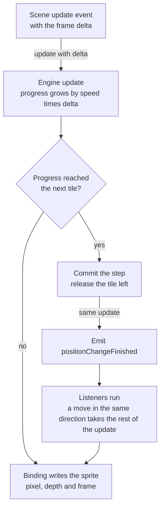

# Grid movement

A headless grid movement package of ours replaces grid-engine: tile collision, characters on integer tiles that step in four directions, five typed events, and no Phaser, rxjs or other runtime dependency. A thin binding in the dungeon world draws it on Phaser's sprites .

## Scope

The package is built, and the dungeon world is its one consumer through a binding in the app, which the [dungeons world](../../dungeons/world/design.md) page describes with the world's use of the engine. The package's requirements are in the [grid movement spec](spec.md), and the verdicts on the upstream tracker are in the [area index](../README.md).

## How it works

The package holds the grid: which tiles block, where each character stands, which way it faces, and how far through its current step it is. It has no notion of pixels. The app's binding owns the Phaser objects. Each frame the scene's update event hands the frame's delta to the engine, and the engine's order of work is what makes a listener's call land where it should.



The commit and its event come before the sprite is written, so a listener sees the character on its new tile. A step starts only from a `move` call, and the distance a step passes its end waits for the next move in its direction (the rule is in Decisions), so a listener that asks for nothing stops the character on its tile, the stop the upstream tracker's #528 reports as missed.

## Key files

Paths relative to the repository root.

| File                                                                       | Role                                                                             |
| -------------------------------------------------------------------------- | -------------------------------------------------------------------------------- |
| `packages/grid-engine-headless/src/services/createGridEngine.ts`           | The factory: checks the grid, adds the characters and makes the engine           |
| `packages/grid-engine-headless/src/services/DirectionDeltaMap.ts`          | The tile one cardinal step reaches, for a caller that draws by direction         |
| `packages/grid-engine-headless/src/models/Direction.ts`                    | The nine-value vocabulary and its list                                           |
| `packages/grid-engine-headless/src/internal/services/advanceCharacter.ts`  | One character's update: a step under way grows, or a waiting move starts one     |
| `packages/grid-engine-headless/src/internal/services/startStep.ts`         | Starts a waiting move as a step, or turns the character when its tile is blocked |
| `packages/grid-engine-headless/src/internal/services/spendDistance.ts`     | Grows a step and commits it when full, carrying the distance past its end        |
| `packages/grid-engine-headless/src/internal/services/commitStep.ts`        | Commits a step and emits its finish, ending the run when no move waits           |
| `packages/grid-engine-headless/src/internal/services/teleportCharacter.ts` | Places a character at once, stopping its step and its run                        |
| `packages/grid-engine-headless/src/internal/services/checkIsBlocked.ts`    | The collision rule: blocking, absent and outside tiles, and other characters     |

## Behaviour kept from grid-engine

grid-engine's source is not in the installed package, which ships minified bundles and declaration files. The behaviour below was read from those declarations, the upstream tracker and the bundle's property names, and each item is pinned by a test in the package's suite.

- **Movement.** A character advances by its speed in tiles per second against the scene's update delta, and its default speed is four tiles per second. A step's progress is a value from zero to a thousand on the way to the next tile. An update that carries a step past that value drops the excess, and the next step starts from zero on the following update, so the time a run takes depends on the update's delta: one update of a second commits one tile where four updates of a quarter second commit four. The core carries the excess into the next step, as the Decisions record.
- **Collision.** A tile blocks when the collision property the config names is set on a tile of any layer at that position. A position with no tile on any layer blocks too, which is the documented default. Characters block each other by default, and a moving character also blocks the tile it has left until it has left it.
- **Facing.** A character faces the direction of its last step or turn. A move into a blocked tile turns the character without moving it. A move while the character is already moving is ignored.
- **Events.** `positionChangeStarted` fires when a step starts and `positionChangeFinished` when it is committed. `movementStarted` and `movementStopped` bracket a run of steps. `directionChanged` fires on a facing change that is not part of a step, once per change.
- **Teleport.** `setPosition` places the character at once, stops any movement, and emits the position events, as documented.

## Upstream

The verdicts on the tracker's 542 items, each with its proof, and the characterization of the installed package are in the [area index](../README.md#upstream). The rows that fix a behaviour in this design are pinned by the tests the spec names, as the Test plan below says.

## Public API

The package's exports as built, each in `src/models` or `src/services` and re-exported from the entry. The calls that can fail return a result, and a query that cannot fail returns a plain value, so a failure is a value the caller reads.

```ts
// The nine directions a character faces or moves in. Only the four cardinal ones are steps; a diagonal move is refused
export const Direction = {
  Down: "down",
  DownLeft: "down-left",
  DownRight: "down-right",
  Left: "left",
  None: "none",
  Right: "right",
  Up: "up",
  UpLeft: "up-left",
  UpRight: "up-right",
} as const;
export type Direction = (typeof Direction)[keyof typeof Direction];
export const Directions: Direction[];

// The tile one cardinal step reaches; a diagonal or none has no entry
export const DirectionDeltaMap: Partial<Record<Direction, Position>>;

export interface Position {
  x: number;
  y: number;
}

export interface CharacterConfig {
  facingDirection?: Direction; // absent: down
  id: string;
  speed?: number; // absent: four tiles per second
  startPosition?: Position; // absent: the origin
}

// A tile is blocking (true), open (false), or absent on every layer (undefined), and an absent tile blocks
export interface GridEngineConfig {
  characters?: CharacterConfig[];
  tiles: readonly (readonly (boolean | undefined)[])[];
}

// A character as a reader sees it: the tile it stands on, its facing, and its step's progress
export interface CharacterState {
  facingDirection: Direction;
  position: Position;
  progress: number;
}

export const GridEngineErrorKind = {
  DiagonalMove: "diagonal-move",
  InvalidGrid: "invalid-grid",
  InvalidSpeed: "invalid-speed",
  OutsideGrid: "outside-grid",
  UnknownCharacter: "unknown-character",
} as const;
export interface GridEngineError {
  id?: string;
  kind: GridEngineErrorKind;
  position?: Position;
}

// The payloads name the character by its id and carry the direction, so a listener never reads the engine back
export interface GridEngineEvents {
  directionChanged: { direction: Direction; id: string };
  movementStarted: { direction: Direction; id: string };
  movementStopped: { id: string; position: Position };
  positionChangeFinished: { direction: Direction; enterTile: Position; exitTile: Position; id: string };
  positionChangeStarted: { direction: Direction; enterTile: Position; exitTile: Position; id: string };
}

export interface GridEngine {
  addCharacter: (config: CharacterConfig) => Result<void, GridEngineError>;
  checkHasCharacter: (id: string) => boolean;
  checkIsBlocked: (position: Position) => boolean;
  move: (id: string, direction: Direction) => Result<void, GridEngineError>;
  on: <TEvent extends keyof GridEngineEvents>(
    event: TEvent,
    listener: (payload: GridEngineEvents[TEvent]) => void,
  ) => () => void;
  readCharacter: (id: string) => Result<CharacterState, GridEngineError>;
  setPosition: (id: string, position: Position) => Result<void, GridEngineError>;
  turnTowards: (id: string, direction: Direction) => Result<void, GridEngineError>;
  update: (delta: number) => void;
}

export const createGridEngine: (config: GridEngineConfig) => Result<GridEngine, GridEngineError>;
```

The engine's members are `checkHasCharacter` and `checkIsBlocked`, since the naming rule refuses `is` and `has` on a function.

## Layout

```text
packages/grid-engine-headless/       ← the manifest, the README and the source, with no Phaser import
  src/models/                        ← the types and value sets: Direction, Position, the config, the state, the events, the error
  src/services/                      ← createGridEngine and DirectionDeltaMap, the exports a caller reaches
  src/internal/                      ← the collision rule, the steps, the carry and the commit, private to the package
  src/index.ts                       ← the entry: the barrel the build generates from the modules outside src/internal
```

## Decisions

- **The core imports no Phaser, no rxjs and no tiled-property-flattener, and its one runtime dependency is neverthrow.** Alternative: keep grid-engine's headless class, which the package exports beside its Phaser plugin. Rejected: the one entry imports Phaser at module scope, so a server or a test loads Phaser to reach the class, and the class still carries rxjs, mnemonist and the Tiled reader.
- **The binding lives in the app, beside the world that is its only consumer.** Alternative: vue-phaserjs, which is the repository's Vue integration of Phaser's objects. Rejected: a movement rule set would make that package know the dungeon's grid, and it has no plugin or scene-attach pattern to reuse. Alternative: a package of its own, or a subpath of the core. Rejected: one consumer is not a shared package, and a subpath would give the core a Phaser peer it must not have.
- **The core is pixel-free.** Progress is a fraction of a tile and the binding maps tiles to pixels. Alternative: the core carries pixel positions, as grid-engine's character does. Rejected: the pixel map is the one thing a headless engine must not know, and grid-engine's own tracker asked for the same split for the same reason.
- **Four directions only, with the nine-value vocabulary kept.** A move in a diagonal direction fails with a diagonal-move error, and a turn may face any of the nine. Alternative: drop the diagonal members. Rejected: the walking mappings and the saved respawn direction hold them, and removing them changes stored data.
- **`Direction` is a value set, not a TypeScript enum.** Alternative: a TypeScript enum, as grid-engine exports. Rejected: two enums with the same members are still two types, which is why each consumer needs a mapping between them.
- **The no-direction value stays.** Alternative: the absent form, undefined. Rejected: the saved respawn location holds a direction, so changing the value is a stored-data change that this package does not own.
- **No character layers, containers, pathfinding, queues, labels, collision groups or tile caches.** Alternative: the full surface, for later use. Rejected: none is called, and each is a feature the rejected and deferred pages would have to justify first.
- **The engine exposes a read of a character's tile, facing and progress.** The binding draws a sprite between two tiles, so it needs the step's progress on every frame, and no event carries it. Alternative: the binding keeps its own copy of each step from the events. Rejected: the copy drifts from the engine's step at the first listener's move. `readCharacter` returns a copy of the tile, the facing and the progress, and is pinned by the test that reads a step's progress at the midpoint and after its commit.
- **Events are typed and carry `id` and `direction`.** Alternative: the streams and a facing getter. Rejected: the app's type extraction from stream signatures is the cost, and the facing getter is the read-back the payload removes.
- **Each `create` makes a new engine.** Alternative: clear the old one in place. Rejected: a new instance has no state to clear, and its listeners are dropped with the old one, so a stale character or listener cannot survive a tilemap change.
- **A step's excess carries into the next step in its direction.** A move waiting when an update starts takes the excess the last update held back, and a move a listener asks for at a commit takes what its own update has left, or waits for the next update when nothing is left; so one update can run on across the steps it ends. A move in another direction, an update with no move waiting, a blocked next tile or a teleport drops the excess, and the character stops on the tile it reached. Alternative: carry only into a listener's move in the same update, the shape a listener chain alone would need. Rejected: the world asks its moves from input before each update and no listener asks, so that shape would leave its walk frame-rate dependent. Alternative: the excess is dropped at each commit. Rejected: one update of a second commits one tile where four updates of a quarter second commit four, which is the #419 defect.
- **A teleport emits the position events, as the documentation says.** Alternative: a teleport emits nothing. Rejected: the world's listeners rely on the position of the player changing, and the documented contract is the one the owner wrote.
- **A position with no tile blocks.** Alternative: open, as the option would give. Rejected for the default: the documented default blocks, and the map edges depend on it.
- **`addCharacter` with an id already in use replaces that character silently.** The new character takes the id, with its own start, facing and speed, and the call returns ok. A run the replaced character was in is dropped with it, so no movement-stopped or position-change-finished event follows for it. Alternative: return an error for a duplicate id. Rejected: the replace is kept as decided, and the error is not added to the engine's contract.
- **Direction's members are PascalCase, `Down` and `UpLeft`.** The naming rule's casing, which the core's value set already follows, so every consumer names its members as the core does. The values are unchanged, so no stored data moves.

## Size and dependency weight

The absorb score reads the client bundle report and the install. For grid-engine those are about 69 KB gzipped in the client, and its install is the package with three dependencies, where rxjs is by far the largest. Its standalone ESM bundle is about 65 KB gzipped, with rxjs, mnemonist and tiled-property-flattener inlined and only Phaser external. Its root imports Phaser at module scope.

| Measure               | grid-engine today                                         | grid-engine-headless                              |
| --------------------- | --------------------------------------------------------- | ------------------------------------------------- |
| Runtime dependencies  | rxjs, mnemonist, tiled-property-flattener                 | neverthrow, which the client already ships        |
| Peer dependencies     | phaser                                                    | none; the binding is app code and uses Phaser     |
| Import without Phaser | loads Phaser at module scope                              | loads nothing outside the package                 |
| Client gzipped bytes  | 77,086 bytes in the `nuxt analyze` report at `b2fbed9b6d` | 6,253 bytes in the report at `7eb0afeeab`         |
| Surface on offer      | about seventy methods and about eight streams             | the methods and the five events in the public API |

The verify step measured both builds with `nuxt analyze --no-serve` (the score's own run, `CLIENT_BUNDLE_REPORT_PATH` set): the client's gzipped total is 8,386,344 bytes at `b2fbed9b6d` and 8,316,740 at `7eb0afeeab`, a net change of -69,604 bytes. The grid-engine share is 77,086 bytes of the report, which is above the "about 69 KB" figure this section started from, so the size claim rests on the measured net change rather than on that figure. The headless core is 6,253 bytes, and neverthrow's 2,695 bytes were already in the client. The rxjs, mnemonist and tiled-property-flattener modules are inlined into grid-engine's bundle, so they carry no separate bytes in the report. `pnpm ai:dependencies:score` no longer lists grid-engine.

## Test plan

Each test below earns its line: each is a rule with branches or a regression that the upstream tracker reports.

- Collision: a blocking tile blocks; a position with no tile blocks; a moving character blocks the tile it has left until it has left; characters block each other; a character added without a sprite is placed and blocks (#107).
- Steps and turns: a run covers the same tiles in one second at any split of updates, and at 20 ms and 4 ms when its move is asked before each update (#419); a move while moving is ignored; a move into a blocked tile turns once and emits once; a move from a position listener starts on the next update when nothing is left of its update, and a stop from one stops on that tile (#528); a stop at a tile with a large delta lands on it, and the excess is dropped by an update with no move, by a move in another direction and by a teleport; `movementStarted` fires once per run of steps, not per tile (#97, #121); a turn during a step is ignored and the facing stays the step's direction.
- Events and teleport: a listener stays subscribed until it unsubscribes; `movementStopped` names the tile the character stopped on; a teleport releases the tile a moving character left; a new engine has no character of the previous one; setPosition for an unknown character returns an error; a teleport mid-step places the character at once and stops its step (#109, #111); a teleport from a `movementStarted` or `positionChangeStarted` listener is not undone by the step that raised it; a raise runs the listeners subscribed when it began, so one that subscribes again runs once; a function subscribed twice runs twice, and each unsubscribe removes one; the engine keeps its own copy of a position passed to `addCharacter` or `setPosition`, so a caller that changes that object later moves nothing.
- Import: the core loads no Phaser module in a Node environment; the emitted declarations resolve under module NodeNext (#16, #435).

Not earned: the direction values, which typecheck already holds; the README; and the spec and ledger prose, which the repository's existing enforcers hold.

## Alternatives rejected

- **Keep grid-engine and patch it.** Rejected: the three runtime dependencies stay, the root still loads Phaser, and the repository would carry a fork of a surface it mostly does not use.
- **Port grid-engine's source.** Rejected: its source is not in the installed package, and the absorption standard is a rewrite from the surface's behaviour, not a port of its structure.
- **Use the headless class beside the plugin.** Rejected for the reasons in the decisions above.
- **Put movement rules in vue-phaserjs.** Rejected: that package is the Vue integration of game objects and would learn the dungeon's grid.
- **Carry pathfinding, diagonal movement or character layers for future maps.** Rejected: no caller exists, and the diagonal decision already stands in the rejected pages.
- **Make the engine reactive.** Rejected: the engine writes per frame, and a reactive wrapper would proxy its state; the store holds it raw.

## Notes

- **A long update walks the distance it covers.** The excess is spent as the steps it covers, so an update of a long delta walks the character through several tiles in one update. The core does not cap the delta it is given. The world passes it the scene's frame delta, and the driven run did not sample a long frame, so a stalled tab's walk is not observed.

## Sources

- [grid-engine](https://github.com/Annoraaq/grid-engine), the upstream repository. Its source is not in the installed package, so behaviour was read from the shipped declarations and bundles, and from the tracker below.
- [grid-engine issues](https://github.com/Annoraaq/grid-engine/issues), the tracker every verdict above is read from, with its comments.
- [grid-engine pull requests](https://github.com/Annoraaq/grid-engine/pulls), read as the issues they close; the fixes cited above are #319's [#320](https://github.com/Annoraaq/grid-engine/pull/320) and [#322](https://github.com/Annoraaq/grid-engine/pull/322), #323's [#324](https://github.com/Annoraaq/grid-engine/pull/324), #419's [#420](https://github.com/Annoraaq/grid-engine/pull/420), #293's [#294](https://github.com/Annoraaq/grid-engine/pull/294), #159's [#169](https://github.com/Annoraaq/grid-engine/pull/169) and #93's [#94](https://github.com/Annoraaq/grid-engine/pull/94).
- The package's README, which links the documentation site; the site was not fetched, and the README's description of the headless and plugin entries is what this design reads.
- [The dependency admission page](../../architecture/dependency-admission/design.md), for the verdict, the stop list, the adapter branch and the standard an absorption meets.
