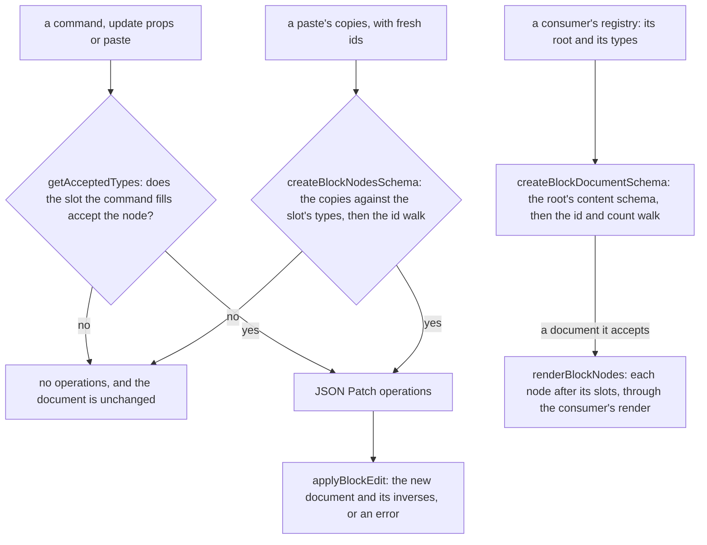

# Headless block editor core

The editing model of a block editor: a registry-checked document whose root declares its own content and props, commands that return JSON Patch operations, the navigation a canvas draws over it, and a fold that renders a checked document from its leaves up. It is built for the page builder's editors, which are its planned consumers in [the document model](../../resource/page-builder/document-model/design.md); the package's own tests run in the plain Node environment.

## How an edit runs

## Decisions

- **The registry declares its root.** A registry is an object: `root` holds the content types the document's root accepts and the props schema its props pass, and `types` holds the node types. The root is not a type in the list, since a reserved root type would make the document a node that a paste could copy and a slot could accept. Each function that reads types reads `types`, and `getRootAcceptedTypes` reads the root's content. The registry is generic over its node, its root's props and its definition, so a consumer's extended definitions keep their own type through the fold.
- **A consumer's children are one port.** Each consumer writes one `BlockChildren<TNode>`: a function from a node to that node's own slots, each the typed list of child nodes it holds (`BlockSlots<TNode>`, distributive over the node union), switched on the node's type tag and ending in `exhaustiveGuard`. A read of a slot the node's type lacks fails the typecheck, and a node type without a case fails it too. The core's walks take the port as a parameter: the fold, the id and count walk, the layer rows, the copy re-minting in a paste, and the node lookup behind the accepting-slot search. A walk never looks a slot up by a runtime name and trusts the result. The walks that iterate every slot read them through one string-keyed view, `getBlockSlots`, derived once from the port at the boundary; the registry's slot names stay strings, so the correlation between a name and a typed slot stays in the consumer's switch. Rejected: typing the registry's slot names per node type, which moves that correlation into the registry that the runtime tag already avoids. Rejected: correlating the runtime tag with the props type inside the core, which TypeScript can express only by an assertion, so the correlation stays in the consumer's switch, where the compiler checks it one case at a time. Rejected: one runtime map from tag to definition, since indexing a map by a union key returns the union of its values, not the value for the tag in hand.
- **A consumer's node schema is static.** Each node type's schema is written in the consumer's code, satisfying its node interface, and the union over those schemas satisfies the consumer's node union. The core takes the schema as a parameter and builds none from the registry. Rejected: a runtime builder that assembles the union from the definitions and returns it by assertion, since a union built from runtime values is typed only by a person's word, and a cache of that union would hold the same assertion.
- **The document schema takes the root's content schema, the registry, the port and the node limit.** `createBlockDocumentSchema(contentSchema, registry, children, maxNodes)` reads the root's props schema from the registry and returns the document type with no assertion. The id walk also refuses a nested child whose type its parent's slot does not accept in the registry, so a consumer's permissive node schema cannot let such a child parse clean and `getAcceptedTypes` cannot disagree with the parse. The content schema takes only the types the root accepts, so the schema an agent reads and the check agree; the registry's root list serves the insert and paste checks. Rejected: a registry check in a refinement after a content schema that takes every node type, since an agent's JSON Schema would then list types the root refuses.
- **The document schema checks shape first, then the ids and the count.** The content schema parses each node's shape and props, and the root's props parse with the root's own schema inside the document's shape. A union over the nodes would report a failure at the union's own position, which buries the slot a refusal has to name, so the walk runs only on a parse that raised no issue: the ids unique across every slot and the count against the limit. The refusal path is `["content", 0, "props", "children", 0, "props", "items", 0, "type"]` for a heading in a list's items slot, `["content", 0, "type"]` for a node the root's content refuses, and `["root", "props", "title"]` for a root whose props lack a title. Rejected: checking the root's props in the refinement, which leaves every consumer's parsed root a loose record to narrow by hand. Parsing them in the shape gives a parsed document the root schema's type, so the webpage's parsed document carries its language as a typed prop.
- **Each walk reads slot keys from where its caller has them.** The layer rows read a node's slots from the port, since a row lists the children a node holds. The accepting-slot search reads each type's slot keys from the registry, since acceptance is a registry fact. `getBlockLayerRows` takes the document and the port and no registry, because its callers hold none.
- **The registry's slot lists are held equal to the schema by a test.** The services that move, paste and find accepting slots read each slot's accepted types as strings from the registry's `slots`. TypeScript cannot compare that runtime list with a schema's type, so each consumer keeps one runtime test that every slot's list equals the tags its static schema accepts there. That test is the one place the two statements of a slot meet.
- **Pointers are built from slot names.** `getSlotPointer(nodePointer, slot)` takes a slot the node's type declares as a `BlockSlotName<TNode>`, so a misspelt slot fails the typecheck at the call. The walks, which hold a runtime name, build the same pointer through `getBlockPropPointer`, which escapes the key as one JSON pointer segment. `getSlotPointer` carries an oxlint disable for `pass-through-helper/no-forwarding-wrapper`, since the typed slot name is the helper's whole job and the wrapper is the point. A pointer arriving from a client or an agent stays a string until a patch applies and its result parses.
- **Commands return operations.** Each command reads the document it is given and returns the operations that change it, or none when the slot would refuse the node. A move is a remove and an add, so its inverse is the same two operations the other way round. A move's index is in the target slot once the node is removed, so moving the first of two siblings to the end of their shared slot is index 1, and an index past that end is an edit that cannot apply.
- **A root's props are edited as a node's are.** `updateBlockNodeProps` over the pointer `/root` writes `/root/props/<key>`, so the core has no command of its own for the root's props.
- **Nodes are addressed by JSON Pointer.** Each node keeps its id among its props, the root's content is `/content`, and a slot is a props key whose value is a list of child nodes. Helpers read and write pointers through `parseJsonPointer` and `toJsonPointer` from `@esposter/shared`.
- **A paste checks its copies as the destination slot's children.** `pasteBlockNodes(document, registry, children, nodeSchema, nodes, slotPointer, index)` re-mints the copies through the port, then checks them with `createBlockNodesSchema(nodeSchema, registry, children, acceptedTypes)`: the node schema, then the slot's accepted types, then the ids and each nested slot's accepted types from the registry. The root's content does not apply, so a heading pastes into a section's slot whatever the root accepts. Rejected: looking the node schema up from the registry inside the paste, which rebuilds the runtime union the static schema replaced; the caller holds the typed schema and passes it, as `duplicateBlockNode` does for its own paste.
- **Refusals are empty operation lists, and an edit that cannot apply is an error.** A command refuses by returning nothing, so a history never records it. `applyBlockEdit` wraps `applyPatches` in `getResult`, so an operation that cannot apply, such as a prop update on a node no longer in the document, refuses the whole edit and leaves the document as it was.
- **A paste re-mints every id.** `remintBlockNode(children, node)` gives a copy and every node in its slots fresh ids, so a copy shares none with the original and a copy of a node from another editor is refused by the registry.
- **Removal names the focus target in post-removal coordinates.** The next sibling takes the removed node's index, so its pointer is the same index; otherwise the previous sibling; otherwise the parent, and the root is the empty pointer.
- **A document lists its nodes in layer order.** `getBlockLayerRows` walks each list in index order, putting a node's row before the rows of its slots, one depth lower and in the order its port returns them. Previous and next are the rows beside a node, so a neighbour can sit across a slot boundary.
- **Move to lists only slots outside the node's subtree.** `getAcceptingSlotPointers(document, registry, children, pointer)` checks each slot with `getAcceptedTypes`, the root's content first and then each node's registry slots in layer-row order, and it skips every slot under the node, its own slots included, so a node is never offered a place inside itself.
- **Move out and duplicate are compositions.** `moveOutAfterParent` is a `moveBlockNode` into the parent's slot at the parent's index plus one; the removal shifts only the node's own siblings, never the parent, so the refusals are the move's own. `duplicateBlockNode(document, registry, children, nodeSchema, pointer)` is a `pasteBlockNodes` of the node into its own slot at its index plus one, so the copy gets fresh ids the same way a paste does.
- **The undo history is not the core's.** The bounded history that undoes a document's edits lives in `@esposter/shared`, [as its own capability](../../shared/bounded-history/design.md), so the core keeps no copy of it.
- **A document folds from its leaves up.** `renderBlockNodes(nodes, registry, children, render)` renders each node of a slot in order, after each of the node's slots has rendered, and hands the consumer's render function the node, its type's definition and each slot's output. A node whose type the registry lacks renders nothing, so a fold over a document that skipped its parse still renders what the registry knows. Each renderer walks the tree through this one fold rather than its own recursion.
- **A test's title is its scenario's name in lowercase.** The suites' titles are lowercase, so a scenario `A renderer reads a child through the port` is the test `a renderer reads a child through the port`. A type-level scenario is a `@ts-expect-error` in a `.test-d.ts` beside the helper it checks.

## Key files

| File                                                                         | Role                                                                                                |
| ---------------------------------------------------------------------------- | --------------------------------------------------------------------------------------------------- |
| `packages/headless-block-editor/src/models/BlockRegistry.ts`                 | the registry: its root beside its types, generic over the node, the root's props and the definition |
| `packages/headless-block-editor/src/models/BlockRootDefinition.ts`           | the root's declared content types and props schema                                                  |
| `packages/headless-block-editor/src/models/BlockChildren.ts`                 | the children port's type, one function per consumer over its node union                             |
| `packages/headless-block-editor/src/models/BlockTypeDefinition.ts`           | one registry entry: its props schema and, for each slot, the types it accepts                       |
| `packages/headless-block-editor/src/models/BlockSlotName.ts`                 | the slot names a node type declares, the argument of a slot pointer                                 |
| `packages/headless-block-editor/src/services/createBlockDocumentSchema.ts`   | the document's shape, then the ids and the node limit                                               |
| `packages/headless-block-editor/src/services/checkBlockNodeIds.ts`           | the id and count walk over every slot, reading the children through the port                        |
| `packages/headless-block-editor/src/services/checkAcceptedType.ts`           | the refusal of a node whose type its slot does not accept                                           |
| `packages/headless-block-editor/src/services/getBlockSlots.ts`               | the one string-keyed view of a node's typed slots, read by the walks that iterate every slot        |
| `packages/headless-block-editor/src/services/createBlockNodesSchema.ts`      | a slot's children: the node schema, the accepted types, then the ids                                |
| `packages/headless-block-editor/src/services/getAcceptedTypes.ts`            | the types a slot accepts; the root's content types come from the registry                           |
| `packages/headless-block-editor/src/services/getSlotItems.ts`                | a slot's accepted types from a record of slots, none for a slot the record does not declare         |
| `packages/headless-block-editor/src/services/getSlotPointer.ts`              | a slot's pointer, named by a slot the node's type declares                                          |
| `packages/headless-block-editor/src/services/moveBlockNode.ts`               | a move as a remove and an add, refused into its own subtree                                         |
| `packages/headless-block-editor/src/services/moveIntoPreviousSibling.ts`     | a move to the end of the previous sibling's accepting slot                                          |
| `packages/headless-block-editor/src/services/pasteBlockNodes.ts`             | copies with fresh ids, checked as the destination slot's children                                   |
| `packages/headless-block-editor/src/services/remintBlockNode.ts`             | a copy of a node and its slots with fresh ids, read through the port                                |
| `packages/headless-block-editor/src/services/renderBlockNodes.ts`            | the fold from the leaves up, through a consumer's render function                                   |
| `packages/headless-block-editor/src/services/getFocusAfterRemoval.ts`        | the node that takes focus after a removal                                                           |
| `packages/headless-block-editor/src/models/BlockLayerRow.ts`                 | a row of the layers tree: a node's depth, its pointer and its type                                  |
| `packages/headless-block-editor/src/services/getBlockLayerRows.ts`           | every node in layer order, a node's row before its slots' rows                                      |
| `packages/headless-block-editor/src/services/getAdjacentBlockNodePointer.ts` | the node a row offset from another, past a slot boundary                                            |
| `packages/headless-block-editor/src/services/getBlockPropPointer.ts`         | a node's prop pointer, the prop's key escaped as one JSON pointer segment                           |
| `packages/headless-block-editor/src/services/getAcceptingSlotPointers.ts`    | every slot that accepts a node, outside the node's own subtree                                      |
| `packages/headless-block-editor/src/services/moveOutAfterParent.ts`          | a move to just after the node's parent, in the slot that holds the parent                           |
| `packages/headless-block-editor/src/services/duplicateBlockNode.ts`          | a paste of the node's copy straight after it, in its own slot                                       |
| `packages/headless-block-editor/src/services/applyBlockEdit.ts`              | an edit applied as one, or refused whole                                                            |
| `apps/web/shared/models/db/resource/JsonPatchOperation.ts`                   | the app's wire schema for an operation, beside its one consumer                                     |

## Notes

- **The applier's schema stayed in the app.** The applier and its types live in `@esposter/shared`, but the zod schemas for a pointer and an operation, and their two limits, have only the resource content inputs as consumers. `scripts/src/workspace/sharedExportConsumers.test.ts` flags such exports in shared, so they sit beside `ReadResourceContentInput.ts` and `UpdateResourceContentInput.ts`. Shared keeps the operation types, `applyPatches` and the pointer parser.
- **Coalescing is the consumer's.** The core applies each edit whole and records nothing, so merging an interaction's edits into one undo entry belongs to the history that holds them: the page builder's [undo as patches](../../resource/page-builder/undo-as-patches/design.md) merges the edits of one interaction that set the same paths.
- **A slot has no model of its own.** A slot is an entry of the registry's type `slots` record and a key of the node's props.
- **The node limit is the consumer's.** `pasteBlockNodes` checks the copies against the slot and the registry but not the destination's node count; the consumer passes the limit to `createBlockDocumentSchema` and refuses an over-limit result.
