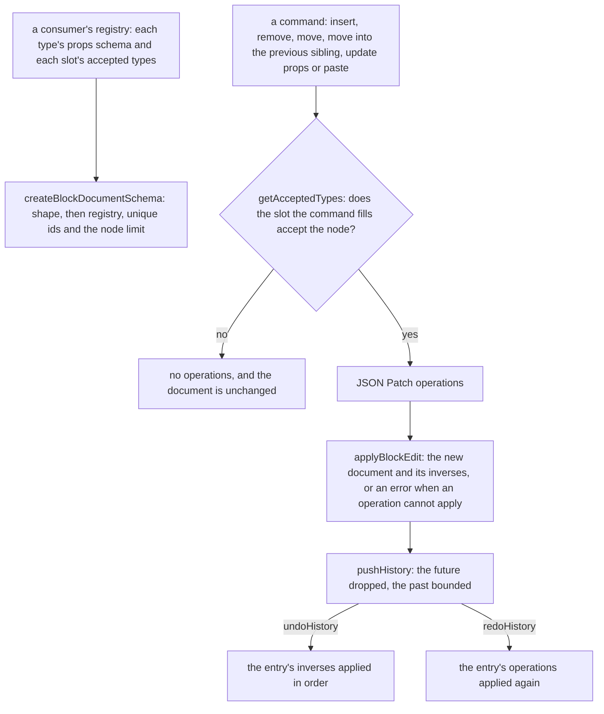

# Headless block editor core

The editing model of a block editor, as built: a registry-checked document, commands that return JSON Patch operations, the navigation a removal needs, and a bounded history. The page builder's editors consume it; the package's own tests run in the plain Node environment.

## How an edit runs

## Decisions

- **Commands return operations.** Each command reads the document it is given and returns the operations that change it, or none when the slot would refuse the node. A move is a remove and an add, so its inverse is the same two operations the other way round.
- **Nodes are addressed by JSON Pointer.** Each node keeps its id among its props, the root's content is `/content`, and a slot is a props key whose value is a list of child nodes. Helpers read pointers through `parseJsonPointer` and `readJsonValue` from `@esposter/shared`.
- **The document schema checks shape first, then the registry.** A recursive union over the registry was the design's first choice, but a union reports a failure at the union's own position, which buries the slot a refusal has to name. The schema parses each node's shape, then walks the tree in a refinement: each child's type must be in the registry and allowed by its slot, its props must pass the type's schema, and its id must be a unique string. The refusal path is `["content", 0, "props", "items", 0]` for a heading in a list's items slot.
- **Refusals are empty operation lists, and an edit that cannot apply is an error.** A command refuses by returning nothing, so a history never records it. `applyBlockEdit` wraps `applyPatches` in `getResult`, so an operation that cannot apply, such as a prop update on a node no longer in the document, refuses the whole edit and leaves the document as it was.
- **A paste re-mints every id.** `remintBlockNode` gives a copy and every node in its slots fresh ids; the copies are then checked against the destination's slot and the registry, so a copy of a node from another editor is refused.
- **Removal names the focus target in post-removal coordinates.** The next sibling takes the removed node's index, so its pointer is the same index; otherwise the previous sibling; otherwise the parent, and the root is the empty pointer.
- **History is a value, generic over its entry.** `pushHistory` clears the future and bounds the past; `undoHistory` and `redoHistory` return the entry moved and the history after it, and a redo keeps the rest of the future.

## Key files

| File                                                                       | Role                                                                |
| -------------------------------------------------------------------------- | ------------------------------------------------------------------- |
| `packages/headless-block-editor/src/services/createBlockDocumentSchema.ts` | the document's shape, registry, id and node-limit checks            |
| `packages/headless-block-editor/src/services/getAcceptedTypes.ts`          | the types a slot accepts; the root's content accepts every type     |
| `packages/headless-block-editor/src/services/moveBlockNode.ts`             | a move as a remove and an add, refused into its own subtree         |
| `packages/headless-block-editor/src/services/pasteBlockNodes.ts`           | copies with fresh ids, checked against the destination and registry |
| `packages/headless-block-editor/src/services/getFocusAfterRemoval.ts`      | the node that takes focus after a removal                           |
| `packages/headless-block-editor/src/services/applyBlockEdit.ts`            | an edit applied as one, or refused whole                            |
| `packages/headless-block-editor/src/services/pushHistory.ts`               | the bounded past and the cleared future                             |
| `apps/web/shared/models/db/resource/JsonPatchOperation.ts`                 | the app's wire schema for an operation, beside its one consumer     |

## Notes

- **The applier's schema stayed in the app.** The change moved the applier and its types into `@esposter/shared`, but the zod schemas for a pointer and an operation, and their two limits, have only the resource content inputs as consumers. `scripts/src/workspace/sharedExportConsumers.test.ts` flags such exports in shared, so they moved back beside `ReadResourceContentInput.ts` and `UpdateResourceContentInput.ts`. Shared keeps the operation types, `applyPatches` and the pointer parser.
- **Not built: coalescing.** The design's diagram merged consecutive replaces of one path within one interaction. No scenario names it, so it waits for a consumer that needs it; the page builder's patch-entry change owns that decision.
- **Not built: duplicate, and the navigation beyond removal.** Document-order neighbours, the Move-to list of accepting slots, moving out past a parent and the layers rows belong to the canvas change that draws them. The package carries the one navigation the removal scenario needs, plus the previous-sibling move the design named.
- **Not built: a slot type.** A slot is an entry of the registry's `slots` record and a key of the node's props, not a model of its own.
- **The node limit is the consumer's.** `pasteBlockNodes` checks the copies and the registry but not the destination's node count; the consumer passes the limit to `createBlockDocumentSchema` and refuses an over-limit result.
- **Test titles are lowercase.** The repo's `prefer-lowercase-title` rule rejects capitals, so the scenario names are the same words in lowercase.
